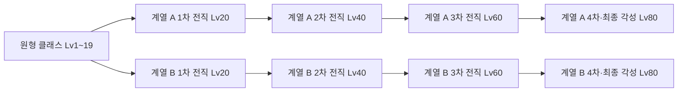
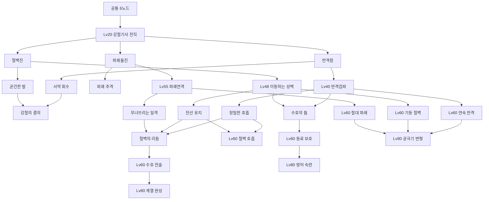

> 2026-10-29 런타임 갱신:0.31.0은 신규 공통12개·선택 경로19개·Lv5/10/15 해금·Lv80 최종 전직 후에만 나타나는 별도 궁극기·저장 호환을 시험 구현했다. [최신 구현과 검증](evidence/skills-0310/README.md). 아래 미구현/일반 슬롯 궁극기/기본3 문구는 당시 설계·검증 이력이며 최신 상태를 대신하지 않는다.

> 최신 슬롯 결정: 4번은 Lv5, 5번은 Lv10에 개방하며 전직과 무관하다. 최대5칸·기술 학습 자격은 별개다.

> 2026-10-29 최신 초반 재설계: [Lv20 이전 6스킬 트리](production/pre20-skill-tree-2026-10-29.md). 기존3개에 새 공통3개를 추가해 선택 경로는6+12+1=19개다. 아래 기본3/총16/108개 예산과 초기 학습 배치는 이전 기준이며, 계열12개 상세표는 유지한다. 새 레벨·기술 효과는 제안이고 런타임은 미반영이다.

# 클래스별 두 전직 계열·레벨 성장·스킬트리

버전0.24 · 2026-10-27 · 상위 문서: [게임 개발 기획안](game-design.md) · [마법 분류·추가 학습](magic-schools-and-learning.md)

## 1. 전직 구조와 결정 상태

캐릭터는 최초 클래스를 유지하고,20레벨에 클래스 안의 두 전직 계열 중 하나를 선택한다.40/60/80레벨에는 같은 계열의 전직을 이어간다. 다른 클래스로 전직하거나 타 클래스 기술을 습득하는 시스템은 포함하지 않는다. ‘계열’과 ‘마법 속성’은 별개이며, 주문을 더 배워도 전직 경로가 늘지 않는다.

기사 강철기사/성기사, 엘프 명궁/마법궁수, 드워프 강철/화약, 마법사 Pyro/Cryo와 단계별 학습은 사용자 결정을 따른다. 성녀는 플레이어 클래스에서 제외하고 NPC·지원 동료로 활용한다. **단계별 직업명까지 확인된 계보는 기사→20 강철기사→40 중갑기사→60 철벽기사→80 강철의 수호자**이며, 나머지 상위 전직명은 가칭이다.

기술명·36액티브/12궁극기·79포인트/216노드·같은 클래스 내 계열 재선택과 리셋권 소비 초기화는 검증할 설계 초안이다. 상세 상태는 [기획 결정표](decisions.md)를 따른다. TD의 영웅 선택/레벨/해금과 RPG 캐릭터 성장은 공통 Diamonds 지갑과 별도로 관리한다.

RPG 직업의 조작·전술을 먼저 설계하고 TD 자산은 적합한 부분을 활용한다. 모델·무기·모션이 부족하면 새로 제작하고, NPC·동료·지원 캐릭터에 적합하면 그 역할로 배치한다. 타워와 전직 단계의 일대일 대응을 요구하지 않는다.

20레벨에 두 전직 계열 중 하나를 선택하고,40·60·80레벨에는 같은 계열의 전직을 이어간다. 추가 주문 학습으로 전직 분기를 늘리지 않는다. 스킬트리의 여러 노드와 장비 빌드는 새로운 전직 계열로 세지 않는다.

## 2. 전직 계보 8개

강철기사의 네 단계 명칭은 사용자 결정이다. 나머지 경로의 상위 전직명은 기획 제안·가칭이다.

| 클래스·전직 계열 | Lv20 1차 | Lv40 2차 | Lv60 3차 | Lv80 4차·각성 | 전투 정체성 |
| --- | --- | --- | --- | --- | --- |
| Knight·강철기사 | 강철기사 | 중갑기사 | 철벽기사 | 강철의 수호자 | 검·방패·물리 연계·반격·장갑/자세 파괴 |
| Knight·성기사 | 성기사 | 성광기사 | 서약의 성기사 | 여명의 성기사 | 성광 검술·서약·전선 보호·표식 폭발 |
| Elf Archer·명궁 | 명궁 | 정예명궁 | 수호명궁 | 전설의 명궁 | 물리 속사·정밀 저격·약점 공략·관통 |
| Elf Archer·마법궁수 | 마법궁수 | 정령궁수 | 비전궁수 | 대마법궁수 | 속성 화살·자연/정령 연계·제어·광역 |
| Dwarf·강철 | 강철투척병 | 파쇄전사 | 산맥전사 | 산맥의 파괴자 | 도끼 투척/회수·장갑 파쇄·충격파 |
| Dwarf·화약 | Gunner | 공성기술자 | 중포기술자 | 화약의 거장 | 폭탄·총포·한정 포격·광역 제압 |
| Mage·화염 | 화염술사 Pyromancer | 잿불현자 | 화염대마법사 | 태양의 대마법사 | 화염→대지 추가→용암 광역→최강 주문 |
| Mage·빙결 | 냉기술사 Cryomancer | 서리현자 | 빙결대마법사 | 영원의 빙결술사 | 빙결→번개 추가→빙뢰 광역→최강 주문 |

강철기사 계열은 Lv20 방패 운용의 기초 → Lv40 검·방패 반격 완성 → Lv60 전선 유지와 아군 보호 → Lv80 수호 전술의 각성으로 발전한다. 기존 TD 타워의 이름/보유 모델이 전직 단계나 기술을 결정하지 않는다.

전직 계열 간 역할 차이를 직업 변경으로 오해하지 않게 UI에 원형 클래스 문장과 아이콘을 계속 표시한다. 예를 들어 “기사 / 성기사 계열 / 성광기사”로 읽히며, 성기사는 기사 클래스의 근접 성광 계열이며 NPC 성녀의 기술/성장을 가져오지 않는다.

2026-10-29 최신 결정: Lv20/40/60/80 각 전직 완료 때 새 스킬을 최소 하나 해금한다. 아래 Lv24/28 학습 및 상위 성장의 기존 배치는 [리뷰와 재배치 제안](production/skill-tree-review-2026-10-29.md)에 따라 재설계한다. 스킬 슬롯은 최대5개이며 궁극기 슬롯은 미정이다.

## 3. 레벨·시험·계열 재선택

| 단계 | 자격·획득 | 전직 경험과 완료 조건 |
| --- | --- | --- |
| Lv1~10 | 클래스 기본기, 공통 액티브3개 순차 획득 | 이동·공격·방어·회피와 클래스 자원을 짧은 전투로 학습 |
| Lv15 | 공통 궁극기 없음 | 기존 Lv15 궁극기 제안은 삭제 |
| Lv20 | 두 계열 시연 후 한 계열 선택 | 계열 전용 서약 시험, 첫 전직·계열 기술·계열 트리 개방 |
| Lv24 / Lv28 | 일반 클래스의 선택 계열 액티브2/3 획득 | 마법사는40레벨 추가 원소·60레벨 광역 주문으로 별도 배치. 스킬포인트로 기본 기술을 구매하지 않음 |
| Lv40 | 같은 계열의2차 전직 | 본편에서 배운 역할을 응용하는 시험, 상위 트리·기술 변화·무기 장식 |
| Lv48 / Lv55 | 계열 기술의 상위 기능 | 단순 수치 증가와 다른 운용을 제공, 기술 버튼 수는 유지 |
| Lv60 | 같은 계열의3차 전직 | 숙련 시험, 숙련 트리·기술 순환/역할 강화·방어/연계 변화 |
| Lv80 | 같은 계열의4차 전직·최종 각성 | 최종전 직전 수행 가능한 서약 시험, 각성 트리·궁극기 변화·문양 |

마법사는 Lv1~19에 비전/바람 입문과 기초 물 마법을 배운다. Lv20에 Pyro/Cryo, Lv40에 Pyro는 대지·Cryo는 번개, Lv60에 대규모 광역, Lv80에 최강 주문을 익힌다. 초반 입문 방식은20레벨 전직 선택을 제한하지 않는다.

전직 조건은 레벨·자기 클래스·이전 단계·시험 완료다. 희귀 드롭·유료 상품·길드 가입·다른 이용자의 접속을 요구하지 않는다. 대화와 시험의 재도전은 무료이고 실패로 XP를 잃지 않는다. 시험과 기술 설명은 메뉴에서 다시 확인할 수 있다.

**초기 제안:** 같은 클래스의 반대 전직 계열은 거점에서 별도 시연/시험을 완료한 뒤 재선택할 수 있다. 전투·원정 중 변경은 불가하다. 첫째 계열을 버리고 캐릭터를 재생성하도록 강요하지 않되, 한 편성에는 한 계열만 활성화한다. 서로 다른 두 전직의 고유 기술/각성 효과는 동시에 활성화하지 않는다. 마법사의 Mana Bolt·Water Ball·Gravity는 공통 기술로 유지하고,40레벨 대지/번개와 이후 고급 주문은 현재 전직 경로의 자격을 따른다.

상위 전직은 해당 경로의 Lv40·60·80 시험 이력이 순서대로 필요하다. 레벨이80이어도 처음 배우는 반대 계열의 시험을 자동 완료하지 않는다. 클래스 레벨을1로 초기화하거나 포인트를 추가 지급하지 않는다. 장착이 무효가 된 기술은 해제하고, 안전한 기본 편성을 제안한다. 잠긴 기술을 몰래 다른 기술로 확정 장착하지 않는다.

### 기본 스탯과 스킬포인트의 구분

플레이어4클래스 모두 **힘·민첩·지력·체력**을 사용한다. 스탯의 효과와 계열별 추천 방향은 [기본 스탯 설계](character-stats.md)를 따른다. 성기사의 힘/지력·마법궁수의 민첩/지력처럼 혼합 계열도 같은 투자 예산에서 비교한다. 스탯 투자는 클래스/계열·레벨·전직 시험·기술 해금 자격을 대체하지 않는다.

스탯 배분 포인트는 Lv2~80에 레벨업마다4포인트, 총316포인트를 받는다. Lv1은 기본 능력치로 시작하고 힘·민첩·지력·체력에 자유 배분하며, 한 스탯에 받은4포인트를 모두 투자할 수도 있다. 기존79P·216노드 예산은 별도 스킬트리 전용으로 유지한다. 기본 스탯 도입과316포인트 자유 배분은 사용자 결정이고, 효과 계수·추천·재분배 상세는 검증할 초안이다.

## 4. 클래스 공통 행동과 자원

| 클래스 | 기본 공격·고유 방어 | 클래스 자원 | 두 계열에서 달라지는 소비 |
| --- | --- | --- | --- |
| 기사 | 검 3연격·방패 방어/반격 | 서약: 정확한 방어·연계로 축적 | 강철기사는 장갑/자세 파괴·반격, 성기사는 성광 검 표식·전선 보호 |
| 엘프 | 활 사격·짧은 옆걸음과 조준 유지 | 집중: 정확한 사격·계열 연계로 축적 | 명궁은 속사/저격, 마법궁수는 속성 표식/덩굴 연계 |
| 드워프 | 손에 든 도끼를 휘두르는 근접 기본 공격·단단한 버티기 | 열기: 도끼 또는 화약 기술의 유효 적중으로 축적 | 강철은 파쇄 일격, 화약은 고출력 사격/포격에 소비 |
| 마법사 | 손에 든 지팡이를 휘두르는 근접 기본 공격·짧은 마력 장벽 | 마력: 기본 회복+계열 조건 충족 | Pyro는 화염/대지 연계, Cryo는 서리/번개 연계 |

최신 사용자 결정에 따라 공격·블록·회피·스프린트는 모든 영웅의 공통 액션이며 스태미나를 사용하지 않는다. Stamina는 제거하며 기사·엘프·드워프의 물리 스킬은 자원 비용 없이 기술별 쿨다운을 사용한다. 기본 공격과 회피에는 별도 쿨다운이 없고 동작 지속 시간은 유지한다. 마법은 직업에 관계없이 MP와 기술별 쿨다운을 사용한다. 공통 블록의 무기별 방어 동작과 세부 판정은 재설계하며, 모든 직업에 기사의 완벽 방어를 그대로 복제하지 않는다. 마법사의 장벽은 기사의 장기 방패 방어보다 짧고, 지속 공격에는 이동 대응이 필요하다. 자원 획득을 위해 아군이 일부러 피해를 입거나 허공에 회복을 반복하는 것이 최적이 되지 않도록 유효 기여만 계산한다.

## 5. 기술 구성과 콘텐츠 수

클래스마다 공통 액티브3개와 계열별 액티브12개씩을 목표로 설계한다. 전투용 스킬은 기본 최대 **3개**, Lv20/40 전직 완료 후 각각 최대 **4/5개**를 장착한다. 슬롯 개방과 개별 기술 학습은 별개이며 미습득 기술을 자동 지급하지 않는다. 기본 공격·고유 방어·회피는 이 슬롯을 쓰지 않는다. 기존 궁극기 독립 슬롯은 제안이며, 3~5개 슬롯과의 관계는 미정이다. Lv15 공통 궁극기는 없고 Lv80 전직 완료 시 계열 궁극기1개를 해금한다. 전직 단계는 기존 계열 기술의 기능을 발전시키며 Lv20/40 전직 완료마다 슬롯을 하나씩 추가한다.

마법사의 기본 공통3개는 Mana Bolt·Water Ball·Gravity로 구성하고, 비전/바람 입문 훈련은 유지한다. 마법사는20레벨 주력 원소·40레벨 추가 원소·60레벨 광역 주문을 포함해 계열 액티브12개를 재설계한다. 학습한 후보 중 기본 최대3개, Lv20/40 전직 완료 후 각각 최대4/5개를 장착한다. 80레벨 최강 주문은 궁극기이며 독립 슬롯 여부는 미정이다.

목표 제작량은 플레이어4클래스의 **액티브108개 = 4×(공통3+두 전직×12)**, **계열 궁극기8개 = 4×2**다. 아직 상세 설계·구현된 수가 아니다. 마법사의 기술을 이 예산 안에서 재구성했고, 더 많은 주문/속성은 별도 제작 범위를 산정한다. Lv40·60·80의 파생 연출·판정·모션은 별도 작업량이다. 이름만 바꾼 중복 기술로 수를 채우지 않는다.

| 클래스 | 공통 액티브3개 | 조작 목적 |
| --- | --- | --- |
| 기사 | Shield Bash / Whirlwind / Provoke | 방패 자세 피해·주변 광역 검격·주변 적 도발 |
| 엘프 | Aimed Shot / Rapid Fire / Multi Shot | 단일 정밀 사격·연속 사격·전방 다중 표적 |
| 드워프 | Overhead Smash / Axe Throw / Ground Slam | 단일 내려찍기·도끼 투척·주변 광역 충격 |
| 마법사 | Mana Bolt / Water Ball / Gravity | 비전 투사체·기초 물·중력 제어. 수치와 제어 방식은 시험 중 |

기술 이름은 개발용 가칭이다. 모든 기술 데이터에는 대상·거리·예고·판정 시간·피해/보호·자원·쿨다운·서버 검증·모바일 조준·솔로 용도·공명 상태를 기록한다. 자동 대상 선택이 잘못됐을 때 취소/재조준 가능한 시간도 명시한다.

## 6. 두 전직 계열의 기술과 상위 성장

2026-10-29: 아래 각 계열의 액티브3개 표는 과거 초안이다. 현재 [드워프·엘프·마법사 세 뿌리별 액티브12개 제안](production/dwarf-elf-mage-skill-trees-2026-10-29.md)과 기사 최신 초안을 적용한다. 수치·노드·구현은 검증 전이다.

### 6.1 기사: 강철기사 / 성기사

다음 기술 표의 성장 흐름에서 Lv40에는 기술 변형을 확립하고, Lv60에는 숙련 트리로 자원·방어·연계를 발전시키며, Lv80에는 최종 궁극기/계열 완성을 개방한다. 모든 계열에 이4단계 구조를 적용한다.

| 계열 | 계열 액티브3개 | 계열 궁극기 | Lv40·60 성장 → Lv80 각성 |
| --- | --- | --- | --- |
| 강철기사 | 반격참: 방어 후 검격 / 철벽진: 짧은 방어 전선 / 파쇄돌진: 장갑·자세 타격 | 불굴의 전선 | 반격 성공 시 다음 파쇄 강화 → 각성 중 정확한 방어로 한정 반격 기회 생성 |
| 성기사 | 서약검: 검으로 빛 표식 / 여명폭발: 표식 소비 / 빛의 보루: 전선 보호 | 여명의 서약 | 검과 성광의 순서에 따라 표식 변형 → 궁극기 동안 보호 성공이 검격을 강화 |

강철기사는 완벽 방어를 못해도 기본 연계와 방어로 진행한다. 성기사는 검을 사용하는 근접 전투를 중심으로 성광·서약·아군 보호를 연결한다. 강철기사의 두 빌드는 반격 결투와 파쇄 돌격, 성기사의 두 빌드는 표식 폭발과 보호 검술이다. 이는 같은 계열 안의 스킬 선택이며 별도 전직이 아니다.

기존 타워 분류에서 Swordsman·Shieldbearer·Ironwall·Lancer는 강철기사, **Paladin·Crusader는 성기사** 쪽에 둔다. Crusader의 회전 공격 동작은 성기사의 근접 광역/성광 표식 전투를 표현하는 활용 후보이다. 이는 자산의 계열 분류이며 새 전직 단계나 별도 필수 기술을 추가하는 결정은 아니다.

기사의 공격 시간·비용·피해/자세·반격·표식/보호 규칙과 첫 실험 조건은 [기사 전투 상세 명세](knight-combat-spec.md)를 따른다. 수치는 실험 시작값이며 이 문서의 기술/노드 제작 예산을 늘리지 않는다.

전직 시험은 강철기사의 경우 오우거 강공격을 막고 틈에 반격하는 결투, 성기사의 경우 보호 장치를 지키며 검 표식과 폭발을 연결하는 시험이다. 성기사 시험도 혼자 완료할 수 있다.

### 6.2 엘프: 명궁 / 마법궁수

| 계열 | 계열 액티브3개 | 계열 궁극기 | Lv40·60 성장 → Lv80 각성 |
| --- | --- | --- | --- |
| 명궁 | 속사: 짧은 연속 사격 / 약점저격: 조준 후 강한 한 발 / 관통연사: 사선의 적 관통 | 명궁의 궤적 | 이동/조준 후 집중 소비 사격 강화 → 각성 중 약점 적중으로 제한적 연속 사격 |
| 마법궁수 | 속성화살: 마법 표식 부여 / 덩굴덫: 속박 구역 / 폭풍화살: 표식과 연결되는 광역 사격 | 정령의 화살비 | 마법 표식과 덩굴을 연계 → 각성 중 정령의 힘으로 광역 공격/제어를 완성 |

명궁은 기동 연사/약점 저격 빌드를 지원한다. 빠른 연사만으로 제한하지 않고 강한 한 발·사선·관통의 판단을 포함한다. 카메라를 빠르게 흔들어야만 피해를 낼 수 있는 조작은 요구하지 않는다.

마법궁수는 속성 폭발/자연 제어 빌드를 지원한다. 활·화살·명중 위치를 중심으로 마법을 발동하며 NPC 성녀의 회복/정화 역할이나 마법사의 주문 체계를 그대로 복제하지 않는다. 속성 표식과 덩굴을 폭풍화살에 연결할 수 있고, 보스 속박은 자세 피해로 전환한다. 사용 가능한 세부 속성과 강화 계수는 후속 설계에서 정한다.

기존 자산은 Archer·Rapid Shooter·Sharpshooter를 명궁, Storm Archer·Warden을 마법궁수의 참고 후보로 둔다. Tracker는 공통 추적 교관·지원 캐릭터 또는 양쪽의 일부 기술 표현에 활용할 수 있다. 타워를 전직 단계에 일대일로 배치하지 않는다.

명궁 시험은 이동 엄폐 사이의 속사/약점 저격, 마법궁수 시험은 표적에 속성 표식을 남기고 덩굴로 유도한 뒤 마법 화살로 마무리하는 방식이다. 특정 모바일 정밀 조준 없이 완료 가능한 표적 크기와 보정을 검증한다.

### 6.3 드워프: 강철 / 화약

| 계열 | 계열 액티브3개 | 계열 궁극기 | Lv40·60 성장 → Lv80 각성 |
| --- | --- | --- | --- |
| 강철 | 파쇄도끼: 장갑 손상 / 되울림: 회수 궤적 충격 / 산맥강타: 열기 소비 | 산맥 붕괴 | 왕복 적중이 파쇄를 누적 → 각성 중 도끼 경로의 충격파를 연결 |
| 화약 | 폭탄투척: 예고 위치에 광역 폭발 / 산탄포격: 짧은 조준 후 부채꼴 사격 / 이동식 박격포: 한정 시간 지정 구역 포격 | 총포 일제사격 | 총·폭탄·포격을 각각 독립 운용 → 각성에서 제한된 공성 포격 |

**강철은 도끼를 통한 직접 교전·단일 장갑 파쇄, 화약은 폭탄·총포를 통한 원거리 광역 제압**에 집중한다. 강철의 빌드는 왕복 투척/근접 파쇄, Gunner는 총격/폭탄/공성 포격을 독립적으로 조합한다. 총격으로 폭탄을 터뜨리는 연계를 요구하거나 보너스를 부여하지 않는다. 화약은 마법사의 화염 계열과 달리 기계적 무기·물리 폭발·반동·재장전 틈으로 손맛을 만든다. 마법사로 전직하거나 화상 유지 스킬을 복제하는 계열이 아니다.

드워프의 공통 기본 공격은 손도끼 근접 휘두르기다. 도끼 투척·회수와 화약 계열의 총포·폭탄·박격포는 별도 기술로 설계한다. 원형 클래스는 드워프로 유지한다. Lv20 화약 계열의 이름은 Gunner이며 총·폭탄·포격 스킬을 사용한다. 기존 Gunner·Mortar·Grenadier 타워의 외형과 무기는 활용 후보이고 전직 단계·기술을 타워와 일대일로 대응시키지 않는다. 필요한 몸체·무기·조준/재장전 모션은 신규 제작한다.

이동식 박격포는 활성 최대1개·짧은 유지 시간을 초기값으로 둔다. 설치는 기술 사용의 한 동작이며 별도 병력 배치/강화 메뉴를 요구하지 않는다. 재배치·만료·전멸·지역 이탈 시 정리하고, 동료/파티원의 이동과 시야를 막지 않는다. 폭발·섬광은 적 예고를 가리지 않으며 벽 너머 피해와 무한 연쇄를 제한한다. 화약 기술은 쿨다운·열기·사용 모션으로 관리하고 유료/소모 탄약 파밍을 요구하지 않는다.

두 계열 모두 원정 중 기본 공격과 이동으로 위기에 대응할 수 있어야 한다. 도끼가 벽·낭떠러지·스트리밍 경계에 걸리면 긴급 회수로 복구하고, 박격포를 놓을 수 없는 지형에서도 폭탄/사격으로 솔로 보스를 공략할 수 있어야 한다.

시험은 강철의 경우 장갑 골렘의 약점을 왕복 도끼로 파쇄하고, 화약은 이동 표적의 진로를 예측해 폭탄과 포격을 맞히는 공성 훈련으로 구성한다. 화약 시험은 짧은 조준·포격 예고·재장전 틈을 가르치며 터치에서도 완료 가능해야 한다.

### 6.4 마법사: 화염 / 빙결

| 계열 | 계열 액티브3개 | 계열 궁극기 | Lv40·60 성장 → Lv80 각성 |
| --- | --- | --- | --- |
| 화염 | Lv20 불씨창 / Lv40 대지융기 / Lv60 용암분출 | Lv80 화산의 심판 | 대지 추가로 화염과 지형 연계 → 대규모 용암 광역 → 최강 주문 |
| 빙결 | Lv20 서리창 / Lv40 연쇄번개 / Lv60 빙뢰폭풍 | Lv80 영원의 빙뢰 | 번개 추가로 물/서리 표식 연계 → 대규모 빙뢰 광역 → 최강 주문 |

Pyro는 화염+대지의 지형/분출 빌드, Cryo는 빙결+번개의 표식/연쇄 빌드를 지원한다. 초반 비전/바람 훈련과 기초 물 마법은 어느 전직에서도 유지한다.60레벨에는 대표적인 대규모 광역 주문,80레벨에는 최강 궁극기를 개방한다. 초반의 작은 범위 타격까지 금지하는 규칙은 아니다.

마법은 원소/비전의 학파, 물·화염·빙결·번개·바람·대지 등의 속성, 투사체·결계·제어·이동 등의 기술 형태로 나눈다. Arcanist/Zephyrmancer는 입문 교관, Geomancer는40레벨 Pyro 교관, Voltmancer는40레벨 Cryo 교관의 활용 후보이다. 주문명과 기능·학습/장착 조건은 [마법 분류·추가 학습](magic-schools-and-learning.md)을 따른다.

시험은20레벨 주력 원소 조작 →40레벨 추가 원소와의 연결 →60레벨 이동하는 적을 대상으로 광역 위치 선정 →80레벨 큰 시전의 안전한 기회 만들기로 발전한다. 고급 주문은 기본 회피/방어를 대체하지 않는다.

### 6.5 성녀는 NPC·지원 동료

성녀는 플레이어 전직·기술 장착·79P 스킬트리를 갖지 않는다. 기존 심판/축복·성광/정화/보호 기술 초안은 교단NPC·셀레네·지원군의 행동을 설계하는 참고로 보존한다. NPC 기술·AI·임무지원 제작량은 플레이어36액티브/12궁극기·216노드와 별도로 산정한다. 자세한 범위는 [동료·성녀 지원 설계](companions-and-support.md)를 따른다.

현재 12개 기본 스킬을 기반으로 한 공통 숙련 랭크와 계열별 성장의 신규 시험 제안은 [영웅별 스킬 성장 설계](production/hero-skill-progression-design.md)를 따른다. 아래의 오래된 서약·집중·열기 예시는 확정된 추가 자원이 아니다.

## 7. 스킬트리의 구조와 포인트

**레벨2~80에 1포인트씩, 총79포인트**를 지급하는 기준안이다. 레벨 보상을 중복 수령해도 포인트는 늘지 않는다. 추가 스킬포인트를 상품·이벤트·무한 성장으로 지급하지 않는다. 랭크당1포인트이며 각 노드는3랭크다.

| 층 | 개방 | 노드 구성 | 노드 수·최대 포인트 |
| --- | --- | --- | --- |
| 공통 기반 C | Lv2, 기본 기술 획득에 맞춰 노드 활성 | 공통 액티브 보강3·방어1·자원1·공통 운용1 | 6개·18P |
| 1차 전직 T | Lv20 전직, 기술 노드는 해당 기술 획득 후 | 계열 액티브 보강3·자원1·조건1·방어1·계열 핵심1 | 7개·21P |
| 2차 전직 V | Lv40 전직, 일부 Lv48/55 | 상위 기술 보강3·재사용1·지속1·폭발1·연계1·운용 핵심1 | 8개·24P |
| 3차 숙련 M | Lv60 3차 전직 | 기술 순환 보강3·자원1·방어1·연계1 | 6개·18P |
| 최종 각성 A | Lv80 4차 전직·각성 | 궁극기 변형1·숙련 보상1·계열 완성1 | 3개·9P |
| 한 캐릭터가 선택 계열에서 접근하는 합계 | 공통+선택 계열 | 30노드, 모든 노드를 최대 투자할 수 없음 | **90P 중79P 선택** |

전체 제작량은 클래스당 공통6+두 계열×(7+8+6+3)=54개, 4클래스 **216개 노드**의 기준안이다. 데이터 구조는 공통화하되 노드 효과는 클래스 행동에 맞게 작성한다. 위 숫자는 범위 예산이며216개 모두의 계수와 설명이 이미 완성됐다는 뜻은 아니다.

기본 공격·회피·고유 방어·기본 기술은 포인트 없이 확보한다. 스킬트리는 범위·자원·조건·기술 변형을 선택하는 성장이다. “회피를 배우려면 공격력 노드를 사야 함” 같은 통과 세금은 만들지 않는다.

## 8. 연결·랭크·초기화 규칙

- 계열 T에 접근하려면 해당 Lv20 전직, V는 같은 계열 Lv40 전직, M은 Lv60 전직, A는 Lv80 각성이 필요하다. 각 단계의 이전 전직 시험도 완료해야 한다.
- 층마다 자원 경로·공격 경로·방어/연계 경로를 둔다. 모든 노드를 직선으로 강제하지 않는다.
- 기본 선행은 부모 노드1랭크다. 상위 층에 진입하려고 앞 층 전체를 최대 투자할 필요는 없다.
- 1차 T의 세 기술 노드는 각각 해당 기술을 획득하면 시작점으로 접근한다. 공통 C와 전직층은 레벨/전직 조건으로 연결된다.
- 마법사 T2/V2의 추가 원소 보강은40레벨, T3/V3의 대표 광역 보강은60레벨에 해당 주문을 배운 뒤 투자한다. 층 개방과 기술 해금을 구분하고, A층의 계열 최강 궁극기는80레벨까지 잠근다.
- 랭크1은 기능을 열고, 랭크2/3은 제한된 효율이나 운용을 강화한다. 최종 계수는 기술별로 정하며 일괄 공격력 증가로 채우지 않는다.
- 기술의 핵심 변형 중 서로 충돌하는 것은 선택 관계로 표시한다. 두 변형의 선행 후손을 동시에 활성화하지 못하게 한다.
- 랭크를 내리면 선행이 끊기는 후손도 함께 환급하는 미리보기를 보여준다. 거점에서 확정하며 전투 중에는 변경하지 않는다.
- 거점의 확정 스킬 배분 전체 초기화는 스킬 리셋권1개를 소비한다. 부분 초기화는 출시 범위 밖이다. 같은 계열의 빌드 저장2개는 기본안이며 저장된 투자 분배 적용으로 기존 배분을 바꿀 때도 리셋권을 요구한다. 장착 프리셋만 바꾸는 것은 무료다. 재분배/계열 재선택은 같은79P 예산이며 미해금 전직을 판매하지 않는다.
- 반대 전직 계열 재선택이 허용되는 경우 거점에서 실제 투자 배분을 초기화할 때 스킬 리셋권을 소비하며 이전 계열의 투자포인트를 돌려주고 그 노드를 비활성화한다. 원래 빌드는 기록으로만 남으며 수동 복원 시 현재 예산/조건을 재검증한다.
- 장착 기술은 해금된 공통·현재 전직 고유 기술에서 기본 최대3개, Lv20/40 전직 완료 후 각각 최대4/5개를 선택한다. 마법사의 기본 세 주문은 두 전문화 공통이며, 대지/번개와 고급 주문은 경로·레벨 자격이 필요하다. 획득했어도 미장착 기술은 발동하지 않는다.

UI는 노드 이름·현재/다음 랭크 효과·조건·연결·현재 포인트·미리보기 합계를 제공한다. 포인트 미리 배치와 실제 저장을 구분하고, 저장 중·성공·충돌·재시도 상태를 명시한다. 모바일은 트리 전체를 작게 축소하지 않고 층/경로 탐색과 상세 패널로 읽게 한다.

## 9. 실제 스킬트리 예: 강철기사 계열

아래는30노드의 구조 예시다. 효과는 설계안이며, 실제 피해/쿨다운 계수는 전투 프로토타입에서 검증한다. 일부 랭크의 실험값은 [기사 전투 명세](knight-combat-spec.md#8-레벨편성스킬트리-연결)에 작성했고 나머지는 후속 설계한다. 공통 C1~C3은 각각 Lv1/5/10에 얻은 액티브를 보강한다. 계열1차는 강철기사,2차는 중갑기사,3차는 철벽기사,4차는 강철의 수호자를 뜻한다.

| ID | 노드·효과 | 선행·개방 |
| --- | --- | --- |
| C1 | 방패 숙련: Shield Bash의 세부 보강은 재설계 | 공통 기술1 획득 |
| C2 | 회전 숙련: Whirlwind의 세부 보강은 재설계 | 공통 기술2 획득 |
| C3 | 도발 숙련: Provoke의 세부 보강은 재설계 | 공통 기술3 획득 |
| C4 | 안정된 방어: 정확한 방어 보상 (효과 재설계 필요) | C2 |
| C5 | 서약의 호흡: 연계 적중 후 서약 획득 보강 | C1 |
| C6 | 전열 정비: 전투 후 회복/재진입 운용 보강 | C3 |
| T1 | 반격참 숙련: 방어 후 첫 검격 보강 | 강철기사1차·반격참 획득 |
| T2 | 철벽진 숙련: 방어 방향과 지속 운용 보강 | 강철기사1차·철벽진 획득 |
| T3 | 파쇄돌진 숙련: 파쇄의 자세 피해 보강 | 강철기사1차·파쇄돌진 획득 |
| T4 | 서약 회수: 반격 적중 후 일부 자원 회수 | T1 |
| T5 | 파쇄 추격: 자세가 무너진 적에게 다음 타격 강화 | T3 |
| T6 | 굳건한 발: 철벽진 중 밀림 저항 보강 | T2 |
| T7 | 강철의 결의: 완벽 방어 후 한정 반격 기회 | T4 또는 T6 |
| V1 | 반격검파: 반격에 짧은 직선 검파 추가 | Lv40 중갑기사·T1 |
| V2 | 이동하는 성벽: 철벽진의 위치 조정 보강 | Lv48·중갑기사·T2 |
| V3 | 파쇄연격: 파쇄돌진 후 다음 기본 연계 변형 | Lv55·중갑기사·T3 |
| V4 | 정밀한 호흡: 정확한 반격의 재사용 효율 보강 | V1 |
| V5 | 전선 유지: 연속 방어의 자원 운영 보강 | V2 |
| V6 | 무너뜨리는 일격: 노출된 적에게 서약 소비 강화 | V3 |
| V7 | 수호의 틈: 유효 방어 뒤 동료/자신의 짧은 공격 기회 | V2 또는 V1 |
| V8 | 철벽의 리듬: 방어→공격 순환 보상 | V4 또는 V5 또는 V6 |
| M1 | 연속 반격: 정확한 반격 뒤 다음 검격의 순환 보강 | Lv60 철벽기사·V1 |
| M2 | 기동 철벽: 방어 전선 재배치의 운용 보강 | Lv60 철벽기사·V2 |
| M3 | 절대 파쇄: 자세 노출 중 파쇄 연계 보강 | Lv60 철벽기사·V3 |
| M4 | 철벽 호흡: 유효 방어와 반격의 자원 순환 보강 | Lv60 철벽기사·V4 또는 V5 |
| M5 | 동료 보호: 위험을 막은 뒤 파티/자신의 짧은 공격 기회 | Lv60 철벽기사·V7 |
| M6 | 수호 전술: 전선 유지와 파쇄 전환의 운용 보강 | Lv60 철벽기사·V8 |
| A1 | 불굴의 전선: 계열 궁극기 운용 변형 | Lv80 각성·M1 또는 M2 또는 M3 |
| A2 | 흔들리지 않는 검: 정확한 방어 뒤 숙련 보상 | Lv80 각성·M5 |
| A3 | 강철의 수호자: 전선 유지와 파쇄의 계열 완성 | Lv80 각성·M6 |

화살표가 여러 개 들어오는 노드는 표에 적힌 OR 조건이다. Lv40/60/80 전직 게이트는 연결선과 별도로 항상 적용한다. T7처럼 다른 노드에 선행으로 반드시 쓰이지 않는 노드도 선택 가치가 있도록 효과를 설계한다.

### 79포인트 편성 예시

| 편성 | C1~C6 | T1~T7 | V1~V8 | M1~M6 | A1~A3 | 합계·운용 |
| --- | --- | --- | --- | --- | --- | --- |
| 반격 결투 | 3/3/3/3/3/3=18 | 3/3/3/3/2/1/3=18 | 3/2/2/3/2/2/3/3=20 | 3/3/2/3/3/3=17 | 3/3/0=6 | 79P, 반격검파·정밀한 방어 중심 |
| 파쇄 돌격 | 3/3/3/3/3/3=18 | 2/2/3/2/3/3/3=18 | 2/3/3/2/2/3/2/3=20 | 2/3/3/3/3/3=17 | 3/0/3=6 | 79P, 파쇄연격·서약 소비 중심 |

두 편성은 같은 최종 직업이다. 예시에서 C 전체 투자는 비교를 쉽게 하기 위한 선택이며 필수 조건이 아니다. 실제 테스트에서는 공통 일부를 줄이고 계열/상위 노드에 투자하는 편성도 유효해야 한다.

## 10. 다른 일곱 계열의 노드 작성 기준

동일한 C/T/V/M/A 데이터 틀을 쓰되 아래 축으로 효과를 구체화한다. 각 계열의 계열 기술3개에는 T1~3과 V1~3을 대응시키고, M층은 기술 순환3·자원1·방어1·연계1의6노드로 구성한다. 나머지 노드는 자원·조건·방어·지속·폭발·연계·궁극기 축에 배치한다.

| 계열 | 자원·조건 노드 | 방어·연계 노드 | 각성 선택의 차이 |
| --- | --- | --- | --- |
| 성기사 계열 | 검 표식 보존 / 폭발 소비 회수 | 전선 보호 성공 / 근접 성광 노출 | 서약 폭발 집중 / 보호 후 검격 |
| 엘프 명궁 | 이동/조준 집중 / 약점 연속 적중 | 회피 후 조준 안정 / 관통 약점 공유 | 기동 연사 / 집중 저격 |
| 엘프 마법궁수 | 속성 표식 유지 / 마법 화살 소비 | 덩굴 위치 조절 / 표식·구역 연계 | 속성 폭발 / 자연 제어 |
| 드워프 강철 | 왕복 적중 열기 / 파쇄 소비 | 회수 안전 / 장갑 노출 | 투척 경로 / 근접 충격파 |
| 드워프 Gunner | 자원 비용 없이 기술별 쿨다운 | 반동·범위·착탄 위치 선택 | 독립 총격 / 독립 폭탄 / 공성 포격 |
| 마법사 화염 | 화상 축적 / 화염·대지 자원 연계 | 대지 엄폐 / 분출 위치 연계 | 지속 용암 / 집중 분출 |
| 마법사 빙결 | 서리 표식 / 번개 연쇄 소비 | 돌풍 거리 확보 / 젖음·서리 표적 연계 | 표적 제어 / 연쇄 폭풍 |

이 표는 효과 방향의 기준이며 나머지186개 고유 노드의 완성 사양은 아니다. 대량 제작 전 각 계열에서 접근하는30노드의 이름·랭크 효과·선행·서버 제약·실제 기술 상호작용을 데이터 시트로 완성한다. 같은 클래스의 공통 C6개는 두 계열이 공유하며 중복 제작량으로 세지 않는다. 두 계열이 숫자와 색만 다른 복사본이면 통합 검증을 통과시키지 않는다.

## 11. 밸런스 검증

두 전직 계열은 같은 클래스의 대등한 선택이다. 단일 보스·다수 적·이동 압박·방어 요구·지원 적 조합으로 나누어 평가한다. 같은 장비 예산에서 평균 처치 시간·생존·조작 부담을 비교하되, 전체 상황에서 동일 DPS를 강제하지 않는다.

- 같은 클래스 두 계열의 표준 솔로 보스 처치 시간 차이20% 이내를 초기 검토선으로 삼는다. 벗어나면 원인을 조사하며 자동 너프 규칙으로 쓰지 않는다.
- 클래스/계열마다 유효한 스킬트리 빌드2개 이상을 실제 플레이로 확인한다.
- Cryo·마법궁수·성기사 등 제어/보호 계열도 일반 이야기 보스를 혼자 공략한다.
- 저레벨은 아직 없는 기술/노드를 요구하는 보스를 만나지 않는다.
- 거점 초기화·계열 전환으로 궁극기·자원·체력·쿨다운을 원정 중 무한 회복하지 못하게 한다.
- 장비 효과와 노드 효과의 합산/곱산·중첩 상한을 데이터로 정의한다. 무한 쿨다운 초기화·무한 자원·무한 제어를 검증한다.

## 12. 저장과 수용조건

서버는 플레이어4클래스 중 불변 `baseClassId`, `advancementPathId`(첫 전직 전에는 미선택, 이후 자기 클래스의 두 경로 중 하나), 전직 시험 이력, 현재 단계, 레벨, 노드/랭크, 추가 주문 학습 기록, 장착 기술, 스킬 편성 버전을 검증한다. NPC/지원 동료ID는 플레이어 클래스 생성/전직에 허용하지 않는다. 전직 자격과 공용 주문 학습 자격을 구분하며 클라이언트가 보낸 최종 공격력·남은 포인트를 신뢰하지 않는다.

사용 가능 포인트는 레벨로 산출한 `max(0, min(level, 80)-1)`에서 유효 투자 합계를 뺀다. 과거 환급 기록이나 저장 빌드의 값을 더해 포인트를 복제하지 않는다. 노드의 클래스·계열·선행·최대랭크·기술 해금·전직 자격을 함께 확인한다. 전직 단계와 트리 저장이 일부만 반영되는 상태를 막고 재시도에 같은 결과를 돌려준다.

필수 검증은 Lv19/20·39/40·79/80 경계, 네 클래스×두 전직 계열×네 단계, 다른 클래스/반대 전직 고유 기술 요청 거부, 공통 물/바람 유지, Pyro 대지·Cryo 번개40레벨 제한,60레벨 광역/80레벨 최강 주문 제한, 기술 선행 없는 노드 투자 거부,79P 초과 거부, 저장/재접속·편성 복원·양 계열 솔로/협동/터치 플레이다.

완료는 직업명이 바뀌는 화면만으로 판단하지 않는다. 전직 시험·서버 자격·기술 변화·트리·모션·외형·저장/재접속·실제 전투가 모두 연결돼야 한다.

기획 상태와 미정 항목은 [결정표](decisions.md), 변경 과정은 [이력](CHANGELOG.md)에 모은다.
