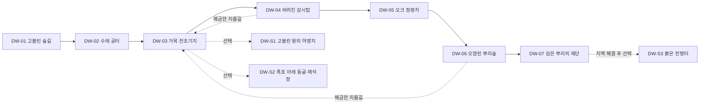

# Deepwood 첫 지역·동선·몬스터 배치 설계

문서 묶음 v0.24 · 2026-10-27 · 상태: 지역 구성 기준안 · [기획 결정](decisions.md) · [전체 서사](../the-last-throne-rpg-proposal.md)

## 1. 지역의 역할과 범위

첫 구간의 사용자 승인 시나리오는 [스토리1 고블린 숲길](story-01-goblin-trail.md)에 보존한다. 경로·조사·완료·협동 방향을 제작 기준으로 삼고 몬스터 레벨/수·보상 수치는 테스트용 초안으로 구분한다.

Deepwood는 첫 제작·전투 검증 맵이자 첫 본격 모험 필드다. 전체 이야기에서는 Dawnspire 프롤로그 이후의1장·권장Lv5~12 기준안을 유지한다. 실제 XP·소요 시간·세부 배치는 플레이테스트로 조정한다. K0의 임시Lv10 기사는 제작 검사용이며 실제 입장 레벨 조건이 아니다.

핵심 경험은 **고블린 숲길에서 기본 전투 학습 → 거목 거점과 숲의 주민 이해 → 점령 유적에서 지배의 원인 발견 → 오염된 뿌리의 제단 공략 → 봉인 자원 배분 선택**이다. 고블린을 모두 적으로 취급하지 않고 주술사 세력과 난민을 구별한다.

대화에서 제안한 지역 구성안을 현재 제작 기준에 반영했다. 아래 지명·구역ID·배치/퀘스트 세부·보상·소요 시간은 구현 전 설계이며 실제 맵이 완성됐다는 뜻은 아니다.7개 주동선 지점과3개 선택 구역은 Deepwood 지역 내부의 장소이며 각각 별도 대형 맵/Place를 만들겠다는 약속이 아니다.

## 2. 주동선과 공간 계층

**고블린 숲길 → 무너진 수레 공터 → 거목 전초기지 → 버려진 감시탑 → 오크 점령지 → 오염된 뿌리숲 → 검은 뿌리의 제단**

지역의 큰 탐험권역은 외곽 숲길·점령 유적·깊은 뿌리숲의3곳이다. 중심 거점은 거목 전초기지1곳이고, 마지막 제단은 첫 본격 던전이다. 거점에서 선택 탐험으로 나가고, 주동선의 진척에 맞춰 귀환 지름길을 열어 같은 복도를 반복 왕복하지 않게 한다.

선택 구역을 건너뛰어도 DW-07 진입과 봉인핵 획득·다음 지역 진행을 막지 않는다. 지름길은 선행 장면/전투를 끝낸 이용자에게 개방하며 파티 참여로 개인 선행을 자동 건너뛰지 않는다.

## 3. 일곱 주동선 지점

| 구역ID·장소 | 경험·이야기 | 몬스터/역할 | 완료와 다음 동선 |
| --- | --- | --- | --- |
| DW-01 고블린 숲길 | 포탈 인근 안전 도착점에서 끊어진 보급로 조사. 공격·회피와 길옆 습지의 작은 탐험 | Goblin·Cave Slime | 보급로 흔적 확인 후 수레가 막힌 공터로 이동 |
| DW-02 무너진 수레 공터 | 주민 구조·고블린 위협 해제·큰 발자국과 먼 실루엣 | Goblin, 오우거 교전 없음 | 주민 대피와 길 확보 후 거목 거점으로 귀환 |
| DW-03 거목 전초기지 | 안전 정비·제작·퀘스트·귀환 포탈. 에린과 만나 숲의 갈등을 이해 | 일반 전투 없는 중심 거점 | 정령 구조와 감시탑 조사 의뢰, 선택 구역 소문과 다음 원정 안내 |
| DW-04 버려진 감시탑 | 정령 구조·오염 장치 발견·지원 적 우선 처치. 에린과 협력 시작 | Goblin Shaman·Orc Warrior | 지배 장치의 연결을 추적하고 거점 지름길 개방 |
| DW-05 오크 점령지 | 장갑 적과 지원 적 조합, 포로 구출·군벌과 대면 | Orc Warrior·Ogre, 중간 보스 Orc Warlord | 군벌 격파와 지배 원인 기록 확보, 깊은 뿌리숲 진입 |
| DW-06 오염된 뿌리숲 | 뿌리 결박·주술 연결선 해제, 고블린 난민과 지배된 병력의 사정 발견 | Goblin Shaman·지배된 기존 종 병력 | 제단 연결을 확인하고 가까운 재도전/거점 지름길 개방 |
| DW-07 검은 뿌리의 제단 | 첫 본격 던전. 포로·장치·엄폐·공명 연계 종합 | 최종 보스 King Shaman과 지원 병력 | 봉인핵·왕좌의 생명력 징수 기록 획득, 지역 선택과 귀환 |

첫 필수 Ogre 교전은 DW-05 막사 접근이며 단독 예고/회피 학습으로 설계한다. Ogre는 일반 몬스터 종류이고 King Ogre가 별도 보스다. K0 실험의 체력6,000·보스 반응 적용은 공격 읽기 검사용 프리셋이며 이 지역의 모든 일반Ogre가 같은 수치/반응을 갖는다는 뜻은 아니다.

## 4. 선택 퀘스트 지역과 보스3종

| 구역ID·장소 | 보스 | 이야기/탐험 목적 | 입장/보상 원칙 |
| --- | --- | --- | --- |
| [DW-S1 고블린 왕의 야영지](deepwood-side-story-01-goblin-king.md) | Goblin King | 식량 독점·포로/물자 회수 | DW-04 후 선택 의뢰 |
| [DW-S2 폭포 아래 동굴·채석장](deepwood-side-story-02-king-ogre.md) | King Ogre | Cave Slime 서식지·채굴 흔적·대형 보스 | DW-05 후 선택 의뢰·낙하 강요 없음 |
| [DW-S3 붉은 전쟁터](deepwood-side-story-03-enraged-warlord.md) | Enraged Warlord | 별도 인물인 잔당 지휘관과 귀환로 | DW-07 결말 후 선택 의뢰 |

메인 필수 보스는 **Orc Warlord → King Shaman**이다. 선택 보스는 고유 외형/제작 재료/기록·주민 이야기의 목표를 제공하되 첫 지역 결말·다음 장·기본 전직에 필요한 재료를 독점하지 않는다. 보상 계수·리젠·반복 제한은 경제 상세에서 정한다.

Enraged Warlord는 `warlord`·`enraged`의 gameplay 조합과 전용 시각 키 `warlord:enraged`를 쓴다. 오크 군벌과 같은 원형을 쓴다는 이유로 방금 죽인 동일 인물이 설명 없이 되살아나는 이야기를 만들지 않는다. 별도의 잔당 지휘관이라는 정체성을 선택 이야기 초안에 기록한다.

[통합 선택 퀘스트 DW-Q1~Q4](deepwood-optional-quests.md)는 습지 조사와 왕의 야영지·폭포 채석장·붉은 전쟁터 이야기를 포함한다. 주민 안내와 현장 단서는 같은 퀘스트로 합쳐지며 별도 완료·보상이 아니다. 본편 선행과 기존 성장 예산에 포함하지 않는다.

## 5. 몬스터10종과 지역 역할

| 분류 | TD 명칭 | 배치 기준안 | 플레이어가 배울 것 |
| --- | --- | --- | --- |
| 일반 | Goblin | DW-01·주술사 지원 병력 | 측면 압박·거리·기본 검격 |
| 일반 | Cave Slime | DW-01 습지·DW-S2 | 분열 뒤 표적 전환·공간 관리 |
| 일반 | Orc Warrior | DW-04~05 | 장갑·측후면·자세 파괴 |
| 일반 | Ogre | DW-05·06 | 큰 예고·방어/회피·반격 기회 |
| 일반 | Goblin Shaman | DW-04~07 | 연결선·지원 우선순위·위험 시전 차단 |
| 보스 | Orc Warlord | DW-05 필수 | 근접 패턴·장갑/지원 조합 종합 |
| 보스 | Goblin King | DW-S1 선택 | 방어/소환 같은 왕의 전술 응용 후보 |
| 보스 | King Ogre | DW-S2 선택 | 넓은 예고·엄폐/안전 공간 |
| 보스 | Enraged Warlord | DW-S3 선택 | 이미 배운 근접 패턴의 강화 도전 |
| 보스 | King Shaman | DW-07 필수 | 뿌리/주술 장치·포로 구조·연계 종합 |

이는RPG 행동/배치 초안이다. 기존TD의 웨이브·HP·왕좌 피해·자동 경로 이동을 그대로 복제하지 않는다. 최신 모델 연결과 구 미리보기의Zombie→Cave Slime 변경은 [자산 문서의10종 표](shared-universe-and-assets.md#41-deepwood-10종의-현행-모델-연결)를 따른다. 실제 형상 재사용과RPG 감지·예고·공격·리그/모션 수용은 별도 확인한다.

튜토리얼 원형에서 슬라임은 부모 사망 후 크기 50%, 부모 최대 체력의 25%인 자식 2기로 분열하며 재분열하지 않는다. 자식이 모두 사라진 뒤 부모가 재생성되어 활성 수를 제한한다. 추가 보상과 정식 지역 밸런스는 별도 검증한다. 일반 적을 한꺼번에 모두 소개하지 않고 구역별로 새 판단을 하나씩 추가한다.

## 6. 제단 던전과 지역 결말

제단은15~20분 대표 시연 구간의 목표를 유지한다. 지역 전체의 길이와 구분하며, 포로 구조 → 두 오염 장치 차단 → King Shaman → 봉인핵 확인의 흐름을 사용한다. 자세한 보스3단계는 [개발 기획안](game-design.md#10-몬스터와-보스)을 따른다.

뿌리 회랑과 포로/장치는 한 길을 여러 번 왕복하지 않게 연결한다. 포로 구조는 보스전의 엄폐·오우거 지원으로 돌아오지만 놓쳐도 기본 엄폐와 안전 시간이 남는다. 모든 클래스가 환경 상호작용으로 장치를 끊을 수 있어야 하며 성녀NPC의 정화나 특정 전직을 필수 열쇠로 요구하지 않는다.

주술사를 쓰러뜨리면 첫 봉인핵에서 왕좌가 숲의 생명력을 거둬들인 기록을 확인한다. 엘프 성역 보호와 고블린 난민 거점 복원에 자원을 어떻게 나눌지 선택하고, 거점 주민·대사·시설과 최종전 정찰 지원에 반영한다. 두 선택 모두 다음 장으로 이어지고 필수 기술/성능 보상에 손해가 없게 한다.

DW-03의 거목 전초기지는Deepwood의 지역 거점, Dawnspire는 왕도다. 지역 복원 결과와 왕도에 돌아오는 주민을 별도 상태로 기록한다. 지역 성역의 수정 구조물이 왕도의 원형 왕좌와 어떤 관계인지와 실제 포탈 연결 대상은 세계관/Place 상세에서 확정한다.

## 7. 동료·체크포인트·협동

에린은 이 지역의 중심 이야기 인물이다. 정령 구조를 통해 협력하며 개인 인물과 플레이어 엘프 클래스를 구분한다. 셀레네는 [NPC/지원 동료](companions-and-support.md)로 유지하되Deepwood 초반 동행을 필수로 두지 않는다. 거점 교단NPC는 별도 활용 후보이며 NPC 수/합류 시점은 후속 설계다.

안전 도착점·거목 거점·제단 입구와 보스 직전에 체크포인트를 둔다. 구역 완료·선택·보스 처치·보상 확정을 분리하고 서버 재접속 시 마지막 안전 지점과 유효 임무 상태로 복구한다. 처음부터 잠긴 지름길 반대편에 생성하거나 보스를 다시 죽여야 이미 획득한 봉인핵을 복구할 수 있게 하지 않는다.

솔로와1~4인에서 같은 메인 목표를 완료할 수 있다. 인원에 따라 적 무리/체력·처리 시간을 조정하되 필수 장치 수나 동시 조작 요구를 늘리지 않고 두 지점을 혼자 동시에 밟는 기믹은 사용하지 않는다. 성녀/특정 클래스·선택 보스 보상·유료 기능이 없어도 공략 가능해야 한다. 일반 모험의AI동료 상한은 동료 상세 문서를 따른다.

파티의 공통 전장/호스트 장면과 개인의 퀘스트 자격·지역 선택·초회 보상을 구분한다. 선택 구역을 다른 파티에서 먼저 도와줬다고 메인 선행이나 개인 결말을 강제 저장하지 않는다.

## 8. 원형 활용과 첫 제작 순서

TD의 거목·석조 포탈·수정 왕좌·돌길·이끼 바위·초지·절벽/폭포를 정체성으로 이어받는다. 기존U턴/타워 패드는 자유 탐험 동선·근접 교전·카메라에 맞게 재구성한다. 원본 사진·Forest kit와 별도 충돌 구조의 검토는 [공유 자산](shared-universe-and-assets.md#12-deepwood-첫-제작-맵-적용)을 따른다.

첫 제작은DW-01~02의 작은 범위를 [기사 K0](knight-combat-spec.md#9-첫-전투-실험실의-적공간시나리오)로 검증한다.96×96stud는 그 안의 전투 검사 구역 예산이며Deepwood 전체 크기가 아니다. 먼저 기본기와 시야·충돌을 확인하고 DW-03 거점/퀘스트 연결, DW-07 대표 던전, 나머지 주동선/선택 구역 순으로 의존성에 맞춰 확장한다. 이 순서는 전체 지역 제공 완료를 뜻하지 않는다.

후속 산출물은 구역별 동선/고저차 지도·퀘스트 상태/선행·주민/대사·10종의 실제RPG 행동·보상/XP·거점 복원표다. 구현 후에는 선택3구역을 모두 건너뛴 메인 완주, 성녀 미동행·네 클래스 솔로/파티, 재접속/지름길·지역 선택·기기/카메라를 검증한다.

## 전체 줄거리와 일곱 제작 시나리오

[에픽1 대삼림의 검은 뿌리](epic-01-deepwood-story.md)가 전체 이야기·지식 공개 순서·시나리오 연결의 기준이다. 고블린 숲길 → 무너진 수레 공터 → 거목 전초기지 → 버려진 감시탑 → 오크 점령지 → 오염된 뿌리숲 → 검은 뿌리의 제단 순서로 진행한다. 각 상세 문서는 해당 색인에서 연결한다.

필수 보스는 Orc Warlord와 King Shaman이다. Goblin King·King Ogre·Enraged Warlord의 세 지역은 선택 콘텐츠다. 일반Ogre 교전을 King Ogre 보스전으로 바꾸지 않는다. 새 시나리오의 배치·레벨·보상은 지역 블록아웃 및 성장 시뮬레이션에서 조정한다.

[7스토리 맵 공간 제작안](deepwood-map-design.md)에 구역 중심/크기·높이·전투 여유·스토리 연결 방식을 구체화했다. [전체 배치도와 구역별 검토 보드](../assets/maps/deepwood-v1/index.html)는 구현 전 설계 초안이다.
