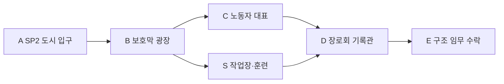

# 에픽3 Ember Caldera · 스토리2 용광로 도시

문서 묶음 v0.24 · 2026-10-27, America/Toronto · 상태: 신규 상세 시나리오 제안, 구현 전

[에픽3 전체/공통 계약](epic-03-ember-caldera-story.md) · [맵 제작안](ember-caldera-map-design.md) · [이전: 잿빛 관문](ember-caldera-story-01-ash-gate.md) · [다음: 무너진 공명광산](ember-caldera-story-03-collapsed-mine.md)

## 1. 역할·진입·이야기

EC-02, 권장Lv21 · 안전 거점. 직전 EC-01 완료가 서사 선행이다. 레벨·배치·보상·대사·장치 수는 테스트 초안이다.

도시는 용광로 보호막으로 화산재와 분출을 막는다. 노동자들은 위험을 알리지 않는 작업 명령에 항의하고 장로회는 용광로를 끄면 주민이 죽는다고 주장한다. 플레이어는 양쪽 말을 듣고 광산 구조부터 맡는다. 브란은 가문의 설계를 확인하겠다고 약속하지만 필수 전투동료가 되지는 않는다.

## 2. 동선과 공간

전투 적0. 광장/두 대표/정비를 짧은 고리로 연결한다. 상점 구매·제작·재료 기부·전직 선택을 대화 완료 조건으로 쓰지 않는다.

입구 A는 `EC-02-SP` 안전 스타트 포인트다. 적 추격/공격과 분리한40×32stud 마당을 시험하며4명/동료 개별 생성 슬롯을 둔다. 좌표·바닥·카메라는 블록아웃에서 검증한다.

## 3. 몬스터·배치

적0마리. 노동자·장로·브란은 이야기NPC이며 공격/전리품 대상이 아니다.

## 4. 성공 조건·단서

필수: **양측 면담·보호막 상태 확인·광산 구조 수락**. 각 조사/장치 완료 → 다음 상호작용 활성 → 종점/보고 확인 → 개인 스토리 완료 순서다. 선택 가지/재료/유품·완벽 방어·동료 생존·궁극기 사용은 필수가 아니다. 주민은 위협 해제 뒤 짧게 안전 이동하고 긴 시간 제한 호위를 요구하지 않는다.

단서 공개: 도시가 용광로에 의존한다는 사실. 노동자/장로를 일괄 악인으로 규정하지 않음.

## 5. 복구·재플레이·보상

면담과 임무 수락을 각각 저장한다. 복귀 후 중재/개인 선택은 이 안전 거점에서 진행한다.

첫 시작/처음부터는 SP, 이어하기는 유효 체크포인트, 파티 재합류는 같은 실행의 안전 합류 지점이다. 보스 도중이면 안전실 대기 후 안전 시점에 합류한다. 서버/실행이 소멸했으면 개인 확정 목표로 새 실행을 복구하고 미완료 적HP/효과를 초기화한다.

처음부터는 새 실행이며 영구 레벨·장비·완료·개인 선택·초회 수령 기록을 지우지 않는다. 혼자 공동 실행을 초기화하지 않는다. 재합류 유예/보관 기간은 미정이다.

첫 완료 Coins160·퀘스트XP92·도시 정비·광산 구조 임무가 초안이다. 거점 대화 반복 보상은0. 장비/증거/핵/선택 초회 보상은 반복하지 않는다. 처치XP/보스 전리품은 별도 영수증이며 화산 전용 인장 종류/수량은 미정이다.

## 6. 협동·공유 자산·검증

인간1~4인, 전투AI 상한2/2/1/0. 브란 정식 영입/편성·드워프 클래스·Pyro/Cryo/물마법을 요구하지 않는다. 모든 장치는 공통 상호작용으로 솔로 순차 처리한다. 막타 대신 보호/회복/조사도 참여로 인정하고 자격 있는 현장 참여자의 공통 목표만 공유한다. 개인 선행·수령·선택은 호스트가 덮어쓰지 않는다.

TD 화산 모델·현무암·석조 성벽/다리·주황 용암·보라 포탈·공통 메뉴/아이콘을 공유한다. 열원/수로 상태는 원형 모델과 분리한 소품/VFX 파생으로 표현하고 몬스터 외형을 새로 생성하지 않는다.

검증: 네 클래스 솔로/동료0·전직 미선택/궁극기 미사용,1/2/4인, 모든 SP 시작/이어하기/처음부터/리조인, 장치/보스 뒤 재접속, 낙하 복귀·용암 대비·보상 중복 방지. 현재는 문서 설계이며 실제 플레이 검증 결과가 아니다.

## 반영된 성장 예산 · v0.21

초회 퀘스트XP **92**, 퀘스트Coins **160**, 필수 전투XP 예산 **0**다. 초회 총XP **92**, 처치 포함 총Coins **160**이며 선택 소비 전 유입량이다. 순서대로 진행할 때 예상 완료Lv **21**다. 거점 대화 반복XP/Coins는0이다. 처치/보스 보상은 별도 유효 참여/수령 기록을 따른다. [성장 기준표](story-progression-budget.md)의 XP곡선·필수 처치 가정·개인 지급 규칙을 함께 적용한다. 기존 퍼센트 보상 대신 고정 정수XP를 사용하며 사용자 승인으로 기획에 반영했고 런타임/실제 플레이 검증은 아직이다.
