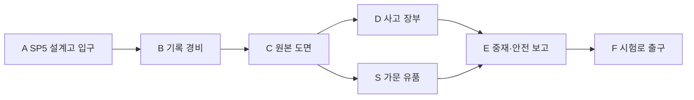

# 에픽3 Ember Caldera · 스토리5 가문의 설계고

문서 묶음 v0.24 · 2026-10-27, America/Toronto · 상태: 신규 상세 시나리오 제안, 구현 전

[에픽3 전체/공통 계약](epic-03-ember-caldera-story.md) · [맵 제작안](ember-caldera-map-design.md) · [이전: 갈라진 냉각 수로](ember-caldera-story-04-coolant-canals.md) · [다음: 지열 심장 시험로](ember-caldera-story-06-geothermal-testworks.md)

## 1. 역할·진입·이야기

EC-05, 권장Lv25~26. 직전 EC-04 완료가 서사 선행이다. 레벨·배치·보상·대사·장치 수는 테스트 초안이다.

브란은 가문이 결함을 알면서도 도시가 무너질까 두려워 침묵했음을 인정한다. 원본에는 주민의 생명력을 소모하지 않는 지열 순환안이 있었지만 위험과 비용 때문에 폐기됐다. 플레이어는 노동자 안전 중단권과 단계별 시험에 대한 합의를 기록하고 대체 열원 시험 준비를 한다.

## 2. 동선과 공간

중재 장면은 기록실 안전 구역에서 원격/왕복 없는 대화로 진행한다. 대표 두 명이 동시에 버튼을 누르지 않는다. 합의의 필수 안전 조건은 모두 적용하고 복구 예산 우선순위만 최종 개인 선택으로 남긴다.

입구 A는 `EC-05-SP` 안전 스타트 포인트다. 적 추격/공격과 분리한40×32stud 마당을 시험하며4명/동료 개별 생성 슬롯을 둔다. 좌표·바닥·카메라는 블록아웃에서 검증한다.

## 3. 몬스터·배치

| TD 기존 종 | 레벨 초안 | 솔로 수 | 역할 |
| --- | --- | --- | --- |
| Golem | 25 | 2 | 기록 경비 |
| Volcano Shaman | 26 | 2 | 도면 반출 통로 점령 |

교전은 위 단위로 분리하며 처음부터 모두 몰아넣지 않는다. TD HP/웨이브/이동 경로를 RPG 수치로 복사하지 않는다. 화염 적이 있는 구역도 특정 전직/속성 저항을 필수 열쇠로 요구하지 않는다.

## 4. 성공 조건·단서

필수: **도면/사고 장부 확인·통로 경비 해제·양측 안전 합의 확인·F 도착**. 각 조사/장치 완료 → 다음 상호작용 활성 → 종점/보고 확인 → 개인 스토리 완료 순서다. 선택 가지/재료/유품·완벽 방어·동료 생존·궁극기 사용은 필수가 아니다. 주민은 위협 해제 뒤 짧게 안전 이동하고 긴 시간 제한 호위를 요구하지 않는다.

단서 공개: 브란 가문의 책임과 대안. 대체 회로의 실효성은 다음 시험에서 확인.

중재의 필수 합의는 위험 정보 공개·작업 중단권·독립 열원 시험이다. 지불/기부/장비 구매가 아니라 대화와 확인으로 진행한다. 대표NPC 이름/세부 대사는 후속 초안이다.

## 5. 복구·재플레이·보상

도면/장부는 소모 아이템이 아닌 진행 플래그로 보존한다. 합의 확정 뒤 끊겨도 대화를 다시 강제하지 않는다. F에서 도시 귀환 지름길을 해금한다.

첫 시작/처음부터는 SP, 이어하기는 유효 체크포인트, 파티 재합류는 같은 실행의 안전 합류 지점이다. 보스 도중이면 안전실 대기 후 안전 시점에 합류한다. 서버/실행이 소멸했으면 개인 확정 목표로 새 실행을 복구하고 미완료 적HP/효과를 초기화한다.

처음부터는 새 실행이며 영구 레벨·장비·완료·개인 선택·초회 수령 기록을 지우지 않는다. 혼자 공동 실행을 초기화하지 않는다. 재합류 유예/보관 기간은 미정이다.

첫 완료 Coins720·퀘스트XP630·독립 지열 도면·작업장 복원 자격가 초안이다. 재플레이 퀘스트 Coins216·첫 퀘스트XP25%를 시험한다. 장비/증거/핵/선택 초회 보상은 반복하지 않는다. 처치XP/보스 전리품은 별도 영수증이며 화산 전용 인장 종류/수량은 미정이다.

## 6. 협동·공유 자산·검증

인간1~4인, 전투AI 상한2/2/1/0. 브란 정식 영입/편성·드워프 클래스·Pyro/Cryo/물마법을 요구하지 않는다. 모든 장치는 공통 상호작용으로 솔로 순차 처리한다. 막타 대신 보호/회복/조사도 참여로 인정하고 자격 있는 현장 참여자의 공통 목표만 공유한다. 개인 선행·수령·선택은 호스트가 덮어쓰지 않는다.

TD 화산 모델·현무암·석조 성벽/다리·주황 용암·보라 포탈·공통 메뉴/아이콘을 공유한다. 열원/수로 상태는 원형 모델과 분리한 소품/VFX 파생으로 표현하고 몬스터 외형을 새로 생성하지 않는다.

검증: 네 클래스 솔로/동료0·전직 미선택/궁극기 미사용,1/2/4인, 모든 SP 시작/이어하기/처음부터/리조인, 장치/보스 뒤 재접속, 낙하 복귀·용암 대비·보상 중복 방지. 현재는 문서 설계이며 실제 플레이 검증 결과가 아니다.

## 반영된 성장 예산 · v0.21

초회 퀘스트XP **630**, 퀘스트Coins **720**, 필수 전투XP 예산 **236**다. 초회 총XP **866**, 처치 포함 총Coins **782**이며 선택 소비 전 유입량이다. 순서대로 진행할 때 예상 완료Lv **26**다. 반복 퀘스트XP는25% 정수 내림 **157**, 반복 퀘스트Coins는 **216**다. 처치/보스 보상은 별도 유효 참여/수령 기록을 따른다. [성장 기준표](story-progression-budget.md)의 XP곡선·필수 처치 가정·개인 지급 규칙을 함께 적용한다. 기존 퍼센트 보상 대신 고정 정수XP를 사용하며 사용자 승인으로 기획에 반영했고 런타임/실제 플레이 검증은 아직이다.
