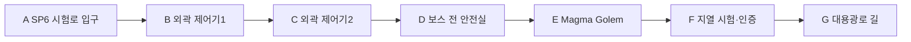

# 에픽3 Ember Caldera · 스토리6 지열 심장 시험로

문서 묶음 v0.24 · 2026-10-27, America/Toronto · 상태: 신규 상세 시나리오 제안, 구현 전

[에픽3 전체/공통 계약](epic-03-ember-caldera-story.md) · [맵 제작안](ember-caldera-map-design.md) · [이전: 가문의 설계고](ember-caldera-story-05-ancestral-design-vault.md) · [다음: 대용광로](ember-caldera-story-07-great-furnace.md)

## 1. 역할·진입·이야기

EC-06, 권장Lv26~28. 직전 EC-05 완료가 서사 선행이다. 레벨·배치·보상·대사·장치 수는 테스트 초안이다.

두 외곽 제어기를 연결하고 시험로를 점거한 Magma Golem을 돌파한다. 독립 지열 회로가 도시의 최소 보호막을 유지할 수 있음을 시험 계기로 확인하지만 본 회로 전환은 아직 남아 있다. 과열된 기존 용광로에서 거대한 공명체가 형성되기 시작한다.

## 2. 동선과 공간

보스 공터124×116stud. HP100~60% 내려치기/전방 돌진,60% 아래 예고된 열파와 임시 냉각 배출구2개를 시험한다. 배출구는 솔로 순차 처리 가능하고 방어 불가 공격은 이동으로 피할 수 있다.

입구 A는 `EC-06-SP` 안전 스타트 포인트다. 적 추격/공격과 분리한40×32stud 마당을 시험하며4명/동료 개별 생성 슬롯을 둔다. 좌표·바닥·카메라는 블록아웃에서 검증한다.

## 3. 몬스터·배치

| TD 기존 종 | 레벨 초안 | 솔로 수 | 역할 |
| --- | --- | --- | --- |
| Golem | 26 | 2 | 외곽 제어기 |
| Volcano Shaman | 27 | 2 | 시험로 접근 |
| Magma Golem | 28 | 1 | 필수 중간 보스 |

교전은 위 단위로 분리하며 처음부터 모두 몰아넣지 않는다. TD HP/웨이브/이동 경로를 RPG 수치로 복사하지 않는다. 화염 적이 있는 구역도 특정 전직/속성 저항을 필수 열쇠로 요구하지 않는다.

## 4. 성공 조건·단서

필수: **외곽 제어기2개·Magma Golem 격파·시험 계기 확인·G 도착**. 각 조사/장치 완료 → 다음 상호작용 활성 → 종점/보고 확인 → 개인 스토리 완료 순서다. 선택 가지/재료/유품·완벽 방어·동료 생존·궁극기 사용은 필수가 아니다. 주민은 위협 해제 뒤 짧게 안전 이동하고 긴 시간 제한 호위를 요구하지 않는다.

단서 공개: 대체 열원의 국소 성능 입증과 과열 경보. 무한 에너지/세계 전체 해법으로 설명하지 않음.

## 5. 복구·재플레이·보상

외곽 제어기와 보스 전 안전실을 저장한다. 전멸 시 보스HP·임시 배출구만 초기화한다. 처치 뒤 끊기면 시험 계기/F부터 이어가며 재처치하지 않는다.

첫 시작/처음부터는 SP, 이어하기는 유효 체크포인트, 파티 재합류는 같은 실행의 안전 합류 지점이다. 보스 도중이면 안전실 대기 후 안전 시점에 합류한다. 서버/실행이 소멸했으면 개인 확정 목표로 새 실행을 복구하고 미완료 적HP/효과를 초기화한다.

처음부터는 새 실행이며 영구 레벨·장비·완료·개인 선택·초회 수령 기록을 지우지 않는다. 혼자 공동 실행을 초기화하지 않는다. 재합류 유예/보관 기간은 미정이다.

첫 완료 Coins900·퀘스트XP745·대체 열원 시험 인증·클래스 무기1개가 초안이다. 재플레이 퀘스트 Coins270·첫 퀘스트XP25%를 시험한다. 장비/증거/핵/선택 초회 보상은 반복하지 않는다. 처치XP/보스 전리품은 별도 영수증이며 화산 전용 인장 종류/수량은 미정이다.

## 6. 협동·공유 자산·검증

인간1~4인, 전투AI 상한2/2/1/0. 브란 정식 영입/편성·드워프 클래스·Pyro/Cryo/물마법을 요구하지 않는다. 모든 장치는 공통 상호작용으로 솔로 순차 처리한다. 막타 대신 보호/회복/조사도 참여로 인정하고 자격 있는 현장 참여자의 공통 목표만 공유한다. 개인 선행·수령·선택은 호스트가 덮어쓰지 않는다.

TD 화산 모델·현무암·석조 성벽/다리·주황 용암·보라 포탈·공통 메뉴/아이콘을 공유한다. 열원/수로 상태는 원형 모델과 분리한 소품/VFX 파생으로 표현하고 몬스터 외형을 새로 생성하지 않는다.

검증: 네 클래스 솔로/동료0·전직 미선택/궁극기 미사용,1/2/4인, 모든 SP 시작/이어하기/처음부터/리조인, 장치/보스 뒤 재접속, 낙하 복귀·용암 대비·보상 중복 방지. 현재는 문서 설계이며 실제 플레이 검증 결과가 아니다.

## 반영된 성장 예산 · v0.21

초회 퀘스트XP **745**, 퀘스트Coins **900**, 필수 전투XP 예산 **564**다. 초회 총XP **1309**, 처치 포함 총Coins **1134**이며 선택 소비 전 유입량이다. 순서대로 진행할 때 예상 완료Lv **28**다. 반복 퀘스트XP는25% 정수 내림 **186**, 반복 퀘스트Coins는 **270**다. 처치/보스 보상은 별도 유효 참여/수령 기록을 따른다. [성장 기준표](story-progression-budget.md)의 XP곡선·필수 처치 가정·개인 지급 규칙을 함께 적용한다. 기존 퍼센트 보상 대신 고정 정수XP를 사용하며 사용자 승인으로 기획에 반영했고 런타임/실제 플레이 검증은 아직이다.
