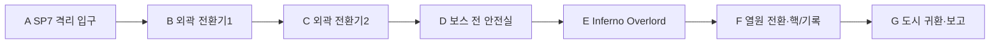

# 에픽3 Ember Caldera · 스토리7 대용광로

문서 묶음 v0.24 · 2026-10-27, America/Toronto · 상태: 신규 상세 시나리오 제안, 구현 전

[에픽3 전체/공통 계약](epic-03-ember-caldera-story.md) · [맵 제작안](ember-caldera-map-design.md) · [이전: 지열 심장 시험로](ember-caldera-story-06-geothermal-testworks.md)

## 1. 역할·진입·이야기

EC-07, 권장Lv28~30. 직전 EC-06 완료가 서사 선행이다. 레벨·배치·보상·대사·장치 수는 테스트 초안이다.

과열과 강제 추출이 Inferno Overlord라는 공명체를 만들었다. 플레이어는 냉각 장치로 폭주를 억제하며 공명체를 쓰러뜨린다. 도시 보호막을 시험 완료된 지열 회로로 넘기고 강제 추출을 차단한 뒤 세 번째 봉인핵을 분리한다. 기록에서 왕좌 중심 의식이 아직 살아 있음을 확인하고 왕도의 기억 상실 소식을 받는다.

## 2. 동선과 공간

보스 공터144×136stud. HP100~70% 검격/부채꼴 열파,70~35% 임시 냉각 장치2개/보호막,35% 아래 예고된 바닥 분출과 기존 패턴을 조합한다. 냉각 장치는 솔로 순차 처리하고 별도 안정화 창을 제공한다. 외곽 전환기와 임시 보스 장치는 서로 다른 오브젝트/저장 상태다.

입구 A는 `EC-07-SP` 안전 스타트 포인트다. 적 추격/공격과 분리한40×32stud 마당을 시험하며4명/동료 개별 생성 슬롯을 둔다. 좌표·바닥·카메라는 블록아웃에서 검증한다.

## 3. 몬스터·배치

| TD 기존 종 | 레벨 초안 | 솔로 수 | 역할 |
| --- | --- | --- | --- |
| Imp | 28 | 2 | 외곽 통로 |
| Golem | 29 | 2 | 전환기 경비 |
| Volcano Shaman | 29 | 2 | 안정화 회로 |
| Inferno Overlord | 30 | 1 | 최종 필수 보스 |

교전은 위 단위로 분리하며 처음부터 모두 몰아넣지 않는다. TD HP/웨이브/이동 경로를 RPG 수치로 복사하지 않는다. 화염 적이 있는 구역도 특정 전직/속성 저항을 필수 열쇠로 요구하지 않는다.

## 4. 성공 조건·단서

필수: **외곽 전환기2개·보스 격파·대체 회로 본 전환/보호막 확인·핵/기록·도시 개인 보고**. 각 조사/장치 완료 → 다음 상호작용 활성 → 종점/보고 확인 → 개인 스토리 완료 순서다. 선택 가지/재료/유품·완벽 방어·동료 생존·궁극기 사용은 필수가 아니다. 주민은 위협 해제 뒤 짧게 안전 이동하고 긴 시간 제한 호위를 요구하지 않는다.

단서 공개: 왕좌 중심 의식의 생존. 피난민 기억 상실과 연결되며 제4장 망자들의 원본 증언이 필요해짐.

개인 복구 선택은 작업장/보급 재개 우선 또는 광산/주거 안전 보강 우선이다. 두 쪽 모두 최소 안전 기준과 주민 보호를 충족한다. 어느 쪽도 필수 제작 기능·성능 보상·다음 에픽을 잠그지 않는다. 최종 흑막의 완성 계획/리라의 강제 희생 원본까지 미리 공개하지 않는다.

## 5. 복구·재플레이·보상

보스 승리를 먼저 저장한다. 전멸 시 임시 장치/HP/효과만 초기화하고 외곽 회로는 유지한다. 승리 후 끊기면 F의 열원 전환/기록부터 이어간다. 보호막 본 전환이 확정되기 전 핵 회수는 불가하다. 핵/기록/개인 보고는 별도 저장한다.

첫 시작/처음부터는 SP, 이어하기는 유효 체크포인트, 파티 재합류는 같은 실행의 안전 합류 지점이다. 보스 도중이면 안전실 대기 후 안전 시점에 합류한다. 서버/실행이 소멸했으면 개인 확정 목표로 새 실행을 복구하고 미완료 적HP/효과를 초기화한다.

처음부터는 새 실행이며 영구 레벨·장비·완료·개인 선택·초회 수령 기록을 지우지 않는다. 혼자 공동 실행을 초기화하지 않는다. 재합류 유예/보관 기간은 미정이다.

첫 완료 Coins1200·퀘스트XP843·세 번째 봉인핵1개·중심 의식 기록·개인 복구 선택이 초안이다. 재플레이 퀘스트 Coins360·첫 퀘스트XP25%를 시험한다. 장비/증거/핵/선택 초회 보상은 반복하지 않는다. 처치XP/보스 전리품은 별도 영수증이며 화산 전용 인장 종류/수량은 미정이다.

## 6. 협동·공유 자산·검증

인간1~4인, 전투AI 상한2/2/1/0. 브란 정식 영입/편성·드워프 클래스·Pyro/Cryo/물마법을 요구하지 않는다. 모든 장치는 공통 상호작용으로 솔로 순차 처리한다. 막타 대신 보호/회복/조사도 참여로 인정하고 자격 있는 현장 참여자의 공통 목표만 공유한다. 개인 선행·수령·선택은 호스트가 덮어쓰지 않는다.

TD 화산 모델·현무암·석조 성벽/다리·주황 용암·보라 포탈·공통 메뉴/아이콘을 공유한다. 열원/수로 상태는 원형 모델과 분리한 소품/VFX 파생으로 표현하고 몬스터 외형을 새로 생성하지 않는다.

검증: 네 클래스 솔로/동료0·전직 미선택/궁극기 미사용,1/2/4인, 모든 SP 시작/이어하기/처음부터/리조인, 장치/보스 뒤 재접속, 낙하 복귀·용암 대비·보상 중복 방지. 현재는 문서 설계이며 실제 플레이 검증 결과가 아니다.

## 리뷰 보충 · 반복 실행 완료와 일회성 후일담

첫 진행은 위의 핵/기록·개인 선택/보고까지 마쳐야 에픽 완료다. 이미 에픽을 끝낸 사람의 재플레이는 새 실행의 필수 외곽 목표와 보스 승리로 반복 퀘스트 보상 자격을 확정하고, 최초 결말/후일담을 다시 선택하도록 요구하지 않는다. 과거 사건의 기록 연출은 건너뛰거나 다시 볼 수 있다. 실행ID와 개인 수령 기록으로 같은 실행의 재접속/중복 요청을 구분해1회만 지급한다. 영구 완료 플래그만으로 새 실행의 보스를 건너뛰어 반복 보상을 받게 하지 않는다. 처치/전투 승리 전리품과 반복 퀘스트 보상은 별도 기록이다.

## 반영된 성장 예산 · v0.21

초회 퀘스트XP **843**, 퀘스트Coins **1200**, 필수 전투XP 예산 **732**다. 초회 총XP **1575**, 처치 포함 총Coins **1482**이며 선택 소비 전 유입량이다. 순서대로 진행할 때 예상 완료Lv **30**다. 반복 퀘스트XP는25% 정수 내림 **210**, 반복 퀘스트Coins는 **360**다. 처치/보스 보상은 별도 유효 참여/수령 기록을 따른다. [성장 기준표](story-progression-budget.md)의 XP곡선·필수 처치 가정·개인 지급 규칙을 함께 적용한다. 기존 퍼센트 보상 대신 고정 정수XP를 사용하며 사용자 승인으로 기획에 반영했고 런타임/실제 플레이 검증은 아직이다.

## 2026-10-30 서사 보강 · 구현 인계

[2026-10-30 전체 서사 개정](production/narrative-review-2026-10-30.md)에 따른 장면/인과관계 개정안이다. 왕도 소식의 재가동은 남은 중앙 회로의 비상 방어 가동 강화이며 네 핵과 조각의 완전 통합과 다르다. 마지막 기록/보고 장면에 프롤로그 상인의 기억 상실을 귀환 또는 통신으로 연결한다. 별도 수주·추가 보상·필수 귀환 퀘스트를 만들지 않는다. 세 핵은 차단 보관하고 재장착을 보류한다. 실제 장치/저장/재접속·영어 전체 원고·플레이 검증은 후속이다. 기존 단계 안에서 구현하며 목표 수·보상 정본을 바꾸지 않는다.
