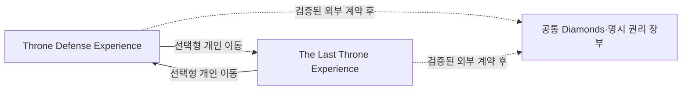

# Throne Defense ↔ The Last Throne 독립 Experience·경제 연동 설계

버전 0.25 · 2026-10-28 · [기획 본문](game-design.md) · [결정표](decisions.md)

## 1. 현재 제품 경계

The Last Throne은 Throne Defense와 세계관·승인 원본 자산을 공유하지만, **분리된 Roblox Experience**로 공개한다. 각 게임은 자체 공개 페이지, Start Place, DataStore, 상품 영수증 처리와 운영 릴리스를 가진다. 이 문서는 아직 Experience를 만들거나 TD 운영 코드·저장·상품을 바꾸지 않는다.

| 영역 | 현재 기준 |
| --- | --- |
| 게시 | TD Experience와 The Last Throne Experience를 각각 공개·운영 |
| 진입 | 각 Experience의 Start Place를 유지. 상호 이동은 선택형 개인 이동 |
| 게임 데이터 | TD 성장/전투와 RPG 클래스/전직/학습/장비/스토리/Coins를 완전 분리 |
| Diamonds·공통 권리 | 별도 서버 권위 지갑과 조정 계약이 검증될 때만 공유; 그 전에는 분리 |
| 기존 TD | 잔액·구매/수령 권리·성장·복구와 공개 페이지를 보존 |
| 클래스 | RPG 플레이어 4클래스·8전직 계열. 성녀는 NPC/지원 동료 |

## 2. Experience 간 진입

각 게임은 독립 Start Place를 가진다. TD의 기존 시작 진입을 RPG로 바꾸지 않으며, RPG는 Dawnspire에서 독립적으로 시작한다. 게임 내 포털·메뉴에서 상대 Experience의 이름, 장르, 대상 Experience, 개인 이동임을 명시한다. 자동 접촉 이동이나 특정 클래스·구매 강제는 금지한다.

`TeleportService`는 다른 게임으로의 이동을 지원하지만, `TeleportAsync` 단체 이동은 같은 Experience 안에서만 가능하다. 따라서 초기 TD↔RPG 동선은 개인 이동으로 한정한다. 한 게임 안의 파티/원정은 기존 1~4인 규칙을 유지하며, Experience 간 파티 보존·예약 서버 동행은 후속 별도 결정이다. TeleportData는 클라이언트가 볼 수 있는 보조 정보일 뿐 재화·아이템·권리의 근거가 될 수 없다. 이동은 게시된 각 테스트 Experience의 Roblox 클라이언트에서만 수용한다. [Teleport 공식 문서](https://create.roblox.com/docs/projects/teleport)

## 3. 데이터·상품 경계

DataStore는 Experience 단위다. TD와 RPG의 DataStore를 서로 직접 읽거나 하나의 `ProcessReceipt` 콜백/저장 키로 취급하지 않는다. 각 Experience는 자기 서버에서 자기 상품 영수증을 한 번만 처리하고, 기존 TD 상품 처리기는 그대로 보존한다.

| 영역 | 소유 Experience | 쓰기 원칙 |
| --- | --- | --- |
| TD 프로필·TD Gold·타워/전투·TD 상품 | Throne Defense | 기존 의미와 복구 경로 보존 |
| RPG 캐릭터·RPG Coins·장비·스토리·RPG 상품 | The Last Throne | RPG 서버 계약에서만 변경 |
| 공통 Diamonds·명시 업적/외형·공동 이벤트 | 검증된 외부 권위 서비스가 있을 때만 | 양쪽 서버는 인증된 요청과 처리 ID로만 조정 |

공통 계약이 없는 동안에는 Diamonds·외형·업적·공동 이벤트를 자동 복사, 환전, 재지급하거나 다른 게임에서 소유한 것으로 표시하지 않는다. TD에서 구매한 Developer Product가 RPG에서 자동 사용 가능하다고 가정하지 않는다.

## 4. 공통 Diamonds 후보 계약

공통 Diamonds는 제품 목표이지만 독립 Experience 전환으로 **새 기술 선행 조건**이 생겼다. 구현 전 다음을 확정하고 별도 보안·운영 검증을 통과해야 한다.

1. 외부 서버 권위 지갑의 소유자, 인증 방식, 비밀 관리, 가용성·장애 대응과 TD/RPG 서버의 최소 권한.
2. `userId`, 계약 버전, 처리 ID, 원인(구매/보상/소비), 금액, 결과와 만료/정리 정책을 가진 변경 불가 거래 기록.
3. 동일 처리 ID 재요청의 멱등성, 동시 소비 원자성, 불명 응답 조회, 지갑 차감과 각 Experience 권리 지급의 outbox·재처리.
4. 각 Experience의 영수증 검증과 외부 지갑 반영 순서. 클라이언트·TeleportData·상대 Experience의 캐시를 권위로 사용하지 않는다.
5. 서비스 장애 또는 호환 버전 불일치 시 소비/지급을 확정하지 않고 재시도 가능한 상태를 보이는 정책.

예시 수용 조건은 잔액 100에서 TD와 RPG가 각각 80을 동시에 소비하면 한 요청만 성공하여 최종 잔액이 20이 되는 것이다. 이는 가격 제안이 아니다. 위 계약과 게시 테스트가 없으면 공통 지갑은 **미구현·비활성**으로 남는다.

## 5. 도입 순서와 수용

1. TD의 지갑·상품·수령·복구 writer를 읽기 전용으로 감사하고, TD 운영 동작을 변경하지 않는다.
2. The Last Throne Experience의 독립 DataStore·상품·공개 페이지·테스트 환경을 준비한다.
3. 공통 지갑을 원하면 외부 권위 서비스와 양쪽 서버 어댑터를 별도 보안 설계/테스트 환경에서 구현한다. 이 단계 전에는 양쪽 재화를 분리한다.
4. 개인 Experience 간 이동과 각 게임의 저장 후 이동·실패 재시도·복귀 동선을 게시 테스트에서 검증한다.
5. 공통 지갑을 활성화하기 전 TD 회귀, RPG 회귀, 동시 소비, 중복 영수증, 장애·재접속 복구 및 외부 서비스 장애를 독립 검증한다.

| 상황 | 기대 결과 |
| --- | --- |
| TD 또는 RPG 단독 플레이 | 서로의 데이터·상품·공개 페이지를 바꾸지 않음 |
| TD↔RPG 개인 이동 실패 | 출발 게임에 남거나 안전하게 재시도하며 권리·진행을 복사하지 않음 |
| 공통 계약 미배포 | 각 게임 Diamonds·상품·권리가 분리된 상태로 명시됨 |
| 공통 계약 배포 후 동시 소비 | 원자적 결과, 음수·이중 소비·덮어쓰기 없음 |
| 영수증/권리 지급 중 종료 | 동일 처리 ID로 결과를 조회·복구하며 새 구매를 요구하지 않음 |
| 외부 지갑 장애 | 신규 0잔액 저장이나 임의 지급 없이 소비/지급을 제한하고 재시도 안내 |

현재 완료 상태는 **문서상 독립 Experience 전환 결정**뿐이다. 새 Experience 생성, 지갑 서비스, 포털, 영수증 조정, Roblox 게시와 실제 클라이언트 검증은 모두 후속 작업이다.
