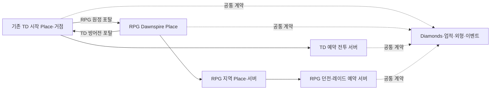

# Throne Defense ↔ The Last Throne Experience·경제 연동 설계

버전0.25 · 2026-10-28 · [기획 본문](game-design.md) · [업데이트 제안서](../../throne-defense/docs/throne-chronicles-rpg-proposal.md)

## 1. 현재 연동 범위

TD와 RPG는 **같은 Experience의 별도 Place**로 연결하고, 공통 계정 요소와 장르별 진행을 구분한다. 업데이트 제안서에서 채택한 방향과 구현할 계약은 [기획 결정표](decisions.md)에서 구분한다.

| 영역 | 현재 기준 |
| --- | --- |
| 게임·소스 | The Last Throne / 최후의 왕좌. RPG 개발 소스는 별도 |
| 게시 | 기존 TD와 같은 Experience의 별도 RPG Place |
| 진입 | 기존 TD 시작 Place 유지, 양방향 거점 포탈 |
| 지갑 | Diamonds 공통 지갑, 기존 TD 잔액·확인된 구매/수령 권리 보존 |
| 공통 권리 | 명시된 업적·외형·공동 이벤트 기록 |
| 장르별 진행 | TD 성장/전투와 RPG 클래스/전직/학습/장비/스토리/Coins 분리 |
| 클래스 | RPG 플레이어4클래스·8전직 계열, 클래스 외부 전직 금지. 성녀는NPC/지원 동료 |

계약의 키·버전·실제 Place ID는 기존 TD 감사 후 확정한다. 여기의 계약과 도입 순서는 기획이며 실제 연동 완료를 뜻하지 않는다. 변경 과정은 [이력](CHANGELOG.md)에 둔다.

## 2. Experience와 진입 동선

기존 TD 시작 Place의 진입을 유지한다. 최초 RPG 방문은 클래스 체험/생성과 프롤로그로, 재방문은 저장된 안전 거점으로 연결한다. 공통 허브의 신설은 아직 확정하지 않는다. 실제 Experience/Place ID와 정원·직접 접근 설정은 구현 시 기존 구성을 조회해 기록하며, 이 문서에서 ID를 추정하거나 생성하지 않는다.

포탈에는 목적지 게임명·예상 활동·현재 파티 이동 범위를 표시한다. 상호작용으로 이동하며 단순 접촉으로 의도치 않게 전투를 떠나지 않는다. TD 전투나 RPG 던전 진행 중에는 기존 이탈/보상 규칙에 따라 안전 거점에서 이동한다. 포탈 이용을 위해 TD/RPG의 특정 클래스·구매를 요구하지 않는다.

파티 이동은 각 이용자의 출발 자격을 확인하고 목적지를 예약한다. 준비→저장/전투 상태 정리→이동 중→도착 확인→복귀 가능 상태를 구분한다. 일부만 도착하면 남은 사람의 재시도와 이미 도착한 사람의 대기/안전 복귀를 제공하며, 실패한 사람의 슬롯을 무기한 점유하지 않는다. 구체적인 대기 시간과 재시도 횟수는 구현 사양에서 확정한다.

이동 성공이 보상 지급 조건이 되지 않는다. TeleportData는 목적지·파티/원정 식별의 보조 정보로만 사용하고 돈·아이템 권리는 서버 저장 기록에서 확인한다. Roblox의 [TeleportService 안내](https://create.roblox.com/docs/projects/teleport)에 따라 Place 이동은 게시된 테스트 환경의 Roblox 클라이언트에서 검증한다.

## 3. 데이터 소유권

같은 Experience의 Place들은 같은 DataStore에 접근할 수 있다. 플랫폼 근거는 [Data stores](https://create.roblox.com/docs/cloud-services/data-stores)다. 접근 가능하다는 사실이 모든 데이터를 같은 구조로 저장해야 한다는 뜻은 아니다.

| 영역 | 권리/진행의 기준 | 쓰기 규칙 |
| --- | --- | --- |
| 공통 계정 | UserId, Diamonds·공통 업적/외형·공동 수령 기록 | 버전이 맞는 공통 처리 계층에서만 변경 |
| TD 진행 | 기존 TD 영웅/타워/전투/복구 데이터 | 기존 의미를 보존, RPG 캐릭터 저장과 구분 |
| RPG 캐릭터 | characterId, 불변 원형 클래스·계열·전직·스킬·장비·스토리·Coins | RPG 계약에서만 변경 |
| 임시 원정 | 파티/원정ID, 서버·체크포인트·Command Points | 유효 기간과 전멸/복귀 규칙 사용 |

스토어/키/스코프 이름은 기존 TD 저장 구조를 감사한 뒤 정한다. 기존 이름을 임의로 공용으로 해석하거나 TD 프로필 전체를 RPG 저장기로 다시 쓰지 않는다. 계정 지갑은 캐릭터별 잔액 사본으로 보관하지 않는다. TD 영웅 선택·XP는 RPG의 클래스/스킬포인트로 자동 변환하지 않는다. TD의 Priest 영웅·타워·구매권·성장은 보존하고, RPG 성녀NPC 전환으로 TD 데이터를 삭제하거나 플레이어 성녀 캐릭터를 자동 생성하지 않는다.

## 4. Diamonds 공통 지갑 계약

양쪽 게임이 같은 잔액을 읽고 획득/소비를 반영한다. Place 이동 자체로 복사·환전·초기 지급하지 않는다. 신규 RPG 캐릭터를 만들거나 삭제해도 공통 Diamonds 잔액을 새로 만들거나 초기화하지 않는다.

서버 요청에는 이용자·처리ID·작업 유형·상품/보상ID·계약 버전을 둔다. 금액과 자격은 서버가 계산한다. 거래 결과는 성공/잔액 부족/이미 처리/호환 버전 아님/저장 재시도로 구분하고, 화면은 서버 확정 전 소비 성공을 표시하지 않는다.

- **동시성:** 현재 잔액·변경량·처리 기록을 함께 확인하는 원자적 지갑 갱신을 설계한다. 오래된 캐시를 새 잔액으로 덮어쓰지 않는다. DataStore의 단일 키 갱신을 여러 키/스토어의 자동 원자 트랜잭션으로 간주하지 않는다.
- **중복 방지:** 같은 구매/보상 처리ID의 재요청에는 새로 차감/지급하지 않고 기존 결과를 복구한다. 공통 처리 기록의 보존·정리 정책도 정의한다.
- **잔액 부족:** 확인과 차감을 분리해 두 서버가 동시에 같은 잔액을 쓰지 못하게 한다. 잔액은 음수가 되지 않는다.
- **불명 응답:** 저장 타임아웃을 곧바로 “차감 실패”로 단정해 새 처리ID로 재구매시키지 않는다. 같은 ID로 결과를 확인한다.
- **권리 지급:** 지갑 차감과 외형 권리가 다른 저장 단위라면 미완료 구매를 재처리하는 지속 기록을 둔다. 한쪽만 성공해 돈은 빠지고 외형은 없는 상태를 복구한다.
- **영수증:** 기존 TD의 확인된 구매 권리를 보존한다. 영수증 재시도·다른 Place에서의 후속 처리도 같은 계약을 사용한다. 실제 상품ID/영수증 구조를 감사하기 전 일괄 이전했다고 가정하지 않는다.

예시 수용조건: 잔액100에서 TD/RPG가 각80을 동시에 사용하면 **한 요청만 성공하고 최종 잔액20**이어야 한다. 이 예시는 지갑 일관성 검증용이며 상품 가격 제안이 아니다.

## 5. 상품·업적·공동 이벤트

| 항목 | 공통 여부와 제품 원칙 |
| --- | --- |
| Diamonds | 같은 계정 지갑. 양쪽 게임의 획득량/플레이 시간/소비를 함께 평가 |
| TD Gold | TD 전투 전용. RPG Coins나 Diamonds로 자동 환전하지 않음 |
| RPG Coins | RPG 제작·재련·생활 전용, 공통 지갑과 구분 |
| Command Points | RPG 임무 내 병력 자원. 구매·이동으로 영속 누적하지 않음 |
| 공통 외형 | 공통 권리ID와 TD/RPG별 표현을 연결. 지원되지 않는 외형은 사용 가능 범위 표시 |
| 기존 TD 상품 | 기존 효과와 권리 보존. RPG 적용/전용/공통 여부를 상품별로 기록 |
| RPG 상품 | v0.22 실제 성능 장비·스탯/스킬 리셋권 판매와 기존 외형 병행. 직접Robux 첫 제안과 Diamonds 공통 지갑을 구분하며 전직·포인트·필수 기술 구매로 연결하지 않음 |
| 공통 업적 | 명시한 업적만 연동. TD 업적이 RPG 스토리/전직 시험을 자동 완료하지 않음 |
| 공동 이벤트 | 이벤트·기간·보상 권리별 공통 수령ID. 두 게임에서 같은 권리를 반복 수령하지 않음 |
| 장르별 추가 보상 | TD/RPG 전용 조건·보상임을 명시하고 공동 보상과 다른 ID 사용 |

두 게임의 모든 일일 미션을 하나로 합치지 않는다. 무엇이 같은 보상 권리인지 먼저 정의한다. 공통 이벤트는 어느 게임을 선호해도 참여할 수 있는 대체 경로를 검토하고, RPG 본편 완주를 위해 TD 반복 플레이를 강제하지 않는다.

## 6. 기존 TD 보존과 도입 순서

1. 기존 지갑·구매·수령·프로필·재접속 코드와 데이터 버전을 감사한다. 현재 값과 확인된 권리를 기준으로 복구 가능한 스냅샷/기록을 준비한다.
2. 공통 계약을 정하고 두 게임의 관련 Place에 호환되는 읽기/쓰기·재시도·영수증 처리를 준비한다. 개별 캐릭터 세션 잠금을 공통 지갑의 동시성 해결로 착각하지 않는다.
3. 기존 TD 잔액의 기준을 유지한다. 별도 공통 저장 단위로 전환해야 한다면 기존 writer를 차단/이관하는 순서와 단일 전환 기록을 설계한다. 기존 지갑과 새 지갑의 잔액을 단순 합산하지 않는다.
4. RPG의 공통 소비/지급과 양방향 포탈은 호환되지 않는 구버전 TD writer가 남아 있지 않음을 확인한 뒤 활성화한다. 실제 배포 방법은 관련 Place·서버 목록을 조사한 뒤 결정한다.
5. TD의 기존 플레이·잔액·구매권·복구와 RPG 왕복을 검증한다. 공통 기능을 비활성화하더라도 구버전의 오래된 잔액 저장기로 되돌려 공통 지갑을 덮어쓰지 않는다.

이 순서는 구현 준비 기준이다. 이번 문서 갱신은 기존 TD 코드·운영 저장·상품·Place 구성을 변경하지 않는다. 개발/테스트는 운영 데이터와 분리된 환경에서 수행하고, 실제 운영 반영은 양쪽 호환 검증과 복구 준비를 포함하는 별도 작업이다.

## 7. 필수 검증과 완료 판정

| 상황 | 기대 결과 |
| --- | --- |
| TD→RPG→TD 왕복 | 같은 Diamonds 잔액·공통 권리, 각 장르 진행 보존 |
| 기존 TD 이용자의 첫 RPG 방문 | 잔액을 복사/재지급하지 않고 기존 권리와 연결 |
| 양쪽 동시 소비·소비/지급 경쟁 | 원자적 결과, 음수/덮어쓰기/이중 소비 없음 |
| 같은 영수증·공동 보상 재요청 | 권리당 한 번만 반영하고 기존 결과 복구 |
| 차감 직후/권리 지급 직전 종료 | 미완료 처리 기록으로 재접속 후 권리/환급 상태 복구 |
| 이동 실패·일부 파티원만 도착 | 돈/진행을 이동 정보로 재발급하지 않고 대기/재시도/복귀 가능 |
| 공통 지갑 로드 실패 | 신규0잔액으로 저장하지 않고 소비/지급 확정 제한과 재시도 안내 |
| 구버전 서버·뒤늦은 저장 | 호환되지 않는 writer 거부·차단, 최신 지갑 덮어쓰기 방지 |
| TD 영웅 변경·RPG 전직·새 캐릭터 | 상대 장르의 클래스/레벨/포인트를 덮어쓰거나 복제하지 않음 |
| 공동 이벤트를 양쪽에서 완료 | 공통 보상1회, 명시된 게임별 추가 보상만 별도 지급 |

완료 판정에는 공통 계약 검사·동시 요청/장애 검증·게시된 테스트 환경의 실제 왕복·TD 회귀 검증이 필요하다. 같은 Experience나 공통 지갑을 문서에 적었다는 사실만으로 실제 연동 완료를 선언하지 않는다.

## v0.22 RPG 유료 아이템 연결

[리셋권/실제 장비 상품](items-and-monetization.md)은 직접Robux Developer Products를 첫 제안으로 쓰며 계정 보관함에 지급한다. 같은 Experience의 영수증 처리 소유자를 하나로 유지하고 TD 기존 상품 콜백을 덮어쓰지 않는다. 구매ID별1회 지급·리셋권 구매와 소비 분리·대상 캐릭터 검증·수령 대기 보존을 적용한다. Diamonds/TD Gold/RPG Coins 지갑 분리는 유지한다. 실상품ID/라이브 가격/런타임은 아직 없다.

## 장비/스토리지 소유 경계

[장착/가방/창고](equipment-bag-and-storage.md)의 캐릭터 가방과 RPG계정 창고를 분리한다. 계정 공용 소유를 캐릭터 저장마다 복제하지 않고 단일instanceId/위치·요청/아이템 버전·지급 영수증으로 이동/수령을 추적한다. 계정 창고는 TD 인벤토리와 합치지 않는다. 다중 서버 커밋/복구 스키마는 실제 구현 전에 검증한다.
