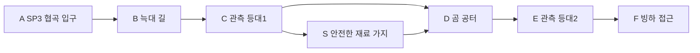

# 에픽2 Frozen Vale · 스토리3 얼음늑대 협곡

문서 묶음 v0.24 · 2026-10-27, America/Toronto · 상태: 신규 상세 시나리오 제안, 구현 전

[에픽2 전체 줄거리·공통 계약](epic-02-frozen-vale-story.md) · [맵 제작안](frozen-vale-map-design.md) · [이전: 잿불 피난처](frozen-vale-story-02-ember-refuge.md) · [다음: 빙하 아래 폐허](frozen-vale-story-04-subglacial-archive.md)

## 1. 역할과 진입

지역ID FV-03, 권장Lv13~14. 직전 스토리 FV-02 완료가 서사 선행이다. 레벨은 안내값이며 XP 곡선과 함께 검증한다. 장소·대사·적 수·장치 수·보상은 초안이다.

눈보라에 밀려난 늑대와 곰이 관측길을 점유하고 있다. 두 관측 등대를 복구하면 폭풍이 자연 기후만으로 설명되지 않고 빙하 아래 봉인망에서 되돌아오는 현상임을 알게 된다. 주민을 굶주리게 하는 야수를 모두 섬멸하는 이야기가 아니라 안전한 통행권을 되찾는 임무다.

## 2. 내부 동선·공간

좁은 협곡은 이동 구간에만 쓰고 교전은 폭56stud 이상으로 넓힌다. 곰 공터는80×72stud를 시험한다. 난간 없는 얼음다리나 필수 활공은 없다. 등대는 연료 구매/화염 주문 없이 공통 상호작용으로 켠다.

입구 A는 안전 스타트 포인트 `FV-03-SP`다. 첫 시작/처음부터는 A, 이어하기는 유효 체크포인트, 리조인은 같은 실행의 안전 합류 지점을 쓴다. 적 스폰·추격·광역 공격과 분리한다.

## 3. 몬스터 배치

| 기존 TD 종 | 레벨 초안 | 솔로 수 | 배치/역할 |
| --- | --- | --- | --- |
| Ice Wolf | 13 | 6 | 협로2+2·관측소2 |
| Ice Bear | 14 | 1 | 넓은 관측소 앞 공터 |

배치는 고정 교전 단위이며 무한 소환이 아니다. 기존 TD HP/웨이브를 RPG 수치로 복사하지 않는다. Ice Elf 일반 경비는 격퇴/퇴각으로 처리할 수 있으며 중립 주민과 구분한다.

## 4. 사건과 성공 조건

| 단계 | 행동 | 결과 |
| --- | --- | --- |
| 1 | 두 관측 등대의 경비 위협 해제 | 등대별 복구 가능 |
| 2 | 등대2개 복구·폭풍 흐름 조사 | 빙하 아래 공동으로 이어진 흔적 |
| 3 | F 도착 | 스토리3 완료, 폐허 접근로 확보 |

위 필수 목표와 완료 지점/보고를 충족해야 성공한다. 선택 탐험·완벽 방어·특정 동료·속성·궁극기·Lv20 전직은 요구하지 않는다. 특정 몬스터 전멸 자체가 필수인지 여부는 위 목표의 위협 해제 범위로 한정한다.

공개할 단서: 폭풍과 오래된 봉인망의 연결. 여왕의 의도/왕좌 전쟁 전모는 아직 미공개. 대사 초안: “바람이 산에서 오는 게 아니야. 얼음 아래에서 되돌아오고 있어.”

## 5. 체크포인트·실패·보상

경비전+등대 복구를 한 단위로 저장하고 끝낸 등대는 유지한다. 미완료 전투만 초기화한다. 반복 등대 클릭으로 재료/XP를 지급하지 않는다.

처음부터 재플레이는 새 실행으로 시작하며 영구 완료·장비·레벨·개인 선택·초회 보상 기록을 지우지 않는다. 같은 파티의 진행을 혼자 초기화하지 않는다. 동일 실행이 사라진 재접속은 개인 확정 목표로 새 실행을 복구하고, 진행 중 교전 HP/효과는 복원하지 않는다.

첫 완료 Coins360·퀘스트XP185·제작 재료 묶음1개를 초안으로 둔다. 재플레이 퀘스트 보상은 Coins108·첫 퀘스트XP25%를 시험한다. 초회 장비/기록/핵/선택은 반복 지급하지 않는다. 일반 전투XP/전리품은 별도이며 반영된 고정 퀘스트XP를 수령자 레벨로 다시 환산하지 않는다.

## 6. 협동·공유 자산·검증

1~4인, 파티 전체 전투AI 상한은 인간1/2/3/4명에2/2/1/0명이다. NPC 대화 인물을 이유로 4인에 추가 전투AI를 붙이지 않는다. 회복·보호·상호작용도 참여로 인정한다. 자격 있는 현장 참여자의 공통 목표만 공유하고 미완료 선행·초회·개인 선택은 호스트 진행으로 덮어쓰지 않는다. 모든 장치는 솔로 순차 처리 가능하다.

TD 설원 맵의 석조 성벽/다리·설송·청회색 절벽·빙하·보라 포탈, 해당 몬스터 원본과 공통 목표/지도/결과 메뉴를 공유한다. 원본을 새 외형으로 재생성하지 않는다. 익명 주민/기록 소품은 기존 NPC/환경 키트 활용을 우선 조사한다. 신규 소품이 필요하면 원본 부족분만 제작한다.

검증: 곰 돌진 시 절벽 복귀, 두 등대 순차 완료, 재료 샛길 생략 완주. 공통으로 네 클래스 솔로·동료0명,1/2/4인, 체크포인트·재시작·리조인·보상 중복을 확인한다. 현재는 문서이며 실제 맵/전투 테스트 결과가 아니다.

## 반영된 성장 예산 · v0.21

초회 퀘스트XP **185**, 퀘스트Coins **360**, 필수 전투XP 예산 **240**다. 초회 총XP **425**, 처치 포함 총Coins **424**이며 선택 소비 전 유입량이다. 순서대로 진행할 때 예상 완료Lv **14**다. 반복 퀘스트XP는25% 정수 내림 **46**, 반복 퀘스트Coins는 **108**다. 처치/보스 보상은 별도 유효 참여/수령 기록을 따른다. [성장 기준표](story-progression-budget.md)의 XP곡선·필수 처치 가정·개인 지급 규칙을 함께 적용한다. 기존 퍼센트 보상 대신 고정 정수XP를 사용하며 사용자 승인으로 기획에 반영했고 런타임/실제 플레이 검증은 아직이다.
