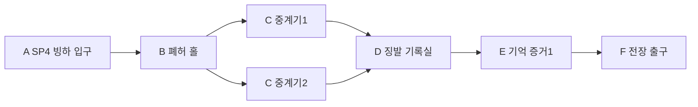

# 에픽2 Frozen Vale · 스토리4 빙하 아래 폐허

문서 묶음 v0.24 · 2026-10-27, America/Toronto · 상태: 신규 상세 시나리오 제안, 구현 전

[에픽2 전체 줄거리·공통 계약](epic-02-frozen-vale-story.md) · [맵 제작안](frozen-vale-map-design.md) · [이전: 얼음늑대 협곡](frozen-vale-story-03-wolf-ravine.md) · [다음: 침묵의 전장](frozen-vale-story-05-silent-battlefield.md)

## 1. 역할과 진입

지역ID FV-04, 권장Lv14~16. 직전 스토리 FV-03 완료가 서사 선행이다. 레벨은 안내값이며 XP 곡선과 함께 검증한다. 장소·대사·적 수·장치 수·보상은 초안이다.

빙하 아래에는 왕도 문양이 새겨진 보급 시설이 있다. 두 중계기를 안정화하고 기록실을 열면 식량만 아니라 주민의 공명과 기억을 징발한 명부가 나온다. 첫 기억은 주민들의 자발적 헌신이라는 공식 서술과 다른 강제 징발의 증거다. 경비 Ice Elf는 기억을 밖으로 내보내지 않으려 하며 격퇴 뒤 물러난다.

## 2. 내부 동선·공간

두 중계기 가지가 기록실 앞에서 합류한다. 천장은 카메라를 가리지 않게 높이고, 깨진 빙하는 이동 장애물로만 쓰며 과도한 미끄러짐을 넣지 않는다. 기록 영상은 안전실에서 재생한다.

입구 A는 안전 스타트 포인트 `FV-04-SP`다. 첫 시작/처음부터는 A, 이어하기는 유효 체크포인트, 리조인은 같은 실행의 안전 합류 지점을 쓴다. 적 스폰·추격·광역 공격과 분리한다.

## 3. 몬스터 배치

| 기존 TD 종 | 레벨 초안 | 솔로 수 | 배치/역할 |
| --- | --- | --- | --- |
| Ice Troll | 14 | 2 | 외곽 경비 |
| Ice Golem | 15 | 2 | 봉인 중계기별1 |
| Ice Elf | 15 | 2 | 기록실 경비·격퇴 후 퇴각 |

배치는 고정 교전 단위이며 무한 소환이 아니다. 기존 TD HP/웨이브를 RPG 수치로 복사하지 않는다. Ice Elf 일반 경비는 격퇴/퇴각으로 처리할 수 있으며 중립 주민과 구분한다.

## 4. 사건과 성공 조건

| 단계 | 행동 | 결과 |
| --- | --- | --- |
| 1 | 중계기2개 안정화 | 기록실 개방, 솔로 순차 가능 |
| 2 | 경비 격퇴·명부 조사 | 기억 증거1: 강제 징발 |
| 3 | F 도착 | 스토리4 완료, 침묵의 전장 위치 획득 |

위 필수 목표와 완료 지점/보고를 충족해야 성공한다. 선택 탐험·완벽 방어·특정 동료·속성·궁극기·Lv20 전직은 요구하지 않는다. 특정 몬스터 전멸 자체가 필수인지 여부는 위 목표의 위협 해제 범위로 한정한다.

공개할 단서: 기억1: 북방의 공명/기억 징발이 강제였음. 왕이 지금 깨어나는 상태는 아직 단정하지 않음. 대사 초안: “이 명부에는 물자 옆에 사람의 기억이 적혀 있어.”

## 5. 체크포인트·실패·보상

중계기별 완료·기록 증거 확인을 저장한다. 증거는 거래/소모 아이템이 아닌 영구 퀘스트 플래그이며 재도전/접속 종료로 사라지지 않는다. 기록실 전투가 미완료면 그 교전만 재설정한다.

처음부터 재플레이는 새 실행으로 시작하며 영구 완료·장비·레벨·개인 선택·초회 보상 기록을 지우지 않는다. 같은 파티의 진행을 혼자 초기화하지 않는다. 동일 실행이 사라진 재접속은 개인 확정 목표로 새 실행을 복구하고, 진행 중 교전 HP/효과는 복원하지 않는다.

첫 완료 Coins480·퀘스트XP382·기억 증거1·제작 재료 묶음1개를 초안으로 둔다. 재플레이 퀘스트 보상은 Coins144·첫 퀘스트XP25%를 시험한다. 초회 장비/기록/핵/선택은 반복 지급하지 않는다. 일반 전투XP/전리품은 별도이며 반영된 고정 퀘스트XP를 수령자 레벨로 다시 환산하지 않는다.

## 6. 협동·공유 자산·검증

1~4인, 파티 전체 전투AI 상한은 인간1/2/3/4명에2/2/1/0명이다. NPC 대화 인물을 이유로 4인에 추가 전투AI를 붙이지 않는다. 회복·보호·상호작용도 참여로 인정한다. 자격 있는 현장 참여자의 공통 목표만 공유하고 미완료 선행·초회·개인 선택은 호스트 진행으로 덮어쓰지 않는다. 모든 장치는 솔로 순차 처리 가능하다.

TD 설원 맵의 석조 성벽/다리·설송·청회색 절벽·빙하·보라 포탈, 해당 몬스터 원본과 공통 목표/지도/결과 메뉴를 공유한다. 원본을 새 외형으로 재생성하지 않는다. 익명 주민/기록 소품은 기존 NPC/환경 키트 활용을 우선 조사한다. 신규 소품이 필요하면 원본 부족분만 제작한다.

검증: Pyro/전직 없이 두 중계기 처리, 증거 중복 수령 방지, 경비와 중립 주민 식별. 공통으로 네 클래스 솔로·동료0명,1/2/4인, 체크포인트·재시작·리조인·보상 중복을 확인한다. 현재는 문서이며 실제 맵/전투 테스트 결과가 아니다.

## 반영된 성장 예산 · v0.21

초회 퀘스트XP **382**, 퀘스트Coins **480**, 필수 전투XP 예산 **224**다. 초회 총XP **606**, 처치 포함 총Coins **540**이며 선택 소비 전 유입량이다. 순서대로 진행할 때 예상 완료Lv **16**다. 반복 퀘스트XP는25% 정수 내림 **95**, 반복 퀘스트Coins는 **144**다. 처치/보스 보상은 별도 유효 참여/수령 기록을 따른다. [성장 기준표](story-progression-budget.md)의 XP곡선·필수 처치 가정·개인 지급 규칙을 함께 적용한다. 기존 퍼센트 보상 대신 고정 정수XP를 사용하며 사용자 승인으로 기획에 반영했고 런타임/실제 플레이 검증은 아직이다.
