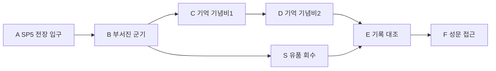

# 에픽2 Frozen Vale · 스토리5 침묵의 전장

문서 묶음 v0.24 · 2026-10-27, America/Toronto · 상태: 신규 상세 시나리오 제안, 구현 전

[에픽2 전체 줄거리·공통 계약](epic-02-frozen-vale-story.md) · [맵 제작안](frozen-vale-map-design.md) · [이전: 빙하 아래 폐허](frozen-vale-story-04-subglacial-archive.md) · [다음: 서리왕성 성문](frozen-vale-story-06-frost-citadel-gate.md)

## 1. 역할과 진입

지역ID FV-05, 권장Lv16~17. 직전 스토리 FV-04 완료가 서사 선행이다. 레벨은 안내값이며 XP 곡선과 함께 검증한다. 장소·대사·적 수·장치 수·보상은 초안이다.

얼어붙은 병사들은 새 언데드 종이 아니라 전장의 환경 조형물이다. 두 기념비의 기록을 대조하면 북방이 징발에 저항했고 그 전쟁이 역사에서 지워졌음을 알게 된다. 왕도 문양과 북방 문양이 한 전장에 남아 있다. 세렌의 이야기는 대사/기록으로 전달하며 정식 동료 편성을 강요하지 않는다.

## 2. 내부 동선·공간

전장 중앙의 얕은 지형 굴곡은 시선을 기념비로 유도한다. 필수 교전은 평탄한 바닥에서 하며 얼어붙은 병사 사이 좁은 통로로 적을 밀집시키지 않는다. S 유품 회수는 추가 대사/탐험이며 전진 조건이 아니다.

입구 A는 안전 스타트 포인트 `FV-05-SP`다. 첫 시작/처음부터는 A, 이어하기는 유효 체크포인트, 리조인은 같은 실행의 안전 합류 지점을 쓴다. 적 스폰·추격·광역 공격과 분리한다.

## 3. 몬스터 배치

| 기존 TD 종 | 레벨 초안 | 솔로 수 | 배치/역할 |
| --- | --- | --- | --- |
| Ice Wolf | 16 | 2 | 전장 외곽 |
| Ice Golem | 16 | 2 | 기념비 주변 |
| Ice Elf | 17 | 3 | 봉인 경비·격퇴 후 퇴각 |

배치는 고정 교전 단위이며 무한 소환이 아니다. 기존 TD HP/웨이브를 RPG 수치로 복사하지 않는다. Ice Elf 일반 경비는 격퇴/퇴각으로 처리할 수 있으며 중립 주민과 구분한다.

## 4. 사건과 성공 조건

| 단계 | 행동 | 결과 |
| --- | --- | --- |
| 1 | 두 기념비 주변 위협 해제·조사 | 서로 다른 전쟁 기록 확보 |
| 2 | 기록 대조 | 기억 증거2: 저항 전쟁과 역사 삭제 |
| 3 | F 도착 | 스토리5 완료, 여왕과 직접 대면할 근거 확보 |

위 필수 목표와 완료 지점/보고를 충족해야 성공한다. 선택 탐험·완벽 방어·특정 동료·속성·궁극기·Lv20 전직은 요구하지 않는다. 특정 몬스터 전멸 자체가 필수인지 여부는 위 목표의 위협 해제 범위로 한정한다.

공개할 단서: 기억2: 북방의 저항과 역사 삭제. 여왕의 동결 선택 이유는 마지막 궁전에서 공개. 대사 초안: “반란이라고 배웠던 일이, 누군가에게는 마지막 거절이었어.”

## 5. 체크포인트·실패·보상

기념비 조사와 증거2를 확정 단위로 보존한다. 전멸은 미완료 경비전만 초기화하며 회상 연출을 매번 강제하지 않는다. F에서 피난처 귀환 지름길을 해금하는 초안이다.

처음부터 재플레이는 새 실행으로 시작하며 영구 완료·장비·레벨·개인 선택·초회 보상 기록을 지우지 않는다. 같은 파티의 진행을 혼자 초기화하지 않는다. 동일 실행이 사라진 재접속은 개인 확정 목표로 새 실행을 복구하고, 진행 중 교전 HP/효과는 복원하지 않는다.

첫 완료 Coins540·퀘스트XP403·기억 증거2·현재 클래스용 무기1개를 초안으로 둔다. 재플레이 퀘스트 보상은 Coins162·첫 퀘스트XP25%를 시험한다. 초회 장비/기록/핵/선택은 반복 지급하지 않는다. 일반 전투XP/전리품은 별도이며 반영된 고정 퀘스트XP를 수령자 레벨로 다시 환산하지 않는다.

## 6. 협동·공유 자산·검증

1~4인, 파티 전체 전투AI 상한은 인간1/2/3/4명에2/2/1/0명이다. NPC 대화 인물을 이유로 4인에 추가 전투AI를 붙이지 않는다. 회복·보호·상호작용도 참여로 인정한다. 자격 있는 현장 참여자의 공통 목표만 공유하고 미완료 선행·초회·개인 선택은 호스트 진행으로 덮어쓰지 않는다. 모든 장치는 솔로 순차 처리 가능하다.

TD 설원 맵의 석조 성벽/다리·설송·청회색 절벽·빙하·보라 포탈, 해당 몬스터 원본과 공통 목표/지도/결과 메뉴를 공유한다. 원본을 새 외형으로 재생성하지 않는다. 익명 주민/기록 소품은 기존 NPC/환경 키트 활용을 우선 조사한다. 신규 소품이 필요하면 원본 부족분만 제작한다.

검증: 선택 유품 미회수 진행, 세렌/셀레네 없이 기록 이해, 기념비 중간 재접속. 공통으로 네 클래스 솔로·동료0명,1/2/4인, 체크포인트·재시작·리조인·보상 중복을 확인한다. 현재는 문서이며 실제 맵/전투 테스트 결과가 아니다.

## 반영된 성장 예산 · v0.21

초회 퀘스트XP **403**, 퀘스트Coins **540**, 필수 전투XP 예산 **286**다. 초회 총XP **689**, 처치 포함 총Coins **617**이며 선택 소비 전 유입량이다. 순서대로 진행할 때 예상 완료Lv **17**다. 반복 퀘스트XP는25% 정수 내림 **100**, 반복 퀘스트Coins는 **162**다. 처치/보스 보상은 별도 유효 참여/수령 기록을 따른다. [성장 기준표](story-progression-budget.md)의 XP곡선·필수 처치 가정·개인 지급 규칙을 함께 적용한다. 기존 퍼센트 보상 대신 고정 정수XP를 사용하며 사용자 승인으로 기획에 반영했고 런타임/실제 플레이 검증은 아직이다.
