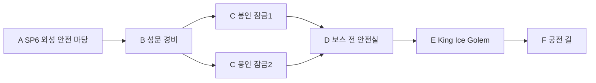

# 에픽2 Frozen Vale · 스토리6 서리왕성 성문

문서 묶음 v0.24 · 2026-10-27, America/Toronto · 상태: 신규 상세 시나리오 제안, 구현 전

[에픽2 전체 줄거리·공통 계약](epic-02-frozen-vale-story.md) · [맵 제작안](frozen-vale-map-design.md) · [이전: 침묵의 전장](frozen-vale-story-05-silent-battlefield.md) · [다음: 얼음거울 궁전](frozen-vale-story-07-ice-mirror-palace.md)

## 1. 역할과 진입

지역ID FV-06, 권장Lv17~19. 직전 스토리 FV-05 완료가 서사 선행이다. 레벨은 안내값이며 XP 곡선과 함께 검증한다. 장소·대사·적 수·장치 수·보상은 초안이다.

왕성의 골렘은 기억 반출을 막도록 옛 명령을 반복한다. 플레이어는 두 봉인 잠금을 풀어 골렘의 시험장에 들어간다. 골렘을 돌파하자 여왕은 침입자가 기록을 파괴하지 않았음을 확인하고 궁전의 문을 연다. 여왕이 완전히 설득된 것은 아니며 마지막 대면을 준비한다.

## 2. 내부 동선·공간

골렘 공터120×112stud, 외곽 엄폐와 넓은 측면 순환로를 둔다. HP100~60%에는 팔 휘두르기/내려치기,60% 아래에는 예고한 얼음 파열과 공통 상호작용으로 끊는 공명 연결을 시험한다. 몸체의 기존 외형을 유지하고 임시 연결 효과만 분리한다. 속성 약점/궁극기 사용을 승리 조건으로 삼지 않는다.

입구 A는 안전 스타트 포인트 `FV-06-SP`다. 첫 시작/처음부터는 A, 이어하기는 유효 체크포인트, 리조인은 같은 실행의 안전 합류 지점을 쓴다. 적 스폰·추격·광역 공격과 분리한다.

## 3. 몬스터 배치

| 기존 TD 종 | 레벨 초안 | 솔로 수 | 배치/역할 |
| --- | --- | --- | --- |
| Ice Golem | 18 | 2 | 외성 두 경비 |
| Ice Elf | 18 | 2 | 성문 통로 경비 |
| King Ice Golem | 19 | 1 | 필수 중간 보스 |

배치는 고정 교전 단위이며 무한 소환이 아니다. 기존 TD HP/웨이브를 RPG 수치로 복사하지 않는다. Ice Elf 일반 경비는 격퇴/퇴각으로 처리할 수 있으며 중립 주민과 구분한다.

## 4. 사건과 성공 조건

| 단계 | 행동 | 결과 |
| --- | --- | --- |
| 1 | 외성 경비 격퇴·잠금2개 해제 | 보스 전 안전실 활성 |
| 2 | King Ice Golem 격파 | 성문 통행 기록 확정 |
| 3 | F 도착 | 스토리6 완료, 궁전 진입 자격 |

위 필수 목표와 완료 지점/보고를 충족해야 성공한다. 선택 탐험·완벽 방어·특정 동료·속성·궁극기·Lv20 전직은 요구하지 않는다. 특정 몬스터 전멸 자체가 필수인지 여부는 위 목표의 위협 해제 범위로 한정한다.

공개할 단서: 여왕은 기억을 지키는 수호자이며 대화를 위해 마지막 방어를 시험함. 대사 초안: “기록을 지우러 온 것이 아니라면, 안으로 들어와 증명하라.”

## 5. 체크포인트·실패·보상

외성 잠금 완료와 보스 전 체크포인트를 저장한다. 전멸 시 보스HP·임시 연결·효과만 초기화한다. 처치 확정 뒤 끊겨도 F 통행부터 이어가며 재처치를 강제하지 않는다.

처음부터 재플레이는 새 실행으로 시작하며 영구 완료·장비·레벨·개인 선택·초회 보상 기록을 지우지 않는다. 같은 파티의 진행을 혼자 초기화하지 않는다. 동일 실행이 사라진 재접속은 개인 확정 목표로 새 실행을 복구하고, 진행 중 교전 HP/효과는 복원하지 않는다.

첫 완료 Coins680·퀘스트XP500·성문 통행 기록·방어구1개를 초안으로 둔다. 재플레이 퀘스트 보상은 Coins204·첫 퀘스트XP25%를 시험한다. 초회 장비/기록/핵/선택은 반복 지급하지 않는다. 일반 전투XP/전리품은 별도이며 반영된 고정 퀘스트XP를 수령자 레벨로 다시 환산하지 않는다.

King Ice Golem의 보스 전리품은 처치 확정 시 별도 기록한다. RPG용 인장 종류/수량/제작 처방은 아직 확정하지 않으며 퀘스트 보상과 중복하지 않는다.

## 6. 협동·공유 자산·검증

1~4인, 파티 전체 전투AI 상한은 인간1/2/3/4명에2/2/1/0명이다. NPC 대화 인물을 이유로 4인에 추가 전투AI를 붙이지 않는다. 회복·보호·상호작용도 참여로 인정한다. 자격 있는 현장 참여자의 공통 목표만 공유하고 미완료 선행·초회·개인 선택은 호스트 진행으로 덮어쓰지 않는다. 모든 장치는 솔로 순차 처리 가능하다.

TD 설원 맵의 석조 성벽/다리·설송·청회색 절벽·빙하·보라 포탈, 해당 몬스터 원본과 공통 목표/지도/결과 메뉴를 공유한다. 원본을 새 외형으로 재생성하지 않는다. 익명 주민/기록 소품은 기존 NPC/환경 키트 활용을 우선 조사한다. 신규 소품이 필요하면 원본 부족분만 제작한다.

검증: 골렘 보스 중 리조인 대기, HP 입퇴장 악용 방지, 처치 후 출구 재개. 공통으로 네 클래스 솔로·동료0명,1/2/4인, 체크포인트·재시작·리조인·보상 중복을 확인한다. 현재는 문서이며 실제 맵/전투 테스트 결과가 아니다.

## 반영된 성장 예산 · v0.21

초회 퀘스트XP **500**, 퀘스트Coins **680**, 필수 전투XP 예산 **406**다. 초회 총XP **906**, 처치 포함 총Coins **848**이며 선택 소비 전 유입량이다. 순서대로 진행할 때 예상 완료Lv **19**다. 반복 퀘스트XP는25% 정수 내림 **125**, 반복 퀘스트Coins는 **204**다. 처치/보스 보상은 별도 유효 참여/수령 기록을 따른다. [성장 기준표](story-progression-budget.md)의 XP곡선·필수 처치 가정·개인 지급 규칙을 함께 적용한다. 기존 퍼센트 보상 대신 고정 정수XP를 사용하며 사용자 승인으로 기획에 반영했고 런타임/실제 플레이 검증은 아직이다.
