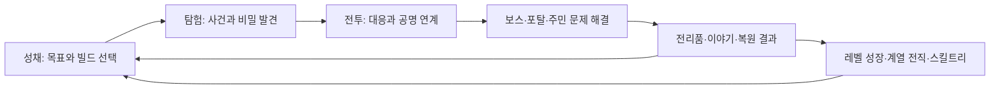

# The Last Throne — Roblox 액션 RPG 개발 기획안

문서 버전: 0.25 · 갱신일: 2026-10-28, America/Toronto  
게임명: **The Last Throne** · 한국어명: **최후의 왕좌**  
기획 기반: [현재 통합 제안서](../the-last-throne-rpg-proposal.md) · [기획 결정](decisions.md) · [Throne Defense](../../throne-defense/GOAL.md)

> **한 줄 정의:** 네 플레이어 클래스 중 하나로 성장하고, 두 전직 계열 중 하나를 완성하며, 동료와 포탈을 돌파해 왕좌에 묶인 세계를 해방하는 1~4인 협동 액션 RPG.

이 문서는 제품 전체의 제작 기준안이다. 사용자 결정·채택한 연동 방향·설계 초안·미정 항목은 [기획 결정표](decisions.md)에서 구분한다. 실제 전투 수치·상위 직업명·콘텐츠 시간·공개 범위는 검증할 기획 제안이며, 현재 단계는 기획이다. 전체 서사와 인물은 [통합 제안서](../the-last-throne-rpg-proposal.md)를 따른다.

관련 상세 문서:

- [Deepwood 지역·동선·몬스터 배치](deepwood-region-design.md)
- [동료·성녀NPC·전술 지원](companions-and-support.md)

- [클래스별 두 전직 계열·스킬트리](class-advancement-and-skill-trees.md)
- [기사 전투 상세 명세·첫 전투 실험실](knight-combat-spec.md)
- [마법 학파·속성 분류·추가 학습](magic-schools-and-learning.md)
- [Throne Defense 공유 자산 활용안](shared-universe-and-assets.md)
- [같은 Experience·Place 이동·Diamonds 공통 지갑](experience-integration.md)
- [제작 로드맵·우선 작업·품질 검증](production-roadmap.md)

## 1. 최고의 액션 RPG를 위한 제품 약속

목표는 **직접 싸우는 순간의 재미, 성장 방식의 선택, 세계에 대한 애착, 친구와 함께한 공략**이 모두 기억에 남는 Roblox 액션 RPG다. 콘텐츠 개수나 무한한 전투력으로 품질을 대신하지 않는다.

| 품질 기둥 | 플레이어가 느낄 경험 | 제작 판단 기준 |
| --- | --- | --- |
| 읽고 대응하는 전투 | “이번에는 내가 피하고 반격했다” | 공격 예고·판정·피격 이유가 일치하고, 장비가 부족해도 학습으로 개선됨 |
| 클래스와 전직 계열의 정체성 | “같은 기사라도 내 전투는 다르다” | 두 계열이 공격 리듬·자원·기술·외형에서 구별됨 |
| 함께 만드는 공명 연계 | “친구가 열어 준 기회를 내가 완성했다” | 역할 기여가 보이고, 특정 직업이 없다고 일반 모험이 막히지 않음 |
| 돌아갈 이유가 있는 세계 | “내가 구한 사람들이 여기 살아 있다” | 주민·동료·거점 변화가 퀘스트 이후에도 남음 |
| 납득할 수 있는 성장 | “다음에는 이 장비와 기술을 완성하겠다” | 목표 획득 경로, 확정 제작, 무료 빌드 실험이 제공됨 |
| 신뢰할 수 있는 운영 | “다시 접속해도 내 모험이 남아 있다” | 보상·진행·장비·구매가 중복 요청과 서버 이동에서도 보존됨 |

차별화의 중심은 **계열 전직 액션 + 공명 연계 + 영웅이 직접 뛰는 왕좌 수호전 + 복원되는 성채**다. 기존 타워디펜스의 매 전투 배치·강화 루프를 일반 사냥에 반복하지 않는다. RPG에서는 플레이어의 이동·공격·방어 판단이 전투를 주도한다.

## 2. 제품 범위와 결정 상태

| 항목 | 제작 기준안 |
| --- | --- |
| 플랫폼 | Roblox 확정. PC·터치를 전투 제작 시작부터 함께 검증하고 게임패드 지원을 통합 단계에서 완료 |
| Roblox 구성 | Throne Defense와 같은 Experience, RPG는 별도 Place·별도 개발 소스 |
| 진입·연동 | 기존 TD 시작 Place 유지, 양쪽 거점의 포탈로 왕복. 공통 허브는 후속 동선 결정 |
| 공통 계정 요소 | Diamonds 지갑·연동 업적·공통 외형·공동 이벤트 수령 기록 |
| 장르·카메라 | 스토리 중심 협동 액션 RPG, 3인칭 자유 시점·선택형 표적 고정 |
| 모험 인원 | 솔로~4인. 친구를 기다리지 않고 출발 가능 |
| 클래스 | Knight / Elf Archer / Dwarf Axe Thrower / Mage의4종. 성녀는NPC/지원 동료 |
| 전직 | 최초 클래스 고정. 클래스마다 정확히 두 전직 계열. Lv20 선택 → Lv40 2차 → Lv60 3차 → Lv80 4차·각성 |
| 마법 학습 | 비전/바람+기초 물 입문 →20 Pyro/Cryo →40 Pyro 대지/Cryo 번개 →60 광역 →80 최강 주문 |
| 성장 | 캐릭터 Lv1~80. 만렙 뒤에는 빌드·숙련·외형·기록 중심 |
| 세계 | 왕도 1곳 + 네 기존 테마의 지역 + 신규 부유 도시 + 최종 지역 = 주요 공간 7곳 |
| 본편 | 프롤로그 + 8장 + 에필로그. 첫 완주 25~35시간은 검증할 목표 |
| 전체 경험 | 동료·탐험·생활을 포함해 고유 경험 50~70시간 목표. 반복 사냥 시간을 포함해 부풀리지 않음 |
| 세션 길이 | 발견 5~10분, 원정 15~25분, 던전 30~45분, 레이드 45~60분 목표 |
| 완성상 | 4클래스·8전직 계열, 주요 던전 6개, 레이드 3개, 균열 원정·왕좌 수호전·동료·생활·길드 |
| 수익 모델 | 기본 무료 플레이, 스탯/스킬 리셋권·실제 성능 장비 확정 판매와 외형·장식·감정 표현 병행. 가격/성능/실상품은 검증 전 |

핵심 결정은 클래스 고정, 클래스마다 두 전직 계열,20/40/60/80 성장, RPG 직업을 우선하는 자산 활용이다. 기사·엘프·드워프의 계열명과 강철기사의 단계별 명칭, 마법사의 단계별 학습, Crusader의 성기사 분류는 사용자 결정을 따른다.

성녀 지원 기술/AI, 다른 계열의 상위 명칭, 기술·노드·포인트 예산과 전투/콘텐츠 수치는 설계 초안이다. 같은 클래스 안의 계열 재선택과 스킬 리셋권 기반 트리 재분배도 현재 제안이며, 다른 클래스로의 전직은 허용하지 않는다. 캐릭터 슬롯·RPG 캐릭터 간 기록 공유·출시 범위는 별도 결정한다. 상태별 목록과 용어는 [기획 결정표](decisions.md), 변경 과정은 [이력](CHANGELOG.md)에 모은다.

## 3. 플레이어와 첫 경험

대상은 판타지 모험·직접 전투·협동을 좋아하는 Roblox 이용자다. 짧게 접속하는 이용자는 원정 하나를, 오래 즐기는 이용자는 이야기와 던전을 이어갈 수 있어야 한다. 2026-10-28 사용자 지시에 따라 개발 문서는 한국어, 게임 UI·대사·퀘스트·이름/설명·상품/오류·음성/자막은 영어(en-US)로 제작한다. 텍스트·UI·음성을 분리하고 영어 문자열 키/용어집/분기 검수를 적용한다. 타깃 연령과 콘텐츠 성숙도는 실제 표현물을 기준으로 출시 전에 확정한다.

캐릭터 생성 전 네 클래스를 짧게 체험하고, 클래스 고정과 두 전직 계열을 미리 볼 수 있게 한다. 외형 꾸미기를 길게 하지 않아도 기본 외형으로 바로 모험을 시작할 수 있다. 생성 후 캐릭터의 원형 클래스는 유지된다.

| 시작 후 목표 시간 | 플레이 장면 | 자연스럽게 배우는 행동 |
| --- | --- | --- |
| 0~2분 | 서약식으로 가는 길에서 무너진 수레와 주민 발견 | 이동·카메라·상호작용·첫 기본 공격 |
| 2~5분 | 포탈에서 나타난 고블린과 작은 전투 | 표적 선택·액티브 1개·회피, 한 번에 한 안내 |
| 5~10분 | 민가 구조와 성문 고블린 순차 교전 | 기본 공격 예고·방어·회피 복습·무료 체크포인트 재도전 |
| 10~15분 | 주민이 돌아온 성채, 첫 장비 선택 | 구조 결과·장비 효과 비교·저장 확인 |
| 15~25분 | 숲의 첫 정찰 원정과 귀환 | 비밀길·지원 적 우선 처치·동료 연계·다음 목표 |

첫 원정 종료 시 “새 공격을 써 봤다”, “공격을 보고 피했다”, “구한 사람을 다시 만났다”, “다음 목표를 안다”가 모두 성립해야 한다. 20레벨 전직의 긴 설명이나 유료 상점을 첫 전투 앞에 배치하지 않는다.

## 4. 플레이 루프와 세션

- 순간 루프: 적의 의도 파악 → 공격/회피/방어 → 기회 생성 → 기술 연계 → 다음 위험 대응.
- 원정 루프: 목적 선택 → 길과 사건 발견 → 강적 공략 → 확정 보상 → 귀환과 변화 확인.
- 장기 루프: 클래스 숙련 → 계열 전직 → 장비·스킬 조합 완성 → 더 어려운 협동 도전 → 성채와 세계 기록 확장.

전투 2~4분 사이에 탐색·짧은 대화·보상 선택을 섞는다. 매번 적 수십 마리를 요구하는 퀘스트를 기본 단위로 삼지 않는다. 보스 전에는 준비 공간과 짧은 재도전 경로를 둔다. 원정 중 안전 지점에서 진행을 저장하며, 보스 도중에는 개인 일시정지 대신 이탈·재접속 규칙을 사용한다.

## 5. 세계관과 Throne Defense의 관계

공유하는 정체성은 **수정 왕좌·보라 포탈·TD의 다섯 영웅/팩션·숲/설원/화산/묘지·종족별 무기와 색**이다. RPG 플레이어는4클래스이며 성녀의 기억/영혼·교단 문화는NPC/지원 역할로 이어받는다. RPG는 같은 세계의 다른 전선에서 왕좌의 역사를 발견하는 이야기로 제안한다. 정확한 연대와 기존 TD 전투의 시간적 관계는 세계관 설정집에서 확정한다.

기존 TD의 왕좌 수호 목적은 그 당시 인물이 아는 진실로 존중한다. RPG에서 드러나는 왕좌의 부작용과 아우렐리안의 비밀은 **새 이야기의 제안**이며 TD 제품 설정을 소급 변경한 사실로 취급하지 않는다.

대륙 에테리아의 다섯 문명은 서약·생명·물질·지식·기억의 공명을 다룬다. 700년 전 첫 균열에서 아우렐리안과 다섯 수호자가 왕좌를 만들었으나, 중앙에 힘을 모은 봉인은 점차 영혼과 기억을 소모하게 됐다. 왕은 안전을 위해 모든 생명을 하나의 의지로 묶으려 한다. 플레이어는 견습 수호자로 시작해 **한 사람의 희생 대신 책임을 나누는 새로운 서약망**을 만든다.

포탈은 침공·고대 이동·불안정한 균열의 세 용도를 가진다. 외형에는 공통 원형 문양을 쓰고, 실루엣·문양·소리·상호작용 문구로 용도를 구분한다. 안전한 포탈과 공격 포탈을 보라색의 밝기 차이만으로 구별하지 않는다.

## 6. 전체 서사와 지역 제작 구조

| 구간·권장 레벨 제안 | 주요 공간·목표 | 플레이의 변화·주요 적 | 세계에 남는 결과 |
| --- | --- | --- | --- |
| 프롤로그·1~5 | Dawnspire 서약식과 성문 구조 | 고블린 순차 대응·회피, 세렌의 지휘 | 구조 주민이 성채로 돌아옴 |
| 1장·5~12 | Deepwood 검은 뿌리와 봉인핵 | 고블린·슬라임·오크·오우거, King Shaman | 엘프 성역/난민 지원 선택과 첫 진실 |
| 2장·12~20 | Frozen Vale 왕의 기억 복원 | Ice Wolf·Ice Golem, Queen Ice Elf | 북방 교역·기억 공개, 첫 전직 서약 |
| 3장·20~30 | Ember Caldera 대체 열원 가동 | 용암 수로·장갑 파괴, Inferno Overlord | 드워프 작업장과 제작 복원 |
| 4장·30~40 | Haunted Graveyard 잃어버린 이름 | 언데드·정화, Death Knight·Lich Sovereign | 망자의 안식·왕좌 원본 기록 확보·2차 전직 서약 |
| 5장·40~50 | Aether Spire 공동 제어 규칙 | 중력·기억 퍼즐, The First Warden | 서약망 설계 확보 |
| 6장·50~60 | 갈라진 성채의 대피와 장치 차단 | 다중 목표·루칸전 | 비상 통치 종료·루칸 후일담 선택·3차 전직 서약 |
| 7장·60~70 | 다섯 깃발의 호송·왕좌 수호 | 지휘 지원·포탈 차단, Dread Commander | 과거 구조와 동료 선택이 전선 지원으로 돌아옴 |
| 8장·70~80 | The Fractured Crown 원형 왕좌 | 지역 기믹 통합·영원의 왕 3단계 | 공명 독점 해제·리라 해방·4차 각성 서약 완성 |
| 에필로그·80 | 새로운 협약의 운영 형태 선택 | 다섯 의회/열린 왕관/자유 수호자 | 개인 거점·대사·기념물이 바뀜, 성능 보상 동일 |

첫 제작·전투 검증 맵과 첫 본격 필드는 **Deepwood**다. TD의 실제 맵/자산을 참고해 작은 기사 전투 공터부터 만들고 지역 탐험·제단 던전으로 확장한다. Dawnspire 프롤로그의 서사상 순서와 제작 순서는 구분한다. 구체적인 원본 확인과 전환 기준은 [Deepwood 적용](shared-universe-and-assets.md#12-deepwood-첫-제작-맵-적용)을 따른다.

위 레벨은 정상적인 메인 진행으로 도달하도록 설계한다. 전직을 위해 반복 사냥을 강제하지 않는다. 각성 서약은 8장 최종 보스 직전 수행할 수 있게 하며 에필로그나 레이드 클리어로 잠그지 않는다. 최종전 초회에도 완성된 클래스의 손맛을 경험한다.

Lv80까지의 성장과4단계 전직은 같은 모험의 자연스러운 진행에 배치한다. 레벨 숫자를 이유로 필요 XP와 플레이 시간을 과도하게 늘리지 않는다. 본편25~35시간 목표를 유지하면서 장별 퀘스트·전투 보상으로 전직 레벨에 자연스럽게 도달하는지 검증한다.

각 장은 도입 사건 → 지역 주민과 생활권 → 문제 조사 → 중간 반전 → 고유 던전/보스 → 선택과 귀환의 리듬을 갖는다. 전체 장 수를 먼저 확보한 뒤 동일한 처치 퀘스트로 채우지 않는다. 각 지역에는 다음 제작 단위를 둔다.

- 중심 거점 1곳, 서로 다른 탐험 구역 3곳, 기억에 남는 랜드마크 1곳 이상.
- 주민 연속 이야기 2개, 표식 없이 발견하는 사건 3개를 초기 설계 예산으로 설정.
- 지역마다 이동/환경 규칙 1개와 이를 보스전에 재사용하는 학습 경로.
- 공통 아트 키트, 퀘스트 상태표, 개인 세계 변화표, 솔로/협동 동선과 체크포인트.

신규 부유 도시와 최종 지역의 몬스터는 별도 제작이 필요하다. 네 기존 테마의 몬스터를 단순 재색칠해 전부 충당한 것으로 계산하지 않는다.

## 7. 탐험과 퀘스트

숲은 나무 위와 뿌리 아래의 연결, 설원은 피난처와 기억, 화산은 노동 시설과 수로, 묘지는 현실과 영혼의 중첩, 부유 도시는 중력과 시간의 흔적을 중심으로 탐험한다. 기본 이동 → 짧은 공명 도약 → 활공 → 지역 이동망 순으로 이동 선택을 늘린다. 이동 능력은 클래스와 무관하게 본편에서 얻는다.

발견 보상은 장비·제작법·단축로·기억 기록·동료 대화·경관·외형으로 분산한다. 비밀 장소마다 같은 상자를 놓지 않는다. 필수 동선에 난해한 퍼즐을 연속 배치하지 않고 힌트 강도를 선택하게 한다.

퀘스트 데이터에는 `questId`, 선행 조건, 단계, 완료 사건, 보상 묶음, 체크포인트, 세계 변화, 파티 진행 규칙, 복구 규칙을 둔다. “도착”, “보스 처치”, “보상 확정”은 서로 다른 상태다. 대사 스킵이나 재접속으로 필수 아이템이 빠지지 않아야 한다.

### Deepwood 지역 구성

첫 지역의 주동선은 **고블린 숲길 → 무너진 수레 공터 → 거목 전초기지 → 버려진 감시탑 → 오크 점령지 → 오염된 뿌리숲 → 검은 뿌리의 제단**이다. 외곽 숲길·점령 유적·깊은 뿌리숲3탐험권역과 거점1곳·첫 제단 던전으로 구성한다.

필수 보스는 Orc Warlord와 King Shaman이다. Goblin King의 야영지·King Ogre의 폭포 아래 동굴/채석장·Enraged Warlord의 붉은 전쟁터는 선택 탐험으로 배치한다. 선택 보스를 건너뛰어도 다음 장에 진입하며, 지역10종 몬스터와 난민/정령 구조·봉인 자원 선택을 연결한다. 세부 지명/배치·선행/보상·레벨은 [Deepwood 지역 설계](deepwood-region-design.md)의 제작 기준안으로 관리한다.

## 8. 네 클래스·두 전직 계열·레벨별 성장

캐릭터의 원형 클래스는 고정되며 전직은 같은 클래스 안에서만 이루어진다. ‘전직 계열’은 직업의 성장 방향, ‘마법 속성’은 주문의 성질이다. 학습하는 원소가 늘어도 전직 계열이나 클래스가 자동으로 바뀌지 않는다.

| 클래스 | 전직 계열 A | 전직 계열 B | 상태 |
| --- | --- | --- | --- |
| 기사 | 강철기사 | 성기사 | 사용자 결정 |
| 엘프 궁수 | 명궁 | 마법궁수 | 사용자 결정 |
| 드워프 | 강철 | 화약 | 사용자 결정 |
| 마법사 | Pyro 화염술사 | Cryo 냉기술사 | 사용자 성장 방향 반영 |

강철기사의 확정 계보는 **기사 →20 강철기사 →40 중갑기사 →60 철벽기사 →80 강철의 수호자**다. 성녀의NPC 전환으로 플레이어는4클래스·8전직 계열이며, NPC 지원 기술/AI 제작량은 플레이어 예산과 별도다. 다른 경로의 단계별 명칭은 [클래스 설계](class-advancement-and-skill-trees.md)의 가칭이다. 명궁은 속사·저격·약점 공략, 마법궁수는 활을 매개로 한 속성·자연·정령 마법을 사용한다.

RPG 직업과 무기 운용을 먼저 설계하고 적합한 TD 자산을 활용한다. 모델이나 타워 이름을 전직 단계에 맞출 의무는 없으며, 필요한 몸체·무기·모션은 신규 제작한다.

### 마법사의 추가 마법 학습

초반의 비전술사/바람술사는 같은 Mage 클래스 안의 입문 호칭·훈련 방식이며, 기초 물 마법도 공용으로 배운다. 어느 방식으로 입문해도20레벨에 Pyro/Cryo를 선택할 수 있다. 전직 후에도 물·바람·비전 기초를 유지한다.

| 레벨 | Pyro 성장 | Cryo 성장 |
| --- | --- | --- |
| 20 | 화염 주력 주문: 불씨창 | 빙결 주력 주문: 서리창 |
| 40 | 대지 마법: 대지융기 | 번개 마법: 연쇄번개 |
| 60 | 화염+대지 광역: 용암분출 | 빙결+번개 광역: 빙뢰폭풍 |
| 80 | 최강 궁극기: 화산의 심판 | 최강 궁극기: 영원의 빙뢰 |

주문명은 가칭이다. 마법사의 공통3개·전직별3개 안에서 학습 순서를 다시 구성해 전체 기본 액티브36개·궁극기12개 예산을 유지한다. 액티브는 첫 전직 전 최대3개, 첫 전직 완료 후 최대5개를 장착하며 궁극기의 슬롯 구성은 미정이다. 추가 원소/광역/최강 주문은 현재 경로와 레벨 자격을 요구한다.60레벨은 대표적인 대규모 광역 주문의 해금 시점이고, 초반 작은 범위 타격까지 막지는 않는다.

마법 분류는 원소/비전 학파→속성→기술 형태를 유지한다. 공간·금속·중력·시간·환영 등은 후속 후보이다. 학습·스킬트리·자산·저장 규칙은 [상세 마법 분류](magic-schools-and-learning.md)를 따른다.

전직은 레벨만 올려 자동 이름 변경하지 않는다. 레벨 도달 → 전직 안내 → 짧은 계열 체험 → 클래스 전용 서약 시험 → 기술·스킬트리·외형 변화 확인으로 진행한다. 실패 비용과 유료 건너뛰기는 없다. 필수 회피·기본 방어·솔로 공격을 특정 계열 전직 뒤에 잠그지 않는다.

네 클래스 모두 솔로 피해·생존·우두머리 대응 수단을 가진다. 성녀는NPC/선택형 지원 동료이며 플레이어 생성·전직·스킬트리에서 제외한다. 성녀 없이도 본편을 완주할 수 있고 강철기사·성기사도 검·방패의 공격/반격으로 혼자 공략한다. 클래스별 기술·전직 시험·스킬트리 규칙은 [상세 설계](class-advancement-and-skill-trees.md)를 따른다.

### 기본 스탯 성장

**힘 STR·민첩 DEX·지력 INT·체력 VIT의4종 기본 스탯을 적용한다.** 레벨·전직·스킬트리·장비와 함께 캐릭터를 성장시키며, 공격력·방어력·공격속도·치명타 등 전투 능력치는 스탯과 장비/트리를 조합해 계산한다. 체력 VIT와 생명력 HP는 구분한다.

힘은 근접 물리, 민첩은 정밀 무기·치명타/공격속도, 지력은 마법·마법 기반 보호/회복과 MP 사용 시 최대 MP, 체력은 최대 HP·방어 보조에 기여하는 초안이다. 성기사·마법궁수 등 혼합 계열은 두 주 스탯을 모두 올려야 기본 전투가 가능한 구조를 피한다.

스탯 포인트는 **Lv2~80에 레벨업마다4포인트, 총316포인트**를 지급하고 힘·민첩·지력·체력에 자유롭게 배분한다. Lv1은 기본 능력치로 시작하며, 한 번 받은4포인트를 한 스탯에 모두 투자할 수도 있다. 기존 스킬트리79P와 별도 예산이다. 추천 배분·적용 전 능력치 미리보기·거점 리셋권 기반 재분배는 초안이며, 기본 스탯 초기값·계수·스탯별 상한은 미정이다. 상세 효과·계열별 활용·자원 관계·저장/검증은 [기본 스탯 설계](character-stats.md)를 따른다.

## 9. 액션 전투의 기준

### 9.1 조작과 판정

공통 액션은 공격·블록·회피·스프린트다. 영웅별 스킬은 별도로 배우고 전투용으로 첫 전직 전 최대3개, 첫 전직 완료 후 최대5개를 장착한다. 궁극기 구성은 미정이다. 근접은 방향과 공격 연계, 원거리는 시야·조준·거리 확보를 중심으로 설계한다. 기본 공격 홀드 옵션은 반복 입력을 완화하며, 전체 전투 자동 진행은 넣지 않는다.

| 요소 | 초기 전투 프로토타입 값·규칙 | 검증 목적 |
| --- | --- | --- |
| 입력 버퍼 | 0.12초 시작값, 기기·지연 조건에서 조정 | 연계 입력이 먹지 않는 느낌 감소 |
| 회피 | 무적 0.20초, 이동/회복 포함 총 0.65초 시작값 | 위험을 보고 사용해야 하며 연속 무적으로 버티지 못함 |
| 스태미나 | 물리 스킬에 사용, 공통 액션에는 미사용 | 기사·궁수·드워프의 물리 스킬 자원과 개별 쿨다운 |
| 일반 강공격 예고 | 0.7~1.0초, 큰 보스 공격 1.0~1.5초 시작값 | 30FPS·터치·일반 네트워크에서 인지와 대응 가능 |
| 완벽 방어 | 기사 기준 유효창0.15초 시작값 | 필수 생존과 분리된 숙련 보상 |
| 피격 반응 | 피해 방향·짧은 음향·자세 반응·위험 표시 | 피해 숫자를 읽지 않아도 원인을 알 수 있음 |
| 타격 정지 | 조작 캐릭터의 짧은 시각 연출만 적용 | 다른 플레이어와 서버 시뮬레이션을 정지시키지 않음 |

이 숫자는 밸런스 확정값이 아니다. 무적이 허용되지 않는 공격은 문양과 음향으로 미리 구분하고 이동/엄폐 등 대안을 제공한다. 피해는 시각 메시의 모서리가 아니라 기술별 판정체로 처리하며, 무기 궤적·공격 범위·판정 시간이 서로 맞아야 한다. 벽 너머 공격과 화면 밖 즉사 패턴은 금지한다.

기사의3연격·방패/회피·반격 기회·9액티브/3궁극기·표식/보호막·실험용 적의 상세 시작값은 [기사 전투 명세](knight-combat-spec.md)에서 관리한다. 이 표의 공통 방향을 유지하며, 실제 구현/기기 검증 전 수치를 확정하지 않는다.

### 9.2 공통 자원과 상태

체력과 스킬 자원을 분리한다. 물리 스킬은 스태미나와 기술별 쿨다운, 마법은 MP와 기술별 쿨다운을 함께 사용한다. 기사 서약·엘프 집중·드워프 열기·마법사 마력의 네 플레이어 자원은 각 클래스의 두 전직 계열에서 다르게 획득·소모한다. 자원 설명은 [전직 설계](class-advancement-and-skill-trees.md)를 따른다.

주요 상태는 균형 붕괴·약점 노출·속박·화상·서리·성광 표식·보호막·정화다. 일반 적은 제어에 반응하고, 보스는 제어가 자세 피해로 전환되며 반복 제어에는 저항이 쌓인다. 무한 빙결과 무한 넘어뜨리기를 허용하지 않는다. 속성 상성은 유리한 공략을 만들되 특정 속성 전체 면역으로 한 계열의 본편 진행을 막지 않는다.

### 9.3 공명 연계

공명은 **기회 생성 → 연결 → 마무리**다. 예: 기사 반격으로 균형 붕괴 → 엘프가 약점 노출 → 드워프가 회수 도끼로 장갑 파쇄. 마법사 화상과 성기사 표식을 조합하는 공명은 별도 연계 조건으로 정의하며 타인의 표식을 임의 소비하지 않는다. 자연 속박과 빙결 장판은 적의 이동을 관리하는 대안이다. NPC 성녀의 정화/보호는 선택형 지원으로 연결하고 필수 조합으로 요구하지 않는다.

모든 조합을 필수 연계로 지정하지 않는다. 초보는 기본 상태 연결만으로 작은 이익을 얻고, 숙련자는 파티 자원과 보스 노출 시간을 맞춘다. 솔로에서도 자기 기술과 동료로 완성할 수 있다. 연계에는 보이는 재사용 대기와 보스 저항을 두어 한 조합의 영구 제압을 막는다.

## 10. 몬스터와 보스

기존 모델의 실루엣은 유지하고 RPG 행동은 새로 설계한다. 적은 대기 → 감지 → 접근/자리잡기 → 공격 예고 → 공격 확정 → 회복 → 재판단으로 움직인다. 전투에서 벗어나면 초기화하고, 파티 전멸 후 남은 장판·소환물·임시 지원도 정리한다.

| 적 역할 | 기존 자산 예 | RPG 행동과 대응 |
| --- | --- | --- |
| 측면 압박 | Goblin, Ice Wolf | 공격 전 위치를 바꿈. 회피 후 짧은 반격 틈 |
| 장갑·전선 | Orc Warrior, Ice Golem | 정면 방어·느린 강공격. 측후면과 자세 파괴에 취약 |
| 공간 점유 | Ogre, Magma Worm | 넓은 예고와 이동 통제. 무작위 즉시 타격 금지 |
| 지원 | Shaman, Volcano Shaman, Lich | 연결선·장치로 버프를 알림. 우선 처치·차단이 유효 |
| 분열·자원 압박 | Slime, Lava Slime | 분열 수와 활동 적 수에 상한. 예고 후 분열 차단 가능 |
| 돌진·매복 | Hellhound, Ghoul | 도약 방향·출발 신호, 추적 시간 제한과 회복 틈 |

### 대표 던전: 검은 뿌리의 제단

Deepwood 1장의 결전이며, 제작 초기에는 이 구간만 뽑아 15~20분의 수직 시연 구간으로 만든다. 본편 첫 20분 튜토리얼과는 별개다. 목표는 포로 구조 → 두 오염 장치 차단 → King Shaman 격파 → 봉인핵 기록 확인이다.

| 구간 | 학습·협동 | 재도전/솔로 규칙 |
| --- | --- | --- |
| 뿌리 회랑 | 고블린 측면 공격과 오크 전면 압박 | 가까운 체크포인트, 동료가 전선을 보조 |
| 오염 장치 | 주술 연결선 차단·도끼/활 등의 약점 공략 | 모든 클래스가 상호작용으로 차단 가능 |
| 포로 수용소 | 구조가 보스전 엄폐와 지원을 바꿈 | 구조하지 않아도 승리 가능, 초회 목표는 명확히 안내 |
| 제단 보스 | 기존에 배운 예고·장치·연계 결합 | 전멸 시 제단 직전 복귀, 보스HP·임시 기둥/증원 초기화, 완료한 외곽 장치 유지 |

**King Shaman 3단계 설계:**

1. HP100~70%: 지팡이 부채꼴 공격, 바닥 뿌리, 고블린 지원. 예고와 안전 방향을 학습한다.
2. HP70~35%: 주술 기둥이 보호막을 공급한다. 혼자는 순서대로 차단하고, 파티는 역할을 나눈다. 기둥 수·처리 시간은 인원에 맞춘다.
3. HP35~0%: 제단 일부가 오염되고 앞선 공격 두 개를 조합한다. 포로를 구했다면 해방된 오우거가 한 차례 장벽을 만든다. 미구조 경로에는 기본 엄폐와 충분한 안전 시간이 남는다.

승리 후 무작위 장비만 주지 않고 고유 무기 제작 재료·봉인핵 기록·귀환한 주민을 제공한다. 사망 원인에는 “뿌리 폭발에 맞음 / 주술 기둥이 활성 상태였음”처럼 다음 시도의 행동으로 연결되는 설명을 쓴다.

최종 왕의 3단계는 검과 서약 결투 → 다섯 봉인 회수 → 서약망 연결로 발전한다. “완전한 정적”에서도 동료의 발광 신호·고대 문양·자막 위험 신호가 남아야 한다. 솔로에서 서로 먼 두 지점을 동시에 밟는 기믹은 쓰지 않는다.

## 11. 동료와 타워 병력의 역할

이야기 동료는 세렌·에린·브란·이리아·셀레네 5명을 중심으로 한다. 플레이어 클래스와 NPC 개인은 별개다. 같은 클래스의 동료를 만나도 다른 플레이어 직업으로 바뀌지 않는다. 동료 이야기는 책임·복수·가문의 침묵·지식의 통제·영혼의 자유를 다룬다.

성녀 셀레네는 주요 스토리NPC·선택형AI지원 동료로 유지한다. 보호막·정화·제한 회복을 제공하고, 기존 성녀 타워6종은 교단NPC·거점 치유·수호전 지원에 활용한다. 플레이어의 성기사는 계속 기사 계열이다. 성녀의 지원 없이도 모든 클래스가 본편을 완주하고 필수 저주/장치는 공통 상호작용으로 해제할 수 있어야 한다. 자세한 능력·AI·편성은 [동료/지원 설계](companions-and-support.md)를 따른다.

일반 모험의 전투 구성은 다음을 초기안으로 둔다. 동료 미편성도 허용하며 아래 인원은 동행을 선택했을 때의 최대값이다.

| 실제 플레이어 | AI 동료 최대 | 전체 전투 인원 최대 |
| --- | --- | --- |
| 1 | 2 | 3 |
| 2 | 2, 플레이어별 최대1 | 4 |
| 3 | 1, 파티 대표 편성 | 4 |
| 4 | 0 | 4 |

이야기에 필수인 NPC는 전투 슬롯과 무관하게 대화·연출에서 등장할 수 있다. 일반4인 파티에는 성녀도 추가 전투원으로 상시 배치하지 않으며, 수호전의 성역/지원군은 별도 임무 예산을 사용한다. AI는 큰 예고를 회피하고, 무한 회복/부활을 제공하지 않으며, 연계 명령·집결·집중 공격에 반응한다. 관계 선택은 대사·외형·연계 변형을 열지만 필수 정화나 기본 회복을 잠그지 않는다.

기존 **30종 타워는 30명의 신규 주연 동료를 뜻하지 않는다.** 팩션 병력·훈련 교관·호위 NPC·수호전 지원으로 활용한다. Swordsman/Shieldbearer는 방어선, Archer/Tracker는 정찰, Mortar/Runesmith는 공성·장치, Cryomancer는 통로 제어, Blessing Priest는 전선 지원을 맡는다.

이 배치는 활용 예시이며 모든 타워를 RPG 직업이나 지원 유닛으로 반드시 변환하는 약속은 아니다. 플레이어 직업에 맞는 모델이 없으면 새로 만들고, 기존 타워의 개성이 NPC나 지원 캐릭터에 더 적합하면 그 역할을 선택한다. 몸체는 NPC에, 무기는 플레이어에 쓰는 부분 재사용도 허용한다.

## 12. 왕좌 수호전

일반 사냥과 다른 시그니처 콘텐츠다. 플레이어는 왕좌 앞에서 메뉴만 관리하지 않고 전장을 뛰며 포탈·지휘관·공성 장치를 직접 처리한다.

- 전투 전 지원 병력 3종 편성. 임무 중 획득하는 **Command Points**로 지정된 전술 지점에 요청한다.
- 포탈 차단·구조·목표 달성으로 지휘 자원을 얻는다. Coins나 유료 재화를 소모해 화력을 사지 않는다.
- 방어선 유지, 포탈 돌격, 위험한 지원 적 제거, 위기 구조의 선택을 제공한다.
- 1~4인에 맞춰 공격 방향·동시 목표 수를 바꾼다. 솔로는 동료와 지원군이 한 전선을 맡는다.
- 초기 임무는 12~15분, 3개의 전투 단계 목표. 병력 편성/지시 시간이 전체 플레이의 20%를 넘으면 조작 흐름을 개선한다.

7장의 필수 수호전과 엔드게임 반복 수호전을 분리한다. 필수전은 기본 병력만으로 클리어할 수 있고, 반복전은 적 조합·전선·지원 병력을 바꿔 전술을 확장한다.

## 13. 장비·전리품·경제

장비는 무기1·보조1·방어구4·장신구2·유물1의 9슬롯을 원안으로 유지한다. 클래스 무기와 외형 식별을 지키며 성능과 외형을 분리한다. 희귀도보다 **어떤 행동을 바꾸는가**를 먼저 보여준다.

| 장비 효과 예 | 바뀌는 플레이 | 한계와 대안 |
| --- | --- | --- |
| 반격 후 짧은 검파 | 기사 방어 성공을 공격 기회로 전환 | 상시 피해 증가와 구분, 실패 시 기본 방어는 유지 |
| 폭탄 적중 후 다음 포격 강화 | 화약 드워프가 적의 이동과 포격 타이밍을 설계 | 강화 횟수·폭발 연쇄에 상한, 무한 포격 방지 |
| 화상 적에게 마력 일부 회복 | 화염 마법사가 대상 분배를 판단 | 보스 단일 표적용 대안 효과 제공 |
| 서약 표식 유지 후 검격 보강 | 성기사가 검 표식과 공격 순서를 판단 | 자기 표식/조건만 사용, 표식이 없어도 기본 공격 가능 |

보스 고유 장비는 무작위 완제품 + 확정 재료 제작을 병행한다. 예시로 **보스당 확정 인장1개, 인장5개로 기본형 제작**을 시작값으로 둔다. 낮은 난도로 최고 난도 전용 성능을 우회하지 않도록 난도별 제작 등급과 외형 보상을 구분한다. 확정 경로의 실제 시간을 표시하며 “5회” 자체를 목표로 고집하지 않는다.

강화는 재료 확정 소비·성공 확정·파괴/하락 없음이다. 상위 장비에도 고유 효과를 계승할 수 있게 하되 모든 효과 중첩을 허용하지 않는다. 재료 파밍, 룬, 전직, 강화가 같은 공격력 증가만 중복 판매하지 않도록 역할을 분리한다.

| 자원 | 획득 | 소비 | 저장 |
| --- | --- | --- | --- |
| Diamonds | TD/RPG의 정의된 획득·구매·공동 이벤트 | 양쪽의 명시된 상품, RPG에서는 외형·꾸미기 중심 | Experience 공통 계정 지갑 |
| TD Gold | TD 전투의 기존 규칙 | TD 전투 배치·강화 | TD 매치 규칙, RPG로 환전하지 않음 |
| Coins | 퀘스트·전투·일반 전리품 정리 | 제작·재련·생활·장식 | 영속 |
| 제작 재료·보스 인장 | 지역 활동·보스 확정 보상 | 목표 장비·효과 계승 | 영속, 아이템 단위 |
| Command Points | 수호전 목표·전술 행동 | 임무 내 지원 병력 | 임무 종료 초기화 |
| Robux 상품 | Roblox 구매 | 리셋권·확정 성능 장비·외형 | 계정 아이템/권리·영수증으로 관리 |

**Diamonds는 양쪽 Place가 하나의 계정 지갑을 사용한다.** 기존 TD 잔액과 확인된 구매·수령 기록을 보존하고, 이동 때 복사·환전·추가 지급하지 않는다. TD Gold, RPG Coins, Command Points는 별개다. 기존 TD 상품의 RPG 적용은 상품별 권리표로 정의하며 기존 구매권을 없애거나 모든 효과를 자동 이전하지 않는다.

같은 공동 이벤트·일일 보상 권리는 공통 수령 키로 한 번만 지급하고, 장르별 추가 보상은 별도 권리로 명시한다. Diamonds 유입·소비는 두 장르의 플레이 시간과 수급을 함께 검토한다. 지갑 차감·지급은 서버의 공통 계약으로 처리하고 양쪽 서버의 동시 소비·결제 재시도·오래된 저장의 잔액 덮어쓰기를 막는다. 자세한 경계와 도입 순서는 [연동 설계](experience-integration.md)를 따른다.

거래소·플레이어 간 장비 거래는 아이템 공급과 복구 계약을 검증한 뒤 도입한다. 거래 출시 전까지 자동으로 거래 가능한 것으로 안내하지 않는다.

경제는 레벨 구간별 Coins 유입·필수 제작 비용·평균 귀환 잔액·재료 부족 시간을 시뮬레이션한다. 필수 전직·스토리 재도전은 무료이고 확정 스탯/스킬 배분 초기화는 판매 소모품인 리셋권을 사용한다. 안전한 기본 장비로 다음 장에 진입할 수 있어야 한다.

## 14. 솔로·협동·개인 이야기

일반 모험에 힐러·탱커 정원을 강제하지 않는다. 인원이 늘면 체력만 늘리지 않고 동시 목표·적 조합·공략 기회를 조정한다. 초기 보스 HP 배율은 플레이어 1/2/3/4명에 1.0/1.7/2.3/2.8을 시험값으로 사용하고, AI 동료의 피해·회복 기여를 포함해 실제 처치 시간으로 보정한다. 플레이어 대상 피해를 인원수대로 배수 증가시키지 않는다.

초회 감상·빠른 반복·연습·고난도 목적을 파티 찾기에서 구분한다. 입장 후 난도와 보상 규칙을 숨기지 않는다. 도중 인원 변화는 체크포인트에서 반영하며, 체력 배율 악용을 위해 보스 체력이 계속 회복/감소하지 않게 한다.

| 상황 | 진행과 보상 원칙 |
| --- | --- |
| 파티원 모두 해당 장 도달 | 각자 유효한 퀘스트 단계를 서버가 확인해 진행·보상을 기록 |
| 뒤처진 플레이어가 앞선 장 도움 | 스포일러 안내 후 참여 가능. 선행을 건너뛰거나 개인 결말을 확정하지 않음 |
| 앞선 플레이어가 친구 지원 | 지역 보정과 지원 보상. 반복 초회 보상은 지급하지 않음 |
| 중요한 선택 | 장면은 호스트 기준, 개인 선택 자격이 있는 사람만 자신의 기록에 결정 저장 |
| 연결 끊김 | 예약된 복귀 시간 동안 슬롯과 체크포인트 보존. 보상은 서버 완료 기록으로 복구 |
| 전멸 | 가까운 체크포인트에서 무료 재시도. 적·장치·임시 자원 복구 기준을 일관되게 적용 |

한 공유 서버의 전체 세계를 특정 이용자의 결말로 바꾸지 않는다. 개인 성채 구역·개인 장면·NPC 대사로 후일담을 표현하고, 공통 광장과 파티 전장은 공통 진행 상태를 사용한다.

## 15. 던전·엔드게임·생활

| 콘텐츠 | 완성상 | 목적과 보상 |
| --- | --- | --- |
| 주요 던전 | 6개: 검은 뿌리의 제단·얼음 기억궁·대용광로·이름 없는 왕릉·기억 도서관·원형 왕좌 진입로 | 지역 이야기, 고유 장비, 협동 학습 |
| 균열 원정 | 15~25분, 지역·적·환경 규칙 조합 | 다양한 빌드 활용, 목표 재료·유물 변형 |
| 왕좌 수호전 | 전선·침공·병력 조합 변주 | 영웅 액션과 팩션 전술의 결합 |
| 레이드 | 8인·3개: The Hollow Cathedral / Heart of the Caldera / The Starless Court | 공략 성취, 고유 조합·외형·칭호 |
| 수호자의 시험 | 클래스·전직 계열 숙련 시험 | 전직 후 숙련 목표와 외형 |
| 보스 추적·세계 사건 | 단서 추적과 지역 공동 목표 | 몬스터 도감·제작·복원 장식 |
| 길드 | 회관·연습 보스·공동 장식·기록 | 강제 출석보다 함께 만든 장소와 공략 |
| 생활·개인 거처 | 채광·약초·낚시·요리·제작·전리품 전시 | 탐험·준비·관계·애착 |

본편 결말은 1~4인 모험으로 완결한다. 8인 레이드에서 진짜 엔딩을 잠금 해제하지 않는다. 최고 난도 보상은 끝없는 전투력보다 고유한 선택과 성취 표현을 강화한다.

생활 버프를 반복 숙제로 만들지 않는다. 메인 진행에 필요한 기본 소모품은 지역 공급으로 확보할 수 있다. 길드장은 다른 플레이어의 전리품을 독점 배분하지 않는다. 시즌은 세계 사건·기록·외형으로 확장하며, 이전 시즌의 주요 이야기는 회상 기록에 남긴다.

결투·3대3·길드 성채전은 원안의 선택형 확장 항목으로 보존한다. PvE 품질과 경제 안정 후 별도 제작 게이트를 둔다. 대전 능력치·제어·피해 계수는 PvE와 분리하고 본편 보상에 참여를 강제하지 않는다.

## 16. 화면·조작·접근성

TD와 RPG는 **메뉴·아이콘·이미지·3D 모델과 UI 룩앤필을 최대한 공유한다.** 로비HUD/로비 메뉴/배틀HUD/배틀 메뉴는 공통 패널·버튼·아이콘·글꼴·상태 반응을 사용하고, 장르별 정보·조작·데이터를 연결한다. 같은 기능의 원본을 별도로 새로 그리거나 복사 후 독립 수정하지 않는다. [공통 UI와 룩앤필](shared-ui-and-look-and-feel.md)의 원본·토큰·화면 적용표와 [공유 레지스트리](../assets/shared/td-asset-registry.json)를 기준으로 한다. 현재 컨셉은 탐색안이며 공통 컴포넌트 보드·통일 시안·실제 연결 검증은 후속 제작이다.

HUD는 중앙의 캐릭터·적 예고·현재 목표를 우선한다. 체력·스태미나/MP·직업 자원은 가까운 한 묶음으로, 액티브3·궁극기·방어·회피는 손이 닿는 영역에 둔다. 진행 퀘스트는 전투 중 한 줄 목표를 기본으로 하고 상세 일지는 메뉴에서 읽는다.

| 행동 | PC 기본안 | 터치 기본안 | 게임패드 기본안 |
| --- | --- | --- | --- |
| 이동·카메라 | WASD·마우스 | 좌측 스틱·우측 드래그 | 좌/우 스틱 |
| 기본 공격·방어 | 마우스 좌/우 | 공격 버튼·방어 버튼 | RT·LT |
| 회피·상호작용 | Space·E | 회피·상황 버튼 | B·A |
| 액티브1/2/3·궁극기 | 1/2/3·R | 하단 3개·독립 궁극기 | X/Y/RB·LB+RB |
| 점프·표적 고정 | F·가운데 버튼 | 이동 영역 점프·표적 버튼 | 우스틱 누름·좌스틱 누름 |

키 배치는 초안이며 실제 입력 충돌과 접근성 검증 후 재설정 가능하게 제공한다. 게임패드의 이동 중 점프/조준 부담, 모바일의 방어·카메라 동시 조작을 초기에 평가한다. 동료 명령은 전투 중 매번 메뉴를 펼치지 않도록 상황 명령과 길게 누르기 메뉴를 병행한다.

모바일은 가로를 주 전투 레이아웃으로 검증하며 세로에서도 같은 기능에 접근할 수 있는 재배치안을 검증한다. 작은 화면은 글자를 일괄 축소하지 않고 정보량·행 배치·상세 펼침을 조절한다. UI 크기는 실제 화면 렌더와 터치 성공률로 판단한다.

자막·대화 기록·텍스트 크기·색 이외의 위험 문양·카메라 흔들림/플래시 감소·이펙트 축소·길게 누르기 공격·조준 보정을 제공한다. 이펙트를 줄여도 공격 예고와 위험 표식은 남는다. 클래스/전직/스킬트리에서 미리보기·장착 예정·서버 확정 상태를 구분한다.

## 17. 미술·애니메이션·음향

Throne Defense의 밝은 판타지 색과 블로키 몸체 문법을 이어받고, 근접 카메라에서 읽히는 재질·손·얼굴·관절 품질을 높인다. 기사 은청, 엘프 녹색, 드워프 갈색/주황, 마법사 속성색, NPC 성녀/교단 백금의 식별을 유지한다. 승인된 TD 캐릭터의 블로키 비례·얼굴·복장·무기 원형과 몬스터 실루엣을 공유하며, RPG라는 이유로 성인 비례나 다른 얼굴로 바꾸지 않는다. 암부와 과한 발광으로 행동을 숨기지 않는다.

전직은 적합한 공통 리그에 무기·장식·문양·동작·속성 VFX를 결합하는 방식을 우선 검토한다. 직업의 실루엣·무기 운용·조작·근접 품질에 부족하면 몸체·리그·장비·모션을 새로 제작한다. Lv20에는 계열 표식, Lv40에는 무기와 자세, Lv60에는 숙련 장비·연계 동작, Lv80에는 절제된 각성 문양과 궁극기 연출을 강화한다. 큰 날개·오라가 시야와 적 예고를 가리면 재설계한다.

이동·대기·공격 연계·회피·방어·피격·넘어짐/기상·기술·궁극기·상호작용을 리그별 애니메이션 목록으로 관리한다. 타워의 간단한 사격 애니메이션만으로 근접 액션이 완성됐다고 판단하지 않는다.

왕좌의 음악 동기는 장엄함 → 불협화음 → 다섯 문명의 합주로 변한다. 지역은 숲의 생명/오염, 설원의 고요/상실, 화산의 노동/분노, 묘지의 애도, 부유 도시의 경이를 표현한다. 타격·방어·위험·연계 성공 소리에는 서로 다른 역할을 준다. 음소거에서도 전투와 이야기를 이해할 수 있어야 한다.

## 18. Roblox 기술 구조와 데이터 신뢰

RPG의 게시 대상은 **기존 Throne Defense와 같은 Roblox Experience의 별도 Place**다. 개발 소스는 이 프로젝트로 구분하고, RPG의 소셜 성채·지역·예약 던전/레이드는 필요에 따라 Place와 서버를 나눈다. 기존 TD 시작 Place를 유지하며 TD→RPG 원정, RPG→TD 방어전 포탈을 제공한다. RPG 광장 정원20명·지역16명·원정4명·레이드8명은 시험할 초기 상한이며 TD 기존 정원 변경을 뜻하지 않는다.

공통 계정 데이터는 Diamonds·공통 업적/외형·공동 이벤트 기록, TD 전용은 TD 성장/전투 기록, RPG 전용은 캐릭터·전직·스킬트리·장비·Coins·스토리다. 같은 Experience의 Place들은 같은 DataStore에 접근할 수 있으므로 저장 이름과 쓰기 책임을 명시적으로 나눈다. 플랫폼 근거는 [Data stores](https://create.roblox.com/docs/cloud-services/data-stores)다. 공통 지갑을 각 게임의 캐릭터 저장본에 복사해 저장하지 않는다.

텔레포트 정보는 목적지·파티/원정 식별의 보조 정보로 사용하고, 잔액·아이템·보상 자격은 서버 저장 기록으로 다시 확인한다. 이동 실패·부분 파티 이동·재접속의 복구 흐름을 설계한다. Place 이동은 [TeleportService 안내](https://create.roblox.com/docs/projects/teleport)를 따르고 실제 게시된 테스트 환경의 Roblox 클라이언트에서 검증한다. 이 문서 갱신은 Place 생성·게시·운영 데이터 변경을 실행한 것이 아니다.

서버는 피해·회복·쿨다운·자원·인벤토리·전직·스킬포인트·퀘스트·전리품·구매를 확정한다. 클라이언트는 입력과 빠른 애니메이션을 예측하고 서버 결과와 맞춘다. 원격 요청에는 타입·범위·거리·상태·순서·빈도를 검증한다. 이는 Roblox의 [클라이언트/서버 경계 검증 지침](https://create.roblox.com/docs/scripting/security/client-server-boundary)을 적용한 설계다.

데이터 모델의 초기 단위는 `characterId`, 불변 `baseClassId`, 선택 `advancementPathId`, 전직 단계, 레벨/XP, 스킬 노드/랭크, 장비 인스턴스, Coins, 퀘스트 단계, 개인 선택, 세계 복원, 보상 처리 기록, 스키마 버전이다. 전직·스킬 요청은 현재 상태와 함께 원자적으로 검증하며, UI만 숨기는 방식으로 교차 전직을 막지 않는다.

저장 로드 실패를 신규 캐릭터로 덮어쓰지 않는다. 세션 소유권·버전 충돌·재시도·중복 보상 기록을 설계하고, 서버 이동 중 이전 저장이 끝나기 전 새 서버가 오래된 상태를 쓰는 상황을 검증한다. Roblox [플레이어 데이터와 구매 시스템 안내](https://create.roblox.com/docs/cloud-services/data-stores/player-data-purchasing)를 기술 근거로 사용한다. “전 구간 완전 무손실”을 문서만으로 보장하지 않고, 저장 장애 중의 진행 제한·복구 한계를 구체화한다.

지역은 스트리밍을 전제로 설계한다. [Instance streaming](https://create.roblox.com/docs/workspace/streaming)은 월드 콘텐츠를 동적으로 로드/언로드하므로, 멀리 있는 NPC·전직 제단·목표물이 클라이언트에 항상 존재한다고 가정하지 않는다. 서버 퀘스트 상태와 가까운 표현을 분리한다.

| 성능 항목 | 초기 목표·측정 방식 |
| --- | --- |
| 기준 모바일 | 실제 Android/iOS 각1기종 이상 선정, 일반·보스 전투 P95 프레임 시간33.3ms 이하 목표 |
| 기준 PC | 지정 하드웨어·해상도에서 P95 프레임 시간16.7ms 이하 목표 |
| 부하 장면 | 4인+일반 적24+보스1, 별도로 솔로+동료2와 8인 레이드 측정 |
| 네트워크 | RTT80/150/250ms·손실 조건별 입력·피격·재접속 측정, 150ms에서 핵심 패턴 학습 가능 목표 |
| 메모리 | 기준 기기에서20분 원정 반복 후 지속 증가·OOM 없이 예산 수립 |
| 로딩·재도전 | 접속→조작 가능, 지역 이동, 보스 재도전 시간을 P50/P95로 분리 기록 |

위 수치는 Roblox의 보장 사양이 아니다. 부하 수·메시·텍스처·VFX 예산은 대표 장면을 측정해 설정한다. Roblox의 [성능을 고려한 설계](https://create.roblox.com/docs/performance-optimization/design)에서도 기준 실기기 검증을 권장하며, Studio 에뮬레이터 화면 통과를 메모리·FPS 통과로 대신하지 않는다.

## 19. 공정한 수익 모델과 운영

첫 RPG 상품군은 스탯/스킬 리셋권,실제 성능이 있는 무기·방어구·액세서리와 클래스 의상/무기 외형/장식이다. Diamonds 사용 상품과 Robux 직접 구매 상품을 명시하고, 공통 외형은 게임별 표현을 연결한다. 콘텐츠와 가격이 명확한 확정 상품으로 구성한다. 전직/스킬포인트 자체·필수 스토리·전투 중 부활을 판매하지 않고 리셋권과 확정 장비는 [아이템/수익화 계획](items-and-monetization.md)을 따른다. 실제 장비 상품의 수치·등급·가격은 검증 전이다. 기존 TD 상품은 권리를 보존하며 RPG 적용 여부를 상품별로 정한다. 구매 스킨이 공격 범위나 히트박스를 바꾸거나 위험 신호를 숨기면 안 된다.

선호 외형 일부는 본편·계열 시험·보스 도전에서 획득하게 한다. 이용자가 실패한 직후에는 상점을 강제로 열지 않는다. 시즌 외형 목표는 놓쳐도 기본 성장과 결말에 손해가 없게 한다. 상품 출시 전 실제 Roblox 상품·영수증 처리·플랫폼 요구사항은 최신 문서로 별도 검증한다.

운영 지표는 첫 원정 완주·회피 이해·전직 도달/완료·두 계열 선택·스킬 재분배·보스 재도전·협동 기여·장별 이탈·저장 실패·복구 시간을 중심으로 둔다. D1/D7/D28과 매출은 실제 코호트가 생긴 뒤 기준선을 수집한다. 존재하지 않는 시장 평균이나 성공률을 목표의 근거로 제시하지 않는다.

## 20. 제작 전략과 출시 판단

전체 서사·4클래스·8전직 계열·6던전·3레이드를 완성상으로 유지한다. 첫 내부 시연 구간은 이 전체 게임을 검증하는 제작 도구다. 시연 구간만 제작했다고 본편이나 전체 RPG를 완료로 보고하지 않는다.

제작 순서는 **전체 사건과 전직 규칙 확정 → 공통 조작과 적 행동 → 대표 던전의 실제 재미 검증 → 저장/전직/퀘스트 통합 → 본편 전 장 제작 → 엔드게임·생활·길드 → 통합 품질·운영 검증**이다. 전투와 데이터 기반이 검증되기 전에 수십 개 맵과 기술을 대량 제작하지 않는다.

실제 인력·애니메이션 제작 속도·자산 품질·실기기 성능이 확인되지 않았으므로 출시일과 전체 비용을 확정하지 않는다. 대표 구간에서 측정한 제작 속도로 지역/기술/보스의 잔여 작업을 추산한다. 공개 버전의 세부 구성과 단계별 공개 여부는 이 근거로 결정하며, 미제작 콘텐츠를 이미 제공하는 것으로 홍보하지 않는다.

필수 출시 품질선은 다음과 같다.

1. 신규 이용자가 도움 없이 첫 원정과 첫 전직을 이해하고 완료한다.
2. 네 클래스의 두 전직 계열이 조작·기술·역할로 구별되며 모든 계열로 본편을 완주한다.
3. 전체 서사와 보상·세계 변화가 끊기지 않고, 결말이 레이드 인원 모집에 묶이지 않는다.
4. 실제 기기·네트워크에서 공격 예고와 회피가 납득되고, 핵심 화면과 입력이 가려지지 않는다.
5. 클래스 외부 전직·스킬포인트 복제·보상 중복·구매 유실·재접속 진행 퇴행의 필수 검증을 통과한다.
6. 버전·스키마·자산을 추적하고 실제 운영 복구·배포 되돌리기 절차를 리허설한다.
7. TD↔RPG 왕복·Diamonds 동시 소비·공동 보상 중복 수령·영수증 재시도·구버전 서버 혼용을 검증하고, 기존 TD 잔액·성장·구매권·복구를 보존한다.

작업 단위·단계 게이트·검증 표본·최초 백로그는 [제작 로드맵](production-roadmap.md)에 정의한다.

## 21. 근거와 문서 관리

현재 제품 결정은 [기획 결정표](decisions.md), 전체 서사는 [통합 제안서](../the-last-throne-rpg-proposal.md)를 따른다. 전직·기술은 [클래스 설계](class-advancement-and-skill-trees.md), 마법 단계는 [마법 학습](magic-schools-and-learning.md), 자산은 [공유 자산](shared-universe-and-assets.md), 공통 데이터/지갑은 [연동 설계](experience-integration.md), 실행은 [로드맵](production-roadmap.md)이 담당한다.

기반 자료는 TD의 [업데이트 제안서](../../throne-defense/docs/throne-chronicles-rpg-proposal.md), [제품 목표](../../throne-defense/GOAL.md), [Config](../../throne-defense/src/Shared/Config.lua), [영웅별 성장](../../throne-defense/docs/hero-class-progression.md), [미술 기준](../../throne-defense/docs/art-style-guide.md)이다. 기존 TD 코드/운영 기록과 RPG 기획 제안은 구분한다. 외부 자료의 오래된 사양보다 최신 사용자 결정을 우선한다.

최초 원문은 [보관본](archive/the-last-throne-rpg-proposal-initial-2026-10-26.md), 변경 과정은 [이력](CHANGELOG.md)에 둔다. 분야별 규칙을 바꾸면 결정표와 관련 문서도 함께 갱신한다.

## Deepwood 시나리오 구현 계약 보충

[에픽 전체/시나리오1~7](epic-01-deepwood-story.md)을 제작 기준으로 따른다. 최종 제단의 완료한 외곽 오염 장치는 체크포인트에 유지하고, 보스전 임시 기둥·증원·HP만 전멸 시 초기화한다. 보스 처치와 개인 결말/에픽 완료를 별도 저장해 보스 이후 연결이 끊겨도 기록·귀환·선택부터 재개한다. 호스트가 다른 사람의 결말을 확정하지 않는다. 포로 미구조·동료0명·Lv15 궁극기 없이도 제단을 완료할 수 있어야 한다.

## Frozen Vale 상세안 연결

[에픽2/7시나리오](epic-02-frozen-vale-story.md) · [맵 디자인](frozen-vale-map-design.md). 필수 보스는 King Ice Golem과 비살상 Queen Ice Elf, 선택3종은 별도 구역이다. Lv15 궁극기·Lv20 같은 클래스 전직을 안내하되 필수 목표의 열쇠로 요구하지 않는다. 주동선만으로 Lv20 도달하도록 XP를 검증한다. 세부 수치/개인 공개 선택은 신규 제안이다.

## Ember Caldera 상세안 연결

[에픽3/7스토리](epic-03-ember-caldera-story.md) · [맵 제작안](ember-caldera-map-design.md). 신규 상세안의 필수 보스는 Magma Golem/Inferno Overlord,선택3종은 별도다. 대체 열원 시험→보스 승리→보호막 본 전환→핵 회수를 분리하고 주동선만으로Lv30에 도달하도록 XP를 검증한다. 클래스/원소/전직/동료를 장치 열쇠로 요구하지 않는다.

## Haunted Graveyard 상세안 연결

[에픽4/7시나리오](epic-04-haunted-graveyard-story.md) · [공간 디자인](haunted-graveyard-map-design.md). Death Knight/Lich Sovereign2종이 필수,선택3종은 분리한다. 전투 승리·원본·안식·핵/조각·개인 보고를 별도 복구하고 주동선Lv40/같은 클래스2차 전직 안내를 검증한다. 성녀NPC/성기사/전직은 필수 열쇠가 아니다.

## v0.21 에픽1~4 성장 보상 반영

[정본 보상 데이터](../assets/balance/story-reward-budget.json)와 [성장 예산표](story-progression-budget.md)의 고정 퀘스트XP·필수 전투XP/Coins 기준을 사용자 승인으로 기획에 반영했다. Lv5~40은 필요XP=100+25×(Lv−1),일반 적XP=8+2×적Lv,일반 적Coins=3+floor(적Lv/2),보스 유효 승리는5배XP/10배Coins로 계산한다. 초회 퀘스트Coins는 유지한다. 반복 퀘스트XP는25% 정수 내림/Coins30%,안전 거점은0이다. 유효 개인 참여자 전액 지급/파티 분할 없음이 기준이며 참여/리조인 판정과 실제 전투/가격 수용은 구현 후 검증한다. 계산기는 보상 자동 보정을 하지 않고 반영값을 검증한다. 게임 런타임을 변경한 작업은 아니다.

## v0.22 프롤로그와 실제 아이템 판매

[Lv1~5 튜토리얼](prologue-dawnspire-tutorial.md)과 [Dawnspire 맵](dawnspire-prologue-map-design.md)을32구간 연속 성장 기준에 연결했다.550XP/198Coins 뒤Lv5·0XP로 Deepwood 진입하며 Coins/포인트를 초기화하지 않는다. 스탯/스킬 확정 초기화는 각 리셋권 소비로 변경하고 실제 무기/방어구/액세서리 상품은 [아이템 카탈로그](items-and-monetization.md)를 따른다. 기존 무료 초기화와 충돌하면 이 최신 사용자 요구가 우선이다. 상품/맵/수치·결제 런타임은 구현 전이다.

## v0.24 장착·가방·계정 스토리지

[상세 기획](equipment-bag-and-storage.md)과 [화면 콘셉트/동작 보드](../assets/concepts/2026-10-27-equipment-storage-v1/index.html)를 추가했다.9슬롯은 유지하고 캐릭터 가방60칸/RPG계정 창고120칸은 초안이다. 계정 귀속과 잠금을 구분하고 구매/공간 부족 보상은 대기 지급으로 보존한다. 가방 내 장착 교환·창고 수량 이동·유효 수령·리셋권 소비를 분리하며 실제 Roblox 구현은 아직이다.
