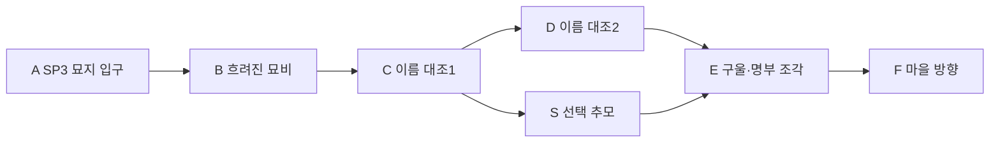

# 에픽4 Haunted Graveyard · 스토리3 이름 잃은 묘지

문서 묶음 v0.24 · 2026-10-27, America/Toronto · 상태: 신규 상세 시나리오 제안, 구현 전

[에픽4 전체/공통 계약](epic-04-haunted-graveyard-story.md) · [맵 제작안](haunted-graveyard-map-design.md) · [이전: 등불 예배당](haunted-graveyard-story-02-lantern-chapel.md) · [다음: 잊힌 마을](haunted-graveyard-story-04-forgotten-village.md)

## 1. 역할·진입·이야기

HG-03, 권장Lv31~33. 직전 HG-02 완료가 서사 선행이다. 레벨·적 수·대사·보상·장치 수는 테스트 초안이다.

지워진 묘비와 남아 있는 매장 명부를 대조해 두 사람의 이름을 복원한다. 망자는 잠시 적의를 멈추고 집과 가족에 관한 단편을 말한다. 기록에는 반역자라는 낙인이 있지만 개인의 삶은 그 말로 설명되지 않는다. 집을 확인하기 위해 옛 마을로 향한다.

## 2. 동선과 공간

묘비는 낮게 모아 전투 여백을 남긴다. 이름 복원은 공통 상호작용/확인 선택이며 철자 입력 시험이나 유료 추모품을 요구하지 않는다. 추모NPC와 적은 표식/자세로 구분한다.

입구 A는 `HG-03-SP` 안전 스타트다.40×32stud 유효 마당과4명/동료 개별 생성 슬롯을 시험한다. 적 추격/광역 공격에서 분리하고 실제 바닥/좌표/카메라는 블록아웃에서 확인한다.

## 3. 몬스터 배치

| TD 기존 종 | 레벨 초안 | 솔로 수 | 배치/역할 |
| --- | --- | --- | --- |
| Zombie | 31 | 2 | 묘지 입구 |
| Skeleton | 32 | 4 | 묘비 두 무리2+2 |
| Ghoul | 33 | 1 | 묘역 끝 강한 단독 교전 |

고정 교전 단위로 배치하며 처음부터 모두 합치거나 무한 소환하지 않는다. TD HP/웨이브를 그대로 복제하지 않는다. 망자 증언NPC와 적은 표식/자세/행동을 구분하고 대화 중 처치 목표로 전환하지 않는다.

## 4. 사건·성공·단서

필수: **두 이름 대조/복원·명부 조각 확인·E 위협 해제·F 도착**. 현장 위협 해제/조사 → 다음 상호작용 활성 → 종점/보고 → 개인 스토리 완료 순서다. 선택 추모/유품/장비·특정 클래스/동료·완벽 방어·궁극기·Lv40전직은 필수가 아니다.

공개 단서: 피해자의 개인 이름/옛 주소. 왕좌 제물이라는 확정은 다음 마을 기록에서.

## 5. 체크포인트·재시작·보상

복원한 이름은 영구 진행이고 보상 아이템처럼 소비하지 않는다. 미완료 경비/구울 교전만 초기화한다. 추모 연출을 반복 보상에 연결하지 않는다.

첫 시작/처음부터는 SP, 이어하기는 유효 체크포인트, 리조인은 동일 실행의 안전 합류 지점이다. 보스 도중 접속은 안전실 대기 후 합류하고 입퇴장으로 HP를 재계산/회복하지 않는다. 서버/실행이 사라지면 개인 확정 목표로 새 실행을 복구하고 미완료 교전HP/임시 효과는 초기화한다. 처음부터는 새 실행이며 영구 레벨/장비/완료/선택/초회 수령을 지우지 않는다. 공동 실행을 혼자 초기화하지 않는다.

첫 완료 Coins780·퀘스트XP929·이름 대조 기록·재료1묶음가 초안이다. 재플레이 퀘스트 Coins234·첫 퀘스트XP25%를 시험한다. 증거/이름/안식/핵/초회 장비/개인 선택은 반복 지급하지 않는다. 처치XP/보스 전리품은 별도 영수증이며 묘지 전용 인장 종류/수량은 미정이다.

## 6. 협동·공유 자산·검증

인간1~4인/전투AI 상한2/2/1/0. 셀레네는 성녀NPC/선택 지원 동료이고 플레이어 클래스가 아니다. 미영입/미편성/성기사 없이도 장치/이름 복원은 공통 상호작용으로 가능하다. 모든 장치는 순차 조작하며 분기 위치를 동시에 밟지 않는다. 보호/회복/조사도 참여로 인정한다. 자격 있는 현장 참여자의 공통 목표만 공유하고 개인 선행/이름 기록/초회/선택은 호스트가 덮어쓰지 않는다.

TD 묘지 몬스터 원본·낮은 묘비/석관·앙상가지·폐예배당·석조 다리·보라 포탈과 공통 메뉴/지도/결과/아이콘을 공유한다. 베이르는 Lich Sovereign 원본의 같은 정체성을 유지한다. 기억/영혼 표현은 상태 표식/소품/VFX를 분리하고 새 몬스터 외형을 재생성하지 않는다.

검증: 네 클래스 솔로/동료0·전직/궁극기 미사용,1/2/4인, 모든SP 시작/이어하기/처음부터/리조인, 조사/장치/보스 뒤 종료, 증언NPC 오조준 방지·안개/카메라·보상 중복. 실제 플레이 검증은 아직 없다.

## 반영된 성장 예산 · v0.21

초회 퀘스트XP **929**, 퀘스트Coins **780**, 필수 전투XP 예산 **502**다. 초회 총XP **1431**, 처치 포함 총Coins **911**이며 선택 소비 전 유입량이다. 순서대로 진행할 때 예상 완료Lv **33**다. 반복 퀘스트XP는25% 정수 내림 **232**, 반복 퀘스트Coins는 **234**다. 처치/보스 보상은 별도 유효 참여/수령 기록을 따른다. [성장 기준표](story-progression-budget.md)의 XP곡선·필수 처치 가정·개인 지급 규칙을 함께 적용한다. 기존 퍼센트 보상 대신 고정 정수XP를 사용하며 사용자 승인으로 기획에 반영했고 런타임/실제 플레이 검증은 아직이다.
