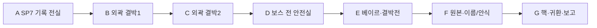

# 에픽4 Haunted Graveyard · 스토리7 증언의 왕릉

문서 묶음 v0.24 · 2026-10-27, America/Toronto · 상태: 신규 상세 시나리오 제안, 구현 전

[에픽4 전체/공통 계약](epic-04-haunted-graveyard-story.md) · [맵 제작안](haunted-graveyard-map-design.md) · [이전: 왕릉의 문](haunted-graveyard-story-06-royal-tomb-gate.md)

## 1. 역할·진입·이야기

HG-07, 권장Lv38~40. 직전 HG-06 완료가 서사 선행이다. 레벨·적 수·대사·보상·장치 수는 테스트 초안이다.

베이르는 증인이 떠나면 왕이 역사를 다시 지울 것이라며 기록을 내주지 않는다. 플레이어는 Lich Sovereign과 싸워 결박의 힘을 약화하고 기록을 소실 없이 보존한다. 패배한 베이르는 리라가 자원한 희생자가 아니었고 왕이 다섯 문명의 협약을 독점했다는 원본을 넘긴다. 이름과 증언을 남긴 뒤 망자가 떠나도록 돕고 네 번째 핵을 회수한다.

## 2. 동선과 공간

공터144×136stud. HP100~70% 전방 주술/예고 바닥문양,70~35% 임시 결박 기둥2개,35% 아래 기존 패턴 조합을 시험한다. 기본 전투로 약화하고 기둥을 순차 해제해 결박을 무력화한다. 승리는 베이르의 항복/대화로 이어지며 기록 전달 전에 소멸시키지 않는다.

입구 A는 `HG-07-SP` 안전 스타트다.40×32stud 유효 마당과4명/동료 개별 생성 슬롯을 시험한다. 적 추격/광역 공격에서 분리하고 실제 바닥/좌표/카메라는 블록아웃에서 확인한다.

## 3. 몬스터 배치

| TD 기존 종 | 레벨 초안 | 솔로 수 | 배치/역할 |
| --- | --- | --- | --- |
| Mummy | 38 | 2 | 기록 회랑 |
| Ghoul | 39 | 2 | 외곽 결박 장치 |
| Lich Sovereign | 40 | 1 | 베이르·최종 필수 대면 |

고정 교전 단위로 배치하며 처음부터 모두 합치거나 무한 소환하지 않는다. TD HP/웨이브를 그대로 복제하지 않는다. 망자 증언NPC와 적은 표식/자세/행동을 구분하고 대화 중 처치 목표로 전환하지 않는다.

## 4. 사건·성공·단서

필수: **외곽 결박2개·베이르 전투 승리·원본 보존·이름/안식 확인·핵/조각 기록·개인 보고**. 현장 위협 해제/조사 → 다음 상호작용 활성 → 종점/보고 → 개인 스토리 완료 순서다. 선택 추모/유품/장비·특정 클래스/동료·완벽 방어·궁극기·Lv40전직은 필수가 아니다.

공개 단서: 리라의 강제 희생·협약 독점·주인공의 공명 조각이 왕좌 완성의 마지막 열쇠. Aether Spire의 새 서약망 해법은 아직 얻지 못함.

개인 추모 선택은 원본을 공동 기록소에 공개 보존할지, 원본을 보존하고 주민 이름의 추모 정원을 먼저 세울지다. 둘 다 증거와 이름을 남기고 망자를 놓아준다. 망자를 계속 붙잡거나 기록을 파괴해야 보상을 받는 분기는 없다. 필수 성능 보상/다음 에픽은 같고 개인 연출/대사 우선순위만 달라진다. 원본 전달 후 셀레네는 정화 명령을 거부하고 희생 체계를 끝내겠다고 결심한다.

## 5. 체크포인트·재시작·보상

보스 승리/원본 보존/이름과 안식/핵/개인 보고를 각각 저장한다. 전멸 시 HP/임시 기둥만 초기화하고 외곽 결박은 유지한다. 승리 후 끊기면 F 원본/안식부터 이어가며 재전투를 강요하지 않는다.

첫 시작/처음부터는 SP, 이어하기는 유효 체크포인트, 리조인은 동일 실행의 안전 합류 지점이다. 보스 도중 접속은 안전실 대기 후 합류하고 입퇴장으로 HP를 재계산/회복하지 않는다. 서버/실행이 사라지면 개인 확정 목표로 새 실행을 복구하고 미완료 교전HP/임시 효과는 초기화한다. 처음부터는 새 실행이며 영구 레벨/장비/완료/선택/초회 수령을 지우지 않는다. 공동 실행을 혼자 초기화하지 않는다.

첫 완료 Coins1600·퀘스트XP1252·네 번째 봉인핵1개·원본 기록·개인 추모 선택이 초안이다. 재플레이 퀘스트 Coins480·첫 퀘스트XP25%를 시험한다. 증거/이름/안식/핵/초회 장비/개인 선택은 반복 지급하지 않는다. 처치XP/보스 전리품은 별도 영수증이며 묘지 전용 인장 종류/수량은 미정이다.

베이르의 반복전은 과거 결박전 재현이다. 안식한 망자를 다시 끌어오거나 정사 결말을 덮어쓰지 않는다. 유효 전투 승리와 최종 퀘스트 완료를 분리해 처리한다.

## 6. 협동·공유 자산·검증

인간1~4인/전투AI 상한2/2/1/0. 셀레네는 성녀NPC/선택 지원 동료이고 플레이어 클래스가 아니다. 미영입/미편성/성기사 없이도 장치/이름 복원은 공통 상호작용으로 가능하다. 모든 장치는 순차 조작하며 분기 위치를 동시에 밟지 않는다. 보호/회복/조사도 참여로 인정한다. 자격 있는 현장 참여자의 공통 목표만 공유하고 개인 선행/이름 기록/초회/선택은 호스트가 덮어쓰지 않는다.

TD 묘지 몬스터 원본·낮은 묘비/석관·앙상가지·폐예배당·석조 다리·보라 포탈과 공통 메뉴/지도/결과/아이콘을 공유한다. 베이르는 Lich Sovereign 원본의 같은 정체성을 유지한다. 기억/영혼 표현은 상태 표식/소품/VFX를 분리하고 새 몬스터 외형을 재생성하지 않는다.

검증: 네 클래스 솔로/동료0·전직/궁극기 미사용,1/2/4인, 모든SP 시작/이어하기/처음부터/리조인, 조사/장치/보스 뒤 종료, 증언NPC 오조준 방지·안개/카메라·보상 중복. 실제 플레이 검증은 아직 없다.

## 리뷰 보충 · 반복 실행 완료와 일회성 후일담

첫 진행은 위의 핵/기록·개인 선택/보고까지 마쳐야 에픽 완료다. 이미 에픽을 끝낸 사람의 재플레이는 새 실행의 필수 외곽 목표와 보스 승리로 반복 퀘스트 보상 자격을 확정하고, 최초 결말/후일담을 다시 선택하도록 요구하지 않는다. 과거 사건의 기록 연출은 건너뛰거나 다시 볼 수 있다. 실행ID와 개인 수령 기록으로 같은 실행의 재접속/중복 요청을 구분해1회만 지급한다. 영구 완료 플래그만으로 새 실행의 보스를 건너뛰어 반복 보상을 받게 하지 않는다. 처치/전투 승리 전리품과 반복 퀘스트 보상은 별도 기록이다.

## 반영된 성장 예산 · v0.21

초회 퀘스트XP **1252**, 퀘스트Coins **1600**, 필수 전투XP 예산 **780**다. 초회 총XP **2032**, 처치 포함 총Coins **1918**이며 선택 소비 전 유입량이다. 순서대로 진행할 때 예상 완료Lv **40**다. 반복 퀘스트XP는25% 정수 내림 **313**, 반복 퀘스트Coins는 **480**다. 처치/보스 보상은 별도 유효 참여/수령 기록을 따른다. [성장 기준표](story-progression-budget.md)의 XP곡선·필수 처치 가정·개인 지급 규칙을 함께 적용한다. 기존 퍼센트 보상 대신 고정 정수XP를 사용하며 사용자 승인으로 기획에 반영했고 런타임/실제 플레이 검증은 아직이다.
