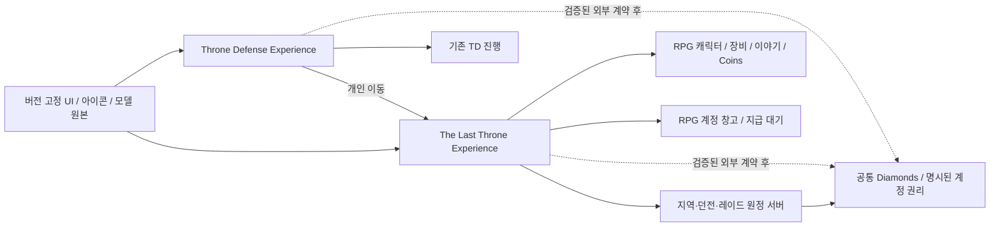

# 7. 기술·공유 Experience·데이터

실제 폴더/의존 도구는 TLT-003에서 정한다. 제안 아키텍처는 Luau 기반 서버 서비스와 클라이언트 컨트롤러, 버전 관리하는 콘텐츠 데이터/영어 키, 공통 UI/자산 패키지다. 미정 프레임워크·라이브러리·빌드 도구를 설치 완료나 필수 도입으로 취급하지 않는다. [기술 제작 계획](../production/engineering-plan.md)에 계약·구조·오류/복구·네트워크·성능 세부를 둔다.

독립 Experience는 DataStore를 공유하지 않는다. 공통 Diamonds를 제공하려면 두 게임의 DataStore를 직접 읽어 합치는 대신, 별도 서버 권위 지갑과 거래/영수증 조정 계약이 필요하다. 그 계약이 검증되기 전에는 TD와 RPG의 잔액·상품을 분리하며, RPG 저장기를 TD 프로필 저장기로 사용하지 않는다. [Roblox Data stores](https://create.roblox.com/docs/cloud-services/data-stores).

TeleportData는 돈·아이템 권리의 근거가 아니며, Experience 간 개인 이동 실패/재접속을 복구해야 한다. Roblox의 단체 TeleportAsync는 같은 Experience 안에서만 지원되므로, 초기 TD↔RPG 이동은 개인 이동으로 제한한다. 수용은 게시된 각 테스트 Experience의 Roblox 클라이언트에서 한다. [Roblox Teleport](https://create.roblox.com/docs/projects/teleport).

서버가 입력 자격·거리·상태·빈도·금액·피해·보상·소유권을 검증한다. 상품 구매 UI 종료를 지급 근거로 쓰지 않고, 각 Experience가 자신의 영수증을 처리한다. 공통 권리가 필요하면 검증된 외부 권리 장부로 조정하며 TD 기존 권리는 보존한다. [클라이언트/서버 경계](https://create.roblox.com/docs/scripting/security/client-server-boundary), [Developer Products](https://create.roblox.com/docs/production/monetization/developer-products).
