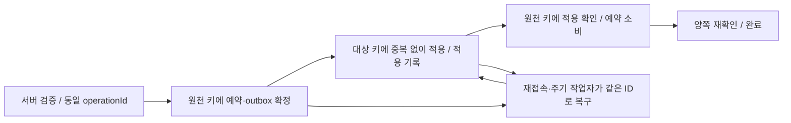

# 기술 제작 계획

2026-10-28 · 상태: 구현 전 기술 제안 · 담당: 소프트웨어 엔지니어 · [통합 계획](../../plan.md) · [백로그](../../backlog.md) · [역할 지침](../../agents/roles/software-engineer.md)

이 계획은 Deepwood 기사 K0부터 전체 RPG로 확장할 구현 순서와 서비스·데이터·복구 계약이다. 문서는 한국어, 코드 식별자·데이터 키·게임 콘텐츠는 영어(en-US)를 사용한다. 아래 폴더·서비스·키·상태·스키마는 **제안**이며 아직 실행 코드·Place·상품·저장소를 생성하지 않았다. TD 운영 코드·라이브 데이터·자산 업로드·게시를 변경하는 작업은 포함하지 않는다.

## 1. 원천과 확인 범위

우선순위는 [공통 지침](../../AGENTS.md), [최신 결정](../decisions.md), 해당 상세 사양이다. 핵심 입력은 [기사 전투](../knight-combat-spec.md), [스탯](../character-stats.md), [클래스/전직](../class-advancement-and-skill-trees.md), [성장 보상](../story-progression-budget.md), [장비/가방/창고](../equipment-bag-and-storage.md), [상품](../items-and-monetization.md), [Experience 연동](../experience-integration.md), [공통 UI](../shared-ui-and-look-and-feel.md), [자산 생산](asset-production-plan.md)이다. 앞부분의 오래된 외형 중심 수익화 문장보다 최신 리셋권·실제 성능 장비 판매 결정을 적용한다.

### TD 읽기 전용 표본 조사

2026-10-28에 형제 저장소의 현재 작업 파일을 읽었다. 당시 TD HEAD는 `22ff3be95a8e9d3c034d83d93b8c540a36070ac2`였고 미커밋 변경이 있으므로 HEAD만으로 이 표본을 재현할 수 없다. 아래 SHA-256은 읽은 파일의 지문이며 채택 승인이나 배포 증거가 아니다.

| 원본 | 확인한 사실 | SHA-256 |
| --- | --- | --- |
| [DiamondWallet.lua](../../../throne-defense/src/Server/DiamondWallet.lua) | `diamonds` 단위에서 잔액·claim·receipt·일부 TD 권리를 `Persistence.mutate`로 함께 처리한다. `robux:<PurchaseId>`가 기존 구매 중복 방지 키다. RPG 인벤토리 처리기는 없다. | `e22546aba78e063a0c69b31afce6f9257d4e5d91194d61c3b2f3f583f9ba3a07` |
| [ReceiptDispatcher.lua](../../../throne-defense/src/Server/ReceiptDispatcher.lua) | 실제 `ProcessReceipt` 대입과 TD Diamonds/Luck 상품ID 라우팅이 있다. 미설정/충돌ID는 거부한다. | `421fa1f8283ba2dfd9d266660a74f7470e35689df9e639130bbc9ca05e75a93f` |
| [Persistence.lua](../../../throne-defense/src/Server/Persistence.lua) | `ThroneDefense_` 이름 접두사, strict 결과 상태, 구형 세션 fallback API, 이동 중 쓰기 동결 코드가 공존한다. | `7313974bcc06197e7163ce779c87e748f1db897e03b59d8a6a02a8b69b5e75cc` |

`LuckPotion.lua`와 `ServerMain.server.lua`에는 LuckPotion이 영수증 콜백을 소유한다는 오래된 주석이 남아 있다. 실제 대입 위치와 주석을 구분한다. `src/Server`·`src/Client`의 관련 검색과 위 파일을 읽은 **표본 조사**다. 전체 writer/상품/의존 그래프·다른 브랜치·게시된 Place·실행 서버·DataStore 값·실제 상품ID·기존 구매자의 권리는 감사하지 않았다. TLT-021에서 현재 파일과 실제 배포본을 다시 고정하고 전수 조사한다. 변경 중인 다른 프로젝트 파일을 복사하거나 되돌리지 않는다.

### 확인한 플랫폼 계약

2026-10-28 공식 문서를 직접 열어 아래만 확인했다. 이어지는 설계는 이 조건을 바탕으로 한 프로젝트 제안이다.

| 공식 근거 | 확인 내용과 설계 영향 |
| --- | --- |
| [Data stores](https://create.roblox.com/docs/cloud-services/data-stores) | 같은 Experience의 Place가 같은 저장 데이터를 읽고 바꿀 수 있다. 서버에서 접근하며 호출 실패를 처리해야 한다. 운영 Experience의 Studio 접근은 운영 저장에 닿을 수 있어 별도 테스트 Experience를 사용한다. |
| [GlobalDataStore / UpdateAsync](https://create.roblox.com/docs/reference/engine/classes/GlobalDataStore#UpdateAsync) | 갱신 대상은 지정 키다. 여러 키의 커밋을 하나로 보장한다고 확대 해석하지 않는다. 프로젝트의 변환 콜백은 순수·비동기 대기 없음으로 제한한다. |
| [클라이언트/서버 경계](https://create.roblox.com/docs/scripting/security/client-server-boundary) | 서버에서 입력 구조·값·행동 자격을 검증한다. NaN/무한대·과도한 크기·허용 범위 밖 값도 거부한다. |
| [네트워크 소유권](https://create.roblox.com/docs/scripting/security/network-ownership) | 클라이언트가 물리 시뮬레이션을 소유한 위치·접촉만으로 피해나 보상을 확정할 수 없다. 서버 이동/상태 검증이 필요하다. |
| [Developer Products](https://create.roblox.com/docs/production/monetization/developer-products), [ProcessReceipt](https://create.roblox.com/docs/reference/engine/classes/MarketplaceService#ProcessReceipt) | 구매 팝업 종료를 지급 근거로 쓰지 않는다. 영수증을 처리하고 서버당 콜백 소유자를 하나로 둔다. 영속 지급을 확인한 뒤 구매 처리 결과를 반환한다. |
| [Teleport](https://create.roblox.com/docs/projects/teleport) | 서버 `TeleportAsync`·오류/`TeleportInitFailed` 처리를 사용한다. TeleportData는 보안 데이터 운반 수단이 아니다. Studio가 아닌 게시된 테스트 환경의 Roblox 클라이언트에서 검증한다. |
| [Memory stores](https://create.roblox.com/docs/cloud-services/memory-stores) | 빠른 임시 파티/예약/매칭에 적합하지만 영구 보상·소유권의 유일한 기록으로 사용하지 않는다. |
| [성능 설계](https://create.roblox.com/docs/performance-optimization/design) | 기준 실기기를 정해 프레임·메모리를 측정한다. Studio 기기 에뮬레이터를 실제 기기 메모리 측정으로 보고하지 않는다. |

## 2. 제안 런타임 구조와 책임

Luau의 서버 서비스·클라이언트 컨트롤러·버전 있는 콘텐츠 정의를 기본안으로 한다. 프레임워크·외부 패키지·빌드 도구는 TLT-003에서 저장소와 기존 도구를 확인한 뒤 정한다. 이 구조는 파일 생성·설치 완료 목록이 아니다.

```text
src/Shared/
  Protocol/             # 입력/응답 구조, enum, 호환 버전
  Definitions/          # Class, Advancement, Skill, Enemy, Quest, Item, Region
  Strings/en-US/        # 표시 키, 원문, placeholder 계약
  StatRules/            # 순수 계산; 서버 결과가 권위
  UI/                   # 버전 고정 TD 공통 셸/토큰/아이콘 어댑터
src/Server/
  Combat/               # ActionState, HitValidation, Damage, Effects
  World/                # EnemyDirector, Encounter, Interaction, Checkpoint
  Progression/          # Quest, Reward, Level, StatAllocation, SkillLoadout
  Persistence/          # CharacterSession, InventoryAuthority, OperationRecovery
  Integration/          # CommonWalletAdapter, ReceiptRouter, PartyTravel
  Observability/        # 구조화 이벤트, 성능 표식, 장애 주입 경계
src/Client/
  Input/ Camera/ CombatPresentation/ UI/ Audio/ Accessibility/
tests/                  # 정의/불변식/장애/통합 시나리오; 도구는 별도 결정
```

| 영역 | 서버가 소유하는 상태 | 클라이언트가 담당하는 표현 |
| --- | --- | --- |
| 전투 | 행동 승인·자원·쿨다운·유효 위치·피해·효과·기여 | 입력·조준·카메라·빠른 모션·승인 뒤 VFX/음향·보정 |
| 세계/적 | AI·스폰·생명ID·패턴·장치 조건·안전 복구 | 거리별 시각 품질·개인 이야기 장식·상호작용 안내 |
| 성장/장비 | 클래스·레벨·포인트·소유/위치·장착·보상 | 비교/미리보기·빈/잠김/동기화/오류 표시 |
| 공통 계정 | Diamonds·명시된 공통 권리·구매 처리 | 서버 잔액/수령 대기/재시도 상태 표시 |
| 파티 | 참가 자격·편성·예약·출발/도착·재합류 | 준비·대기·부분 실패·안전 복귀 선택 |

공통 UI와 아이콘/모델의 원본을 버전 고정해 공유하고 전투 시뮬레이션·장르별 진행을 분리한다. TD의 전역 `Config`나 게임 루프 전체를 RPG에 연결하지 않는다. 공통 패키지 변경은 양쪽의 채택 버전·호환성·되돌릴 버전을 기록한다.

## 3. 콘텐츠 정의·영어 문자열 계약

모든 정의는 `id`, `schemaVersion`, `definitionVersion`, `sourceRef`, `status`를 가진다. 필수 키·타입·중복ID·참조·조건 그래프·정수/유한수·호환 리그/자산·영어 키 누락을 빌드 단계에서 검사한다. 클라이언트는 표시/예측에 필요한 정의만 받고 비공개 보상 판정·상품 처리·운영 설정은 서버에 둔다. 변경된 정의는 빌드에 고정하며 원정 중 조용히 다른 버전으로 바꾸지 않는다.

| 정의 | 필수 필드 제안 | 핵심 검사 |
| --- | --- | --- |
| `ClassDefinition` | `baseClassId`, `nameKey`, `allowedPathIds`, `startingProfileId`, `resourceProfileId`, `rigProfileId` | 기존 카탈로그 키 `knight`, `elf`, `dwarf`, `mage`를 기준 후보로 유지. 표시명은 Knight / Elf Archer / Dwarf Axe Thrower / Mage. `priest`/Selene은 플레이어 생성 목록에서 제외 |
| `AdvancementDefinition` | `pathId`, `baseClassId`, `stage`, `requiredLevel`, `trialId`, `prerequisites`, `unlockIds`, `nameKey` | 각 클래스2계열·20/40/60/80. 상위 가칭/영문 번역 상태를 데이터와 분리해 표시 |
| `SkillDefinition` | `abilityId`, `classId`, `pathId`, `requirements`, `resourceCosts`, `cooldown`, `phaseWindows`, `cancelRules`, `hitProfile`, `damageProfile`, `effectIds`, `animationProfileId`, `vfxProfileId`, `descriptionKey` | 기술의 준비/유효/회복·대상 상한·비용·기여 태그 일치. 마법사 입문/추가 원소를 전직 계열과 별도 해금 조건으로 표현 |
| `EnemyDefinition` | `enemyId`, `modelKey`, `rigProfileId`, `statProfileId`, `actionIds`, `behaviorProfileId`, `leashProfile`, `spawnBudget`, `rewardPolicyId`, `childSpawnPolicy` | 시각 메시 크기와 논리 판정 분리. 자식 Slime/증원/재생성의 보상 중복 정책 명시 |
| `QuestDefinition` | `questId`, `epicId`, `storyId`, `prerequisites`, `objectiveIds`, `checkpointIds`, `participationPolicyId`, `rewardBudgetRef`, `replayPolicy`, `personalChoiceIds`, `textKeys` | `DS-01`~`HG-07`의 원천ID 보존. 각 목표는 서버 사건·횟수·순서·실패/재시도 정책을 가짐 |
| `ItemDefinition` | `itemDefinitionId`, `nameKey`, `descriptionKey`, `category`, `slot`, `classRequirements`, `levelRequirement`, `pathRequirement`, `uniqueGroup`, `powerTemplateId`, `bindingPolicy`, `stackPolicy`, `salePolicy`, `visualProfileId` | 9슬롯·요구조건·보호 품목·유료/플레이 획득 공통 성능 템플릿·시각 호환 검사 |
| `RewardDefinition` | `rewardId`, `sourceVersion`, `sourceHash`, `xp`, `coins`, `itemGrants`, `claimScope`, `participationPolicyId` | [보상 정본](../../assets/balance/story-reward-budget.json) 참조. 그림의 수치나 목표Lv 역산으로 지급값 생성 금지 |
| `StringEntry` | `key`, `enUS`, `placeholders`, `surface`, `reviewStatus` | 누락·타입·잘림·복수형·입력 방식별 문구. 한국어 기획 제목과 생성 이미지의 글자는 런타임 원문으로 쓰지 않음 |

예시 키는 `quest.dw01.title`, `skill.knight.basic_attack.name`, `inventory.error.bag_full`이다. 기존 JSON의 한국어 `name`은 개발용 설명이며 최종 게임 표시명으로 전달하지 않는다. 승인한 영문 용어집을 연결한다. 오류에도 행동을 포함한다. 예: `save.error.retry` → “Your progress could not be saved. Stay here and try again.”, `inventory.error.bag_full` → “Your bag is full. Free a slot or use storage at a hub.” 이 문구도 영어 검토 전 제안이다.

## 4. K0 전투의 서버 계약

첫 실행 범위는 Deepwood 공터의 Knight 기본 이동·3연격·방패·회피·피격/사망/리셋과 Goblin/Ogre다. K0 고정 ATK/HP 프리셋을 유지하며 스탯 성장·계열·상품·영속 저장은 별도 단계다. 시험용 프리셋을 실제 전직/보상으로 저장하지 않는다.

### 입력과 상태

| 메시지/상태 | 필드 제안과 처리 |
| --- | --- |
| 입력 의도 | `protocolVersion`, `characterId`, `lifeId`, `inputSeq`, `actionId`, `aimDirection`, 선택 `targetEntityId`. 최종 피해·명중 목록·가격·포인트 잔량을 요청하지 않음 |
| 입력 검증 | 자료형/길이/깊이·유한 벡터·정규화/방향 범위·허용 action·현재 생명·소유 세션·상태·해금/장착·쿨다운·비용·빈도·순번을 검사. 잘못된 대상ID는 서버 객체로 재해석하지 않음 |
| 서버 상태 | `Idle`, `Moving`, `Windup`, `Active`, `Recovery`, `GuardRaise`, `GuardHold`, `Dodge`, `Stagger`, `Dead`, `Interacting`. 전이/취소 표를 기사 명세에서 변환 |
| 승인 | `inputSeq`, `actionInstanceId`, `definitionVersion`, `serverStartedAt`, 자원/쿨다운 revision. 같은 입력 재요청은 같은 결과이며 다시 소비하지 않음 |
| 거부/정정 | `reasonKey`, 현재 상태/자원 revision, 필요한 위치 보정. 클라이언트가 예측 모션/이동을 취소·완화하고 최신 상태에 맞춤 |
| 적중 결과 | `actionInstanceId`, `hitWindowId`, `targetEntityId`, `targetLifeId`, 피해/방어/무적·자세·효과·기여 변화. 대상 생명마다 구간별 적용 횟수 제한 |

서버는 `검증 → 행동 생성 → 비용/쿨다운 한 번 확정 → 서버 시각의 구간 진행 → 판정/중복 제거 → 피해/효과/기여 → 결과 복제` 순서로 처리한다. 범위는 시작 포함·끝 제외다. 회피 무적·완벽 방어는 서버 시간 기준으로 시작하고 80/150/250ms 관측 전 임의 소급 보정을 넣지 않는다. 민첩의 공격속도를 후속 연결할 때에도 회피 무적·방어 창·비용까지 함께 단축하지 않는다.

### 위치·명중·복제

- 논리 공격 형상은 서버 정의의 원점·범위·각도·높이·대상 수·쿼리 그룹을 사용한다. 무기 `Touched`, 클라이언트 애니메이션 마커, 시각 MeshSize만으로 피해를 주지 않는다. 빠른 공격/투사체는 이전 위치부터의 sweep/raycast와 벽 차폐를 검사한다.
- 플레이어 이동은 허용 속도·돌진/회피 거리·지면/벽·서버 승인 이동 상태와 대조한다. 물리 복제 위치를 무조건 신뢰하지 않는다. 지연·스트리밍 낙하·정상 teleport와 부정 이동을 구분해 관측하며 오차 하나로 제재하지 않는다.
- 적 행동·논리 투사체·피해/보상 판정은 서버가 소유한다. VFX 투사체는 클라이언트에서 재현하고 목표ID나 접촉 보고가 피해 권한을 얻지 않는다. 시각과 서버 판정의 차이를 재현 장면에서 비교한다.
- `(actionInstanceId, hitWindowId, targetEntityId, targetLifeId)`로 중복 적중을 제거한다. 사망/원정 리셋 때 `lifeId`/`encounterEpoch`를 갱신해 늦은 콜백이 새 생명/새 원정에 적용되지 않게 한다.
- 자원 보상은 실제 유효 피해·실제 예방량·허용 기여 태그로 계산한다. 서약 행동당1회·궁극기4/초 등 기사 명세의 상한과 자기 궁극기 환급 제외를 보존한다.
- 관련 없는 먼 전투 결과를 매 프레임 전원에게 보내지 않는다. 초기 snapshot과 revision 있는 변화 이벤트, 누락 때 재동기화 경로를 둔다. 모바일 저품질에서도 공격 예고·위험 바닥·피격 원인은 유지한다.

K0의 완료 증거는 기사 `KC-01~08`의 해당 검사와 실제 PC/터치 조작·판정/모션 비교다. K1 공통 기술, K2 두 계열, K3 성장/협동, G2 대표 구간의 범위를 섞어 완료하지 않는다.

## 5. 캐릭터 프로필·세션·포인트

| 저장 단위 제안 | 원본이 되는 정보 | 다른 단위와의 관계 |
| --- | --- | --- |
| 공통 계정 지갑 | 기존 TD의 Diamonds·확인된 claim/receipt·명시된 공통 권리 | 기존 권리/키를 감사하고 호환 어댑터로만 변경. 캐릭터 잔액 사본 없음 |
| RPG 캐릭터 | `userId`, `characterId`, 불변 `baseClassId`, 레벨/XP·Coins·전직/시험·스탯/스킬 투자·개인 스토리/선택·안전 SP·outbox | `equipmentProjection`은 참조/계산 캐시이며 아이템 소유권 원본이 아님 |
| RPG 계정 아이템 원본 | `instanceId`별 소유/위치/버전·스택·장착 위치·RPG 창고·미수령 grant·작업 기록 | TD 인벤토리와 별개. 아래 초기 단일 키 제안과 성장 한도 게이트 적용 |
| 지속 작업/지급 기록 | 구매·보상·리셋·다중 키 작업의 ID/원천/결과·미완료 상태 | 메모리 큐가 사라져도 재처리할 수 있음. 화면용 목록 인덱스는 권리 원본이 아님 |
| 원정/파티 | `partyId`, `expeditionId`, 구성·예약·단계·재합류·TTL | Command Points는 원정 상태. 영구 재화/보상을 TeleportData나 TTL 기록에만 두지 않음 |

이름은 의미를 설명하기 위한 것이며 실제 DataStore 이름/스코프/키 문자열은 TLT-021/022/041에서 확정한다. 새 RPG용 저장소와 기존 TD 저장소가 우연히 같은 이름을 쓰지 않게 명시적 allowlist를 둔다.

### 세션과 쓰기 규율

1. 캐릭터 키의 조건부 갱신으로 `sessionToken`, `ownerJobId`, 증가하는 `sessionEpoch`, `leaseExpiresAt`, `schemaVersion`, `revision`을 얻는다. 다른 유효 소유자가 있으면 로드를 기다리고, 클라이언트 요청으로 잠금을 강제 해제하지 않는다.
2. 새 세션은 계정 아이템 원본의 `characterEpochs[characterId]`도 갱신하고 미완료 작업을 복구한 뒤 최신 장비/프로필 조합으로 입장한다. 이전 서버의 늦은 캐릭터 저장과 아이템 명령은 더 낮은 epoch라 거부한다. 아이템 원본 갱신 전의 이전 명령은 최종 snapshot에 반영하고 입장 전에 다시 읽는다.
3. 갱신마다 소유 세션·epoch·원본 revision·허용 스키마를 검사한다. 전체 캐시를 `SetAsync`로 덮어쓰지 않는다. 잠금 갱신이 실패/불명 상태면 투자·지급·아이템 변경·출발을 제한하고 재연결한다. 메모리 fallback을 영속 성공으로 응답하지 않는다.
4. 저장 결과는 `found`, `missing`, `unavailable`, `durable`, `unknown`, `conflict`, `incompatible`, `rejected`를 구분한다. 읽기 실패를 `missing`으로 바꾸거나 새 캐릭터/0잔액으로 저장하지 않는다. 손상 데이터와 알 수 없는 미래 버전은 원본을 보존하고 복구 경로로 보낸다.
5. 키별 명령을 직렬화하고 예산을 확인해 제한된 재시도·backoff/jitter를 적용한다. 비용/중요 보상은 확인된 커밋 이후 확정한다. 위치·비핵심 설정은 묶어 저장할 수 있으나 `PlayerRemoving`/`BindToClose`만을 유일한 저장 기회로 삼지 않는다.
6. GUID·난수 전리품·확정 금액·시간·요청 fingerprint는 갱신 콜백 밖에서 준비해 같은 작업에 고정한다. 콜백 안에서 메시지/아이템 인스턴스 생성·네트워크 호출·음향·yield를 하지 않는다. 재호출돼도 부작용이 늘지 않아야 한다.

lease 길이·갱신 주기·저장 큐 상한·재시도 시간은 TLT-041에서 장애/부하 실측 후 동결한다. 특정 라이브러리를 설치하거나 세션 잠금이 이미 구현됐다고 가정하지 않는다.

### 성장 불변식

- `baseClassId`는 생성 이후 불변이다. 투자/리셋권·TD 영웅 변경·재접속·데이터 이관으로 다른 클래스가 되지 않는다. Selene은 별도 NPC/지원 정의다.
- 스탯은 `STR/DEX/INT/VIT`의 정수 투자량과 미배분량을 저장한다. `sum(statInvestments) + unspentStatPoints = 4 × (level - 1)`이며 Lv1/2/20/40/60/80은 0/4/76/156/236/316이다. 기본 스탯·레벨 자동 성장·장비 수치는 이 배분 예산과 분리한다.
- 스킬 기준안은 `sum(skillPointCosts) + unspentSkillPoints = level - 1`이며 Lv80 총79다. 노드 랭크별 실제 비용을 합산한다. 스탯316과 전환·합산하지 않는다. 데이터 버전이 바뀌면 승인한 비용/이관 규칙으로 검증한다.
- 레벨 상승의 전후 차이로 지급량을 계산하고 보상ID를 함께 저장한다. 다중 레벨업/재시도에서 포인트를 다시 만들지 않는다. 파생 전투 능력치는 현재 정의·장비 revision으로 재계산하고 저장된 최종 ATK를 자격으로 신뢰하지 않는다.
- 장비/스탯 변경이 최대HP·자원을 바꿀 때 현재값 보존/상한 조정 규칙을 정의한다. 교체·초기화·재입장을 회복/쿨다운 초기화 수단으로 만들지 않는다. 공통 MP가 미정이므로 K0 스태미나/서약을 임의 대체하지 않는다.

## 6. 장비9슬롯·소유권·다중 키 복구

### 초기 저장 배치 제안

G3 첫 구현은 **RPG 계정 아이템 원본 한 키 안에 해당 계정의 가방·9슬롯·창고·미수령 상태를 함께 두는 안**을 우선 검증한다. 캐릭터별 화면/용량·귀속은 그대로 분리하며 물리 키 배치만 원자적 교환에 맞춘다. 같은 아이템을 캐릭터 키와 창고 키 양쪽의 독립 소유 사본으로 만들지 않는다.

이 선택으로 장착 교환·가방↔창고·미수령→컨테이너의 위치 변경은 한 키 안에서 확정할 수 있다. **캐릭터 XP/Coins·리셋·공통 지갑·외부 지급 원천과의 거래는 여전히 다중 키**이며 아래 지속 작업 프로토콜이 필요하다. 캐릭터 세션 잠금만으로 공통 지갑/창고의 동시성이 해결된다고 보지 않는다.

| 아이템/요청 | 필수 필드 제안 |
| --- | --- |
| 아이템 원본 | `instanceId`, `itemDefinitionId`, `definitionVersion`, `ownerUserId`, `binding`, `boundCharacterId?`, `quantity`, `location`, `version`, `locked`, `sourceGrantId`, `createdByOperationId` |
| 위치 | `kind = bag / equipped / storage / pending / reserved / consumed`, 필요한 `characterId`, `slotId`, `grantId`, `operationId`. 활성 위치는 정확히 하나 |
| 장착 슬롯 | `weapon`, `offhand`, `head`, `body`, `hands`, `feet`, `accessory1`, `accessory2`, `relic`. 망토 성능 슬롯 추가 없음 |
| 변경 명령 | `requestId`, `characterId`, `sessionEpoch`, `instanceId`, `expectedItemVersion`, `expectedInventoryRevision`, `targetLocation`, `quantity`, `requestFingerprint` |
| 지속 작업 | `operationId`, `kind`, `source`, `target`, `fingerprint`, `phase`, `sourceRevision`, `targetRevision`, `reservedAssets`, `outbox`, `result`, `lastAttemptAt`, `recoveryOwnerEpoch` |

`requestId`는 중복 방지용이지 권한이 아니다. 서버의 이용자/작업 namespace로 묶고 같은 ID에 다른 대상·수량을 보내면 충돌로 거부한다. 장비는 GUID 한 개당1개이며 스택 분할 때 새 instanceId·원래 grant/부모 작업을 보존한다. 수량 이동/합치기·잔여량·대상 칸 검사와 instance 생성은 같은 아이템 원본 갱신에서 확정한다. 60/120칸·99/999 스택은 검토할 용량 제안이다.

장착은 서버의 현재 캐릭터 클래스/레벨/계열/안전 상태와 인벤토리 버전을 다시 확인한다. 고정 슬롯은 자동 지정하고 장신구만 교체 대상 슬롯을 받는다. 슬롯 간 충돌·고유그룹·귀속을 검사한 뒤 새 장비와 기존 장비의 가방 이동을 한 번에 확정한다. 가방이 가득 차도 같은 칸을 쓰는 교환은 가능하고 단독 해제는 빈 칸이 있어야 한다. 장착품은 창고로 바로 이동하지 않는다.

캐릭터 장비 projection이 뒤처지면 최신 `inventoryRevision`으로 재생성한다. UI 미리보기와 캐릭터 저장 캐시가 소유권을 복제하지 않는다. 전투에 사용할 장비 snapshot은 서버의 세션/아이템 원본과 맞춘 뒤 확정하며 변경 중에는 해당 캐릭터의 추가 변경/전투 입장을 잠깐 막는다. 계정 창고에 있는 클래스 불일치 장비의 보관은 허용하되 장착은 허용하지 않는다.

### 다중 키 작업의 공통 규칙



원천 키에 손실을 복구할 수 있는 **지속 outbox와 확정 입력**을 먼저 남긴다. 대상은 자신의 변경과 `appliedOperationIds[operationId]`를 같은 키 갱신으로 기록한다. 확인 응답을 잃어도 같은 ID로 결과를 읽거나 재적용한다. 대상 적용을 확인한 뒤 원천의 예약을 소비하고 완료 상태를 남긴다. 중간 상태에서는 아이템/권을 다른 거래가 사용할 수 없다. 재시도 큐/MemoryStore 인덱스는 가속 수단이며 영구 원천 기록을 대체하지 않는다.

| 작업 | 원천 키에서 먼저 확정 | 대상/최종 처리·장애 복구 |
| --- | --- | --- |
| 스토리/전투 보상 | 캐릭터 키에 수령ID·XP/Coins·레벨/포인트 변화·아이템 outbox를 함께 저장 | 아이템 원본에 `grantId`별 한 번 지급해 pending/보관 위치 생성 → 캐릭터 outbox 확인. 지급 지연은 영어로 안내하고 승인 XP를 다시 주지 않음 |
| 스탯/스킬 리셋권 | 아이템 원본에 권1개를 `reserved(operationId, targetCharacterId)`로 잠금 | 캐릭터 키에 해당 작업ID·이전 투자 버전·투자분 반환·장착 기술 재검증·처리 결과를 한 번 적용 → 원본 예약 소비 → 캐릭터 잠금 해제 |
| 공통 Diamonds 소비→RPG 권리 | 지갑 키에서 잔액 확인/차감·영수증·RPG grant outbox를 같이 확정 | RPG 아이템/권리 키의 동일 grant 적용 → 지갑 영수증 delivered. 미확정 응답을 새 거래ID로 재구매시키지 않음 |
| 외부 영수증→RPG 아이템 | 해당 구매의 영수증ID와 계정 지급 권리를 지속 저장 | 같은 `PurchaseId`의 pending grant를 되살리며 장비/권을 추가 생성하지 않음. 공간 부족으로 삭제/자동 장착/자동 소비하지 않음 |
| 인벤토리→캐릭터 projection | 아이템 원본의 위치/장착 revision이 최종 기준 | 캐릭터 projection을 최신 값으로 갱신. projection 저장 실패가 원본 위치를 되돌리거나 두 번째 아이템을 만들지 않음 |

리셋 대상은 처리 중 추가 투자·리셋·캐릭터 삭제·출발을 허용하지 않는다. 투자0·취소·검증 거부는 권을 소비하지 않는다. 대상 갱신이 `unknown`이면 `appliedOperationIds`의 결과를 확인하기 전 예약을 풀지 않는다. **타임아웃만으로 환급하지 않는다.** 명시적으로 적용되지 않았다는 지속 결과를 확인한 경우에만 예약 해제/보상 트랜잭션으로 종료한다. 적용된 작업은 계속 완료하며 반대 방향의 늦은 취소가 권과 포인트를 동시에 복원하지 않게 한다.

### 크기·기록 보존·복구의 출시 게이트

단일 계정 키는 단순한 초기안이지만 미정인 캐릭터 수·전리품량·무기 옵션·만료 없는 유료 미수령·작업 이력을 무한히 담을 수 있다고 가정하지 않는다. TLT-041/043/047에서 직렬화 크기·읽기/쓰기 예산·경합·장기 구매 시뮬레이션을 측정한다. 서비스 한도보다 여유 있는 내부 한도와 경보를 정하고, 대기 항목의 수가 늘어도 구매품을 만료/삭제하지 않는다.

출시 전에 지급 원장/처리 이력을 페이지 또는 별도 키로 옮길 필요가 있으면 **원본 권리 하나·중복 방지 증거·이동 중 상태·조회 인덱스 복구·버전 전환**을 다시 설계하고 장애 주입을 통과한다. 인덱스는 원장을 대체하지 않는다. 오래된 receipt/작업ID를 단순 TTL로 지우거나 아이템 소비 후 중복 방지 기록을 제거해 재지급을 허용하지 않는다. 로드·복구에 필요한 기록의 보존/압축 정책이 증명되기 전 상품/장기 운영 게이트를 통과시키지 않는다. 이 확장은 현재 구현 완료가 아닌 의도적인 G3 결정 항목이다.

## 7. 퀘스트·체크포인트·보상

- 서버가 처치/유효 비살상 승리·보호·회복·조사·장치 상호작용 사건을 만들고 기여자를 기록한다. 클라이언트 “완료” 버튼이나 호스트의 완료 상태가 각 파티원의 개인 보상을 확정하지 않는다. 자격 있는 개인에게 전액 지급하며 막타/파티 인원으로 나누지 않는다.
- `firstClear:<characterId>:<storyId>`와 `replay:<expeditionId>:<storyId>:<characterId>`처럼 초회/반복을 분리한다. 논리 encounter/spawn 보상ID는 재시도/리조인/부활에서도 재사용하고 새 적 생명ID와 구분한다. 보상ID를 새로 만들어 재시도 처치 파밍을 허용하지 않는다.
- 프롤로그 재현의 퀘스트/처치 XP·Coins0, 일반 반복의 정수 내림 규칙과 안전 거점0은 [보상 정본](../../assets/balance/story-reward-budget.json)을 읽어 적용한다. 선택 적/보스·Slime 자식·랜덤 전리품을 필수32구간 예산에 끼워 넣지 않는다.
- `storyProgress`, 개인 선택/증거/복원·안전 SP는 개인 캐릭터 상태다. 원정의 문/보스·전투 장치는 공유 상태로 따로 둔다. 파티원의 다른 선택이 필수 길·장치·다음 이야기·보상을 지우지 않게 `sharedBase`와 개인 표현을 분리한다.
- 처음부터/이어하기/파티 재합류는 서로 다른 명령이다. 이어하기는 개인 승인 SP와 서버의 안전 배치로 복원하고 진행 중인 파티는 생존한 공유 원정 상태로 재합류한다. 원정 만료/서버 종료 때는 개인 안전 SP로 복귀하며 완료 보상을 복제하지 않는다.
- 전투 패배/전멸·낙하·부분 접속·퀘스트 목표 직전/직후 종료마다 어떤 공유 상태를 재설정하고 어떤 개인 권리를 유지하는지 스토리ID별 표를 만든다. Deepwood SP7에서 먼저 검증하고 후속 지역도 같은 계약으로 등록한다.

기획 검증 명령은 `python3 scripts/simulate_story_progression.py --output /tmp/tlt-progression-check.json`이다. 목표는 승인32구간의 정합성·Lv40/0XP·Coins 총유입19,652 확인이며 실제 플레이 속도·소비 후 잔액·저장/지급 검증을 대신하지 않는다. Lv41~80 곡선/전직 시험/후반 보상은 별도 설계·수용 대상이다.

## 8. 공통 Diamonds와 TD writer 전환

**단일 권위는 하나의 논리 지갑 키와 호환 계약**을 뜻한다. 모든 Place가 한 대의 서버 프로세스에 의존한다는 뜻은 아니다. TD/RPG 서버의 공통 계층이 동일 원본 키를 조건부 갱신하고 잔액/권리/작업 기록을 함께 확정한다.

1. TLT-021에서 현재 TD의 저장소/키·모든 지급/소비/legacy fallback·receipt·오래된 저장·Place별 배포 버전을 전수 매핑한다. 현재 TD의 `DiamondWallet` 기반을 우선 평가하고 잔액/기존 권리를 새 RPG 계정으로 복사/합산하지 않는다.
2. `walletContractVersion`, `writerVersion`, revision·작업ID·허용 작업을 정한다. TD 전용 보상 정책 이관을 RPG 로드마다 실행하지 않도록 공통 커널과 TD 어댑터를 분리하고 알 수 없는 기존 필드는 보존한다. 새 RPG 코드가 TD의 유효 권리/마이그레이션을 임의 재해석하지 않는다.
3. 기존 키 유지가 가능하면 호환 writer를 단계적으로 배포한다. 새 키가 필요하면 기준 잔액/권리를 고정한 단일 전환 기록과 구 writer 차단·커밋 지점·검증/복구를 설계한다. 구/신 지갑 이중 쓰기나 두 잔액 합산은 사용하지 않는다.
4. 같은 키를 읽을 수 있다는 이유만으로 구버전 쓰기가 차단되는 것은 아니다. 호환 로직을 모르는 오래된 서버는 새 version 필드만 추가해도 계속 쓸 수 있다. 관련 TD 시작/전투/기타 Place의 구 writer가 모두 교체·종료됐다는 배포 증거 후 RPG 공통 소비·지급/포탈을 켠다. 실제 서버 정리·배포는 별도 승인된 구현 작업에서 수행한다.
5. 잔액100에서 TD/RPG 각각80 동시 소비는 한 번만 성공하고 최종20이어야 한다. 중복/불명 응답·지급과 소비 경쟁·새 캐릭터/삭제·왕복에서도 같은 잔액/권리를 유지한다. 로드 실패는 null/재시도 상태이며0 저장으로 대체하지 않는다.
6. 롤백은 기능 플래그로 RPG 공통 소비/포탈을 중지하고 호환 읽기/복구를 유지한다. 오래된 TD writer나 과거 잔액 snapshot으로 돌아가 최신 지갑을 덮어쓰지 않는다. 복구용 snapshot은 권리 대조/감사 원천이며 그대로 실시간 잔액에 합산하지 않는다.

TD Gold / RPG Coins / Command Points는 각 영역에 남긴다. 공유 업적/외형/공동 이벤트도 명시된 권리ID만 연결한다. TD 영웅/타워·Priest 구매/성장 기록은 RPG 클래스 전환 때문에 삭제하거나 재해석하지 않는다.

## 9. 영수증·장비 판매·지급 대기

같은 Experience의 **각 관련 Place 서버에 같은 버전의 영수증 라우터를 설치하고 서버당 `ProcessReceipt` 대입은 하나로 유지**한다. Experience 전체에서 한 번만 실행되는 전역 콜백으로 착각하지 않는다. 기존 TD 상품 처리기를 보존하고 새 RPG ProductId는 검증된 허용목록에 명시적으로 추가한다. null/0·미등록·중복ID·다른 환경ID를 판매 가능한 상품으로 취급하지 않는다.

| 단계 | 계약 |
| --- | --- |
| 카탈로그 | 기존ID는 뜻을 바꿔 재사용하지 않음. `productId → productKey/fulfillmentVersion/items`를 고정하고 미설정 상품은 구매 버튼 비활성. 가격은 Roblox 상품 조회와 프롬프트의 실제 정보로 표시하며 기획표의39/49/99 등을 확정 가격으로 하드코딩하지 않음 |
| 영수증 수신 | 서버의 `PlayerId`, `ProductId`, `PurchaseId`·상품 계약을 검사. 동일 구매ID의 다른 상품/이용자 조합은 충돌로 보류하고 기록 |
| 지속 지급 | 구매ID·상품 버전·지급 payload·계정 권리/pending grant를 같은 권리 기록에서 한 번 확정. 아이템 instanceId는 첫 결정 뒤 고정. 구매 당시 캐릭터를 현재 캐릭터로 추측해 자동 장착하지 않음 |
| 응답 | 지속 지급 권리를 확인한 경우만 `PurchaseGranted`. 저장 실패/불명·미설정·불일치면 `NotProcessedYet`과 관측 기록. 클라이언트 완료 신호로 지급하지 않음 |
| 후속 수령 | 가방/창고 여유가 있으면 명시적 수령 명령으로 이동. 가득 차면 만료 없는 수령 대기. 같은ID 재시도·TD/RPG 왕복·캐릭터 변경·재접속에서도 한 권리만 존재 |
| 소비 | 스탯/스킬 리셋권 구매와 거점 소비를 분리. 구매 장비는9슬롯/클래스/레벨·귀속/고유그룹 검사. 포인트·전직 시험·클래스 불변 조건을 우회하지 않음 |

현재 TD의 `robux:<PurchaseId>` 수령 기록을 새 RPG 라우터 도입으로 지우지 않는다. 지급 권리 저장과 실제 위치 적용이 나뉘면 §6 outbox·대상 중복 방지·미완료 복구를 사용한다. “PurchaseGranted 후 메모리 큐에만 남은 아이템”은 허용하지 않는다. 유료 미수령 목록의 영구 보존/페이지 분리는 크기 게이트에서 검증한다.

실제 성능 장비 상품을 유지하되 기획의 `power_template`와 동일한 플레이 획득 프로필을 연결한다. 무료 획득 경로/제작시간·판매 장비 계수·강화 규칙·영문 설명을 기획/QA가 확인하기 전 상품 게시 게이트를 열지 않는다. 현재 가격·ID·실제 결제/환불은 미검증이다.

## 10. 파티·Place 이동·환경 분리

| 환경 | 배치·허용 작업 |
| --- | --- |
| 로컬/단위 검사 | 순수 정의/규칙·저장 어댑터 대체·오류 주입. live API 접근 없이 계약 검증 |
| Studio 테스트 | 별도 테스트 Experience/저장 namespace에서 이동·전투·UI·멀티클라이언트 확인. Teleport 통과 증거로 사용하지 않음 |
| 게시된 통합 테스트 | **같은 테스트 Experience 안** TD 테스트 Place↔RPG 테스트 Place↔원정. 테스트 상품/가짜 지급 경로를 명확히 분리하고 운영ID 접근 거부 |
| 운영 | 기존 TD 시작 Place 유지·별도 RPG Place. 호환 writer/상품/복구/TD 회귀/실제 이동 수용 후 승인된 공개 범위만 활성화 |

실제 Experience/Place/상품ID·접근 권한·예약 정책은 환경 manifest에서 조회해 기록한다. 이 문서에 ID를 추정하지 않는다. 시작 때 서버가 `game.GameId`, `PlaceId`, 환경·writer/계약 버전을 대조하고 불일치 환경에서 경제 쓰기·판매·잘못된 포탈을 거부한다. 환경 분리는 단순 파일 이름 접미사만으로 완료하지 않는다.

### 이동 상태와 부분 실패

1. `Preparing`: 파티 명단/동의·이동 가능한 거점·개별 자격·원정 정원을 확인한다. 일반1~4인과 후반8인 레이드를 구분한다. 일반4인에서 전투AI동료는0이고 Selene도 동료 슬롯에 포함한다.
2. `Reserved`: 서버가 목적지/예약 원정·`travelId`·멤버별 상태·기한을 생성한다. TeleportData에는 식별 보조 정보만 넣고 잔액/장비/보상/입장 권한은 목적지 서버가 기록에서 확인한다. reserved access code는 게임 UI/일반 로그에 노출하지 않는다.
3. `Saving`: 새 소비/교환/퀘스트 확정을 동결하고 진행 중인 지속 작업을 정리한다. 캐릭터/계정 상태의 durable 결과·outbox 이관·출발 fence를 확인한다. 저장 불명/미완료 중요 거래가 있으면 해당 출발을 보류한다.
4. `Departing`: 서버 `TeleportAsync` 보호 호출과 실패 이벤트를 처리한다. 호출 반환을 전원 도착으로 표시하지 않는다. 실패한 멤버만 같은 travel/reservation에 제한 재시도하고, 새 예약을 매번 만들어 파티를 흩뜨리지 않는다.
5. `Arriving`: 목적지 서버가 환경/멤버·원정·기한·현재 프로필 세션을 확인하고 출발 fence 이후의 최신 상태로 입장시킨다. 도착 확인 전에는 보스/소비성 활동을 시작하지 않는다. 출발 서버의 늦은 PlayerRemoving 저장은 새 세션을 덮어쓰지 못한다.
6. `Partial`/`Ready`: 일부만 도착하면 도착자는 안전 대기, 출발에 남은 사람은 재시도/취소 안내를 받는다. 초기 검증값은 총대기60초·전송 최대3회이며 측정 전 제안이다. 기한 뒤 누락 슬롯을 해제하고 도착자에게 준비된 인원으로 계속/안전 거점 복귀를 명시적으로 제공한다. 취소된 늦은 도착은 안전 거점으로 안내한다.
7. `Recoverable`/`Closed`: 재접속은 마지막 지속 안전 SP와 미완료 travel 상태를 대조한다. 원정 생존/재합류 기한이 유효할 때만 같은 원정으로 보내고, 그렇지 않으면 안전 거점으로 복구한다. 이동 성공/실패가 구매/보상 재지급 조건이 되지 않는다.

통신/저장 장애로 확인되지 않은 상태는 실패로 단정해 자산을 환급하거나 새 프로필을 만들지 않는다. MemoryStore 예약 만료와 개인 진행 보존을 분리하고, 재합류·파티 리더 이탈·중복 출발·전송 중 결제 영수증 도착·서버 종료를 테스트한다. 도착자 대기/계속 규칙과 기한은 Designer/Planner/QA가 실제 클라이언트에서 검토해 동결한다.

## 11. 리그·맵·성능 계약

3D팀과 G1에서 R15 호환/커스텀 리그를 비교하고 `rigProfileId`, `socketProfileVersion`, 크기/발바닥/피벗·루트 이동·무기 분리·충돌/쿼리 그룹을 동결한다. `GripRight`, `GripLeft`, `Muzzle`, `ArrowNock`, `TrailBase`, `TrailTip`, `CastOrigin`은 제안 소켓이다. TD 원본의 골격/소켓으로 이미 검증됐다고 보고하지 않는다.

시각 정면/엔진 이동 정면을 실제 비대칭 무기/얼굴로 대조한다. 애니메이션의 준비/유효/회복·중단/사망·VFX 마커를 서버 행동 정의와 버전 묶음으로 관리한다. 마커는 표현용이며 피해 권한이 아니다. Dwarf 체형·Elf 활 시위·Mage 로브·Knight 방패의 극단 포즈/카메라 가림을 표본 통과한 후 대량 적용한다.

환경의 시각 메시·발판/적 이동 충돌·전투 쿼리·카메라 가림을 분리한다. TD의 충돌 설정을 그대로 복사하지 않는다. 스트리밍 경계에서 필수 발판/장치·안전 SP를 준비하고 보이지 않는 위험/낙하·벽 너머 공격을 검사한다. 서버 AI/보상 상태는 특정 클라이언트의 시각 스트리밍 완료 여부에 의존하지 않는다.

| 장면 | 측정과 초기 목표 |
| --- | --- |
| K0 솔로 | Knight+Goblin/Ogre·기본 모션/예고·3연격/방어/회피. 기준 기기/품질/빌드/지연별 CPU·GPU·메모리·입력/승인 차이 기준선 |
| 일반 협동 | 4인+적24+보스1, 별도 솔로+AI2. QA와 고정한 동일 구간에서 모바일 P95프레임≤33.3ms·PC≤16.7ms 목표. 기기 목록/해상도·세션 길이/통계 구간은 QA 계획 §7과 함께 G1에서 고정 |
| 네트워크 | RTT80/150/250ms에서 승인/명중/방어/정정·대역폭·원격 빈도/크기·거부율. 평균 한 값으로 지연별 실패를 숨기지 않음 |
| 저장/경제 | 동시 TD/RPG 소비·인벤토리 경합·재시도 폭주·키 크기·쿼터/스로틀·p95 처리/복구 시간. 목표값은 테스트 저장 환경 실측 뒤 결정 |
| 장기/후반 | 지역 왕복·반복 전투·아이템/VFX 생성/정리·세션 메모리 증가, 별도8인 레이드/다수 궁극기. 일반4인 통과로 대체하지 않음 |

성능 조정은 적 활성 범위·AI 의사결정 주기/경로 갱신·조회 배치·장식/LOD·alpha overdraw·이펙트 풀·관련 대상 복제부터 측정한다. 모든 적의 경로를 매 프레임 다시 계산하지 않는다. 적 생존 수·원격 입력 처리량·상태 효과 중첩·쿼리 후보 수에 상한/큐 압력을 둔다. 무조건 서버 소유 물리를 늘리는 방식도 서버 비용과 함께 비교한다. 삼각형 수 감소나 Studio FPS만으로 모바일 통과를 선언하지 않는다.

## 12. 관측·검증·배포

구조화 이벤트에는 `buildId`, `contentVersion`, `environment`, `placeId`, `serverJobId`, `operationId/travelId/actionInstanceId`, 원인·결과·처리 시간을 연결한다. 전투 입력/거부/적중·프로필 로드/lease 상실·저장 불명/충돌·outbox 대기/복구·영수증 재시도·지갑 전환/거부·파티 출발/도착·기기 성능을 관측한다. 예약 access code·전체 저장 payload·결제 관련 비밀을 일반 로그에 쓰지 않는다. 원시 UserId 접근/보존 범위는 운영 설계에서 정한다.

| 검증층 | 필요한 증거 |
| --- | --- |
| 정적/순수 규칙 | 정의/참조/영어 키·216노드 비용/선행·9슬롯 호환·스탯/스킬 불변식·XP32구간 정합성. 아직 없는 validator를 실행 완료로 적지 않음 |
| 서버 계약 | 위조 action/target·NaN/무한/큰 payload·중복/만료 입력·생명/세션 epoch·공격 구간 경계·벽·다중 적중·저장 콜백 재실행 |
| 장애 주입 | 각 거래 단계 전후의 종료/저장 실패/응답 유실/중복 요청·복구 작업자 경합. 잔액·수량·포인트 보존과 단일 수령을 원천 기록으로 대조 |
| Studio/엔진 | K0→K3 실제 판정/모션/리그·전멸·재시도·SP·모바일/패드 입력. Teleport/실기기 증거는 별도 |
| 게시 테스트 | TD↔RPG 왕복·기존/신규 이용자·부분 도착·세션 fence·기존 TD 상품/권리 회귀·설정된 테스트 상품의 실제 영수증 경로 |
| 실기기/관찰 | 기준 기기/그래픽/네트워크/부하의 성능·터치/패드·영어 가독성·새 이용자의 원인 이해. 사용자 미술/재미 수용은 실제 받은 결과만 기록 |

장애 검증의 최소 불변식은 “원래 잔액+확정 유입−확정 소비=잔액”, “원래 아이템+지급−소비/판매=각 활성 위치+예약 수량”, “같은 보상/구매/리셋 작업은 한 번”, “각 instanceId는 한 활성 위치”, “투자+미배분=레벨 예산”이다. 검사는 구현을 따라 쓴 형식적 테스트보다 이 불변식과 사용자 결과를 검증한다. 세부 테스트ID·심각도·출시 판정은 [QA 계획](qa-and-release-plan.md)에 연결한다.

빌드 manifest에는 소스 커밋/dirty 상태·정의/보상 hash·공유 UI/자산 pin·저장 스키마/writer·환경 manifest 버전을 남긴다. 기능 플래그는 서버에서 판정하고 지갑/상품/파티/신규 지역을 독립적으로 중지할 수 있게 한다. 중지는 미완료 영수증/지급 복구를 버리지 않는다. 호환되지 않는 프로필을 구버전 코드로 되돌려 저장하지 않으며 출시 전 전환·복구·롤백을 테스트 환경에서 리허설한다.

## 13. 작업 순서·핸드오프·남은 결정

`ENG-*`는 엔지니어링 묶음 이름이며 루트 TLT ID를 대체하거나 완료 상태를 추가하지 않는다. 실제 상태/우선순위는 [backlog.md](../../backlog.md)가 원본이다.

| 부번 / TLT 연결 | 구현 묶음·선행 | 수용/다음 담당 |
| --- | --- | --- |
| ENG-01 / TLT-003·030 | 로컬/테스트 환경·빌드/버전·스키마·영어 키 경계. G0 원천 확인 | 재현 가능한 K0 빌드 경로·운영ID 접근 방지 → QA/Director |
| ENG-02 / TLT-005·006·031~036 | K0 입력/카메라·행동 상태·서버 피해/이동·기본AI. 리그/소켓 표본 선행 | KC-01~08 실제 판정/모션·기기/지연 증거 → Designer/Modeling/QA |
| ENG-03 / TLT-007·008·009~012·037~040 | 원거리/선택 지원·공명·보스/퀘스트 대표 구간 | 솔로/4인 정상·전멸·재도전·성능 기준선 → Director/Planner |
| ENG-04 / TLT-013·041·042·050~052 | 캐릭터 lease/epoch·4스탯/별도 스킬·전직/XP/보상 outbox·튜토리얼/표시 | Lv1~80 경계·중복/저장 불명·SP 복구 불변식·en-US 데이터 표시 → QA/Planner |
| ENG-05 / TLT-043~048 | 아이템 원본·9슬롯·창고/pending·용량·기획 성능/경제표 연결·리셋 다중 키 복구 | 가득 찬 교환/부분 스택·동시 꺼내기·권 소비 중 종료·장기 크기 → QA/Designer |
| ENG-06 / TLT-016·021~024·049·053 | TD 전수 감사·공통 지갑/receipt·전환/환경·Place 왕복 | 기존 TD 보존·동시 소비·재영수증·구 writer 차단·실제 테스트 클라이언트 → QA/Director |
| ENG-07 / TLT-014·015·054~059 | 4클래스·8계열·32단계·36+12기술·노드216 기준안 | 같은 투자/장비 예산·솔로/협동·영어/리그 호환 → Planner/Modeling/QA |
| ENG-08 / TLT-060~083 | 후속 지역·던전·개인/공유 서사·길드/생활·8인 별도 구조 | 지역별 입력/보상/복구·장면별 부하·원천/권한 → 전 역할 |
| ENG-09 / TLT-084~100 | 실기기 최적화·권리/경제 회귀·관측/배포·운영 복구 | QA 출시 게이트·공개 범위/복구 리허설·빌드별 운영 지표 → Director |

우선 결정할 항목은 실제 개발/빌드 도구와 테스트 Experience(ENG-01), 기본 리그/소켓/서버 이동 허용오차(ENG-02), 캐릭터 수/장기 아이템 원장 크기·기록 보존/분할(ENG-04/05), 기존 TD writer/상품/배포 전수 감사와 공통 계약(ENG-06), 공통 MP/계열 재선택/후반 성장(Planner), 모바일 기준 기기·측정 장면/서버·네트워크 예산(QA)이다. 이 결정들을 완료로 꾸미기 위해 수치나 실제ID를 추정하지 않는다.

현재 산출물은 기술 제안·역할 지침과 읽기 전용 표본 조사다. 런타임 구현·저장 장애 주입·Studio·게시 테스트·실기기·실제 결제·운영 전환은 미실행이다. 다음 구현 담당은 ENG-01의 Engineer/QA, 첫 플레이 장면 담당은 ENG-02의 Engineer/Designer/Modeling이다.

계획 작성 시 검증 기록(2026-10-28): 두 담당 Markdown의 상대 링크 대상 존재와 코드 펜스 균형을 Python으로 확인했다(누락0). 성장 검증 명령 `python3 scripts/simulate_story_progression.py --output /tmp/tlt-engineering-progression-check.json`은 종료0, 반영값 Lv40·0XP/총유입19,652Coins를 반환했다. 이 검사는 문서/기획 데이터 검증이며 서버 구현이나 실제 지급의 Pass가 아니다.
