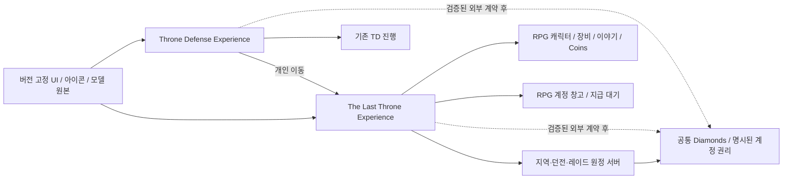

> **2026-11-09 · TLT-027/029/041/052/057/084 · 0.93.5:** 사용자 지시로 Traveler14구매SKU를 제외하고 실제 보상 규칙13의 정적 예산으로 장비 가격을 재산정했다. Tempered 무기500/후드300/장갑·부츠250Gold, Veteran1,200/800/650Gold, Sentinel40/28/24Diamonds. 부위별·통화별/되팔기 일관성 및 기존 배급/영수증 보존. [전체 가격·재계산·검증/미게시](docs/evidence/equipment-price-review-20261109/README.md). 실플레이 경제 수용은 후속.

> **2026-11-09 · TLT-028/029/052/057/084 · 0.93.4:** 사용자 스크린샷 후속으로 대장간 카드를 가로형 한 열로 변경했다. 왼쪽 큰 아이템 그림·오른쪽 이름/설명·하단 행동 버튼 배치. [네이티브 치수 검증·미게시](docs/evidence/blacksmith-item-inspection-20261109/README.md). 실기기 시각 수용 후속.

> **2026-11-09 · TLT-028/029/052/057/084 · 0.93.3:** 대장간 구매/판매·강화의 무기/장비 아이콘을128px로 확대하고 카드/이름/설명 공간을 조정했다. 기존 TD 원본 이미지·거래 계약 유지. [네이티브 화면 치수 검증·미게시](docs/evidence/blacksmith-large-icons-20261109/README.md). 실기기 시각 수용은 후속.

> **2026-11-09 · TLT-028/050/061/084 · 0.93.2:** 사용자 요청으로 로비·전투 최대 줌아웃을22→32studs로 확대하고 서버/프로젝트 초기값도 일치시켰다. 최소6·충돌/회전 보정 유지. [Studio10검사·빌드/미게시](docs/evidence/camera-zoom-20261109/README.md). 실기기 조작/차폐·성능 수용 후속.

> **2026-11-09 · TLT-029/041/052/057/084 · 0.93.1:** Copper Ring은 공격력3→DEX3으로 변경하고 실제공속/이속·강화·가방/상점/영웅표시를 연결했다. 장갑공격/신발방어는 Traveler2/Tempered4/Veteran7/Sentinel15이며 다른부위·HP/MP 유지. [정본](docs/production/equipment-four-tier-reorganization-2026-11-09.md) · [검증/미게시](docs/evidence/copper-dex-secondary-20261109/README.md). 실계정/기기 수용 후속.

> **2026-11-09 · TLT-028/029/032/041/052/073/082/084 · 0.93.0:** 최신 Meshy Traveler·Tempered·Veteran·Sentinel의 검/도끼/활/지팡이16종을 Task ID로 고정해 가져오고, 실물 렌더 투명 아이콘16종을 기어·가방 공통 등록했다. 실제 장비ID별 외형 교체·각 활의 시위 연결, 기존 다른 Rare/Epic 유지. [원본/업로드/네이티브 검증·미게시](docs/evidence/four-family-weapons-20261109/README.md). 실제 계정·게시 클라이언트·기기 수용은 후속.

> **2026-11-09 · TLT-029/041/052/057/084 · 0.91.1:** 사용자 후속 지시로 Traveler 공격/방어3·Tempered5·Veteran10·Sentinel20으로 통일하고 Sentinel 요구레벨15→10으로 변경했다. HP/MP20/30/40/50·단일옵션·장신구3종 유지. [장비별 정본](docs/production/equipment-four-tier-reorganization-2026-11-09.md) · [검증/미게시](docs/evidence/equipment-fixed-values-20261109/README.md). 다른 진행 중 변경은 제외, 실계정/기기 수용 후속.

> **2026-11-09 영웅별 다이아 · TLT-027/041/050/052/057/084 · 0.92.0:** 최신 사용자 지시로 계정 공유 수령 제한을 제거하고 **영웅·메인 스토리·난이도별 최초1회3 Diamonds**를 지급한다. 새 영웅당35스토리×4난이도=420개,4영웅 전체1680개. 같은 영웅/난이도 반복·사이드 추가0. 기존 계정 영수증의 지급분은 한 완료 영웅에 귀속해 보존하고 다른 완료 영웅의 미수령분을 복구한다. [구현·검증·미게시](docs/evidence/hero-diamonds-20261109/README.md). 실계정/기기 수용 후속.

> **2026-11-09 난이도별 다이아 · TLT-027/041/050/052/057/084 · 0.91.0:** 사용자 확인으로 계정당·메인 스토리당·난이도당 최초1회3 Diamonds를 지급한다. Easy/Hard/Insane/Hell 각각105개·본편35스토리 전체420개. 다른 영웅/같은 난이도 반복은 추가0. 기존 Easy 영수증/구DW2개를 보존하며 저장된 상위 난이도 완료 기록의 미수령분만 복구한다. [검증·미게시](docs/evidence/difficulty-diamonds-20261109/README.md). 실계정/기기 수용 후속.

> **2026-11-09 · TLT-029/041/052/057/084 · 0.90.0:** Traveler(Common/Lv1,기본지급)·Tempered(Common/Lv1)·Veteran(Uncommon/Lv10)·Sentinel(Rare/Lv15)을 단일 고정옵션40종으로 구현했다. Copper Ring공격+3·Amber Charm HP+30·새Amber Mana Charm MP+30, 마법사 기본로브MP·장비MP/강화/기존보유 이관 연결. [부위별 정본/이관](docs/production/equipment-four-tier-reorganization-2026-11-09.md) · [검증/빌드/미게시·한계](docs/evidence/equipment-families-20261109/README.md). 실계정/기기·새등급별미술 수용 후속.

> **2026-11-09 사용자 장비 재정리 · TLT-029/041/052/057/084:** Traveler(Common/Lv1/+3~4/HP·MP20, 기본지급·착용) → Tempered(Common/Lv1/+5~6/30) → Veteran(Uncommon/Lv10/+9~10/40) → Sentinel(Rare/**Lv15**/+14~15/50). Copper Ring/Amber Charm 유지. [확정 범위·옵션 배정 질의·구현 인계](docs/production/equipment-four-tier-reorganization-2026-11-09.md). 새 기준 기록이며 게임 미적용.

> **2026-11-09 · TLT-029/032/041/052/057/084 · 0.89.4:** 사용자 지시로 Training 검/도끼/활/지팡이4종의 기존 착용·가방·창고·미수령 인스턴스를 계정 로드 때 전부 삭제한다. 기본 지급 Tempered4종은 Common으로 변경하며 안정ID·공격력+3·강화·외형·가격을 유지한다. [검증/현재 모델 미리보기·미게시](docs/evidence/training-delete-common-20261109/README.md). 실계정/기기 수용 후속.

> **2026-11-09 · TLT-029/041/043/052/057/084 · 0.89.3: 사용자 지시로 Dawnforge 무기4종·Sentinel Gauntlets·Ruby Ring·Storm Pendant의 Rare/Epic14종 기존 보유분을 계정 로드 때 삭제한다. 잠금/강화/가방/창고/미수령/착용과 무관하며 다른 보유품·잔액·영수증은 유지한다. Common/Uncommon 공격 옵션의 숫자는 유지하고 %를 고정 공격력 포인트로 변경한다(Tempered3, Veteran4, 장갑/반지1). 물리/마법·기본/스킬·가방/상점/강화/영웅 표시를 일치시킨다. 강화 단계당 원래 수치3% 증가는 유지한다.** [검증·빌드/미게시](docs/evidence/equipment-delete-flat-20261109/README.md). 실계정/기기 수용·부모 티켓 완료는 후속.

> **2026-11-09 · TLT-031/050/057/061~065/084 · 0.89.1:** 확장 맵의 벽·수목 줄기·암석을 서버 충돌 지형으로 전환했다. 입구 방향/폭·갤러리 통로·절벽 예약·구조물 재배치·DW-Q4 Terrain 턱·EC-01 후면 출입구와 거리별 숨은 충돌을 수정했다. [맵 리뷰·검증/미게시](docs/evidence/scenery-collision-20261109/README.md). 실제 계정/조작·기기/미술/성능 수용과 부모 티켓 완료는 후속이다.

> **2026-11-09 · TLT-027/041/050/052/057/084 · 0.89.0:** 다른 네 에픽에도 메인 스토리당3 RPG Diamonds를 계정1회 지급한다. 다섯 지역35스토리 신규 계정 총105개, 반복/다른 영웅/사이드 중복0. 기존 완료한 GW/FV/EC/HG는 저장 완료 기록에서 미수령분만 복구하며 기존 Deepwood2개 수령분은 보충하지 않는다. [구현·검증·미게시](docs/evidence/all-epic-diamonds-20261109/README.md). 실계정/기기 수용은 후속.

> **2026-11-08 / TLT-001/028/031/050/052/057/061~065/084/087 · 0.88.1:** 재미 리서치를 반영해24사건의 인물/단서/성과를 연결했다. Finn 등불의 결전 회수·설원 수호수 신호 반응·기술자별 회로 단서/현장6조작부·사이드3개 개인 재회를 구현했다. 원본 Deepwood 노드와 정본 선행/대사 일치·조사 색 표시도 수정했다. [검증·빌드·미게시/Studio 미적용·한계](docs/evidence/story-fun-20261108/README.md). 실제 재미/기기 수용과 부모 티켓 완료는 후속.

> **2026-11-08 사용자 구현 지시 · TLT-005/013/014/015/027/032/054/055/057/084 · 0.87.0:** 본인 근접 포즈 히트스톱·공격 신원/지연/중복 검사·안전한 분할 넉백/보스 고정·본인 효과음 우선권을 추가했다. 최신0.86.5 공격 주기/피해·기사/마법사 복구음 유지. [2,685검사·Studio 적용·미게시/남은 수용](docs/evidence/hero-hit-feedback-20261108/README.md). 실전 네트워크/기기·무게감/청취·파티 성능 수용과 부모 티켓 완료는 후속.

> **2026-11-08 사용자 초기 공속 적용 · TLT-005/013/014/015/027/054/055/057/084 · 0.86.5:** 기사3연격0.588/0.644/0.868초(평균0.70), 드워프0.80초로 조정하고 한 방 피해로 지속 기본 피해를 보존했다. 민첩 계수 유지·스킬 동작0.86.4 대조/변경 없음. [구현·검증·미게시/한계](docs/evidence/initial-melee-tempo-20261108/README.md). 실전 처치시간/자세 피해·기기/최종 미술 수용은 후속.

> **2026-11-08 사용자 적용 지시 · TLT-005/013/014/015/027/054/055/057/084 · 0.86.4:** 드워프 기본 주기를0.42→0.65초, 한 방 계수를0.75→약1.160714로 조정해 지속 기본 피해를 보존했다. 준비/판정/회수 동시 리타이밍·종료 idle 유지·민첩 계수 유지. [구현·검증·미게시/남은 수용](docs/evidence/dwarf-basic-tempo-20261108/README.md). 실전 처치시간/자세 피해·기기/최종 미술 수용은 후속.

> **2026-11-08 / TLT-005/013/014/015/027/054/055/057/084 · 공속·민첩 조사:** Diablo II/D2R·III·IV와 Warcraft III/WoW의 무기 주기/민첩·별도 공속·이속을 구분했다. 현행 DEX200/300 상한·드워프/기사 간격을 계산하고 드워프0.60~0.70초 비교 및 피해/후반 투자 효율 실험을 제안했다. [공식 근거·정적 계산·미승인 제안](docs/research/2026-11-08-attack-speed-dexterity-diablo-warcraft.md). 조사 완료이며 게임 수치/버전·빌드 변경 없음.

> **2026-11-08 사용자 최종 컨셉 승인 · TLT-028/029/032/041/052/073/082/084:** 현재 [40품목·160등급 장비 컨셉](assets/concepts/2026-11-08-equipment-rarity-v2/index.html)을 최종 컨셉으로 저장했다. [승인 기준/40이미지·색상 해시](assets/concepts/2026-11-08-equipment-rarity-v2/approved-baseline.json)를 이후 개별 아이콘/착용3D의 비교 기준으로 삼는다. 컨셉 승인에 한정하며 게임 적용·부모 티켓 완료가 아니다.

> **2026-11-08 사용자 리뷰 · TLT-028/029/032/041/052/073/082/084 · 장비 희귀도 컨셉:** 승인 후드 기반 [40품목·160등급 비교 컨셉](assets/concepts/2026-11-08-equipment-rarity-v2/index.html)을 제작했다. 같은 장비군/등급의 색 통일·고급 금속 유니크·무기 비율·원본 참고 기사/드워프 헬멧을 반영했다. [검증/활 보정 미반영·인계](assets/concepts/2026-11-08-equipment-rarity-v2/README.md). 사용자 후속 지시로 컨셉 우선이며 개별 아이콘160/착용3D·게임 적용은 후속, 부모 티켓 미완료.

> **2026-11-08 / TLT-005/013/014/032/033/054/055/057/084/087 · 0.86.3:** 드워프 기본 공격·스킬 끝의 옛 guard와 늦게 풀리던 도끼 yaw를 제거하고 팔/손목/소켓을 함께 idle로 복귀시켰다. 공격/판정 유지·32스킬/R6/R15 종료검사·Studio 전후 확인. [수정·검증·미게시/한계](docs/evidence/dwarf-recovery-20261108/README.md). 실플레이/최종 스킨 수용은 후속.

> **2026-11-08 / TLT-005/013/014/032/033/054/055/057/084/087 · 0.86.2:** 엘프 기본 공격의 승인 조준/회전·직선 발사와 표적 이탈을 수정했다. 드워프 기본기를 이전 Overhead 전체의 빠른 재생으로 교체하고 Overhead는 머리 위 회전 준비가 있는 실제 Mixamo Combo Ver.1로 교체했다. R15/R6·109,111검사·Studio 적용. [변경·검증·미게시/남은 수용](docs/evidence/arrow-dwarf-remap-20261108/README.md). 실플레이/실기기·최종 미술 수용은 후속.

> **2026-11-08 / TLT-005/013/014/032/033/054/055/057/084/087 · 0.86.1:** 실제 Mixamo 원본으로 기사·드워프 기본기/파생 동작과 점프 Ground Slam, 엘프 Standing Draw Arrow 장전·기본 화살통→오른손→노크를 연결했다. 서버 판정/성장·기존 R6 경로 보존, 통합108,895검사·Studio 원문 적용. [근거·검증·미게시/남은 수용](docs/evidence/mixamo-dwarf-20261108/README.md). 실전 조작·기기/최종 미술 수용은 후속.

> **2026-11-08 / TLT-001/028/031/050/057/061~065/084/087 · 0.86.0:** 확장82사건 완료 대사·저널 phase/기록을 수정하고 지역별 동선/복구 장면·FV교량/승강·EC안전 회로·HG동맹 작업을 보강했다. 호위/안내 연결로 이탈·반복 소품을 줄였다. [수정·검증·미게시/남은 수용](docs/evidence/campaign-expansion-review-fixes-20261108/README.md). 실제 시간/재미·실계정/실기기 수용은 후속.

> **2026-11-08 / TLT-001/028/031/050/057/061~065/084/087 · 0.85.0:** 전체5에픽 본편35장·기존12사이드에 사건82개/세부목표246개와 사건 공간·경사 연결로·Finn 호위·복구 장면·체크포인트/귀환·로비 재회를 구현했다. 기존 진행/보상·구원정 규칙1~12 보존, 새 원정13. [구현·검증·빌드·미게시](docs/evidence/campaign-expansion-20261108/README.md). 실측 시간/재미·실계정/실기기/4인+AI 수용은 후속, 부모 티켓 미완료.

> **2026-11-08 / TLT-028/031/041/050/052/057/084 · 0.84.0:** 로비 Tessa의 개인 `!/?/…`·추천/전체 목록·귀환1회 안내·위치 찾기·기존12사이드 대리 보고를 구현했다. 기존 지급/원정 영수증·발견 선행 보존. [검증·빌드·미게시/한계](docs/evidence/lobby-side-quest-guide-20261108/README.md). 실계정/입력/기기·사용자 인지 수용은 후속, 부모 티켓 미완료.

> **2026-11-08 사용자 색상 기준 · TLT-031/032/033/057/061~065/084:** Blender에서 맵·영웅·NPC·몬스터·장비를 제작하거나 컨셉과 비교할 때 **View Transform = Standard**를 반드시 명시한다. Display = sRGB, Look = None, Exposure = 0, Gamma = 1, Use Curves = Off를 비교 기준으로 삼는다. 새 장면/가져오기/렌더 직전에 재확인하며 AgX 화면으로 채도·색 일치 판정을 하지 않는다. 색 텍스처는 sRGB, 데이터 맵은 Non-Color로 구분하고 재질 숫자는 scene-linear 입력 규칙을 지킨다. 임의 채도 증가로 표시 변환을 보상하지 않는다. Standard 비교 렌더와 실제 Roblox 조명 검증은 별도다. [작업 증거](docs/evidence/standard-color-20261108/README.md).

> **2026-11-07 사용자 후속 · TLT-028/031/050/052/084 · 로비 사이드 적극 추천:** NPC의 느낌표/물음표·영웅별 추천·로비 지도/귀환 알림을1차 필수 범위로 정했다. [표식/추천·수용 계약](docs/production/lobby-side-quest-npc-2026-11-07.md). 추천/표식은 대리 보고·전체 에픽 확장보다 먼저 제작한다. 계획 반영·게임 미적용.

> **2026-11-07 / TLT-001/027/050/061~065/084/087 · 재미·분량 최종 통합 계획:** 기존 줄거리·5지역 확장안·사이드/Tessa·최신 보상을 재검토해 [35장 사건·시간 배분·제작 순서·수용 기준](docs/production/campaign-fun-and-duration-final-plan-2026-11-07.md)을 통합했다. 본편285~410분은 실험 가설, FV-01~03 파일럿 우선·기존12사이드 개선·신규4선택 후보는2차·Lv80 성장은 별도 검토. 계획 완료·게임 미적용·부모 티켓 미완료.

> **2026-11-07 / TLT-065/032/033/057/084 · 0.83.7:** Venomcoil King 꼬리 제보를 원본/리그 면 단위로 대조해 손실 없음을 확인했다. 원본 양면 설정 복원·얇은 꼬리 정밀 렌더링 적용. [비교·검증·미게시](docs/evidence/venomcoil-tail-20261107/README.md). 제보 장면의 실제 잘림은 미재현.

> **2026-11-07 / TLT-028/043/057/084 · 0.83.6:** Blacksmith 거래/분류 버튼을 두 줄로 정리하고 Enhancement Guide를 ENHANCE 내부로 이동했다. Diamond Shop 상단의 숨긴 거래 탭 여백50px을 제거했다. [검증·미게시](docs/evidence/blacksmith-two-rows-20261107/README.md). 실기기/사용자 수용 후속.

> **2026-11-07 / TLT-065/032/033/057/084 · 0.83.5:** Meshy 최신 Venomcoil King 모델로 교체했다. 원본/구버전 보존·2,458tri/14본·10모션 슬롯·길이11.32stud·다른7종/전투 판정 유지. [검증·Studio 적용·미게시](docs/evidence/venomcoil-king-20261107/README.md). 실기기/최종 미술 수용 후속.

> **2026-11-07 / TLT-028/031/050/057/061~065/084/087 · 0.83.2:** TD 실제 원본 메시·주연/보조/열린 전경 구성을44지역에 적용했다. 반복 나무벽/성채 축소·설송/빙문/현무암/폐예배당·지도 도면/실제 랜드마크 위치 갱신. 전체 파츠37.59%감소·이동/지도검증. [전후 사진·검증·미게시](docs/evidence/td-inspired-world-20261107/README.md). 실기기/사용자 미술 수용과 부모 티켓 완료는 후속.

> **2026-11-07 사용자 지시 · TLT-027/028/041/050/052/057/061~065/084 · 0.83.0:** 보상 없는 사이드12개·Gloamwood본편7개에 완료XP/Gold와 사이드 확정재료를 추가했다. 기존 완료자의 누락분은 계정로드 때 영웅별1회 복구·원래 진행/보상 보존·신규 반복규칙12/기존1~11유지. [구현·검증·미게시](docs/evidence/quest-completion-rewards-20261107/README.md). Tessa 로비 대리 보고는 설계 단계, 실계정/기기·경제 수용 후속.

> **2026-11-07 / TLT-028/031/050/057/061~065/084 · 0.83.1:** 상세 지도·미니맵을 실제44지역 지형/건축/식생 도면과 곡선 도로로 개선했다. 실제 스폰/랜드마크·원형 경계·공통 투영·로비 정본 에픽 순서 적용. [검증·미게시](docs/evidence/map-cartography-20261107/README.md). 실기기/사람의 시각 수용과 부모 티켓 완료는 후속.

> **2026-11-07 / TLT-001/050/061/063/064/065/084/087 · 다른 에픽 확장 상세 계획:** Deepwood/Gloamwood/Ember Caldera/Haunted Graveyard의 현행 목표·활동·월드를 리뷰하고 [28장 확장·사이드 개선·파일럿·수용 계획](docs/production/other-epic-expansion-review-2026-11-07.md)을 작성했다. 계획만 완료·게임 미적용·기존 진행/보상 보존·부모 티켓 미완료.

> **2026-11-07 사용자 요청 · TLT-028/031/041/050/052/057/061~065/084 · 로비 사이드 의뢰 NPC:** 에픽 귀환 뒤 로비 NPC가 미완료 사이드 퀘스트를 제시하고 수행 결과를 보고·보상하는 역할을 요청했다. [설계안](docs/production/lobby-side-quest-npc-2026-11-07.md)은 기존 Tessa 확장·남은 의뢰/현장 안내·로비 대리 보고·중복 수령 방지를 제안한다. 현재12개 사이드의 고정XP/Gold0 확인, 새 보상 종류/수량·소급 방침은 후속 확정. 설계만 반영·게임 미적용·부모 티켓 미완료.

> **2026-11-07 사용자 요청 · TLT-001/050/061~065/084/087 · 에픽 분량 확장:** Frozen Vale를 포함한 다섯 에픽의 스토리·맵 확장 필요를 기록했다. [확장안](docs/production/epic-story-map-expansion-2026-11-07.md)은 Frozen Vale 우선·장별 사건 공간·거점 복구/지름길·전체 지역 확장 축·저장/보상 보존과 수용 기준을 제안한다. 설계만 작성·게임 미적용·시간/분량은 가설이며 부모 티켓 미완료.

> **2026-11-07 / TLT-028/057/084 · 0.82.6:** 로비 PLAY 아래 빠른 선택에는 생성된 영웅만 표시하고 빈칸 없이 가운데 정렬한다. 미생성 영웅 입력/포커스를 차단하며 별도 Heroes 생성 화면은 유지한다. [검증·미게시](docs/evidence/lobby-created-heroes-20261107/README.md). 실기기 수용 후속, 부모 티켓 In Progress.

> **2026-11-07 / TLT-029/041/043/052/057/084 · 0.82.5:** 사용자 지시로Soft Hide신규지급/아이콘을제거하고기존보유분은계정로드때가방/창고/미수령/잠금과무관하게정리한다. 영웅최초Ore24→10개·기존Ore/다른아이템/잔액유지. [저장이관/검증·미게시](docs/evidence/starter-material-cleanup-20261107/README.md).

> **2026-11-07 / TLT-027/028/029/041/043/044/045/052/057/084 · 0.82.4:** 강화 시도당 수수료를25→50Gold고정으로 변경한다. 성공/실패 모두1회소비·기존25Gold/무료영수증 재조회보존·이전견적재확인. 재료교환·성공률/재료/효과·기존권리유지. [검증·미게시](docs/evidence/enhancement-fee-50-20261107/README.md).

> **2026-11-07 사용자 확정 · TLT-041/043/047/052/057/084 · 0.82.3:** 스탯·스킬 초기화권 가격을 각각100 RPG Diamonds로 변경했다. 이전50다이아 결정을 대체하며 기존 보유권·구매 영수증·언제든 사용·2단계 확인·미투자 미소비 규칙은 유지한다. [구현·검증·미게시](docs/evidence/reset-price-100-20261107/README.md). 실계정/기기 수용 후속.

> **2026-11-07 / TLT-032/033/057/061~065/084/087 · 몬스터 움직임 후속 계획:** 영웅 파일럿 이후 대표6종·특수3종 검증 → Deepwood/Gloamwood/Frozen Vale/Ember Caldera/Haunted Graveyard 순으로 확대한다. 인간형 Mixamo·사족/다족/비행/무정형 전용 모션, 기존 서버 판정 유지. [체형별 제작·인계·검증](docs/production/monster-motion-followup-2026-11-07.md). 계획만 완료·제작 미착수·부모 티켓 미완료.

> **2026-11-07 사용자 확정 · TLT-027/041/050/052/057/084 · 0.82.2:** 신규 원정의 반복 완료Gold20%감소(정수내림)·Deepwood7스토리 계정 최초Diamond2→3. 기존 원정규칙1~10/수령분·초회Gold·처치/XP/재료·가격 유지. [구현·검증·미게시](docs/evidence/gold-diamond-tuning-20261107/README.md). 실계정/기기 경제 수용 후속, 부모 티켓 In Progress.

> **2026-11-07 / TLT-032/033/057/084/087 · Mixamo 움직임 개선 계획:** 기사·드워프 6클립 파일럿 → 네 영웅/Selene → 인간형 적 순으로 리타깃·접지·무기 궤적·전환을 개선한다. 비인간형은 별도 수작업, 서버 판정 시각 유지. [대상·단계·공수·수용 기준](docs/production/mixamo-motion-improvement-2026-11-07.md). 계획 작성만 완료, 제작·Mixamo 다운로드·게임 적용/빌드·게시 전이며 부모 티켓은 미완료다.

> **2026-11-07 사용자 후속 · TLT-041/043/047/052/057/084 · 0.82.1:** 스탯/스킬 리셋권은 로비·모험·전투 중 언제든 사용한다. 기존 거점/안전 상태 제한 제거,50다이아·2단계 확인·미투자 미소비·저장/중복 방지 유지. [검증·Studio 적용·미게시](docs/evidence/reset-anywhere-20261107/README.md). 실계정/기기 수용 후속.

> **2026-11-07 / TLT-041/043/047/052/057/084 · 0.82.0:** 스탯/스킬 리셋권 각50다이아 구매·가방/창고·로비 미리보기/2단계 사용 확인·투자0 미소비·원자 반환/동일 영수증 복구 구현. [검증·Studio 적용·미게시](docs/evidence/reset-tickets-20261107/README.md). 실계정/기기 수용 후속, 부모 티켓 In Progress.

> **2026-11-07 / TLT-027/028/052/057/084 · 0.81.4:** 사용자 지시로 Skills 숙련 상한을 Lv4→Lv9로 확장했다. 기본 Lv1+8SP·기존 투자/79SP·해금 조건 보존, 서버/저장/UI 상한 통일. [검증·Studio 적용·미게시](docs/evidence/skill-level9-20261107/README.md). 실계정/기기·전투 밸런스 수용 후속.

> **2026-11-07 / TLT-050/057/061~065/084 · 0.81.3:** 44지역·로비/훈련장 이동 점검 후 숨은 충돌·도로 침범 소품/오두막·연결로 높이·칼데라 출입구·로비 창고를 수정했다. 길34,041표본 충돌/바닥 이상0·305동선 통과. [변경·검증·한계](docs/evidence/all-map-traversal-20261107/README.md). Studio 소스 적용·미게시, 실제 기기/조작·성능 수용과 부모 티켓 완료는 후속.

> **2026-11-07 / TLT-050/057/061/084 · 0.81.2:** 스토리4 이동 불가 제보 조사 중 Deepwood 중앙 도로의 보이지 않는 옛 감시탑 기둥4개 충돌을 수정했다. 신규/재사용 월드·페이즈3 다섯 동선573엔진검사, 진행/리스폰598검사. [원인·검증·한계](docs/evidence/deepwood-watchtower-road-20261107/README.md). Studio 소스 적용·미게시, 제보 정확한 위치/실기기 재현은 후속.

> **2026-11-07 리뷰3건 수정 · TLT-001/050/057/061~065/084 · 0.81.1:** 칼데라→GW 역방향 완료의 저장 재시도를 원정별 영수증으로 복구하고, 기존 완료 지역의 지도7/7·완료 배지와 GW-07 Tali 목표/단계 안내를 수정했다. [검증·Studio 적용·미게시](docs/evidence/campaign-review-fixes-20261107/README.md). 기존 진행/보상·전투/성장 수치 유지, 실제 계정/기기 수용은 후속.

> **2026-11-07 게임 적용 · TLT-001/050/057/061~065/084 · 0.81.0:** Deepwood → Gloamwood → Frozen Vale → Ember Caldera → Haunted Graveyard 순서·영어 연결·지도/이동·구순서 저널/활성 원정/Selene 권리 이관을 구현했다. GW Lv12~18·새 원정 규칙10, 기존1~9/ID/고정 보상 보존. [검증·Studio 적용·미게시](docs/evidence/campaign-reorder-20261107/README.md). 실제 계정/기기·전투 난도·Lv80 성장 수용은 후속이다.

> **2026-11-07 본편 순서 변경 · TLT-001/061~065:** 사용자 승인으로 Deepwood → Gloamwood → Frozen Vale → Ember Caldera → Haunted Graveyard 순서로 줄거리를 개정했다. Gloamwood는 운반대 추적·정찰대 구조·설원행 옛길 개방, Ember Caldera는 Veyr의 침공 계획·왕릉 진입로 확보를 맡는다. 문서 반영 완료이며 게임 순서·저장 이관·레벨/드롭 조정·빌드/게시는 후속이다. 기존 안정ID·보상·보유품·진행 기록을 보존한다. [상세 시나리오·인계](docs/production/gloamwood-second-story-2026-11-07.md).

> **2026-11-07 / TLT-065/032/033/057/084 · 0.80.0:** 사용자 Meshy Gloamwood8종 실제 스킨 모델·116본/종별 모션으로 임시 블록을 교체했다. 거미8다리·일반 지네/King 크기 구분·서버 공격 시각 유지. [27,993엔진/1,127공격/3,122기존 모션 검사·Studio·미게시](docs/evidence/gloamwood-meshy-20261107/README.md). 실전/기기·최종 미술 수용은 후속.

> **2026-11-07 최신 시작 장비 지시 · 0.79.9:** 신규 영웅은 실제 기본 무기·Lv1 방어구/장신구를 즉시 착용한다. 트레이닝 무기 신규 지급/상자 선택은 중단한다. Lv5 보너스 투구는 가방에 유지하며 기존 보유품/편성은 소급 변경하지 않는다. [구현·검증·미게시](docs/evidence/starter-auto-equip-20261107/README.md).

> **2026-11-07 / TLT-028/057/084 · 0.79.8:** 사용자 지시로 배틀 HUD 아이템2개·스킬5개를 한 줄로 복구한다. 작은 화면은 축소/액션 위 배치로 겹침을 피한다. [변경·검증·미게시·한계](docs/evidence/battle-hud-single-row-20261107/README.md). 실기기 수용 후속, 부모 티켓 In Progress.

> **2026-11-06 / TLT-028/031/052/057/084 · 0.79.7:** 모바일 주요 UI의 겹침/잘림·작은 지도/목록·터치 목표를 검사하고 지도·장비·가방·원정·설정·상점·Selene/완료창·배틀 메뉴를 수정한다. [검증·빌드·미게시·한계](docs/evidence/mobile-ui-audit-20261106/README.md). 실기기 수용 후속, 부모 티켓 In Progress.

> **2026-11-06 / TLT-028/057/084 · 0.79.6:** 모바일 Heroes 카드 폭/초상을 줄여 Mage 포함 네 영웅을 한 행에 표시하고 선택 버튼44px를 확보한다. [검증·빌드·미게시·한계](docs/evidence/mobile-heroes-fit-20261106/README.md). 실기기 수용 후속, 부모 티켓 In Progress.

> **2026-11-06 사용자 확정 · 0.79.5:** Hard 입장은 **Lv30 이상**, Insane 입장은 **Lv60 이상**으로 변경한다. Easy Lv1·Hell Lv80, 같은 임무의 이전 난이도 완료·스토리 조건은 유지한다. 파티원 전원과 도착/재입장 서버 검증 및 UI 안내에 적용한다. 적/보상 레벨·배율과 저장 스키마는 변경하지 않는다. [구현·검증·미게시](docs/evidence/difficulty-entry-levels-20261106/README.md).

> **2026-11-06 / TLT-016/028/057/084 · 0.79.4:** 배틀 동행 Selene의 캠프용 클릭/터치 프롬프트를 제거해 전투 입력 간섭 경로를 수정했다. 캠프3종·로비 동행/지원권 유지, 엔진25·규칙152검사 PASS. [검증·미게시·한계](docs/evidence/selene-combat-click-20261106/README.md). 실기기 수용 후속, 부모 티켓 In Progress.

> **2026-11-06 / TLT-003/028/057/084 · 0.79.3 게시:** 사용자 지시로 Studio를 강제 종료·재시작하고 검증된 단일 파일을 기존 RPG 로비·배틀에 게시했다. 두 게시 성공 확인, 기존 제한 접근 유지. [게시 증거·한계](docs/evidence/release-0793-20261106/README.md). 실제 앱 이동/기기 수용 후속.

> **2026-11-06 / TLT-003/028/057/084 · 0.79.3:** 실제 앱 배틀 로딩 정지 보고에 대응해 현지 바닥 검사 전에 최종 스폰 스트리밍을 요청하고, 영웅UI의 준비중 false/레벨 오류를 수정한다. [571검사·재현·검증/미게시·한계](docs/evidence/battle-loading-stall-20261106/README.md). 제보 서버의 정확한 실패 지점/실제 Teleport 수용은 미검증, 부모 티켓 In Progress.

> **2026-11-06 / TLT-003/028/057/084 · 0.79.2:** 모험→로비 복귀 시 배틀 영웅ID를 전달하고 계정 소유권 확인 뒤 선택을 복원한다. 드워프가 엘프 등 목록 첫 영웅으로 바뀌던 결함 수정. [188검사·검증·미게시·한계](docs/evidence/lobby-return-hero-20261106/README.md). 실제 Teleport/기기 수용 후속, 부모 티켓 In Progress.

> **2026-11-06 / TLT-028/057/084 · 0.79.1:** 사용자 모바일 화면 보고에 따라 Selene 상세창을 최대680×480으로 줄이고 가로 작은화면의 초상/헤더·여백을 압축했다. 실제 GUI 안전영역 크기로 배치하며 상세창 중 MENU를 숨겨 닫기 버튼 중첩을 막는다. 구매3종·영어 조건·44px 터치·TD 원본 유지. [검증·미게시·한계](docs/evidence/selene-detail-size-20261106/README.md). 부모 티켓 In Progress.

> **2026-11-06 / TLT-016/028/043/057/061/072/084 · 0.79.0:** 사용자 지시로 Selene 지원권 구매/기존 보유 시 로비부터 동행하고 메인 모험 입장 시 캠프 방문 없이 지원을 시작한다. 로비 무료·실제 시작 시1회 소비·저장불명 복구·파티AI1/미사용권 보존·모험 내 자동 유료 갱신 없음. [변경·검증·미게시·한계](docs/evidence/selene-lobby-departure-20261106/README.md). 부모 티켓 In Progress.

> **2026-11-06 / TLT-029/041/043/052/084 · 0.78.13:** 사용자 지시로50Gold→보석5개를 제거하고50Gold→보석1개 구매로 변경했다. 구매견적2·완료된 기존 구매 보존·Ore/마석교환 유지. [503검사·빌드·미게시·한계](docs/evidence/gem-purchase-one-20261106/README.md).

> **2026-11-06 / TLT-029/041/043/052/084 · 0.78.12:** 보석→마석 오류의 재현 원인인 상점 exchangeVersion/ExchangeGems 허용 누락을 수정했다. 잘못된 요청의 응답ID를 보존해 저장 대기를 해제한다. [수정 전 재현·실제 핸들러461검사·한계](docs/evidence/merchant-exchange-fix-20261106/README.md). 로컬 미게시·클라이언트 수용 후속.

> **2026-11-06 / TLT-029/041/043/052/084 · 0.78.11:** 사용자 지시로 광석1개→보석1개 변환에50Gold를 추가한다. 서버 원자 차감/지급·영어 가격/확인·잔액 부족 비활성·이전 무료 견적 재확인·완료 영수증 재조회 보존. [검증·미게시·한계](docs/evidence/ore-conversion-gold-20261106/README.md).

> **2026-11-06 / TLT-028/031/050/061~065/084 · 0.78.10:** 완료 에픽의 미완료 사이드 원정이 로비 Continue를 붙잡지 않도록 다음 메인/Easy를 기본 선택한다. 사이드 중 Main 추적은 로비 경유 안내·저장 진행 보존. 상세 지도에 사이드9지역을 포함하고 SIDE AREA 배지를 처리했다. [3980규칙/3981엔진·지도416검사/한계](docs/evidence/optional-epic-map-20261106/README.md). 미게시·실제 이동/기기 수용 후속.

> **2026-11-06 / TLT-005/016/027/050/057/061~065/084 · 0.78.9:** 최신 사용자 지시로 마지막 웨이브를 보스1명+유한 호위 무리로 변경한다. 기존 호위8전투는 총량/처치영수증 보존·보스만 있던14전투는 지역 호위 추가.22보스 엔진588검사·1~4인/영수증263374검사 PASS. [구성·보상·검증/한계](docs/evidence/boss-final-escort-20261106/README.md). 과거 보스 단독 조건보다 우선, 미게시·실전/실기기 수용 후속.

> **2026-11-06 / TLT-005/027/050/057/061~065/084 · 0.78.8:** 사용자 지시로 일반 Goblin/Orc/Ogre/IceWolf/IceBear5종을6stud 근접 전용으로 교정하고 IceElf·마법형/보스 등 나머지44종은 보존한다. 공격 범위 가이드는 실제 지면에만 투영하고 바닥 미검출/해제 시 숨긴다. [변경·검증·한계](docs/evidence/melee-enemies-ground-warnings-20261106/README.md). 로컬 미게시·실플레이/실기기 수용 후속.

> **2026-11-06 / TLT-050/061~065/084 · 0.78.7:** 구현된 사이드 퀘스트12개·44목표 전수 리뷰. 진행/이어하기/반복1610검사·안내77검사·실제 월드/적189개 생성·처리/보고·UI739엔진검사 PASS. 현장 단서의 잘못된 거점 안내와 본편 완결 후 사이드 완료 표시를 수정했다. [퀘스트별 결과·한계](docs/evidence/side-quest-review-20261106/README.md). 미게시·실기기/실전 수용 후속.

> **2026-11-06 / TLT-027/029/041/052/084 · 0.78.6 시작 장비 후속:** 사용자 지정으로 무강화 시작 장비 합계를 공격력5%·HP50·방어5로 조정한다. [수치·검증](docs/evidence/starter-gear-balance-20261106/follow-up.md). 미게시·실전 수용 후속.

> **2026-11-06 / TLT-027/029/041/052/084 · 시작 장비 하향:** 사용자 피드백으로 무강화 기본 지급 구성의 장비 보너스를 공격력18%→5%·HP100→25·방어6→3으로 낮춘다. 영웅별 최초1회 지급·보유/강화단계 유지. [변경·검증·한계](docs/evidence/starter-gear-balance-20261106/README.md). 로컬 조정·미게시·실전 수용 후속.

> **2026-11-06 / TLT-050/061/084 · 0.78.4:** 사이드 퀘스트 전투의 근접 자동 시작 누락을 수정했다. King Ogre 포함 선택 전투9개·메인64개의 진입/차단1029검사와 Studio Luau 검사 통과. [원인·검증·한계](docs/evidence/side-quest-battle-start-20261106/README.md). 로컬 미게시·실제 클라이언트/실기기 수용 후속.

> **2026-11-06 / TLT-005/027/032/050/057/084 · 0.78.3:** 사용자 청취 피드백으로 나이트 기본 공격·마법사 스킬 효과음을0.76.0 이전 명중음/음량/고정속도로 복구하고 해당 신규 발동음을 제거한다. [엔진824검사/검증·한계](docs/evidence/combat-audio-rollback-20261106/README.md). 로컬 미게시·실전 청취 수용 후속.

> **2026-11-06 / TLT-029/041/043/052/084 · 0.78.2:** 사용자 확인으로 시작 장비 세트·물약·기존 재료는 **영웅마다 최초1회** 지급한다. 앞선 계정 첫 영웅1회 해석을 대체하며 재접속/소진/영웅 선택으로 반복 지급하지 않는다. [수정·검증·기존 저장 한계](docs/evidence/starter-per-hero-20261106/README.md).

> **2026-11-06 / TLT-005/006/032/033/084 · 0.78.1:** 방향키 동시 입력 중 스프린트 누락에 대응해 E/패드L3를 우선순위 액션 입력으로 이동했다. 유지/해제67검사·Studio 컴파일 통과. 실제 키 조합/실기기 수용·게시·부모 티켓 완료는 후속. [검증과 한계](docs/evidence/sprint-input-20261106/README.md).

> **2026-11-06 / TLT-005/027/050/057/061~065/084 · 0.78.0:** [공격·마법·피격·3D 개선](docs/evidence/enemy-patterns-20261106/README.md)을 시험 구현했다. 실제49종/142공격·6판정/실제 탄·방어 결과별 접점/방향 반응·Gloamwood8종 형상/일부TD 갑옷·시전 소켓/다단 동작을 연결한다. 신규 원정 규칙9·기존1~8/능력치·보상·보스 단독/설원 진정 보존. 로컬 검증·미게시이며 고급 지원/상태 이상·최종 미술/실기기/다인/난도 수용과 부모 티켓 완료는 후속.

> **2026-11-06 / TLT-027/028/029/041/043/044/045/052/084 · 0.77.0:** 사용자 최종 지시로 강화 시도당25Gold고정·보석50Gold→5개 교환을 추가한다. 마석보석5+50Gold→1개·재료/실패율/강화단계 유지·Diamonds무차감. 보석가격은시험값이며 실제 소비/기기 수용은 후속. [서버/3레이아웃 검증·미게시](docs/evidence/material-exchange-20261106/README.md).

> **2026-11-05 / TLT-005/027/032/050/057/084 · 0.76.0:** 무료 Creator Store 음원12개로4클래스 기본 공격·128스킬의 발동/명중음을 추가·개선했다. 서버 승인 시점·속사/다단·16분류·공간 감쇠·동시16음원/광역중복제한·정리를 적용한다. [엔진818검사/12음원로드·한계](docs/evidence/combat-store-audio-20261105/README.md). 로컬 미게시·실제 전투/실기기 청취·4인+AI 수용은 후속, 부모 티켓 In Progress.

> **2026-11-05 / TLT-008/015/027/050/052/057/084 · 0.75.14:** 사용자 후속 지시로 MP 자연 회복만 이전 속도(Mage/마법궁수 최대MP0.3%/초·마법사용 후1초 대기)로 복구한다. HP자연회복 제거·무료보급 계정1회·MP비용/쿨다운 유지. [검증·미게시·한계](docs/evidence/mana-regen-restored-20261105/README.md).

> **2026-11-05 / TLT-027/029/041/043/050/052/057/084 · 0.75.13:** HP/MP 자연 회복을 제거하고 무료 물약·추가 장비/재료 키트를 계정 첫 영웅 생성1회로 제한한다. 추가 미수령HP5개 지급 중단·기존 아이템/퀘스트 보상·기본 무기·레벨업/물약/Selene 회복은 보존한다. [검증·미게시·잔여 회귀](docs/evidence/no-passive-regen-20261105/README.md). 실전 소비율·실기기 수용과 부모 티켓 완료는 후속.

> **2026-11-05 패턴 계획 후속 · 마법/플레이어 피격:** [개선 계획5.1/5.2](docs/production/enemy-pattern-improvement-plan-2026-11-05.md)에 원소별 마법탄·폭발/잔류와 물리/마법 명중·블록/완벽 블록·보호막 흡수·회피 접점/음향을 추가했다. EP-10/11과 대표7종 원형의 수용 범위로 연결한다. 기존 약한 붉은 화면/신음/공통 피격FX를 확장하는 설계이며 런타임·빌드/게시·실기기 수용은 후속.

> **2026-11-05 몬스터·보스 패턴 리뷰 · TLT-005/027/050/057/061~065/084:** 실제 출현49종(일반27·보스22)의 공통 부채꼴/추격·고정 순환을 검토하고 [개선 계획](docs/production/enemy-pattern-improvement-plan-2026-11-05.md)·[비교 조사](docs/research/2026-11-05-enemy-pattern-review.md)를 작성했다. 역할6종·공간 판정6종·종별 고유기/효과·반격 구간을 제안한다. 대표7종→Deepwood10→설원10→화산10→숲8→묘지11 순서이며 기존 보스 단독 웨이브/설원 진정/보상/원정 호환을 유지한다. 계획만 완료, 신규 패턴 구현·빌드/게시·실기기 수용과 부모 티켓 완료는 후속.

> **2026-11-05 / TLT-027/050/057/061~065/084 · 0.75.12:** 사용자 후속 지시로 보스22종을0.75.11 대비공격력20%·기본 공격 주기 빈도/이동속도15% 추가 상향한다. 예고/타격시간·HP·일반 적·보상과 기존 원정1~7 유지, 새 원정 규칙8. [검증·한계](docs/evidence/boss-pressure-boost-20261105/README.md). 앞선 강화와 모두 미게시·실전/실기기·최종 난도 수용 후속.

> **2026-11-05 / TLT-027/050/057/061~065/084 · 0.75.11:** 사용자 후속 지시로 보스22종 공격력·기본 공격 주기 빈도·이동속도를각10% 높인다. 공격 예고/타격시간·보스HP·일반 적·보상과 기존 원정1~6 유지, 새 원정 규칙7. [검증·한계](docs/evidence/boss-combat-tuning-20261105/README.md). 로컬 미게시·실전/실기기·최종 난도 수용 후속.

> **2026-11-05 / TLT-027/050/057/061~065/084 · 0.75.10:** 사용자 후속 지시로 모든 에픽 일반/보스 체력을0.75.9 대비10% 추가 상향한다. 공격력·보상과 기존 원정1~5 유지, 새 원정 규칙6. [검증·한계](docs/evidence/monster-health-boost-20261105/README.md). 로컬 미게시·실전/실기기·최종 난도 수용 후속.

> **2026-11-05 / TLT-027/050/057/061~065/084 · 0.75.9:** 사용자 후속 지시로 모든 에픽 일반/보스 공격력을0.75.8 대비20% 추가 상향한다. 체력·보상과 기존 원정1~4 유지, 새 원정 규칙5. [검증·한계](docs/evidence/monster-damage-boost-20261105/README.md). 로컬 미게시·실전/실기기·최종 난도 수용 후속.

> **2026-11-05 / TLT-027/050/057/061~065/084 · 0.75.8:** 에픽2~5 몬스터 HP/공격력에 순차 지역 보정을 추가한다. 에픽1·보상·기존 원정1~3 수치 보존, 새 원정은 규칙4. [검증·배율·한계](docs/evidence/epic-monster-progression-20261105/README.md). 로컬 미게시·실전/실기기·최종 난도 수용 후속.

> **2026-11-05 / TLT-003/057/061~065/084 · 전체 에픽 진입 검사:** 0.75.7 격리 Studio Play에서5에픽 실제 캐릭터 준비·로딩 해제·로비 복귀27검사 PASS. [환경·결과·한계](docs/evidence/all-epic-entry-20261105/README.md). 게임 소스/새빌드·게시 변경 없음, 실제 Experience 이동/실기기 수용은 후속.

> **2026-11-05 / TLT-003/057/061~065/084 · 0.75.7:** 칼데라 및 설원·후반 에픽의 비활성 시작 지점을 활성화해 SpawnService 거부로 로딩이 유지되는 결함을 수정한다. [검증·한계](docs/evidence/regional-entry-spawn-20261105/README.md). 5에픽44지점 엔진93검사 PASS, 로컬 미게시·실제 이동/기기 수용 후속.

> **2026-11-05 / TLT-028/050/052/057/084 · 0.75.6:** 전직의 거점·처치 수 조건을 제거하고 모험/전투 중에도 레벨에 맞춰 선택하도록 수정한다. Lv20/40/60/80·같은 클래스/계열 순차 진행·서버 저장 검사는 유지한다. [검증·미검증](docs/evidence/advancement-level-only-20261105/README.md). 로컬 구현·미게시, 실제 앱/실기기·독립 QA 수용과 부모 티켓 완료는 후속.

# The Last Throne 통합 개발 계획

> **2026-11-05 모바일 맵·장비 높이 개선안 · TLT-028/031/052/084:** 사용자 첨부와 현재 소스의 고정 높이/빈 푸터를 분석해 [장비8슬롯·맵 높이 개선안](docs/production/mobile-map-gear-height-2026-11-05.md)을 작성했다. TD 원본 유지·작은 헤더 초상/측면 분류·지도 한 줄 헤더/측면 조작을 제안한다. 설계만 완료, 런타임/빌드/게시·실기기 수용과 부모 티켓 완료는 후속.

> **2026-11-05 / TLT-005/032/033/055/057/084 · 0.75.4:** 드워프 R15 기본 베기의 준비 후 도끼 소켓을 고정하고 팔 관절로 궤적을 재저작했다. R6 준비·연격110도 yaw 초기화·2배공속 연결을 교정했다. [영상 조사](docs/research/2026-11-05-dwarf-natural-axe-swing.md)·[검증/한계](docs/evidence/dwarf-natural-swing-20261105/README.md). 로컬 후보·미게시, GPU/실플레이·실기기·사용자 미술 수용 후속이며 부모 티켓 In Progress.

> **2026-11-05 · TLT-027/028/050/052/084:** [투자 증가량·기본 공격 피해 표시](docs/evidence/stat-investment-preview-20261105/README.md)를 로컬 소스에 적용한다. [자동 회피 조사](docs/research/2026-11-05-passive-evasion.md)는 공통DEX 추가 보류를 추천하며 제품 결정/구현으로 처리하지 않는다. 새 빌드/게시·실기기/사용자 수용과 부모 티켓 완료는 후속이다.

> **2026-11-05 구형 Lv10 Rare/Epic24종 정리 · TLT-028/029/041/043/044/052/057/084 · 0.75.3:** 사용자 확인에 따라 [Dawnforge/Sentinel/장신구24종](docs/production/retired-forge-equipment-2026-11-05.md)을 신규 판매·상자 선택·지급에서 제거했다. 기존 보유·구매영수증·강화·되팔기·상자 권리는 보존한다. Lv10 상자는 대체 선택지 연결 전 보관 안내를 표시하며 교환 공백은 후속이다. 최신160종 재산정/이미지·Common/Uncommon·보상 정본은 보존한다. 미게시·실계정/실기기 수용 후속.

> **2026-11-05 장비160종 재산정 v2 · TLT-028/029/044/045/052/082/084:** [현재 수치·효과](docs/production/equipment-recalculation-2026-11-05.md)와 [160종 전후표](assets/concepts/2026-11-04-equipment-icons/recalculated-160.html)를 작성했다. Rare10/Epic20/Legendary40은 시험 기준, Unique60/Hell만은 사용자 확정 유지. 152종 기본치 변경·세트 -3% 제거·고정Armor0.45 정규화·Unique40종 Lv60 수치/효과 재산정·동일조건 동시착용 충돌11→0. 정적3000비교/실제 순수 성장·난이도 함수1664조건 계산, 실전/MP·세트·효과 엔진·상점80종 연결은 후속. 부모 티켓 In Progress·게임 코드/기존 권리·VERSION·게시 변경 없음.

> **2026-11-05 모바일 상세 UI · TLT-028/031/046/052/057/084 · 0.75.1:** 상세창에서 배경 재화HUD/왼쪽메뉴/재접속 버튼을 숨기고, 모바일 영웅 선택을 얇은 테두리·작은 체크로 축소했다. 로그인7일 보상도 모바일에서 세로스크롤 없이 맞춘다. PC 선택 표시는 유지한다. [검증·한계](docs/evidence/mobile-lobby-overlays-20261105/README.md). 미게시·실기기/사용자 시각수용 후속.

> **2026-11-05 장비160종 통합 목록 · TLT-028/029/052/084:** [등급·영웅클래스 제한·이름 통합 화면](assets/concepts/2026-11-04-equipment-icons/catalog-160.html)과 [문서표](docs/production/equipment-catalog-160-2026-11-05.md)를 작성했다. Rare/Epic/Legendary/Unique 각40종·공통44/기사32/엘프28/드워프28/마법사28이며 전체160행·필터/검색·원본이미지 링크를 제공한다. 생성아이콘 목록이며 실제런타임160종 구현과구분한다.

> **2026-11-05 Unique40 이미지·Lv60 확정 · TLT-028/029/044/045/052/082/084:** [유니크40 아이콘](assets/concepts/2026-11-04-equipment-icons/generated-unique-v1/index.html)과 [무기 교정 전후](assets/concepts/2026-11-04-equipment-icons/generated-unique-v1/weapons-review.png)를 저장한다. 검의직선축·도끼/지팡이긴자루를교정했고 총160PNG다. Unique 최소착용Lv60이Lv50을대체하며Hell전용이다. 이전Lv10수치는참조로분리·Lv60재산정/효과·런타임·실기기수용후속.

> **2026-11-05 대장간 Rare/Epic Diamonds 전용 · TLT-028/029/041/043/044/046/052/057/084 · 0.75.0:** [Rare12·Epic12 고정 판매](docs/production/forge-diamond-sales-2026-11-05.md)를구현했다. Rare Gold SKU중단·서버통화검사·기존51정의/상자권리보존. Common/Uncommon Gold판매/장비Gold되팔기는유지한다. [검증](docs/evidence/forge-diamond-sales-20261105/README.md). 로컬미게시·실제UI/계정/기기·가격수용후속, 계획중Epic40전체구현과구분한다.

> **2026-11-05 상위등급 드롭 모드 확정 · TLT-027/029/041/044/045/073/082/084:** 사용자 지시로 Legendary는Insane/Hell 전용, Unique는Hell 전용이다. Easy/Hard의두등급·Insane Unique는0%이며신규보호/선택보상도동일자격을따른다. [정본 정책](assets/balance/boss-equipment-drop-policy-2026-11-05.json)과 [보스 표](docs/production/boss-drop-reward-design-2026-11-04.md)를갱신했다. 양수확률·실제드롭구현/수용은후속이다.

> **2026-11-05 Unique 최상위 정정 · TLT-027/029/044/045/082/084:** 사용자 지시에 따라 기본치/효과 교환안을 폐기한다. Unique는같은 세대·계열·강화의 Legendary보다 기본치가 높고 고정 효과도 갖는다. 기본 배율1.60 대 Legendary1.40은새 시험값이며 [40종 수치표](docs/production/unique-equipment-plan-2026-11-05.md)·JSON·검사를 수정했다. 효과/런타임 구현은후속이다.

> **2026-11-05 Unique40 추가 설계 · TLT-027/028/029/041/043/044/045/052/073/082/084:** [개별 능력치·효과·목표 보스](docs/production/unique-equipment-plan-2026-11-05.md)와 [JSON](assets/balance/unique-equipment-plan-2026-11-05.json)을 작성했다. 기본 예산1.60+추가 고유 효과 (최신 사용자 정정)·비세트·공유 재발동/중첩 제한 시험안이며 첫 구현은기존 무기4종이다. 수치 제안160종·실제PNG120개, 효과/런타임/드롭/이미지 생성은후속이다.

> **2026-11-05 / TLT-016/028/043/057/061/072/084 · 0.74.0:** Deepwood 구조 스토리 완료 후 영웅별 첫1스토리 무료 지원을 캠프에서 자동 시작한다. 사용 여부/권리를 함께 저장하고 구매 credits를 보존하며, 종료 후 로비 Selene의 추가 지원권을 안내한다. [검증·한계](docs/evidence/selene-trial-20261105/README.md). 로컬 구현·미게시, 실제 계정/실기기 수용 후속.

> **2026-11-05 / TLT-016/057/061/072/084 · 0.73.3:** Selene 영구 영입 해금을 재도전의 초대/외형 선택·상세창에도 적용하고 최초 해금의 잘못된 지원 종료 알림을 수정했다. 지원권 보유 후 캠프 명시적 초대·스토리별 소비는 유지한다. [검증·한계](docs/evidence/selene-recruitment-20261105/README.md). 미게시·실계정/실기기 수용 후속.

> **2026-11-04 / TLT-003/005/057/084 · 0.73.2:** 기존 미커밋 모션·회피·무기·로비 TD 포탈 변경을 포함한 공용 파일을 로비·배틀에 게시했다. [소스/산출물·게시 증거와 한계](docs/evidence/changed-source-build-20261104/README.md). Private 유지, 게시 클라이언트/실기기·실제 이동 수용 후속.

> **2026-11-04 / TLT-003/057/084 · 0.73.1:** 사용자 지시로 로비·배틀 단일 빌드를 도입한다. Place ID로 역할을 자동 판별하며 `TheLastThrone-0.73.1.rbxlx` 하나를 두 Place에 각각 게시한다. [명령·검증·한계](docs/evidence/single-build-20261104/README.md). 미게시·실제 이동/기기 수용 후속.

> **2026-11-04 / TLT-028/031/050/057/061/084 · 0.73.0:** 사용자 지시로 같은 원정의 파티원을 전체 지도/미니맵에 표시한다. 초록 번호·전체 지도 이름·쓰러짐/화면 밖 방향을 추가하고 서버가 자격/위치를0.5초마다 전달한다. 기존 TD 메뉴/아이콘을 유지한다. [검증·한계](docs/evidence/party-map-20261104/README.md). 미게시·실제2~4인/실기기 수용은 후속, 부모 티켓 In Progress.

> **2026-11-04 / TLT-028/050/057/061/084 · 0.72.0:** 사용자 지시로 현재 에픽의 완료 스토리 체크포인트 지도 이동과 Deepwood 마지막 수집 후 Eryn 복귀 포탈을 추가한다. 기존 TD 지도/버튼·포탈 원본을 쓰고 저장된 진행으로 서버가 자격을 검사한다. 무료·선택 이동이며 보고/보상은 자동 완료하지 않는다. [검증·한계](docs/evidence/checkpoint-travel-20261104/README.md). 미게시·실제 다인/실기기 수용은 후속, 부모 티켓 In Progress.

> **2026-11-04 / TLT-028/031/057/061/062/063/064/065/084 · 0.71.5:** 사용자 첨부의 부유 지형·식생을 만드는 공통 병합 메시 배치를5에픽44구역에서 제거하고 장식/길 접지·성문 상부 지지와 지형에 가려지지 않는 내비게이션을 교정했다. [실제5지역 화면·227,441엔진 검사·검증/한계](docs/evidence/map-grounding-navigation-20261104/README.md). 로컬 빌드·미게시, 게시 클라이언트/실기기·부모 티켓 수용은 후속이다.

> **2026-11-04 / TLT-016/050/061/084 · 0.71.1:** 사용자 지시로 일반 적 선행 웨이브 이후 마지막 보스1회·같은 원정의 스토리 공동 진행·인원별 적 수/공격력 증가를 구현한다. 개인 보상 총량·Selene 선택은 보존한다. [변경/검증/한계](docs/evidence/party-shared-story-20261104/README.md). 실제 다인/실기기 수용·게시는 후속이며 부모 티켓은 In Progress다.

> **2026-11-04 / TLT-005/032/033/055/057/084 · 0.70.0:** 사용자 요청의 전체 공격/스킬 PixelFX를20종 자산과4기본/128스킬·Selene지원/적공격에 연결한다. [검증·미검증](docs/evidence/pixelfx-20261104/README.md). 로컬 구현·미게시, Studio Network 권한과 실제 렌더/실기기·최종 미술 수용은 후속이다.

> **2026-11-04 / TLT-028/057/061/084 · 0.69.4:** 배틀 도착 대기 발판 노출을 막도록 ReplicatedFirst에서 기존 이동 로딩 화면을 이어받는다. 서버 전투/캐릭터·클라이언트 전투UI·카메라·현지 바닥/스트리밍 준비 후 닫는다. [검증·미검증](docs/evidence/arrival-loading-20261104/README.md). 실제 게시 이동/모바일 수용은 후속이다.

> **2026-11-04 기존 아이템 등급 표시 · TLT-028/029/043/052/084 · 0.69.3:** [기존51종 분류](docs/production/existing-item-rarity-2026-11-04.md)를 확인하고 가방/창고 상세에 등급명과색상을 항상 표시한다. Common20/Uncommon14/Rare17·ID/능력치/기존희귀도 보존. [검증·미검증](docs/evidence/item-rarity-details-20261104/README.md). 로컬 수정·미게시, 실제UI/기기 수용 후속.

> **2026-11-04 개별 아이템 능력치 계획 · TLT-027/028/029/041/043/044/045/052/073/082/084:** [120종 기본/+9·마나·세트 수치표](docs/production/equipment-item-stats-2026-11-04.md)와 [수치 JSON](assets/balance/equipment-stats-plan-2026-11-04.json)을 작성했다. 40계열×Rare/Epic/Legendary의 Lv10 시험안이며 최소 착용Lv/실측 밸런스·런타임 구현은 후속이다. 세트2/4/5부위·MP 비강화를 보존한다.

> **2026-11-04 장비 저장 및 구현 계획 · TLT-028/029/041/043/044/045/052/073/082/084:** Rare/Epic/Legendary120PNG의 저장을 확인하고 [E01~E08 구현 계획](docs/production/equipment-implementation-plan-2026-11-04.md)을 작성했다. 첫 세대 정의→자산 등록→MP/장착→세트/강화→보스 지급/복구→Deepwood 시범→전체 확장 순서다. 이번에는 계획만 저장했으며 게임 구현/게시·부모 티켓 수용은 후속이다.

> **2026-11-04 Legendary40 추가 · TLT-028/029/052/084:** Epic40을 참조한 상위 외형40종을 생성했다. Rare/Epic/Legendary 각40종·총120PNG와 [등급 비교](assets/concepts/2026-11-04-equipment-icons/comparison.html)를 제공한다. 동일 레벨/부위 예산1.28→1.40(약9.375% 증가)은 기존 제안이며 착용Lv·실제 능력치/게임 연결·최종 미술 수용은 후속이다. [제작·검증](assets/concepts/2026-11-04-equipment-icons/generated-legendary-v1/README.md).

> **2026-11-04 장비 Epic40/Rare40 · TLT-028/029/052/084:** 사용자 지정으로 기존40종을 Epic으로 분류하고 단순화한 Rare40종을 추가했다. [등급별 비교](assets/concepts/2026-11-04-equipment-icons/comparison.html)와 등급_클래스_이름 규칙을 제공한다. 실제80PNG·게임 연결/최종 미술/실기기 수용 후속, 착용Lv·능력치는 미확정이다.
> **2026-11-04 / TLT-005/032/033/055/057/084 · 0.69.2:** Studio 연결 후128스킬을 개별3시점/실제 Play로 검토했다. 검·도끼 접촉 곡선/방패 회수·전신 회전·찌르기 축·건너 총구/반동·엘프 곡사 자세를 보정했다. [128개 전후 갤러리·실행 증거·한계](docs/evidence/hero-skills-studio-20261104/README.md). 로컬 개선본·미게시, 정상 전투/실기기·최종 미술 수용 후속.

> **2026-11-04 / TLT-005/032/033/055/057/084 · 0.69.1:** 네 영웅128스킬의 동작/효과 대응을 검토하고116개 추가 기술의 형태·원소·연타 효과, 기사/드워프58개 절차적 동작과 Mage 반복 방출을 개선했다. [개별 검토·검증·한계](docs/evidence/hero-skills-20261104/README.md). 로컬 개선본·미게시, 실제 화면/기기·미술 수용과 부모 티켓 완료는 후속이다.

> **2026-11-04 영웅 장비·세트·아이콘 / TLT-027/028/029/041/043/044/045/052/073/082/084:** [설계·레벨/강화 재리뷰](docs/production/hero-equipment-and-icon-plan-2026-11-04.md)와 [조사](docs/research/2026-11-04-hero-gear-levels-sets.md), [37품목 아이콘 초안·생성 명세](assets/concepts/2026-11-04-equipment-icons/index.html)를 준비했다. Lv10 222제안 레코드·12세트 후보이며 최종 TD 미술·실제 능력치/효과·런타임·밸런스 수용은 후속이다.

> **2026-11-04 보스 장비 드롭 / TLT-027/029/041/043/044/045/052/061/073/082/084:** 사용자 지시에 따라 [보스 드롭 설계안](docs/production/boss-drop-reward-design-2026-11-04.md)과 [조사](docs/research/2026-11-04-boss-targeted-loot.md)를 작성했다. 난이도별 개인 장비 드롭은 시험안이며 기존 임무 완료 기반 신규 등급 획득안보다 우선한다. 런타임·기존 권리 유지, 경제/저장/다인 수용 후속.

> **2026-11-04 난이도·등급 통합 보상안 / TLT-027/029/041/043/044/045/052/061/073/082/084:** [통합 체계](docs/production/difficulty-rarity-reward-framework-2026-11-04.md)와 [비교 조사](docs/research/2026-11-04-difficulty-rarity-rewards.md)를 추가했다. 개인 전액·난이도별 보상과 별도 등급 선택 진도는 시험 제안이며 기존 정본/런타임 유지, 실제 경제·다인·저장 수용은 후속이다.
> **2026-11-03 / TLT-031/057/061/062/063/064/065/084 · 0.67.0:** 컨셉 격차 재리뷰로5에픽44구역의 연속 지형·수관·지역 고유 건축·수로/폭포·최종 TD 포털을 재구성했다. [컨셉/실제 전후·검증·한계](docs/evidence/epic-world-rebuild-20261103/README.md). 미게시·실기기/4인+AI·사용자 미술 수용 후속, 부모 티켓 In Progress.

> **2026-11-03 / TLT-031/057/061/062/063/064/065/084 · 0.66.0:** 사용자 맵 품질 리뷰에 따라5에픽44구역의 지형 가장자리·계곡·TD 절벽/랜드마크·식생·지역 건축/묘역·조명을 개선했다. [실제 전후·검증·남은 한계](docs/evidence/epic-world-art-20261103/README.md). 로컬 개선본·미게시이며 실제 기기/4인+AI 성능·정상 조작·최종 미술 수용은 후속이다.

> **2026-11-03 / TLT-032/033/055/057/064/084 · 0.65.2:** Haunted Graveyard TD10모델/Veyr11종을 각각 전후 리뷰해 전용77클립·검 팔/소켓·지팡이 접합·보행/전신 예고·하단 표면 접지를 교정했다. [개별 비교·검증·원본 한계](docs/evidence/haunted-monster-review-20261103/README.md). 로컬 개선본·미게시이며 일체형의 완전 관절·경사/실기기/사용자 미술 수용은 후속이다.

> **2026-11-03 / TLT-064/065/057/084 · 0.65.1:** Gloamwood7·Haunted Graveyard7을 기존21개 뒤에 연결해5에픽35개 본편을 로컬 시험 구현한다. HG는 기존TD 언데드10모델(Veyr는Dread Commander 공유), GW는 사용자 지시의 임시8종 블록 모델이며 후속 교체한다. 기존HG 고정 보상/안정ID 보존·GW 고정 예산 임시0. [구현·검증·미검증](docs/evidence/late-epics-20261103/README.md). 고정 Lobby/Battle 빌드와 엔진2,100검사 PASS·미게시. 정상 전투/실계정/실기기/4인+AI·최종 성장/미술/밸런스 수용 후속.

> **2026-11-03 / TLT-028/029/041/043/044/052/073/084 · 0.64.0:** 강화 공통+9·실패율0/10/20/30/40/50/60/70/80%·실패 재료 소모/단계 보존·서버 고정 결과/멱등 저장·영문 게임 내 ENHANCEMENT GUIDE를 구현했다. 시도 Gold0·성공 투입분80%회수·과거+10/구재료 권리를 보존한다. [검증·미검증](docs/evidence/enhancement-probability-20261103/README.md). 로컬 시험판·미게시이며 실제 저장/실기기·경제/상위 티켓 수용은 후속이다.

> **2026-11-03 / TLT-016/057/061/072/084 · 0.63.1:** Selene의 손상된6분할 외형을 TD 원본3메시·15뼈 스킨으로 교체하고 보행·시전·랜턴·손 치유 소켓을 교정했다. 사용자 승인 신규 자산 업로드·로컬 연결. [전후·검증·미검증](docs/evidence/selene-repair-20261103/README.md). 미게시·게시 클라이언트/실기기·최종 미술 수용 후속.

> **2026-11-03 · 0.63.0 / 난이도·신규 재료 시험 구현:** 몬스터 레벨/종류별 HP·Gold 레벨 구간과 별도 보석/마석 지급·소비·명시적 구재료 교환·혼합 원장 회수를 연결했다. [변경·검증·미검증](docs/evidence/difficulty-balance-20261103/README.md). 기존 실행 규칙/보유 권리를 보존하며 별도 +9 확률 강화·실제 기기/게시 수용은 후속이다.

> **2026-11-03 강화 실패율 상향:** 사용자 요청으로 [9단계 강화](docs/production/equipment-enhancement-v2-2026-11-03.md)의 실패율을0/10/20/30/40/50/60/70/80%로 조정했다. +9 성공20%, 기대 비용 보석244.37/마석67.43으로 설명 Page·원고·제안 JSON을 정렬했다. 런타임 미반영.

> **2026-11-03 강화9단계·확률·설명 Page:** [새 계약](docs/production/equipment-enhancement-v2-2026-11-03.md)과 [설명 Page](https://chatgpt.com/space/page_f23783dc7b74819189b751edc73b6843)를 추가했다. 보석·마석·+1~+9·실패 확률은 사용자 방향이며 실패율0~70%·단계 유지/재료 소모·Gold0·공통+9는 제안이다. V2-1 경제 → V2-2 서버 시도/이관 → V2-3 TD 도움말 → V2-4 독립 수용 순이다. 기존 +10/100% 계획을 대체하며 문서/제안 JSON만 작성, 빌드/런타임/게시·상위 티켓 수용은 후속이다.

> **2026-11-03 강화 재료 결정:** 사용자 지시로 장비 강화에 **보석·마석**을 사용한다. [강화 계획](docs/production/equipment-enhancement-plan-2026-11-02.md)에 최신 계약·수치 제안·기존 광석/코어 원장 보존을 반영했다. 재료 채택만 확정이며 획득/소모/교환·Gold·이관 세부와 런타임 전환/검증은 후속이다.

> **2026-11-03 아이템 등급 계획 / TLT-027/028/029/041/043/044/045/052/073/082/084:** 사용자 요청에 따라 [등급 도입 계획](docs/production/item-rarity-plan-2026-11-03.md)과 [조사](docs/research/2026-11-03-item-rarity.md)를 추가했다. Common → Uncommon → Rare → Epic → Legendary → Unique의6단계·동일 세대 예산·고정 고유 효과·무료 확정 진도/선택은 추천안이다. 기존3등급/안정ID·강화·선택 상자·보상 정본을 보존하고 R1~R6로 경제→정의/효과→거래→TD UI→독립 수용→확대한다. 계획 작성만 완료, 런타임/VERSION·게시와 상위 티켓 수용은 변경하지 않는다.

> **2026-11-03 / MR-01 · 0.62.8:** 사용자 승인으로 주술사3종을 Me 개인 자산에 새 업로드하고 공유9뼈·독립 팔/지팡이·서버 시각 기반4공격을 로컬 연결했다. 가져오기 좌표/동작/소켓을 교정하고 네이티브22,278검사 PASS. [실제 렌더·검증·미검증](docs/evidence/regional-casters-runtime-20261103/README.md). 미게시·실기기/게시 클라이언트·최종 미술 수용 후속.

> **2026-11-03 / MR-01:** 주술사3종의 독립 팔·손목/지팡이 스키닝 후보를 제작했다. GLB 계산41,774 / 실제 Bone 계층1,902 PASS. [전후·제작·미검증](docs/evidence/regional-casters-mr01-20261103/README.md). 후보 메시 게임 연결·실제 스킨 변형·최종 미술은 후속이며 기존0.62.7 런타임은 유지한다.

> **2026-11-03 / MR-05:** 실패했던 지역 전체 테스트의 원정 조회·전투 키·지원 이용권 모의 객체를 복구했다. 기존0.62.7 Battle에서 전체27,345 / 모션26,640검사 PASS. [실패 원인·재검증·미검증](docs/evidence/monster-regression-mr05-20261103/README.md). 테스트만 변경했으며 실제 저장·클라이언트·미술 수용은 후속이다.

> **2026-11-03 / TLT-005/032/033/055/057/084 · 0.62.7:** Frozen Vale·Ember Caldera 각10종의 보행/공격을 개별 리뷰해 보폭·대각 발 위상·공격 중 접지·임프 어깨 축·Ice Troll King 무기 팔·슬라임/웜 변형을 수정했다. [20종 전후·검증·한계](docs/evidence/regional-monster-review-20261103/README.md). 주술사3종은 접합 보존을 위해 팔 고정/몸통 시전이며 완전 독립 리깅·실기기·최종 미술 수용은 후속, 로컬 개선본·미게시.

> **2026-11-02 / 0.62.1 · TLT-027/028/029/041/043/044/045/052/061/073/082/084:** 난이도 선택·전원 자격/원정 고정·별도 반복 저널/보상·Hell Play Again·대장간 강화/회수/코어 교환/상자 선택을 현재3지역과 장비군에 시험 연결했다. [구현·검증·한계](docs/evidence/difficulty-enhancement-20261102/README.md). D1~D4/E2~E3의 원형 경로이며 D5/E4 고레벨 콘텐츠·D6/E5 실서버/기기 수용과 상위 티켓은 미완료다.

> **2026-11-02 난이도·보상·입장·강화 계획 / TLT-027/028/029/041/043/044/045/052/061/073/082/084:** [4단계 난이도 계획](docs/production/difficulty-rewards-and-entry-plan-2026-11-02.md)과 [장비 강화 계획](docs/production/equipment-enhancement-plan-2026-11-02.md)을 연결했다. Easy 모드 최소Lv1·Hell 무제한 반복 플레이/새 원정마다 반복 보상은 사용자 확정이며, Hard/Insane/Hell 하한20/40/80·반복 보상·재료/상자 진도·+10/성공100%·재료 회수는 추천 시험값이다. D1~D6/E1~E5 순으로 데이터→입장/거래→TD UI→고레벨 확장→독립 수용한다. 계획만 작성했으며 기존 승인XP·런타임·VERSION은 유지한다. [조사/한계](docs/research/2026-11-02-difficulty-rewards-enhancement.md).

> **2026-11-02 / TLT-031/057/061/084 · 0.59.0:** Selene 제외 NPC29명에 관절·교차 보행·평지 접지·소품 부착·대기 시선을 추가했다. [검증/미검증](docs/evidence/npc-motion-20261102/README.md). 로컬 개선본·미게시, 실제 플레이/실기기·최종 미술 수용은 후속.

> **2026-11-01 / TLT-028/031/050/052/084 · 0.58.35:** 사용자 승인으로 ADVANCE 탭을 SKILLS에 통합한다. 계열 특징·전직 조건·해금 기술·확인/완료를 기술 트리와 함께 제공하며 기존 서버 조건은 유지한다. [구현·검증·미검증](docs/evidence/skills-advancement-20261101/README.md). 로컬 시험판·미게시, 상위 티켓 수용은 후속.

> **2026-11-01 0.58.27 / TLT-016/057/061/072/084:** Selene TD 외형을6메시로 분리해 교차 보행·시전·부드러운 지면 추종과 실제 치유/보호/정화 효과를 연결했다. [검증/미검증](docs/evidence/selene-motion-20261101/README.md). 로컬 개선본·미게시, 최종 미술/실기기 수용 후속.

> **2026-11-01 0.58.10 / TLT-028/061/084:** 로비200×200 확장, 아이템 상점·Mira를 대장간 오른쪽으로 이전하고 접근 길·성벽·안전 경계를 조정했다. [검증/미검증](docs/evidence/lobby-shop-layout-20261101/README.md). 로컬 시험판·미게시.

> **2026-11-01 0.58.8 / TLT-031/057/061/084:** Selene 제외29명을 컨셉과 개별 대조해 머리 비율·가르마/땋기/단발·수염·귀/모자를 다시 제작했다. [컨셉 대조 미리보기](docs/evidence/npc-heads-v4/index.html) · [검증/한계](docs/evidence/npc-heads-v4/README.md). 블록 몸체 유지, 미게시·최종 미술/실기기 수용 후속.

> **2026-11-01 0.58.7 / NPC 개별 재검토:** 사용자가 v2 외형을 거부했다. Selene 제외29명을 정면/측면으로 확인하고 떠 있는 얼굴 패널을 머리 표면 Decal로 교정했다. **헤어/수염은 여전히 미술 수용 보류**. [인물별 문제·전후 비교](docs/evidence/npc-faces-v3/README.md). 미게시.

> **2026-11-01 0.58.6 / TLT-031/057/061/084:** Selene를 제외한29명 NPC의 얼굴을 컨셉 기반 투명 표정 아틀라스와 Blender MCP 머리/헤어로 개선했다. 블록 몸체 유지. [검증·미검증](docs/evidence/npc-faces-v2/README.md). 로컬 시험판·미게시, 최종 미술/실기기 수용은 후속.

> 2026-10-31 **0.55.0 / TLT-028/031/043/046/048/050/061/084:** TD 방식7일 로그인 Gold 보상, Diamonds→RPG Gold 상품, 로비 퀘스트·상단 메뉴·솔로 순서·아이콘을 구현한다. [검증·빌드·한계](docs/evidence/lobby-daily-navigation-0550/README.md). 로컬 시험판·미게시.

> 2026-10-31 **0.54.0 / TLT-028/031/043/046/061/084 수정:** 로비 메뉴 창을 HEROES와 같은 크기로 통일하고 구매 불가 상품에 부족액과 비활성 버튼을 표시한다. [구현·검증·빌드](docs/evidence/lobby-panels-affordability-0540/README.md). 로컬 시험판·미게시.

> 2026-10-31 **0.53.0 / TLT-028/061/084 구현:** 로비 MAPS를5에픽 분류와 배틀 공용 지도 화면으로 교체한다. 구현된30지역은 잠금/진행 상태와 해금 조건을 표시하고 후속2에픽은 LOCKED / COMING SOON으로 구분한다. [검증·빌드·미검증](docs/evidence/lobby-atlas-0530/README.md). 로컬 시험판·미게시.

> 2026-10-31 **0.52.0 / TLT-028/043/046/061/084 구현:** 대장간 WEAPONS / ARMOR / ACCESSORIES 구매·판매 분류와 신규 Lv10 장비12종, TD 포탈 목적지 아이콘을 연결한다. [검증·빌드·한계](docs/evidence/blacksmith-0520/README.md). 로컬 시험판·미게시.

> 2026-10-31 **0.51.1 / TLT-028/031/061/084 수정:** 배틀 추가 메뉴에서 RETURN TO LOBBY가 SETTINGS를 가리던 동일 좌표 배치를 수정했다. [재현·검증·빌드](docs/evidence/battle-settings-0511/README.md). 로컬 시험판·미게시.

> 2026-10-31 **0.51.0 / TLT-063/057/084 부분 구현:** Ember Caldera7본편·4선택 퀘스트/3선택 지역·TD 화산10종과 Blender MCP70동작을 연결한다. 광부 호위·냉각 장치·저장 후 승강기 이동·Inferno Overlord 단계/유한 증원·도시 복구·창고/동료 편성·어둠의 숲행 단서를 포함한다. [구현·검증·남은 수용](docs/evidence/ember-caldera-0510/README.md). 로컬 시험판·미게시이며 정상 전투 완주/Lv30·실기기/4인+AI·최종 미술/밸런스는 후속이다.

> 2026-10-31 **0.50.0 / TLT-062/057/084 부분 구현:** Frozen Vale7본편·4선택 퀘스트/3선택 지역·TD 설원10종과 Blender MCP70동작·무기/네발 보행을 로컬 런타임에 연결한다. [구현·검증·남은 수용](docs/evidence/frozen-vale-0500/README.md). 미게시이며 정상 전투 완주/실기기·4인+AI·최종 미술/난이도 수용은 후속이다.

> 2026-10-31 **0.49.0 / TLT-005/032/033/055/057/084 부분 구현:** Blender MCP로 Deepwood10종70동작·어깨 회전축·무기8종 끝점/궤적·주술사 시전 초점을 개선했다. [제작·검증·미검증](docs/evidence/deepwood-motion-v2/README.md). 로컬 시험판·미게시이며 원본의 일체형 메시/스키닝 한계와 실기기·다인/최종 미술 수용은 남아 있다.

> 2026-10-31 **0.47.0 게시 완료:** 영웅 피격 신음·약한 붉은 효과, 몬스터 타격/몸 반응과 Shield Bash 방패 선행 수정을 기존 RPG Lobby **버전19** / Battle **버전5**에 게시했다. Private 유지. [게시·검증 기록](docs/evidence/damage-feedback-0470/README.md).

> 2026-10-31 **0.47.0 / TLT-005/032/033/084:** 실제 피해에 짧은 피격 신음·약한 붉은 가장자리 효과를 추가하고, 몬스터 접촉면 섬광·국소 몸 반응을 강화한다. Shield Bash 방패 선행 수정도 포함한다. [구현·검증·게시 기록](docs/evidence/damage-feedback-0470/README.md)을 따른다.

> 2026-10-31 **0.46.3 / TLT-005/032 수정:** Shield Bash에서 방패 팔의 좌표축을 보정하고 검을 거둬 방패가 먼저 닿도록 Blender MCP 동작을 교체한다. 실제 R6/R15 메시 경계·30/144Hz 접촉 및 복귀 검증은 [기록](docs/evidence/shield-bash-0463/README.md)을 따른다. 로컬 시험판, 미게시.

> 2026-10-31 **0.46.2 / TLT-005/032/033/057/084 수정:** 실제 Client에서 발견한 늦은 몬스터 스트리밍 시 동작/스턴 표식 미연결을 고쳤다. 컨테이너/부분 리그 재시도와 스트림 아웃 정리를 추가하며 메뉴 제목·지갑 겹침과 별 글꼴의 사각형 표시를 도형 별로 정리한다. [검증/남은 수용](docs/evidence/knight-control-0460/README.md). 로컬 시험판, 미게시.

> 2026-10-31 **0.46.0 / TLT-005/031/032/033/050/057/061/084 부분 구현:** 기사 Shield Bash/방패 기반11개 기술5초 스턴과 기사·드워프 몬스터 제어 표식·계열별 피격 효과를 추가한다. 최종 메뉴 입력 H: STATS & SKILLS / T: 궁극기 / B: GEAR & BAG을 유지한다. [근거/검증/미검증](docs/evidence/knight-control-0460/README.md). 로컬 시험판이며 게시·실기기·밸런스/미술 수용은 후속이다.

> 2026-10-31 **0.45.0 / TLT-005/031/032/033/050/057/061/084 부분 구현:** Blender MCP 몬스터10종의 이동·공격·스턴 동작, 드워프 Ground Slam 계열5초 스턴, DW-01 Goblin→Slime→Goblin→혼합 웨이브와 STATS & SKILLS[H] / GEAR & BAG[B]·궁극기[T]를 반영한다. [조사](docs/research/2026-10-31-deepwood-monster-motion.md) · [검증/미검증](docs/evidence/deepwood-motion-0450/README.md). 로컬 시험판이며 게시·실기기·최종 미술/밸런스 수용은 후속이다.

> 2026-10-31 **0.44.1 / TLT-005/032/033/055/057/084 부분 수정:** 드워프 도끼가 넓은 옆면으로 타격하던 방향을 Blender MCP로 보정했다. R6/R15 기본기·내려찍기·지면 강타의 실제 날 진행 방향과 메시 두께 축을 계측한다. [근거/검증/남은 수용](docs/evidence/axe-edge-0441/README.md). 로컬 시험판이며 게시·실기기·사용자 미술 수용은 후속이다.

> 2026-10-31 **0.44.0 / TLT-005/028/031/043/046/050/052/061/073/084 부분 구현:** Deepwood 일반 적231→462명·진행별2~9명 유한 증원, TD 보스 음악, Mage 전용 최초MP 물약·8종 물약/장비 상점 카테고리, 가방 실제 능력치 증감, 검/도끼/지팡이 최신TD PBR 모델과 개선 엘프 활을 실제 장착 경로에 연결했다. [조사](docs/research/2026-10-31-deepwood-supplies-and-refined-weapons.md) · [제작/검증/미검증](docs/evidence/deepwood-pacing-0440/README.md). 로컬 시험판이며 게시·실기기/난이도·최종 미술 수용은 후속이다.

> 2026-10-31 **0.43.3 / TLT-005/032/033/055/057/084 부분 구현:** Blender MCP로 마법사 지팡이 기본 타격·발사·물 구체·광역·보호·강한 시전6개 Action을 제작하고 모든 Mage 기술에 연결했다. 서버 시각 곡선·원소 초점 충전·현재 지팡이 끝 발사를 적용했으며 무기 네이티브29,549개 검사를 통과했다. [공식 RPG 비교/적용](docs/research/2026-10-31-mage-staff-casting.md) · [제작/검증/남은 수용](docs/evidence/mage-staff-refinement/README.md). 게시·실기기·최종 미술 수용은 후속이다.

> **2026-10-31 0.43.2 / Selene TD 원본 복원·NPC 로컬 적용:** Selene의 로비·대화·야영지·동행·라이브러리를 기존 TD 성녀 nun 메시/텍스처로 통일한다. 새 NPC와 함께 로컬 Studio 빌드에 적용하며 사용자 선택에 따라 미게시를 유지한다. [검증/범위](docs/evidence/selene-td-0431/README.md).

> **2026-10-31 0.43.0 / NPC 캐스트 시험 적용:** 로비와 승인5에픽에 필요한30명·6개 컨셉 보드를 제작하고 둥근 얼굴/블록 몸체 원형을 로비·Deepwood에 연결했다. 후반4개 지역은 모델 라이브러리/배치 계약이며 실제 맵 배치는 후속이다. [캐스트·서사 리뷰](docs/production/npc-cast-and-story-coverage-2026-10-31.md) · [컨셉 갤러리](assets/concepts/2026-10-31-npc-cast-v1/index.html) · [검증/미검증](docs/evidence/npc-cast-0430/README.md). 게시·실기기·최종 미술 수용은 미완료다.

> 2026-10-31 **0.42.2 / TLT-005/032/033/055/057/084 부분 구현:** Blender MCP로 엘프 활 변형·시위2가닥·화살 노크와 당김/앵커/발사/회수 곡선을 제작하고 기본·조준·연사·다중 사격에 연결했다. 같은 원본 화살 메시로 발사하며 무기 네이티브12,462개 검사를 통과했다. [원본/검증/남은 수용](docs/evidence/elf-bow-refinement/README.md). 미게시·실기기/IK 접촉·최종 미술 수용은 후속이다.

> 2026-10-31 **0.41.4 / TLT-005/032/033/055/057/084 부분 구현:** 드워프 도끼 기본기와 내려찍기·투척·지면 강타를 Blender MCP 전용4 Action으로 개선하고 기술ID/서버 시각에 연결했다. [검증/남은 수용](docs/evidence/dwarf-motion-0414/README.md). 네이티브7,618개 검사 통과. 게시·실기기/최종 미술 수용은 미완료다.

> 2026-10-31 **0.41.1 / TLT-005/032/033/055/057/084 부분 구현:** Blender MCP에서 기사3타·드워프 도끼 공격의 R15 리그와144개 F-curve를 편집하고 게임에 연결했다. [Blender 원본](assets/animations/melee-blender-v1/melee-attacks.blend) · [검증/남은 수용](docs/evidence/melee-blender-0411/README.md). 미게시이며 최종 미술·실기기 수용은 후속이다.

> **2026-10-31 0.41.0 / TLT-001/016/050/061/072 부분 구현:** Deepwood7시나리오를 보급대 구조·Eryn과 협력·포탈 폐쇄·Frozen Vale행 단서로 개정했다. DW-03 구조 보고 후 Selene 무료 해금/야영지 편성·TD 수녀 모델·경로 추종·제한 지원을 추가했다.4인도 AI최대1명 허용. [시나리오/계약](docs/production/deepwood-five-epic-scenarios.md) · [검증/빌드/남은 수용](docs/evidence/deepwood/adventure-0410/README.md). 로컬 시험 구현이며 게시판은0.40.2, 상위 티켓은 In Progress다.

> **2026-10-31 최신 동행 지시:** 일반4인 파티에도 추가 AI동료를 허용한다. 현재 구현 상한은 파티 전체1명이며 Selene도 포함한다. 인원별 AI상한은1/2/3/4인에2/2/1/1, 인간 플레이어 정원은4명으로 유지한다. 4인+AI1의 실제 기기 성능·밸런스 수용은 후속이다.

> 2026-10-31 **0.40.4 / TLT-005/032/033/055/057/084 부분 구현:** Monster Hunter Wilds 검·방패와 God of War 도끼 실제 영상 비교를 바탕으로 타격 관성·회복 중 연격 연결·전투 준비 자세·보조 팔/머리 동작을 개선했다. [영상 비교](docs/research/2026-10-31-sword-axe-motion-video-review.md) · [검증/남은 수용](docs/evidence/melee-motion-0404/README.md). 미게시이며 상위 티켓은 In Progress다.

> 2026-10-31 **0.40.3 / TLT-005/032/033/055/057/084 부분 구현:** 기사 사선베기·되베기·내려베기와 드워프 도끼 사선 내려찍기를 서버 시각 기반 연속 곡선으로 개선했다. [3D 원본/전투 조사](docs/research/2026-10-31-sword-axe-motion.md) · [검증/남은 수용](docs/evidence/melee-motion-0403/README.md). 로컬 시험판이며 게시판은0.40.2다. 상위 티켓은 In Progress다.

> **Priestess 수녀 Selene:** NPC·선택형 동행 서포터로 회복/보호/정화를 돕는다. Dawnspire 첫 만남 후 Deepwood 초반 구조 완료·안전한 야영지 도착 시 무료 해금하고 야영지에서 동행을 선택한다. TD 영웅과 타워의 외형·모델·무기·연출을 재사용하며 기존 동행 슬롯과 플레이어4클래스를 유지한다. [서사/자산 적용](docs/production/five-epic-adventure-story-2026-10-30.md#priestess-수녀와-td-영웅타워-재사용).

> **현재 본편: 어둠의 숲을 포함한 총 5에픽.** 10~15세 Roblox 플레이어가 쉽게 이해할 수 있도록 도움·우정·용기·회복을 중심으로 쓴다. Deepwood → 어둠의 숲(Gloamwood, 영문 가칭) → Frozen Vale → Ember Caldera → Haunted Graveyard. Dawnspire는 시작/귀환 거점이며 별도 에픽이 아니다. [쉬운 모험 줄거리](docs/production/five-epic-adventure-story-2026-10-30.md)를 따른다.

> **2026-10-30 본편 승인 이력 · TLT-001/065:** 10~15세 대상 [다섯 에픽 모험 줄거리](docs/production/five-epic-adventure-story-2026-10-30.md)를 현재 서사 기준으로 삼는다. Deepwood → Frozen Vale → Ember Caldera → 어두운 숲 → Haunted Graveyard 순서로 Veyr의 침공을 막고 왕관의 심장을 되찾아 완결한다. 기존 심오한 서사/에픽1~4 줄거리 보존 조건과 8에픽 계획보다 이 승인이 우선한다. 아래 과거 기록·상세안은 참고 자료이며 세부 시나리오/성장·보상/게임 반영은 후속이다. 기존 보상 정본과 안정ID는 자동 변경하지 않는다.

> 2026-10-30 **0.40.2 / TLT-028/031/052/061/084 부분 구현:** Deepwood 지역별 장소·선택 경사로/순환길·숲 군집·굽은 연결 흙길, 서버 판정 BOSS 머리 위 배지, 미니맵 아래 투명 Gold/Diamonds 표시. [비교 조사](docs/research/2026-10-30-deepwood-places.md) · [검증/남은 수용](docs/evidence/deepwood/places-0400/README.md). 로비 버전18·전투 버전4가 비공개 게시됐으며 상위 티켓은 In Progress다. [게시 증거](docs/evidence/release-0402/README.md).

> 2026-10-30 **0.39.0 / TLT-005/031/050/061/084 부분 구현:** Deepwood 연속 지반·폭96studs 열린 숲길/흙 경사·길 벽/난간 제거·밝은 낮/먼 배경 페이드·서버 이탈/낙하 복구·카메라 지면/충돌 제한. [대안 조사](docs/research/2026-10-30-grounded-deepwood.md) · [검증/남은 수용](docs/evidence/deepwood/grounded-0390/README.md). 미게시이며 정상 완주·실기기/4인·최종 미술 수용은 후속이다.

> 2026-10-30 **0.38.0 / TLT-005/028/052/061/084 부분 구현:** 전체 지도를 지형·랜드마크·이야기 목록·지역 상태/탐험률·확대/FIT/내 위치 이동으로 개편하고 Mage 공격 주문 계수40%·MP 자연 회복50% 상향을 시험 적용했다. [근거](docs/research/2026-10-30-atlas-and-mage-balance.md) · [검증·남은 수용](docs/evidence/deepwood/atlas-0380/README.md). 미게시이며 정상 전투 난이도·실기기/4인·사용자 미술 수용은 후속이다.

> 2026-10-30 **TLT-065/gloamwood-venomcoil-king-v5-20261030**: [어두운 숲 갤러리](assets/concepts/2026-10-30-gloamwood-v1/index.html)를 **일반5종+보스3종**으로 갱신했다. 일반 지네는 Venomcoil Centipede,보스는 Venomcoil King으로 바로잡고 왕관형 머리 갑각/큰 목 갑주/금빛 테두리로 킹 외형을 강화했다. 얼굴 인상/블록형 몸체·모델당2~3k tris 목표 유지. 현재4PNG,실제 메시/실측 없음.1~4 유지/기존5~8 보류.

> **2026-10-30 사용자 지시 · 보류:** 기존 에픽5~8의 줄거리·개별 스토리·몬스터·컨셉 확장은 중단한다. 기존 자료는 참고안으로 보존한다. 에픽1~4는 수정하지 않는다. [어두운 숲·거미 여왕 후보](docs/production/dark-forest-epic-candidate-2026-10-30.md)는 번호/채택 미정의 별도 제안이다.

> 2026-10-30 TLT-021/053/084 부분 구현: **0.37.2** 새 RPG Battle Place `129388473517823` 생성·4인/서버 이동 입장 제한 저장·새 ID 연결·로비/전투 고정 빌드·네이티브10/132/13개 통과. 임시 Studio API 접근은 OFF로 복구했다. **두 RPG Place 비공개 게시 확인(로비17·전투3)·실제 Knight 생성/솔로 전투 서버 도착 확인·왕복/다인 미수용** [게시 증거](docs/evidence/release-0372/README.md). [생성·해시·검증](docs/evidence/battle-place-provisioning/README.md).

> 2026-10-30 **TLT-065/late-epic-concepts-20261030**: [컨셉 갤러리](assets/concepts/2026-10-30-late-epics-v1/index.html) 지역4장·몬스터8종씩4장,선정8PNG·프롬프트9개를 제작했다. TD 시각 원본8개를 직접 참고하고 FB Signal Binder 셀을 보정했다. 사용자 시각 검토·모델/리그/맵/기기 수용은 후속이며 부모 티켓/빌드/VERSION은 유지한다.

> 2026-10-30 TLT-011/028/040/041/042/053/084 부분 구현: **0.37.1** 로비 원정 포탈·훈련장·대장간을 실제 월드에 배치하고 F/패드 X/터치로 원정 메뉴·선택 영웅 훈련·무기 구매/판매를 연결했다. 실제 Studio F 입력3경로, 훈련 HUD 오표시 수정, 시설194·로비132·원정13 검사 통과. [컨셉 적용](docs/research/2026-10-30-dawnspire-facilities.md) · [검증/최신 빌드](docs/evidence/lobby-landmarks-0370/README.md). 미게시·전투 Place ID0/실제 이동·실기기 수용은 후속이다.

> 2026-10-30 TLT-003/016/017/021/028/041/044/045/047/049/050/053/084 부분 구현: **0.36.1** RPG Gold/Diamonds·로비 무기 매입/판매·솔로/2~4인 모집·서버 간 합류/예약 전투·15분 리조인 경로와 저장/입장 토큰을 연결했다. 로비 최대 인원20 설정 저장, 실제 Studio 구매/판매·원정 서비스11·로비126·전투 부트10개 통과. [실행 계약](docs/production/lobby-economy-and-expeditions.md) · [검증](docs/evidence/lobby-0361/README.md). 후속0.37.2에서 새 Battle Place 생성·ID 연결, 두 Place 비공개 게시와 실제 솔로 전투 서버 도착 확인([증거](docs/evidence/release-0372/README.md)). 왕복/다인/저장 장애 수용 미완료이며 상위 티켓은 완료 처리하지 않는다.

> 2026-10-30 **TLT-065/late-epics-20261030**: [에픽5~8 전체 줄거리·26이야기](docs/epics-05-08-story-design.md)(메인25+에필로그1)와 [몬스터32교전 정의](docs/epics-05-08-monsters.md)를 상세 기획했다. AS6/DC6/FB7/FC7·안전SP26·필수8/선택4보스·숨은 퀘스트8초안. 성장/수치·맵/모델·실제 게임 수용은 후속이며 기존32구간 보상/VERSION·부모 티켓 상태는 유지한다.

> 2026-10-30 **TLT-001/narrative-20261030 서사 개정**: 프롤로그·8장·에필로그를 판타지 소설 관점에서 검토하고 핵 안전/보관·재가동 구분·주민 재등장·동료의 행동/대가·Lyra의 안식·선택 회수를 보강했다. [개정 줄거리](the-last-throne-rpg-proposal.md) · [리뷰·28스토리 인계·검증](docs/production/narrative-review-2026-10-30.md) · [비교 조사](docs/research/2026-10-30-fantasy-narrative.md). 문서 개정이며 런타임/보상/VERSION은 유지한다. 부모 티켓·게이트 완료와 구분한다.

> 2026-10-29 TLT-014/027/041/050/052/061/084 부분 구현: **0.35.2** 다섯 보스전 총 출현7/10/9/8/12마리·시작 호위/체력 구간 증원·공격 준비를 연결했다. 순수 보스96·진행570·퀘스트31, native 서버126개/종료0. [조사/구성](docs/research/2026-10-29-boss-populations.md) · [검증/남은 수용](docs/evidence/deepwood/bosses-0352/README.md). 실제 정상 전투 난이도·4인/모바일 수용은 후속이며 상위 티켓은 In Progress다.

> 2026-10-29 TLT-001/011/018/025/026/028/050/052/061/084 부분 구현: **0.34.0~0.35.1** 에픽/메인 퀘스트/국면/활동 구분·선택 수주와 보고·현장 단서 자유 순서·본편 필수 기본 추적·3탭 저널·완료 결과를 연결했다. 실제 Player의 LATER 무변경/발견 수락·보고 선행 안내 확인. [리서치](docs/research/2026-10-29-quest-structure.md) · [실행 계약](docs/production/quest-and-story-flow.md) · [증거/남은 수용](docs/evidence/deepwood/quest-flow-0351/README.md). 상위 티켓은 In Progress이며7스토리 정상 전투·4인/실기기/게시 저장 수용은 후속이다.

> 2026-10-29 TLT-014/015/027/028/031/040/042/050/052/061/084 부분 구현: **0.33.5** 안전 야외 성장 투자·본편57/선택3 하위 단계·호위/조사/대화/룬·개인 탐험2D 지도·선행 지역 잠금·X/Z2.2배·줌 제한·스트리밍/거리 예산. [RPG 조사](docs/research/2026-10-29-rpg-exploration-and-rendering.md) · [검증과 남은 수용](docs/evidence/deepwood/adventure-0335/README.md). 실제 Lv2 야외 투자/서버 경계/줌 확인. 전체 정상 전투·실기기/4인·게시 저장·성능 개선량은 미검증이며 상위 티켓을 Done으로 바꾸지 않는다.

> 2026-10-29 TLT-028/031/050/052/061/084 부분 구현: **0.32.0** 에픽1 전체/추적 선택 퀘스트 길 안내, 미니맵 내 위치 강조/경계 표시, 교전 남은 적/조사·기둥·저장 안내. 실제 첫 교전 정상 처치→조사 전환 확인. [검증·이전 중단 원인의 확인 범위](docs/evidence/deepwood/navigation-0320/README.md). 상위 티켓은 In Progress다.

> 2026-10-29 TLT-013/014/015/027/042/052/054~056/058/084 부분 구현: **0.31.3** 신규 공통12개·19노드·저장 스키마3 이전·Lv80 해금 후 전용 궁극기·방패 동작 확대·Provoke 및 파생8개 적 공격 약화·피해 취약(기본4초/파생3초). [검증·남은 수용](docs/evidence/skills-0310/README.md). 일반5칸·316/79 포인트를 유지하며 상위 티켓은 In Progress다.

> 2026-10-29 TLT-011/028/031/041/043/046/047/050/052/061/084 부분 구현: **0.30.4**에 Deepwood 본편7·숨은4 퀘스트와 TD 몬스터10종·연결 지형/원본 환경·보스/개인 선택·서버 초회 지급, 투명 목표창과 로비 전용 트레이닝·초반 길 안내를 연결했다. [검증과 남은 수용](docs/evidence/deepwood/README.md). TLT-050/061은 In Progress이며 전체 티켓·게이트를 Done으로 바꾸지 않는다.

> 2026-10-29 작업 종합 갱신: 당시 로컬 `0.27.3` / 확인된 게시 `0.18.3`. 성장·전직 시험에 이어 영웅/스킬/스탯 UI, 가방 잠금·수량 버리기, 레벨업 완충, 전방 사망·미니맵을 구현했다. [종합 정리](docs/production/work-summary-2026-10-29.md)와 [현재 상태](docs/production/current-status.md)를 우선 확인한다. 게시 저장·재접속·실기기·다인 및 최종 사망 시각 수용이 남아 있어 부모 티켓과 게이트 상태는 유지한다.

> 2026-10-29 TLT-004/014/015/027/042/052/054~056 부분 구현: `0.24.1`에 Lv1~80 성장·8계열 기술·전직 시험·3→4→5 편성·계정 저장 경로를 연결했다. 최신 시작 HP는 Knight250/Dwarf200/Elf150/Mage100, Mage MP100. 실제 게시 저장·재접속,216노드 전체,정식 전직 퀘스트·4인/실기기 수용은 남아 있으므로 부모 티켓 전체 Done으로 바꾸지 않는다. [증거와 다음 담당](docs/evidence/progression/README.md).

문서 묶음 v0.25 · 2026-10-28, America/Toronto · **Deepwood K0 원형 제작·검증 단계**
개발 문서 한국어 · 게임 영어(en-US) · 총괄 [agent.md](agent.md) · 실행 [backlog.md](backlog.md)

## 1. 만들 게임과 성공의 의미

**Throne Defense에서 지킨 세계를, 내 영웅으로 직접 탐험하고 바꾸는 협동 판타지 액션 RPG**를 만든다. 게임명은 The Last Throne이다. 왕좌·보라 포탈·다섯 문명·기존 영웅과 네 지역의 정체성을 이어받고, 왕좌의 비밀을 밝히며 다섯 문명의 책임을 연결하는 모험을 완성한다.

핵심 루프는 `Dawnspire에서 준비 → 지역 탐험/이야기 → 예고를 읽는 전투와 협동 → 확정 성장/장비 → 주민·지역 복원 → 다음 모험`이다. 장기 루프는 빌드 실험·보스 공략·던전/레이드·수호전·생활·친구와의 기록이다. 같은 전투를 더 오래 반복하게 만드는 방식으로 분량을 채우지 않는다.

| 경험의 축 | 제작 방향 | 수용 때 확인할 증거 |
| --- | --- | --- |
| 조작과 전투 | 이동·검격·회피·방어·피격이 일관되고 예고에 대응할 수 있음 | PC/터치 기본기, 지연 조건의 서버 판정, 실패 원인을 설명하는 이용자 관찰 |
| 영웅과 빌드 | 고정 클래스 안의 두 계열이 다른 판단·거리·자원 운용을 만듦 | 8계열별 서로 다른 유효 빌드2개, 같은 투자 예산의 솔로/협동 비교 |
| 탐험과 서사 | 지형·몬스터·주민·증거가 그 지역의 갈등을 말함 | 다음 목표 이해, 선택 동선 발견, 해결 후 귀환 주민/대사/거점 변화 |
| 친구와의 모험 | 솔로 완결, 친구 참여 시 구조·연계·역할 분담이 풍부해짐 | 1~4인 완주·이탈/리조인·개인 선택·공정한 참여 보상 |
| 신뢰할 수 있는 성장 | 시간과 결제의 결과가 보존되고 이유를 설명할 수 있음 | 포인트·아이템·영수증·창고·공통 지갑의 동시 요청/중단/복구 검사 |
| TD와 같은 세계 | 같은 메뉴/아이콘/모델 원본을 쓰면서 장르별 행동을 연결 | 원본ID/버전 추적, 승인 컨셉 비교, TD 회귀와 포탈 왕복 |

‘최고’는 출시 전 객관적 순위를 보장하는 표현이 아니다. 위 경험을 검증 가능한 제작 목표로 사용한다. 매출·유지율·출시일·성능의 달성 결과는 아직 없다.

## 2. 원천과 현재 준비 수준

기존 내용을 새 문서로 대체하지 않고 **제작 순서·담당·수용 기준**을 연결한다. [결정표](docs/decisions.md)가 사용자 결정을, 각 분야 상세 문서가 세부 사양을, 이 계획과 백로그가 실행 순서를 관리한다. [원천 검토표](docs/production/source-audit.md)에 기존 문서와 컨셉 묶음의 연결을 기록한다.

| 구분 | 현재 보유 | 아직 필요한 것 |
| --- | --- | --- |
| 전체 이야기 | [프롤로그·5에픽·귀환 제안서](the-last-throne-rpg-proposal.md), 승인된 모험 방향 | 5에픽 상세 시나리오·공간·Lv1~80/보상·영어 대사 |
| 상세 콘텐츠 | Dawnspire4구간 + Deepwood/Frozen Vale/Ember Caldera/Haunted Graveyard 각7스토리 | 32구간의 런타임 퀘스트/전투/저장·실제 플레이 수용 |
| 지도 | 5개 지도 보드·SVG·layout/scenario JSON, 총32개 시작 구간 | Studio 블록아웃·내비게이션·카메라·충돌·스트리밍·기기 측정 |
| 클래스/성장 | 4클래스·8계열·32전직 단계 방향, 스탯·기술·노드 예산 | 계수·자원 정책·전 데이터·리그/모션·전직 시험·유효 빌드 검증 |
| UI/외형 | 공통 UI v2 최종9장 승인, 영웅/환경/적 컨셉, 장비 UX v2 | 실제 공통 컴포넌트·영어 문자열·기기 입력·접근성·사용성 |
| 자산 | TD 영웅5·타워30·몬스터40 카탈로그 엔트리와 공유 원본 | 최신 해시·권한·사용 적합성·RPG 리그/모션/AI·파생/신규 제작 |
| 경제/연동 | 32구간 보상 정본·장비/리셋권 카탈로그·독립 Experience/공통 Diamonds 후보 | TD 보존 감사·외부 지갑 권위/실제 저장·거래·영수증·상품ID·테스트 왕복/복구 |

컨셉·HTML 동작 보드·정적 계산이 있다는 사실을 게임 기능 완료로 계산하지 않는다. 기존 모델은 메시 재사용 이점이 있지만 근접 액션용 리그·타격·AI까지 대체하지 않는다. 신규 계획 문서의 완성은 G0의 일부 입력이며 게임 게이트 통과가 아니다.

현재 0.22.2의 로비·네 영웅·전투/12개 시험 기술·장비8슬롯·가방/계정 창고와 미수령 원형, 최신 확정 규칙과 미구현 차이는 [현재 개발 상태](docs/production/current-status.md)를 따른다. Studio는 세션 보관이며 실제 게시 저장/재접속·정식 성장 수용은 별도다. [장비 구현 증거](docs/evidence/inventory/README.md)와 [영웅별 스킬 성장 설계](docs/production/hero-skill-progression-design.md)에 다음 검증과 제작 입력을 연결한다.

## 3. 변하지 않을 기준과 검증할 제안

| 항목 | 이번 계획의 기준 | 상태 |
| --- | --- | --- |
| 언어 | 문서 한국어 / 게임 저작 콘텐츠 영어만 | 이번 사용자 지시 |
| 클래스 | Knight·Elf Archer·Dwarf Axe Thrower·Mage, 최초 클래스 불변 | 사용자 결정 |
| 성녀 | Selene/Priestess는 이야기NPC·선택형AI지원·거점/수호전 지원 | 사용자 결정 |
| 전직 | 클래스별2계열, Lv20/40/60/80 | 사용자 결정 |
| 스탯 | STR/DEX/INT/VIT, Lv2~80 매 레벨4P·총316P | 사용자 결정 |
| 제작 출발 | Deepwood 기사 K0 → 기본기 → 계열 비교 → 협동/성장 → 대표 구간 | 기존 제작 기준 |
| 공통 원본 | TD 메뉴·아이콘·이미지·3D를 최대한 공유, 장르 어댑터 사용 | 사용자 결정 |
| 장비/수익화 | 8슬롯, 가방 UX v2, 스탯/스킬 리셋권과 실제 성능 장비 판매 | 최신 사용자 요구 |
| 전직/포인트 판매 | 타 클래스 변경·전직 자격·레벨업 포인트·필수 기술을 상품으로 우회하지 않음 | 현행 상품 기준 |
| 기술/노드 예산 | 액티브108·계열 궁극기8 목표·노드216 재검토, 스킬79P, 기본3개·Lv20/40 전직 완료 후4/5개 장착; 궁극기 슬롯 미정 | 설계 기준안·전체 구현 전 |
| 가방/창고 | 가방60·계정 창고120·소모품99·재료999스택 | 용량/사용성 검증 전 제안 |
| 시간/규모 | 본편25~35h·전체50~70h, 일반1~4인·후반8인 | 완성상 목표·실측 전 |
| 가격/전투 계수 | 기존 카탈로그·기사 명세의 값 | 초기 제안·런타임 수용 전 |

기사의 강철기사 계보 외 상위 전직명은 가칭이다. 마법사 입문 비전/바람과 물은 Lv20 양쪽 선택을 막지 않고, Lv40 Pyro 대지/Cryo 번개 → Lv60 대규모 광역 → Lv80 최강 주문으로 이어진다. NPC/동료에 사용한 TD 타워가 플레이어 전직 모델 제작까지 대신했다고 계산하지 않는다.

과거 문서의 ‘외형 중심 상품’만 적힌 문구는 v0.22 이후의 실제 장비/리셋권 요구보다 우선하지 않는다. 게임 언어의 과거 한국어 UI 예시는 개발 설명으로 해석하고 최종 게임 문자열은 영어로 제작한다.

## 4. 세계관과 전체 서사 제작 범위

[승인된 5에픽 줄거리](docs/production/five-epic-adventure-story-2026-10-30.md)를 반영한다. 대상은 10~15세이며, 지역 구조와 도둑 추적이 Veyr의 침공 저지로 이어진다.

| 구간 | 지역 | 현재 본편의 사건과 결과 |
| --- | --- | --- |
| 프롤로그 | Dawnspire | 왕관의 심장 탈취·포탈 침공·주민 구조 후 추적 시작 |
| 에픽1 | Deepwood | 보급대/주민 구조·King Shaman 격파·Gloamwood행 운반 명령서 발견 |
| 에픽2 | Gloamwood | 운반대 추적·정찰대 구조·거미 여왕 격파·Frozen Vale행 옛길 개방 |
| 에픽3 | Frozen Vale | 고립 주민 구조·얼음 수호수 진정·눈보라 해제·화산 도시의 가공 목적 확인 |
| 에픽4 | Ember Caldera | 광부 구조·냉각 복구·Inferno Overlord 격파·Veyr 침공 계획/왕릉 진입로 확보 |
| 에픽5 | Haunted Graveyard | Veyr 최종전·왕관의 심장 회수·대형 포탈 폐쇄 |
| 귀환 | Dawnspire | 수정 왕좌 복구·구한 주민/동료와 재회·본편 완결 |

Gloamwood/Crownheart는 영문 가칭이다. 기존 DW/GW/FV/EC/HG 안정ID와 승인32구간 보상은 변경하지 않는다. 아래 기존 구간 추적표와 지역별 상세안은 재사용 후보이며 충돌하는 서사는 승인 개요로 개정해야 한다. HG는 새 본편 에픽5다. 기존 GW-01~07을 포함한 35개 본편 ID는 보존한다. 새 순서의 Lv1~80 성장·Lv20/40/60/80 전직 도달 시점과 최종 경제 수용은 후속이며 과거 장별 레벨을 그대로 적용하지 않는다. 현재 GW/사이드 지급은0.83.0 보상 정본을 따른다. 0.81.0에서 현재 순서를 로컬 게임/Studio에 적용했고0.81.1에서 저장 재시도·지도 완료 표시를 보수했다. 실제 계정/게시 클라이언트 수용은 별도다.

기존 AS/DC/FB/FC 8에픽 후반 원고는 참고로 보존하고 현재 본편 제작 범위에서 제외한다. Dawnspire는 거점이며 첫 제작·전투 검증 지역은 Deepwood다. 일반 본편은 솔로~4인으로 완결하며 레이드와 선택 보스를 결말의 필수 조건으로 두지 않는다. 상세 영어 대사·맵/몬스터·정상 성장·실기기/협동 수용은 후속이며 상위 티켓 완료를 뜻하지 않는다.

## 5. 성장·전투·아이템의 구현 순서

| 축 | 먼저 검증할 단위 | 전체 완성 기준 |
| --- | --- | --- |
| 전투 | 기사 K0 이동·카메라·3연격·방어/회피·자원/자세·Goblin/Orc/Ogre | 4클래스 고유 기본기, 예고/사거리/지형·1~4인 동기화·지연/터치 판정 |
| 계열 | K1 공통기술 → K2 강철기사/성기사 비교 → K3 협동/성장 | 8계열×4단계·시험·기술·노드·외형·장착·재접속 일치 |
| 능력치 | 기존 고정 전투 프리셋 → STR/DEX/INT/VIT의 서버 계산 | 투자+잔량=획득 예산, 혼합 계열 이중 보상 방지, 속도/치명타 상한 검증 |
| 퀘스트 | 상태/자격/보상/복구 분리한 한 이야기 | 모든 본편 개인 진척·SP·재시도·개인 선택·공유 전장·초회/반복 보상 |
| 장비 | instanceId·소유/위치·클래스/레벨·8슬롯·장착 교환 | 파생 스탯·강화/제작·귀속/잠금·계정 창고·동시 이동/복구 |
| 상품 | 상품별 권리·지급 대기·영수증 재처리·권 소비 | 리셋/장비 실제 지급, 만료 없는 구매품 대기, TD 상품/공통 권리 보존 |
| 동료 | 선택 편성·따라오기/복귀·명령·어그로·공간 이탈 | 다섯 이야기·관계·AI, Selene 없어도 본편 완주, 인원별 상한 |
| 지속 콘텐츠 | 본편에서 검증한 적/목표 조합을 이용한 재도전 | 단순 HP 증가 외의 공략 변화·목표 보상·강제 일과 없는 반복 가치 |

일반 모험의 전투AI 상한은 플레이어1명 최대2, 2명 파티 최대2/개인1, 3명 파티 최대1, 4명 파티도 최대1이다. 이야기NPC와 임무 고정 지원은 별도 예산으로 기록하고 이 수를 숨겨 넘기지 않는다.

구매 장비는 현재 제안의 같은Lv5/등급 플레이 획득 프로필과 같은 성능을 연결한다. 실제 무료 획득 경로·소요 시간·제작 비용과 계수는 TLT-044/045에서 검증한다. 비구매 본편 완주와 결제 상품의 명확한 가치를 함께 확인하며 전직·포인트 판매로 확장하지 않는다.

## 6. 미술·3D·맵 제작

순서는 `승인 원본/버전 확인 → RPG 요구 정의 → 재사용/파생/신규 판정 → 블록아웃·리그/모션 실험 → 게임 조작 거리 검토 → 충돌/판정/성능 → 통합 수용`이다. [자산 제작 계획](docs/production/asset-production-plan.md)에 원본 현황·필요 리그·모션·무기/소켓·지역 모듈과 생산량을 둔다.

Deepwood는 주동선7·선택3구역과 필수 보스2/선택 보스3을 보존한다. 각 스토리 SP는 안전·처음부터·이어하기·파티 재합류를 구분한다. Frozen Vale의 눈, Ember Caldera의 용암, Haunted Graveyard의 안개/위상은 장식보다 목표·적 예고·상호작용·귀환 경로가 먼저 읽혀야 한다.

영웅 실루엣·기존 얼굴/체형/대표 무기를 유지하고 장비 파생은 원본 위에 연결한다. 생성 이미지에서 UI 아이콘을 잘라 TD 정본을 대체하지 않는다. 공통 UI 토큰/컴포넌트와 TD/RPG 데이터 어댑터는 실제 소스 버전을 고정해 소비한다. 이미지가 비슷하다는 사실만으로 공유 구현 완료로 판단하지 않는다.

## 7. 기술·공유 Experience·데이터

실제 폴더/의존 도구는 TLT-003에서 정한다. 제안 아키텍처는 Luau 기반 서버 서비스와 클라이언트 컨트롤러, 버전 관리하는 콘텐츠 데이터/영어 키, 공통 UI/자산 패키지다. 미정 프레임워크·라이브러리·빌드 도구를 설치 완료나 필수 도입으로 취급하지 않는다. [기술 제작 계획](docs/production/engineering-plan.md)에 계약·구조·오류/복구·네트워크·성능 세부를 둔다.

독립 Experience는 DataStore를 공유하지 않는다. 공통 Diamonds를 제공하려면 두 게임의 DataStore를 직접 읽어 합치는 대신, 별도 서버 권위 지갑과 거래/영수증 조정 계약이 필요하다. 그 계약이 검증되기 전에는 TD와 RPG의 잔액·상품을 분리하며, RPG 저장기를 TD 프로필 저장기로 사용하지 않는다. [Roblox Data stores](https://create.roblox.com/docs/cloud-services/data-stores).

TeleportData는 돈·아이템 권리의 근거가 아니며, Experience 간 개인 이동 실패/재접속을 복구해야 한다. Roblox의 단체 TeleportAsync는 같은 Experience 안에서만 지원되므로, 초기 TD↔RPG 이동은 개인 이동으로 제한한다. 수용은 게시된 각 테스트 Experience의 Roblox 클라이언트에서 한다. [Roblox Teleport](https://create.roblox.com/docs/projects/teleport).

서버가 입력 자격·거리·상태·빈도·금액·피해·보상·소유권을 검증한다. 상품 구매 UI 종료를 지급 근거로 쓰지 않고, 각 Experience가 자신의 영수증을 처리한다. 공통 권리가 필요하면 검증된 외부 권리 장부로 조정하며 TD 기존 권리는 보존한다. [클라이언트/서버 경계](https://create.roblox.com/docs/scripting/security/client-server-boundary), [Developer Products](https://create.roblox.com/docs/production/monetization/developer-products).

## 8. 영어 게임 제작 계약

한국어 기획과 영어 제품을 분리한다. 표시 이름과 영속ID는 별개이며, 기존 한국어 이야기 제목은 영어 번역을 작성하되 승인되지 않은 번역은 제안으로 기록한다. `quest.dw01.title`, `inventory.error.bag_full` 같은 영어 키에 en-US 원문을 연결한다. 이 키는 구조 예시이며 런타임 등록 완료가 아니다.

| 대상 | 완료 조건 |
| --- | --- |
| 퀘스트·대사·저널 | NPC/고유명사 용어집, 선택지 의미, 플레이스홀더/복수형·스킵/재열기, 모든 분기 en-US 원문 |
| 스킬/장비/상품 | 클래스·요구Lv·효과·비용·귀속·재설계 소비·실제 가격과 획득 경로를 일관된 영어로 표시 |
| HUD/메뉴/오류 | 키보드·터치·패드 프롬프트, 빈 목록·잠금·가득 참·저장 재시도·부분 이동·미수령 상태까지 영어 |
| 이미지·사운드 | 컨셉에 그려진 글자를 최종 텍스트로 사용하지 않음, 음성/자막·월드 간판·아이템 아이콘의 고정 문구 검사 |
| QA | 한국어 개발 문장·미번역 키·누락 문자열·잘린 문구 전수 점검, 기기별 줄바꿈과 숫자/플레이스홀더 검사 |

출시 범위는 영어 단일 언어다. 다국어 현지화는 이번 요구의 필수 산출물로 추가하지 않는다. 후속 확장을 위해 문자열을 키로 관리하는 것은 유지보수 수단이다.

## 9. 단계와 완료 게이트

기존 로드맵의 **G0~G8 이름과 순서를 유지**한다. 아래는 통합 실행 기준이다. 날짜 대신 관측 가능한 산출물로 통과시킨다. 다음 단계의 독립 조사/초안은 병행 가능하지만 미통과 게이트를 완료로 표시하지 않는다.

| 게이트 | 집중 범위 | 통과에 필요한 결과 | 주 담당 / 연결 작업 |
| --- | --- | --- | --- |
| G0 전체 설계 | 원천·클래스/성장·세계관·자산·기술/결제 경계·영어 계약 | 충돌/미결정 추적, 전체 범위와32구간의 ID/상태/보상/복구, 신규 제안 구분 | 디렉터+기획 / 001~004,021,025~030 |
| G1 전투 실험실 | Deepwood K0→K1/K2, 근접·원거리·선택 지원 | PC/터치 실제 예고/공격/피격·방어/회피, 기사 계열 차이 체험, Goblin/Ogre/Shaman | 엔지니어+디자인+3D / 005~008,031~036 |
| G2 대표 구간 | 검은 뿌리 제단15~20분 목표, 보스3단계·포로·공명·전리품 | 솔로/협동 정상·전멸·재도전, 신규 관찰, 모바일 성능 기준선·실제 단위 제작시간 | 전 역할 / 009~012,037~040 |
| G3 RPG 기반 | 프로필·포인트·아이템·창고·퀘스트·파티·전직·연동 계약 | 기사 양계열1~80 경계/저장, 보상/상품/이동/공통 지갑의 오류/동시성, TD 회귀 | 엔지니어+기획+QA / 013,016~018,022~024,041~053 |
| G4 클래스 완성 | 4클래스·8계열·32단계·기술36+궁극12·노드216 기준안 구현 | 각 계열 솔로/협동·유효 빌드2개·영어 설명·호환 자산/모션·동일 예산 비교 | 기획+엔지니어+3D+QA / 014,015,054~059 |
| G5 본편 완성 | 프롤로그~5에픽~Dawnspire 귀환·성장/전직·동료 연결 | 신규 캐릭터 결말 완주·레벨/전직 연결·세계 변화·개인 선택·전 구간 재접속 | 전 역할 / 060~074 |
| G6 최종 콘텐츠 | 3레이드·균열·수호전·생활·길드·거처/수집 | 8인 공략·목표 보상·독점 없는 보상·비강제 생활·운영 가능한 제작량 | 전 역할 / 019,075~083 |
| G7 출시 품질 | 전 기기·영어·접근성·음향·경제/상품·복구·TD 호환 | 중대 차단 결함 해결, 실제 클라이언트/기기/부하·복구 리허설·제공 범위/출시 판단 | 디렉터+QA / 020,084~094 |
| G8 운영/확장 | 지표·지원·패치·시즌 기록·신규 콘텐츠 | 출시 빌드별 관측과 조치, 업데이트 처리량, 후속 범위 판단 | 디렉터+전 역할 / 095~100 |

첫 공개 테스트와 정식 공개의 제공 범위는 G2~G4 실측 후 결정한다. 전체 완성상에서 어떤 묶음을 언제 공개할지는 아직 승인되지 않았으며, 현재 계획을 ‘4에픽만 출시’나 ‘8장 즉시 출시’ 약속으로 읽지 않는다. G5/G6 전체 완성 표시는 실제 전체 산출물이 있어야 한다.

## 10. 바로 실행할 작업 묶음

달력 주차를 약속하지 않고 독립적인 네 작업줄로 시작한다.

| 작업줄 | 첫 작업 | 이어질 작업 | 초기 확인 지점 |
| --- | --- | --- | --- |
| 디렉터·기획 | 001/025 세계관·결정 충돌,026 영어 용어/문자열 | 004/027/029 클래스·스탯·자원·콘텐츠 계약 | K0의 고정 프리셋과 향후 성장 연결을 혼동하지 않음 |
| 디자인·3D | 002/028 최신 원본/해시·권한·적합성 | 031~033 블록아웃·기사 리그/무기·위험 예고 | 게임 조작 카메라에서 외형/사거리/터치 시야를 함께 확인 |
| 엔지니어 | 003 개발/테스트 환경·버전 구조 | 005/006 입력·상태·서버 판정 | 새 RPG 환경의 K0 입력→모션→서버 타격→피격 |
| 엔지니어·QA | 021 TD writer/상품 감사,030 검증 환경 | 022 지갑/권리 계약,034·036 전투 부정/지연 검증 | 운영 데이터와 분리, 기존 TD 보존 계약·재현 가능한 증거 |

다음 통합 목표는 **0.19.3 장비/가방/창고의 실제 저장·재접속·동시 서버 검증과 네 영웅/12기술의 플레이 검증 확장, 독립 Experience 자산·음원 권한과 정식 성장 계약 확인**이다. 검증 결과를 바탕으로 Lv20 전직과 스킬 편성을 연결하고 Deepwood 첫 스토리 수직 슬라이스 및 G2 제단으로 확장한다. 프롤로그는 첫 제작맵을 바꾸는 선행 전투 과제가 아니라 검증된 기본기를 처음20분에 전달하는 온보딩 작업으로 연결한다.

2026-10-28 착수 당시에는 공터·임시 기사 장비와 세 적, 서버 판정·입력·영어 HUD의 K0 원형부터 구현했다. 현재 네 영웅과 네 적의 시험 범위는 [현재 상태](docs/production/current-status.md)를 따른다. 테스트와 미검증 범위는 [K0 작업 기록](docs/evidence/k0/README.md)에 연결하며, G0 선행 조건과 G1의 실플레이 수용은 계속 남아 있다. TD 지갑과 저장소는 읽기 전용으로 조사한다. 사용자 재확인에 따라 고블린·슬라임·오우거·오크의 Meshy 원본과 runtime 스냅샷을 RPG 저장소의 LFS로 보존하고, Goblin/Orc/Ogre 전투 리그에 TD 외형을 연결한다. 원본·검증 범위는 [몬스터 자산 기록](docs/evidence/k0/td-monster-sources.md)과 [오크 기록](docs/evidence/k0/orc-source.md)에 남긴다.

## 11. 품질과 플레이테스트

아래 수치는 기존 제안/이번 수용 가설이며 **측정 전 목표**다. 기기 선정·부하 장면·세션 길이·P95 집계 방식은 QA/엔지니어가 G1에서 고정한다. FPS 수치 하나로 서버·네트워크·메모리 통과를 대신하지 않는다.

| 항목 | 초기 검증 기준 | 실패 때 조정 |
| --- | --- | --- |
| 첫 목표/원정 이해 | 신규12명 표본 중10명 이상이 직접 안내 없이 완주 목표 | 목표 문구·세계 배치·카메라·귀환 동선 |
| 예고 대응·계열 차이 | 12명 중10명이 큰 공격 대응/두 계열 차이를 설명하는 목표 | 예고·효과·입력·기술 조건과 자원 운용 |
| 기본 성장 | 프롤로그+28스토리32구간 목표Lv 일치·Lv40/0XP·총유입19,652Coins 기준 | 실제 전투/우회/소비를 관측한 뒤 정본 변경 이유 기록 |
| 기기 성능 | 기준 모바일 P95프레임≤33.3ms·PC≤16.7ms 목표 | 장식/LOD/VFX·AI·적 활성 예산부터 조정, 위험 신호 보존 |
| 부하/네트워크 | 4인+적24+보스1, 솔로+AI2, 후반8인 별도·80/150/250ms 조건 | 서버 판정·복제·시야/이펙트·리조인 상태 조사 |
| 저장·권리 | 재시도/동시 요청/종료에서도 포인트·아이템·영수증 중복/유실 없음 | 차단 결함으로 수정·장애 주입 후 재검증 |
| 영어/접근성 | 모든 저작 게임 표면 영어, 색 외 신호·자막·텍스트/효과/흔들림 옵션 | 문자열/레이아웃/입력·효과 계층 수정 |

12명 관찰은 큰 사용성 결함을 찾는 제작 표본이며 시장 유지율의 통계적 보장이 아니다. D1/D7/D28·전직 전환·재도전·파티 참여·경제 순유입은 공개 테스트 뒤 기기/지역/버전/코호트/기간을 붙여 측정하고 그때 목표를 정한다.

세부 테스트ID·중대도·증거 형식·출시 판단은 [QA/출시 계획](docs/production/qa-and-release-plan.md)에 둔다. 자료 작성, 정적 검사, 엔진, 실제 기기, 사용자 관찰의 결과를 각각 보고한다.

## 12. 일정·인력·비용 산정

일곱 에이전트 역할이 사람 일곱 명의 상근 제작 능력을 뜻하지는 않는다. 현재 실제 인력·가용 시간·출시일·예산이 정해지지 않았으므로 임의 주차/금액을 확정하지 않는다. G2에서 같은 도구/담당/수정·검증 조건의 실제 처리량을 기록하고 TLT-020에서 일정안을 만든다.

`작업별 예상 노력 = 남은 실제 제작 단위 × 관측 단위 시간 + 통합 + QA + 예상 보수`로 산정한다. 원형 캐릭터/기술·노드 데이터·적 행동·보스 패턴·지역 모듈·퀘스트 상태/분기·영어 대사·공유 계약·음향을 별도로 센다. 공통 메시가 있다고 리그/애니/AI/영문/저장 비용을0으로 두지 않는다.

낙관/기준/비관 추정과 담당 가용량으로 의존 경로를 계산한다. 엔지니어링 시간이 미술보다 짧아도 전투 리그나 보스 예고가 지연되면 통합 일정이 늦어지는 병목을 반영한다. 달력 기간은 역할별 시간을 단순 합산/인원수로 나누어 만들지 않는다.

비용표에는 내부 가용시간·리그/애니/음향 외주·콘텐츠 도구·자산 사용권·테스트 기기·운영/지원·예비 보수를 실제 견적으로 넣는다. 범위 변경은 전체 서사와 사용자 결정을 유지한 제작 방법/단계 조정부터 검토하며 실제 제공 범위 변경은 결정 기록을 남긴다.

## 13. 결정 대기와 리스크

‘미정’은 지금 모든 작업을 멈추라는 의미가 아니다. 아래 시점 전에 관련 원형/측정/추천안을 마련하고 필요한 제품 결정만 구체적으로 제시한다.

| 결정ID | 남은 결정 / 현재 처리 | 담당 / 결정 전 필요 증거 | 늦어도 필요한 시점 |
| --- | --- | --- | --- |
| D-01 | TD/RPG 연표·Lumia/Aetheria 관계·주인공 관계 | 기획·디렉터 / 두 서사 대조·용어집 | 본편 영어 대사 고정 전 |
| D-02 | 기본 스탯 초기값·계수·상한·혼합 환산 | 기획·엔지니어 / 고정 프리셋·동일 예산 비교 | G3 성장 연결 전 |
| D-03 | Stamina 제거 후 물리 쿨다운/마법 MP의 균형과 기존 클래스 자원·MP 비용/회복 | 기획·엔지니어·디자인 / 기본기·HUD·비용 비교 | 전 기술 데이터 고정 전 |
| D-04 | 계열 재선택·궁극기 슬롯·캐릭터 간 공유 기록 | 디렉터·기획 / 저장/리셋권·사용성 영향 | G3 전직/캐릭터 저장 고정 전 |
| D-05 | 가방/창고/스택·유물 조건·판매/제작 비용 | 기획·디자인·엔지니어 / 스토리 전리품·정리 빈도·소비 표 | G3 경제/인벤토리 수용 전 |
| D-06 | 실제 장비/리셋권 가격·성능·ProductId | 기획·디렉터·엔지니어 / 무료 동등 프로필·상품별 권리/회복 | 테스트 결제·상점 공개 전 |
| D-07 | 실제 Experience/Place ID·키·버전·TD writer 전환 | 엔지니어 / 읽기 전용 감사·호환/복구 리허설 | 공통 지갑/포탈 활성 전 |
| D-08 | 기준 기기·메모리/로드/서버 예산·최저 지원 | 엔지니어·QA·디자인 / K0/G2 프로파일 | G2 성능 수용 전 |
| D-09 | 전직/스킬/스토리 영어 최종 이름·음성 범위 | 기획·디자인 / 영어 키·용어집·콘텐츠 분량 | 해당 콘텐츠 제작 고정 전 |
| D-10 | 5에픽 상세 시나리오·기존ID 대응·Lv1~80·전직/던전 배치 | 기획·디렉터 / 전체 사건/성장·제작량 표 | G5 해당 지역 제작 전 |
| D-11 | 동료 영입·AI 상세·지원/임무 예산 | 기획·엔지니어·3D / 선택 지원 없는 솔로·인원별 부하 | G4/G5 동료 통합 전 |
| D-12 | 공개 빌드 범위·일정·인력·예산 | 디렉터 / G2~G4 실제 처리량·품질·위험 | 공개 일정/제공 범위 안내 전 |

| 리스크 | 조기 징후 | 예방/대응 |
| --- | --- | --- |
| 전투 검증 전 콘텐츠 확장 | 모든 지역에서 같은 피격/카메라 결함 | K0/G2 품질을 먼저 통과, 신규 지역은 검증된 계약 소비 |
| 공유 원본 변동·정적 모델을 완성 리그로 오해 | 해시 불일치·손/무기/관절/판정 파손 | 현재 원본 재감사·버전 고정·파생 계보·리그 적합성 검사 |
| 스킬 수/지역 수로 일정 과소평가 | 노드·모션·영문·복구가 별도 산정되지 않음 | 48기술·216노드·32단계·장비/맵/시나리오 생산 단위를 분리 |
| 개인 선택/진행과 공유 파티 충돌 | 호스트 선택이 전원에게 저장됨 | 공유 전장과 개인 자격/후일담·수령 기록 분리 |
| 지갑·창고·구버전 writer 충돌 | 재접속 후 과거 잔액/같은 아이템 복제 | 단일 권리·거래 기록·호환 전환·동시성/불명 응답 검증 |
| 결제 가치와 본편 난도 불균형 | 유료 구매가 사실상 다음 장 입장 조건 | 무료 동등 획득/강화 경로·비구매 완주·수급/소비 관측 |
| 모바일/8인 효과 과밀 | 예고 가림·열/프레임/메모리 악화 | 장면별 예산·설정·실기기·위험 신호 최우선 |
| 영어 계약 누락 | 한국어 오류·이미지 텍스트·미번역 키 노출 | 콘텐츠 스키마/문자열 검사와 분기/실화면 수용 |

## 14. 운영과 변경 관리

빌드는 코드·콘텐츠/영문·자산·공통 UI·저장 스키마·상품 계약 버전을 함께 기록한다. 결제/보상 복구·아이템 조사·플레이 차단·패치/호환·문의 응답을 출시 전 리허설한다. 포탈/상품 기능 차단과 데이터 롤백을 구분하고, 구버전 writer로 최신 잔액을 덮어쓰지 않는다.

초기 관측은 접속→캐릭터→첫 전투→첫 원정→장비→전직→지역 이동→재접속의 흐름과 저장/결제/Teleport 오류다. 이후 균열·레이드·생활의 참여/반복 이유를 본다. 운영 개선은 진행 차단/유실·조작/가독성·계열/경제 불균형·새 콘텐츠 순으로 영향과 증거에 따라 정한다.

새 작업은 기존 TLT-001~024 ID를 보존하고 [backlog.md](backlog.md)에 추가한다. 사용자 결정 변경은 [결정표](docs/decisions.md), 관련 상세 사양, [변경 이력](docs/CHANGELOG.md)을 함께 갱신한다. 문서 계획의 성공을 게임 출시·결제·실기기 검증의 성공으로 보고하지 않는다.

2026-10-28 사용자 지시에 따라 작업 마감은 [Git·빌드 버전·릴리스·LFS 규칙](docs/development-workflow.md)을 따른다. 작업 완료마다 커밋/푸시, 빌드마다 세 자리 게임 버전, 실제 릴리스마다 해당 빌드 커밋의 태그/푸시를 기록한다. 이미지/3D/자산 압축본은 LFS로 관리하며 문서 버전과 게임 빌드 버전은 구분한다.

0.20.2: 사용자 요청으로 TD 배틀 프레임·공통 버튼 셸을 HUD에 연결하고 좁은/낮은 화면 재배치를 적용했다. 실제 기기 수용은 후속이며 [증거](docs/evidence/battle-hud/README.md)를 따른다.

### 2026-10-29 Lv20 이전 새 스킬3개 재설계

TLT-013/014/015/027/042/052/054~056/058: [초반6스킬·19개 트리](docs/production/pre20-skill-tree-2026-10-29.md)를 최신 기획으로 적용한다. 네 클래스 각각 기존3개+새 공통3개, 선택 계열12개+Lv80 궁극기1개다. 신규 해금 Lv5/10/15는 제안, 슬롯은 Lv1/5/10에3/4/5칸으로 변경하며79SP는 유지한다. 액티브120·궁극기8 정의가 목표이며 기존16개/108개 문구를 대체한다. 문서 재구성만 완료했고 런타임·노드 이전·플레이 수용은 ENG·DES·ART→QA 후속이며 상위 티켓은 미완료다.

## 2026-10-29 리서치 역할 추가

신규 기능·기존 기능 개선은 [리서치 에이전트](agents/roles/researcher.md)의 인기 RPG·Roblox 사례 조사 → 기획/디자인 적용안 → 구현 → QA 검증으로 연결한다. 출처·확인일·적용 근거·비용/위험·검증 가설을 원래 TLT 작업에 남긴다. 역할 추가는 동시 실행 수나 인력 증가를 뜻하지 않는다.
