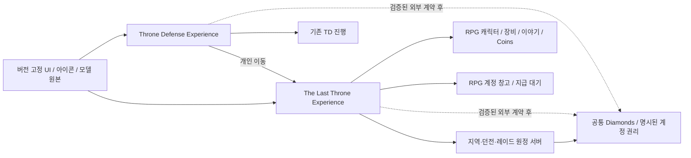

# The Last Throne 통합 개발 계획

문서 묶음 v0.25 · 2026-10-28, America/Toronto · **Deepwood K0 원형 제작·검증 단계**
개발 문서 한국어 · 게임 영어(en-US) · 총괄 [agent.md](agent.md) · 실행 [backlog.md](backlog.md)

## 1. 만들 게임과 성공의 의미

**Throne Defense에서 지킨 세계를, 내 영웅으로 직접 탐험하고 바꾸는 협동 판타지 액션 RPG**를 만든다. 게임명은 The Last Throne이다. 왕좌·보라 포탈·다섯 문명·기존 영웅과 네 지역의 정체성을 이어받고, 왕좌의 비밀을 밝히며 다섯 문명의 책임을 연결하는 모험을 완성한다.

핵심 루프는 `Dawnspire에서 준비 → 지역 탐험/이야기 → 예고를 읽는 전투와 협동 → 확정 성장/장비 → 주민·지역 복원 → 다음 모험`이다. 장기 루프는 빌드 실험·보스 공략·던전/레이드·수호전·생활·친구와의 기록이다. 같은 전투를 더 오래 반복하게 만드는 방식으로 분량을 채우지 않는다.

| 경험의 축 | 제작 방향 | 수용 때 확인할 증거 |
| --- | --- | --- |
| 조작과 전투 | 이동·검격·회피·방어·피격이 일관되고 예고에 대응할 수 있음 | PC/터치 기본기, 지연 조건의 서버 판정, 실패 원인을 설명하는 이용자 관찰 |
| 영웅과 빌드 | 고정 클래스 안의 두 계열이 다른 판단·거리·자원 운용을 만듦 | 8계열별 서로 다른 유효 빌드2개, 같은 투자 예산의 솔로/협동 비교 |
| 탐험과 서사 | 지형·몬스터·주민·증거가 그 지역의 갈등을 말함 | 다음 목표 이해, 선택 동선 발견, 해결 후 귀환 주민/대사/거점 변화 |
| 친구와의 모험 | 솔로 완결, 친구 참여 시 구조·연계·역할 분담이 풍부해짐 | 1~4인 완주·이탈/리조인·개인 선택·공정한 참여 보상 |
| 신뢰할 수 있는 성장 | 시간과 결제의 결과가 보존되고 이유를 설명할 수 있음 | 포인트·아이템·영수증·창고·공통 지갑의 동시 요청/중단/복구 검사 |
| TD와 같은 세계 | 같은 메뉴/아이콘/모델 원본을 쓰면서 장르별 행동을 연결 | 원본ID/버전 추적, 승인 컨셉 비교, TD 회귀와 포탈 왕복 |

‘최고’는 출시 전 객관적 순위를 보장하는 표현이 아니다. 위 경험을 검증 가능한 제작 목표로 사용한다. 매출·유지율·출시일·성능의 달성 결과는 아직 없다.

## 2. 원천과 현재 준비 수준

기존 내용을 새 문서로 대체하지 않고 **제작 순서·담당·수용 기준**을 연결한다. [결정표](docs/decisions.md)가 사용자 결정을, 각 분야 상세 문서가 세부 사양을, 이 계획과 백로그가 실행 순서를 관리한다. [원천 검토표](docs/production/source-audit.md)에 기존 문서와 컨셉 묶음의 연결을 기록한다.

| 구분 | 현재 보유 | 아직 필요한 것 |
| --- | --- | --- |
| 전체 이야기 | [프롤로그·8장·에필로그 제안서](the-last-throne-rpg-proposal.md), 동료/결말 방향 | 5~8장 상세 시나리오·공간·레벨/보상·영어 대사 |
| 상세 콘텐츠 | Dawnspire4구간 + Deepwood/Frozen Vale/Ember Caldera/Haunted Graveyard 각7스토리 | 32구간의 런타임 퀘스트/전투/저장·실제 플레이 수용 |
| 지도 | 5개 지도 보드·SVG·layout/scenario JSON, 총32개 시작 구간 | Studio 블록아웃·내비게이션·카메라·충돌·스트리밍·기기 측정 |
| 클래스/성장 | 4클래스·8계열·32전직 단계 방향, 스탯·기술·노드 예산 | 계수·자원 정책·전 데이터·리그/모션·전직 시험·유효 빌드 검증 |
| UI/외형 | 공통 UI v2 최종9장 승인, 영웅/환경/적 컨셉, 장비 UX v2 | 실제 공통 컴포넌트·영어 문자열·기기 입력·접근성·사용성 |
| 자산 | TD 영웅5·타워30·몬스터40 카탈로그 엔트리와 공유 원본 | 최신 해시·권한·사용 적합성·RPG 리그/모션/AI·파생/신규 제작 |
| 경제/연동 | 32구간 보상 정본·장비/리셋권 카탈로그·독립 Experience/공통 Diamonds 후보 | TD 보존 감사·외부 지갑 권위/실제 저장·거래·영수증·상품ID·테스트 왕복/복구 |

컨셉·HTML 동작 보드·정적 계산이 있다는 사실을 게임 기능 완료로 계산하지 않는다. 기존 모델은 메시 재사용 이점이 있지만 근접 액션용 리그·타격·AI까지 대체하지 않는다. 신규 계획 문서의 완성은 G0의 일부 입력이며 게임 게이트 통과가 아니다.

현재 0.18.7의 로비·네 영웅·전투/12개 시험 기술과 세션 편성, 최신 확정 규칙과 미구현 차이 및 다음 작업은 [현재 개발 상태](docs/production/current-status.md)를 따른다. 문서 계획과 실제 실행·실기기 수용을 구분한다. 12개 기본 기술을 출발점으로 한 랭크·전직·빌드 제안과 구체적 다음 작업은 [영웅별 스킬 성장 설계](docs/production/hero-skill-progression-design.md)를 따른다. 정식 성장 구현 완료는 아니다.

## 3. 변하지 않을 기준과 검증할 제안

| 항목 | 이번 계획의 기준 | 상태 |
| --- | --- | --- |
| 언어 | 문서 한국어 / 게임 저작 콘텐츠 영어만 | 이번 사용자 지시 |
| 클래스 | Knight·Elf Archer·Dwarf Axe Thrower·Mage, 최초 클래스 불변 | 사용자 결정 |
| 성녀 | Selene/Priest는 이야기NPC·선택형AI지원·거점/수호전 지원 | 사용자 결정 |
| 전직 | 클래스별2계열, Lv20/40/60/80 | 사용자 결정 |
| 스탯 | STR/DEX/INT/VIT, Lv2~80 매 레벨4P·총316P | 사용자 결정 |
| 제작 출발 | Deepwood 기사 K0 → 기본기 → 계열 비교 → 협동/성장 → 대표 구간 | 기존 제작 기준 |
| 공통 원본 | TD 메뉴·아이콘·이미지·3D를 최대한 공유, 장르 어댑터 사용 | 사용자 결정 |
| 장비/수익화 | 9슬롯, 가방 UX v2, 스탯/스킬 리셋권과 실제 성능 장비 판매 | 최신 사용자 요구 |
| 전직/포인트 판매 | 타 클래스 변경·전직 자격·레벨업 포인트·필수 기술을 상품으로 우회하지 않음 | 현행 상품 기준 |
| 기술/노드 예산 | 액티브36·궁극기12·노드216, 스킬79P, 첫 전직 전3개·전직 완료 후5개 장착; 궁극기 슬롯 미정 | 설계 기준안·전체 구현 전 |
| 가방/창고 | 가방60·계정 창고120·소모품99·재료999스택 | 용량/사용성 검증 전 제안 |
| 시간/규모 | 본편25~35h·전체50~70h, 일반1~4인·후반8인 | 완성상 목표·실측 전 |
| 가격/전투 계수 | 기존 카탈로그·기사 명세의 값 | 초기 제안·런타임 수용 전 |

기사의 강철기사 계보 외 상위 전직명은 가칭이다. 마법사 입문 비전/바람과 물은 Lv20 양쪽 선택을 막지 않고, Lv40 Pyro 대지/Cryo 번개 → Lv60 대규모 광역 → Lv80 최강 주문으로 이어진다. NPC/동료에 사용한 TD 타워가 플레이어 전직 모델 제작까지 대신했다고 계산하지 않는다.

과거 문서의 ‘외형 중심 상품’만 적힌 문구는 v0.22 이후의 실제 장비/리셋권 요구보다 우선하지 않는다. 게임 언어의 과거 한국어 UI 예시는 개발 설명으로 해석하고 최종 게임 문자열은 영어로 제작한다.

## 4. 세계관과 전체 서사 제작 범위

공유 세계관은 Lumia의 수정 왕좌·포탈 침공·다섯 팩션에서 출발한다. RPG의 Aetheria·700년 전 균열·Aurelian/Lyra·Covenant Network는 확장 서사다. 연표/지리/TD와 RPG 주인공 관계를 정리해 TD의 기존 사건을 무효로 만들지 않는다. 근거는 [TD 보관 이야기](../throne-defense/docs/archive/retired-2026-10-28/storyline.md)와 [현행 RPG 제안서](the-last-throne-rpg-proposal.md)이며, 동기와 용어의 충돌은 TLT-001에서 해소한다.

| 구간 | 공간·성장 연결 | 반드시 전달할 이야기와 플레이 | 현재 상세도 / 후속 작업 |
| --- | --- | --- | --- |
| 프롤로그 | Dawnspire·Lv1→5 | 서약식 붕괴·주민 구조·왕좌의 이상·Lyra의 신호, 순차 Goblin2마리 | 4시나리오/맵 있음 → 입력·장비·포인트 안내·보상/귀환 구현 |
| 에픽1 | Deepwood·Lv5→12 | 오염 원인 조사·Eryn과 협력·Orc Warlord/King Shaman·개인 복원 선택 | 7스토리/지도 있음 → 첫 제작 지역·SP7·제단 대표 구간 |
| 에픽2 | Frozen Vale·Lv12→20 | 북방의 기억·비살상 여왕 대면·진실과 임시 거울 분리 | 7스토리/지도 있음 → 날씨 가독성·Lv20 첫 전직 연결 |
| 에픽3 | Ember Caldera·Lv20→30 | Brann 가문의 책임·노동자 구조·도시 보호막·대체 열원 | 7스토리/지도 있음 → 승강기/수로·장치/보스 전환·SP7 |
| 에픽4 | Haunted Graveyard·Lv30→40 | 이름·옛집·징발 기록·Veyr·원본 증언·안식과 Selene의 갈등 | 7스토리/지도 있음 → 위상/안개·이름/증거·Lv40 전직 |
| 에픽5 | Aether Spire·Lv40 이후 곡선 미정 | 다섯 번째 서약은 추가 핵이 아닌 공동 제어 규칙, The First Warden·Lyra·서약망 설계 | 줄거리 있음 → 공간/스토리/공략·성장 상세 설계 |
| 에픽6 | Dawnspire 귀환·성장 배치 미정 | Lucan의 비상 통치·세 도시 구역 대피·연결 장치 차단·개인 처분 | 줄거리 있음 → 재사용 왕도 변화·주민 상태·보스/복구 |
| 에픽7 | 다섯 깃발의 원정·Lv60 단계 배치 검증 | 각 세력 협약·공명 수정 호송·분리 전선·수호전·Dread Commander | 줄거리 있음 → 선택 지원/기본 지원 동등 완주·다전선 설계 |
| 에픽8 | The Fractured Crown·Lv80 단계 배치 검증 | The Eternal King 3단계·다섯 봉인 회수·서약망 연결·Lyra 해방 | 줄거리 있음 → 최종 지역·보스·연출/접근성·기술/장비 보존 |
| 에필로그 | 지역/성채 후일담 | 세 운영 형태의 서약, 모든 결말에서 영혼 연료 체계 종료 | 줄거리 있음 → 개인 세계 상태·저널·NPC·결말 동등 보상 |

Lv41~80의 장별 레벨과 전직 시험 위치는 **새 설계 작업**이다. 초반 검증기의 XP 공식을 후반 검증 완료로 확대하지 않는다. 에픽5~8을 임의로 각7스토리로 확정하지 않으며 서사/게임플레이 단위로 산정한다. 세 결말은 필수 성능·레이드 자격에서 동등하다.

6던전·3레이드·균열·수호전·세계 사건·동료5·생활·길드·거처·수집은 전체 완성상에 포함한다. 일반 본편은 솔로로 결말까지 갈 수 있어야 하며, 8인 레이드 인원 충족을 본편 결말 조건으로 연결하지 않는다. 선택 PvP·거래소는 별도 확장 판단 뒤 제작한다.

32구간의 상세 추적표와 시스템 계약은 [기획 제작 계획](docs/production/game-systems-plan.md)에, 공간/입력 기준은 [디자인 제작 계획](docs/production/design-and-world-plan.md)에 둔다.

## 5. 성장·전투·아이템의 구현 순서

| 축 | 먼저 검증할 단위 | 전체 완성 기준 |
| --- | --- | --- |
| 전투 | 기사 K0 이동·카메라·3연격·방어/회피·자원/자세·Goblin/Orc/Ogre | 4클래스 고유 기본기, 예고/사거리/지형·1~4인 동기화·지연/터치 판정 |
| 계열 | K1 공통기술 → K2 강철기사/성기사 비교 → K3 협동/성장 | 8계열×4단계·시험·기술·노드·외형·장착·재접속 일치 |
| 능력치 | 기존 고정 전투 프리셋 → STR/DEX/INT/VIT의 서버 계산 | 투자+잔량=획득 예산, 혼합 계열 이중 보상 방지, 속도/치명타 상한 검증 |
| 퀘스트 | 상태/자격/보상/복구 분리한 한 이야기 | 모든 본편 개인 진척·SP·재시도·개인 선택·공유 전장·초회/반복 보상 |
| 장비 | instanceId·소유/위치·클래스/레벨·9슬롯·장착 교환 | 파생 스탯·강화/제작·귀속/잠금·계정 창고·동시 이동/복구 |
| 상품 | 상품별 권리·지급 대기·영수증 재처리·권 소비 | 리셋/장비 실제 지급, 만료 없는 구매품 대기, TD 상품/공통 권리 보존 |
| 동료 | 선택 편성·따라오기/복귀·명령·어그로·공간 이탈 | 다섯 이야기·관계·AI, Selene 없어도 본편 완주, 인원별 상한 |
| 지속 콘텐츠 | 본편에서 검증한 적/목표 조합을 이용한 재도전 | 단순 HP 증가 외의 공략 변화·목표 보상·강제 일과 없는 반복 가치 |

일반 모험의 전투AI 상한은 플레이어1명 최대2, 2명 파티 최대2/개인1, 3명 파티 최대1, 4명0이다. 이야기NPC와 임무 고정 지원은 별도 예산으로 기록하고 이 수를 숨겨 넘기지 않는다.

구매 장비는 현재 제안의 같은Lv5/등급 플레이 획득 프로필과 같은 성능을 연결한다. 실제 무료 획득 경로·소요 시간·제작 비용과 계수는 TLT-044/045에서 검증한다. 비구매 본편 완주와 결제 상품의 명확한 가치를 함께 확인하며 전직·포인트 판매로 확장하지 않는다.

## 6. 미술·3D·맵 제작

순서는 `승인 원본/버전 확인 → RPG 요구 정의 → 재사용/파생/신규 판정 → 블록아웃·리그/모션 실험 → 게임 조작 거리 검토 → 충돌/판정/성능 → 통합 수용`이다. [자산 제작 계획](docs/production/asset-production-plan.md)에 원본 현황·필요 리그·모션·무기/소켓·지역 모듈과 생산량을 둔다.

Deepwood는 주동선7·선택3구역과 필수 보스2/선택 보스3을 보존한다. 각 스토리 SP는 안전·처음부터·이어하기·파티 재합류를 구분한다. Frozen Vale의 눈, Ember Caldera의 용암, Haunted Graveyard의 안개/위상은 장식보다 목표·적 예고·상호작용·귀환 경로가 먼저 읽혀야 한다.

영웅 실루엣·기존 얼굴/체형/대표 무기를 유지하고 장비 파생은 원본 위에 연결한다. 생성 이미지에서 UI 아이콘을 잘라 TD 정본을 대체하지 않는다. 공통 UI 토큰/컴포넌트와 TD/RPG 데이터 어댑터는 실제 소스 버전을 고정해 소비한다. 이미지가 비슷하다는 사실만으로 공유 구현 완료로 판단하지 않는다.

## 7. 기술·공유 Experience·데이터

실제 폴더/의존 도구는 TLT-003에서 정한다. 제안 아키텍처는 Luau 기반 서버 서비스와 클라이언트 컨트롤러, 버전 관리하는 콘텐츠 데이터/영어 키, 공통 UI/자산 패키지다. 미정 프레임워크·라이브러리·빌드 도구를 설치 완료나 필수 도입으로 취급하지 않는다. [기술 제작 계획](docs/production/engineering-plan.md)에 계약·구조·오류/복구·네트워크·성능 세부를 둔다.

독립 Experience는 DataStore를 공유하지 않는다. 공통 Diamonds를 제공하려면 두 게임의 DataStore를 직접 읽어 합치는 대신, 별도 서버 권위 지갑과 거래/영수증 조정 계약이 필요하다. 그 계약이 검증되기 전에는 TD와 RPG의 잔액·상품을 분리하며, RPG 저장기를 TD 프로필 저장기로 사용하지 않는다. [Roblox Data stores](https://create.roblox.com/docs/cloud-services/data-stores).

TeleportData는 돈·아이템 권리의 근거가 아니며, Experience 간 개인 이동 실패/재접속을 복구해야 한다. Roblox의 단체 TeleportAsync는 같은 Experience 안에서만 지원되므로, 초기 TD↔RPG 이동은 개인 이동으로 제한한다. 수용은 게시된 각 테스트 Experience의 Roblox 클라이언트에서 한다. [Roblox Teleport](https://create.roblox.com/docs/projects/teleport).

서버가 입력 자격·거리·상태·빈도·금액·피해·보상·소유권을 검증한다. 상품 구매 UI 종료를 지급 근거로 쓰지 않고, 각 Experience가 자신의 영수증을 처리한다. 공통 권리가 필요하면 검증된 외부 권리 장부로 조정하며 TD 기존 권리는 보존한다. [클라이언트/서버 경계](https://create.roblox.com/docs/scripting/security/client-server-boundary), [Developer Products](https://create.roblox.com/docs/production/monetization/developer-products).

## 8. 영어 게임 제작 계약

한국어 기획과 영어 제품을 분리한다. 표시 이름과 영속ID는 별개이며, 기존 한국어 이야기 제목은 영어 번역을 작성하되 승인되지 않은 번역은 제안으로 기록한다. `quest.dw01.title`, `inventory.error.bag_full` 같은 영어 키에 en-US 원문을 연결한다. 이 키는 구조 예시이며 런타임 등록 완료가 아니다.

| 대상 | 완료 조건 |
| --- | --- |
| 퀘스트·대사·저널 | NPC/고유명사 용어집, 선택지 의미, 플레이스홀더/복수형·스킵/재열기, 모든 분기 en-US 원문 |
| 스킬/장비/상품 | 클래스·요구Lv·효과·비용·귀속·재설계 소비·실제 가격과 획득 경로를 일관된 영어로 표시 |
| HUD/메뉴/오류 | 키보드·터치·패드 프롬프트, 빈 목록·잠금·가득 참·저장 재시도·부분 이동·미수령 상태까지 영어 |
| 이미지·사운드 | 컨셉에 그려진 글자를 최종 텍스트로 사용하지 않음, 음성/자막·월드 간판·아이템 아이콘의 고정 문구 검사 |
| QA | 한국어 개발 문장·미번역 키·누락 문자열·잘린 문구 전수 점검, 기기별 줄바꿈과 숫자/플레이스홀더 검사 |

출시 범위는 영어 단일 언어다. 다국어 현지화는 이번 요구의 필수 산출물로 추가하지 않는다. 후속 확장을 위해 문자열을 키로 관리하는 것은 유지보수 수단이다.

## 9. 단계와 완료 게이트

기존 로드맵의 **G0~G8 이름과 순서를 유지**한다. 아래는 통합 실행 기준이다. 날짜 대신 관측 가능한 산출물로 통과시킨다. 다음 단계의 독립 조사/초안은 병행 가능하지만 미통과 게이트를 완료로 표시하지 않는다.

| 게이트 | 집중 범위 | 통과에 필요한 결과 | 주 담당 / 연결 작업 |
| --- | --- | --- | --- |
| G0 전체 설계 | 원천·클래스/성장·세계관·자산·기술/결제 경계·영어 계약 | 충돌/미결정 추적, 전체 범위와32구간의 ID/상태/보상/복구, 신규 제안 구분 | 디렉터+기획 / 001~004,021,025~030 |
| G1 전투 실험실 | Deepwood K0→K1/K2, 근접·원거리·선택 지원 | PC/터치 실제 예고/공격/피격·방어/회피, 기사 계열 차이 체험, Goblin/Ogre/Shaman | 엔지니어+디자인+3D / 005~008,031~036 |
| G2 대표 구간 | 검은 뿌리 제단15~20분 목표, 보스3단계·포로·공명·전리품 | 솔로/협동 정상·전멸·재도전, 신규 관찰, 모바일 성능 기준선·실제 단위 제작시간 | 전 역할 / 009~012,037~040 |
| G3 RPG 기반 | 프로필·포인트·아이템·창고·퀘스트·파티·전직·연동 계약 | 기사 양계열1~80 경계/저장, 보상/상품/이동/공통 지갑의 오류/동시성, TD 회귀 | 엔지니어+기획+QA / 013,016~018,022~024,041~053 |
| G4 클래스 완성 | 4클래스·8계열·32단계·기술36+궁극12·노드216 기준안 구현 | 각 계열 솔로/협동·유효 빌드2개·영어 설명·호환 자산/모션·동일 예산 비교 | 기획+엔지니어+3D+QA / 014,015,054~059 |
| G5 본편 완성 | 프롤로그~8장~에필로그·7공간·6던전·동료5 | 신규 캐릭터 결말 완주·레벨/전직 연결·세계 변화·개인 선택·전 구간 재접속 | 전 역할 / 060~074 |
| G6 최종 콘텐츠 | 3레이드·균열·수호전·생활·길드·거처/수집 | 8인 공략·목표 보상·독점 없는 보상·비강제 생활·운영 가능한 제작량 | 전 역할 / 019,075~083 |
| G7 출시 품질 | 전 기기·영어·접근성·음향·경제/상품·복구·TD 호환 | 중대 차단 결함 해결, 실제 클라이언트/기기/부하·복구 리허설·제공 범위/출시 판단 | 디렉터+QA / 020,084~094 |
| G8 운영/확장 | 지표·지원·패치·시즌 기록·신규 콘텐츠 | 출시 빌드별 관측과 조치, 업데이트 처리량, 후속 범위 판단 | 디렉터+전 역할 / 095~100 |

첫 공개 테스트와 정식 공개의 제공 범위는 G2~G4 실측 후 결정한다. 전체 완성상에서 어떤 묶음을 언제 공개할지는 아직 승인되지 않았으며, 현재 계획을 ‘4에픽만 출시’나 ‘8장 즉시 출시’ 약속으로 읽지 않는다. G5/G6 전체 완성 표시는 실제 전체 산출물이 있어야 한다.

## 10. 바로 실행할 작업 묶음

달력 주차를 약속하지 않고 독립적인 네 작업줄로 시작한다.

| 작업줄 | 첫 작업 | 이어질 작업 | 초기 확인 지점 |
| --- | --- | --- | --- |
| 디렉터·기획 | 001/025 세계관·결정 충돌,026 영어 용어/문자열 | 004/027/029 클래스·스탯·자원·콘텐츠 계약 | K0의 고정 프리셋과 향후 성장 연결을 혼동하지 않음 |
| 디자인·3D | 002/028 최신 원본/해시·권한·적합성 | 031~033 블록아웃·기사 리그/무기·위험 예고 | 게임 조작 카메라에서 외형/사거리/터치 시야를 함께 확인 |
| 엔지니어 | 003 개발/테스트 환경·버전 구조 | 005/006 입력·상태·서버 판정 | 새 RPG 환경의 K0 입력→모션→서버 타격→피격 |
| 엔지니어·QA | 021 TD writer/상품 감사,030 검증 환경 | 022 지갑/권리 계약,034·036 전투 부정/지연 검증 | 운영 데이터와 분리, 기존 TD 보존 계약·재현 가능한 증거 |

다음 통합 목표는 **0.18.7의 네 영웅과 12개 기술을 실제 플레이로 확인하고, 독립 Experience의 자산·음원 권한과 저장/성장 계약을 검증하는 것**이다. 검증 결과를 바탕으로 Lv20 전직과 스킬 편성을 연결하고 Deepwood 첫 스토리 수직 슬라이스 및 G2 제단으로 확장한다. 프롤로그는 첫 제작맵을 바꾸는 선행 전투 과제가 아니라 검증된 기본기를 처음20분에 전달하는 온보딩 작업으로 연결한다.

2026-10-28 착수 당시에는 공터·임시 기사 장비와 세 적, 서버 판정·입력·영어 HUD의 K0 원형부터 구현했다. 현재 네 영웅과 네 적의 시험 범위는 [현재 상태](docs/production/current-status.md)를 따른다. 테스트와 미검증 범위는 [K0 작업 기록](docs/evidence/k0/README.md)에 연결하며, G0 선행 조건과 G1의 실플레이 수용은 계속 남아 있다. TD 지갑과 저장소는 읽기 전용으로 조사한다. 사용자 재확인에 따라 고블린·슬라임·오우거·오크의 Meshy 원본과 runtime 스냅샷을 RPG 저장소의 LFS로 보존하고, Goblin/Orc/Ogre 전투 리그에 TD 외형을 연결한다. 원본·검증 범위는 [몬스터 자산 기록](docs/evidence/k0/td-monster-sources.md)과 [오크 기록](docs/evidence/k0/orc-source.md)에 남긴다.

## 11. 품질과 플레이테스트

아래 수치는 기존 제안/이번 수용 가설이며 **측정 전 목표**다. 기기 선정·부하 장면·세션 길이·P95 집계 방식은 QA/엔지니어가 G1에서 고정한다. FPS 수치 하나로 서버·네트워크·메모리 통과를 대신하지 않는다.

| 항목 | 초기 검증 기준 | 실패 때 조정 |
| --- | --- | --- |
| 첫 목표/원정 이해 | 신규12명 표본 중10명 이상이 직접 안내 없이 완주 목표 | 목표 문구·세계 배치·카메라·귀환 동선 |
| 예고 대응·계열 차이 | 12명 중10명이 큰 공격 대응/두 계열 차이를 설명하는 목표 | 예고·효과·입력·기술 조건과 자원 운용 |
| 기본 성장 | 프롤로그+28스토리32구간 목표Lv 일치·Lv40/0XP·총유입19,652Coins 기준 | 실제 전투/우회/소비를 관측한 뒤 정본 변경 이유 기록 |
| 기기 성능 | 기준 모바일 P95프레임≤33.3ms·PC≤16.7ms 목표 | 장식/LOD/VFX·AI·적 활성 예산부터 조정, 위험 신호 보존 |
| 부하/네트워크 | 4인+적24+보스1, 솔로+AI2, 후반8인 별도·80/150/250ms 조건 | 서버 판정·복제·시야/이펙트·리조인 상태 조사 |
| 저장·권리 | 재시도/동시 요청/종료에서도 포인트·아이템·영수증 중복/유실 없음 | 차단 결함으로 수정·장애 주입 후 재검증 |
| 영어/접근성 | 모든 저작 게임 표면 영어, 색 외 신호·자막·텍스트/효과/흔들림 옵션 | 문자열/레이아웃/입력·효과 계층 수정 |

12명 관찰은 큰 사용성 결함을 찾는 제작 표본이며 시장 유지율의 통계적 보장이 아니다. D1/D7/D28·전직 전환·재도전·파티 참여·경제 순유입은 공개 테스트 뒤 기기/지역/버전/코호트/기간을 붙여 측정하고 그때 목표를 정한다.

세부 테스트ID·중대도·증거 형식·출시 판단은 [QA/출시 계획](docs/production/qa-and-release-plan.md)에 둔다. 자료 작성, 정적 검사, 엔진, 실제 기기, 사용자 관찰의 결과를 각각 보고한다.

## 12. 일정·인력·비용 산정

여섯 에이전트 역할이 사람 여섯 명의 상근 제작 능력을 뜻하지는 않는다. 현재 실제 인력·가용 시간·출시일·예산이 정해지지 않았으므로 임의 주차/금액을 확정하지 않는다. G2에서 같은 도구/담당/수정·검증 조건의 실제 처리량을 기록하고 TLT-020에서 일정안을 만든다.

`작업별 예상 노력 = 남은 실제 제작 단위 × 관측 단위 시간 + 통합 + QA + 예상 보수`로 산정한다. 원형 캐릭터/기술·노드 데이터·적 행동·보스 패턴·지역 모듈·퀘스트 상태/분기·영어 대사·공유 계약·음향을 별도로 센다. 공통 메시가 있다고 리그/애니/AI/영문/저장 비용을0으로 두지 않는다.

낙관/기준/비관 추정과 담당 가용량으로 의존 경로를 계산한다. 엔지니어링 시간이 미술보다 짧아도 전투 리그나 보스 예고가 지연되면 통합 일정이 늦어지는 병목을 반영한다. 달력 기간은 역할별 시간을 단순 합산/인원수로 나누어 만들지 않는다.

비용표에는 내부 가용시간·리그/애니/음향 외주·콘텐츠 도구·자산 사용권·테스트 기기·운영/지원·예비 보수를 실제 견적으로 넣는다. 범위 변경은 전체 서사와 사용자 결정을 유지한 제작 방법/단계 조정부터 검토하며 실제 제공 범위 변경은 결정 기록을 남긴다.

## 13. 결정 대기와 리스크

‘미정’은 지금 모든 작업을 멈추라는 의미가 아니다. 아래 시점 전에 관련 원형/측정/추천안을 마련하고 필요한 제품 결정만 구체적으로 제시한다.

| 결정ID | 남은 결정 / 현재 처리 | 담당 / 결정 전 필요 증거 | 늦어도 필요한 시점 |
| --- | --- | --- | --- |
| D-01 | TD/RPG 연표·Lumia/Aetheria 관계·주인공 관계 | 기획·디렉터 / 두 서사 대조·용어집 | 본편 영어 대사 고정 전 |
| D-02 | 기본 스탯 초기값·계수·상한·혼합 환산 | 기획·엔지니어 / 고정 프리셋·동일 예산 비교 | G3 성장 연결 전 |
| D-03 | 물리 기술 Stamina/마법 MP와 기존 클래스 자원의 통합·비용/회복 | 기획·엔지니어·디자인 / 기본기·HUD·비용 비교 | 전 기술 데이터 고정 전 |
| D-04 | 계열 재선택·궁극기 슬롯/6번 키·캐릭터 간 공유 기록 | 디렉터·기획 / 저장/리셋권·사용성 영향 | G3 전직/캐릭터 저장 고정 전 |
| D-05 | 가방/창고/스택·유물 조건·판매/제작 비용 | 기획·디자인·엔지니어 / 스토리 전리품·정리 빈도·소비 표 | G3 경제/인벤토리 수용 전 |
| D-06 | 실제 장비/리셋권 가격·성능·ProductId | 기획·디렉터·엔지니어 / 무료 동등 프로필·상품별 권리/회복 | 테스트 결제·상점 공개 전 |
| D-07 | 실제 Experience/Place ID·키·버전·TD writer 전환 | 엔지니어 / 읽기 전용 감사·호환/복구 리허설 | 공통 지갑/포탈 활성 전 |
| D-08 | 기준 기기·메모리/로드/서버 예산·최저 지원 | 엔지니어·QA·디자인 / K0/G2 프로파일 | G2 성능 수용 전 |
| D-09 | 전직/스킬/스토리 영어 최종 이름·음성 범위 | 기획·디자인 / 영어 키·용어집·콘텐츠 분량 | 해당 콘텐츠 제작 고정 전 |
| D-10 | 에픽5~8 시나리오 수·Lv41~80·전직/던전 배치 | 기획·디렉터 / 전체 사건/성장·제작량 표 | G5 해당 지역 제작 전 |
| D-11 | 동료 영입·AI 상세·지원/임무 예산 | 기획·엔지니어·3D / 선택 지원 없는 솔로·인원별 부하 | G4/G5 동료 통합 전 |
| D-12 | 공개 빌드 범위·일정·인력·예산 | 디렉터 / G2~G4 실제 처리량·품질·위험 | 공개 일정/제공 범위 안내 전 |

| 리스크 | 조기 징후 | 예방/대응 |
| --- | --- | --- |
| 전투 검증 전 콘텐츠 확장 | 모든 지역에서 같은 피격/카메라 결함 | K0/G2 품질을 먼저 통과, 신규 지역은 검증된 계약 소비 |
| 공유 원본 변동·정적 모델을 완성 리그로 오해 | 해시 불일치·손/무기/관절/판정 파손 | 현재 원본 재감사·버전 고정·파생 계보·리그 적합성 검사 |
| 스킬 수/지역 수로 일정 과소평가 | 노드·모션·영문·복구가 별도 산정되지 않음 | 48기술·216노드·32단계·장비/맵/시나리오 생산 단위를 분리 |
| 개인 선택/진행과 공유 파티 충돌 | 호스트 선택이 전원에게 저장됨 | 공유 전장과 개인 자격/후일담·수령 기록 분리 |
| 지갑·창고·구버전 writer 충돌 | 재접속 후 과거 잔액/같은 아이템 복제 | 단일 권리·거래 기록·호환 전환·동시성/불명 응답 검증 |
| 결제 가치와 본편 난도 불균형 | 유료 구매가 사실상 다음 장 입장 조건 | 무료 동등 획득/강화 경로·비구매 완주·수급/소비 관측 |
| 모바일/8인 효과 과밀 | 예고 가림·열/프레임/메모리 악화 | 장면별 예산·설정·실기기·위험 신호 최우선 |
| 영어 계약 누락 | 한국어 오류·이미지 텍스트·미번역 키 노출 | 콘텐츠 스키마/문자열 검사와 분기/실화면 수용 |

## 14. 운영과 변경 관리

빌드는 코드·콘텐츠/영문·자산·공통 UI·저장 스키마·상품 계약 버전을 함께 기록한다. 결제/보상 복구·아이템 조사·플레이 차단·패치/호환·문의 응답을 출시 전 리허설한다. 포탈/상품 기능 차단과 데이터 롤백을 구분하고, 구버전 writer로 최신 잔액을 덮어쓰지 않는다.

초기 관측은 접속→캐릭터→첫 전투→첫 원정→장비→전직→지역 이동→재접속의 흐름과 저장/결제/Teleport 오류다. 이후 균열·레이드·생활의 참여/반복 이유를 본다. 운영 개선은 진행 차단/유실·조작/가독성·계열/경제 불균형·새 콘텐츠 순으로 영향과 증거에 따라 정한다.

새 작업은 기존 TLT-001~024 ID를 보존하고 [backlog.md](backlog.md)에 추가한다. 사용자 결정 변경은 [결정표](docs/decisions.md), 관련 상세 사양, [변경 이력](docs/CHANGELOG.md)을 함께 갱신한다. 문서 계획의 성공을 게임 출시·결제·실기기 검증의 성공으로 보고하지 않는다.

2026-10-28 사용자 지시에 따라 작업 마감은 [Git·빌드 버전·릴리스·LFS 규칙](docs/development-workflow.md)을 따른다. 작업 완료마다 커밋/푸시, 빌드마다 세 자리 게임 버전, 실제 릴리스마다 해당 빌드 커밋의 태그/푸시를 기록한다. 이미지/3D/자산 압축본은 LFS로 관리하며 문서 버전과 게임 빌드 버전은 구분한다.
